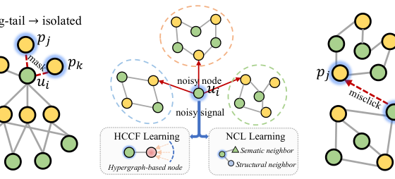
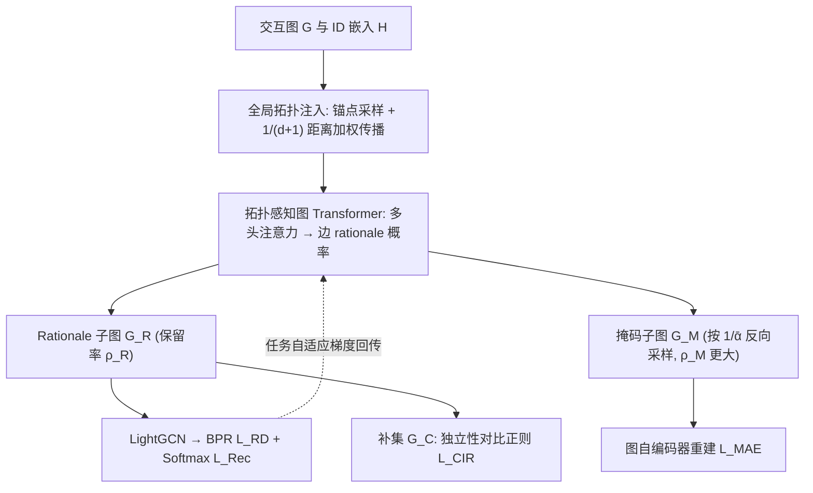
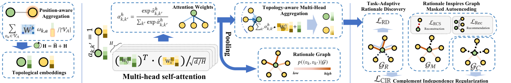

# Graph Transformer for Recommendation (面向推荐的图 Transformer)

- **会议/期刊**: SIGIR 2023
- **作者与机构**: Chaoliu Li, Lianghao Xia, Xubin Ren, Yaowen Ye, Yong Xu, Chao Huang（华南理工大学 / 香港大学）
- **推荐链路定位**: 召回（图协同过滤表征学习 + 自监督增广）
- **研究方向**: 自监督对比学习与交互去噪 / 图神经网络与知识图谱推荐
- **论文原文**: [https://arxiv.org/abs/2306.02330v1](https://arxiv.org/abs/2306.02330v1)
- **开源代码**: [https://github.com/HKUDS/GFormer](https://github.com/HKUDS/GFormer)

## TL;DR (1分钟核心速览)

现有自监督推荐靠**手工图扰动**（SGL 随机丢边、NCL 聚类、HCCF 超图）造对比视图，扰动本身会破坏长尾结构与标签稀缺节点，且把误点击噪声一并放大。GFormer 改为**生成式自监督**：用拓扑感知图 Transformer 的多头注意力给每条边打"协同理由 (rationale)"概率，采样出 rationale 子图做推荐主任务、并按**注意力倒数**反向采样出高密度掩码子图做图自编码重建，再以补集独立性对比正则去噪。在 Yelp/Ifashion/LastFM 三数据集、`0.7/0.05/0.25` 比例划分 + **全库排序**协议下，Recall@20 相对最强基线 SGL 提升 7.7%/5.8%/5.2%（$p<0.05$）。

## Background & Motivation (背景与核心矛盾)

- **主流范式**: GCL 式图增广——在用户-物品图上做随机边/点丢弃（SGL）或人工构造语义视图（NCL 的 EM 聚类、HCCF 的超图消息传递），以 InfoNCE 对齐正视图、推远负样本。
- **前人局限**: ①随机扰动不可控，稀疏用户与长尾物品的关键边被删后变成孤立点，正样本对本身失真；②手工视图（超图/簇）质量取决于预设结构，且会把误点击、流行度偏置当成"语义"注入对比目标，噪声被放大而非被过滤。
- **核心洞察 (Key Insight)**: 真正该保留的不是"随机子图"，而是**与下游推荐目标充分性一致、且与补集相互独立**的不变子图（sufficiency + complement independence）；而"该 mask 哪条边"应可学习，而非人为设定。
- **本文切入点**: 把 rationale discovery 塞进 Graph Transformer——注意力权重即边重要性，掩码策略由注意力**倒数**决定，从而让 MAE 专门重建"最难/最重要"的边。

<figure class="paper-figure" markdown="span">
  <figcaption>图1：不同自监督推荐模型生成的图增强示意图。数据会放大噪声效应，从而稀释对真实用户-物品交互模式的学习。因此，现有解决方案可能难以使自监督过程适应不断变化的实际推荐环境。</figcaption>
</figure>

## Method (核心方法设计)

### 1. 整体框架 (Overall Architecture)

输入交互图 $\mathcal{G}$的 ID 嵌入$\mathbf{H}$，先经**全局拓扑注入**（锚点采样 + 跳数距离加权传播）得到位置感知嵌入$\bar{\mathbf{H}}$；再由**拓扑感知图 Transformer** 输出多头注意力$\bar{\alpha}_{k,k'}$，归一化后作为边被选为 rationale 的概率，采样出$\mathcal{G}_R$（保留率$\rho_R$）；$\mathcal{G}_R$上跑 LightGCN 得推荐表征，配合 BPR 做任务自适应指导与 softmax 主损失；同时以$1/\bar{\alpha}$反向采样得掩码子图$\mathcal{G}_M$，图自编码器重建被遮边（$\mathcal{L}_{MAE}$）；另采极稀疏补集$\mathcal{G}_C$做表征推离正则。推理时用完整图$\mathcal{G}$ 打分。

<figure class="paper-figure" markdown="span">
  <figcaption>图2：所提出 GFormer 模型的整体框架示意图。i) 协同理由发现基于用于交互合理化的拓扑感知图Transformer构建。ii) 借助全局图上下文增强，启用位置感知消息传递以编码成对的用户-物品依赖。iii) 图自编码器旨在重建发现的协同理由，并利用信息丰富的用户-物品交互模式进行增强。iv) 任务自适应自监督通过感知由目标 rec 导出的主优化目标来实现。</figcaption>
</figure>

### 2. 关键设计拆解 (Key Designs)

1. **锚点式全局拓扑注入（让注意力"看得见"远距离高阶关系）**：痛点是在局部邻居上算注意力无法区分结构位置相近的节点。对锚点集 $\mathcal{V}_A$定义$\omega_{k,a}=\frac{1}{d_{k,a}+1}$（$d_{k,a}\le q$，否则 0），做类 PPNP 的逐层传播$\tilde{\mathbf{h}}^{l}_{k}=\sum_{v_a\in\mathcal{V}_A}\mathbf{W}^{l}\omega_{k,a}[\tilde{\mathbf{h}}^{l-1}_{k}\,\|\,\tilde{\mathbf{h}}^{l-1}_{a}]/|\mathcal{V}_A|$。物理直觉：把"到锚点的跳数"当作图上的位置编码，一次传播即可获得全局感受野（实验也表明$L\ge 2$ 会过平滑掉点）。

2. **Rationale 即注意力：可学习的边重要性采样**：以 $\alpha^{h}_{k,k'}=\mathrm{softmax}\big((\mathbf{W}^h_Q\bar{\mathbf{h}}_k)^\top(\mathbf{W}^h_K\bar{\mathbf{h}}_{k'})/\sqrt{d/H}\big)$跨头平均得$\bar{\alpha}_{k,k'}$，归一化为$p((v_k,v_{k'})|\mathcal{G})=\bar{\alpha}_{k,k'}/\sum_{(v_k,v_{k'})\in\mathcal{E}}\bar{\alpha}_{k,k'}$，按此概率无放回采$\rho_R|\mathcal{E}|$条边构成$\mathcal{G}_R$。它把"哪些交互解释了该用户偏好"显式参数化，并由 BPR 损失$\mathcal{L}_{RD}=\sum-\log\sigma(\bar{y}_{i,j^+}-\bar{y}_{i,j^-})$ 端到端校准——这正是"任务自适应"的来源。

3. **反向掩码 + 补集独立性，以及训练/推理开销**：掩码概率取 $\bar{\alpha}^{M}_{k,k'}=1/(\bar{\alpha}_{k,k'}+\epsilon)$后归一化，$\rho_M>\rho_R$，即**专挑最有信息量的边遮住**，迫使自编码器重建难样本$\mathcal{L}_{MAE}=\sum_{(v_k,v_{k'})\in\mathcal{E}\setminus\mathcal{E}_M}-\tilde{y}_{k,k'}$；补集以$\rho_C\ll\rho_M$采样，用$\mathcal{L}_{CIR}=\log\sum_{v_k}\exp\big(\cos(\mathbf{e}^R_k,\mathbf{e}^C_k)/\tau\big)$推离两者表征以抑制噪声冗余。总目标$\mathcal{L}=\mathcal{L}_{Rec}+\mathcal{L}_{MAE}+\lambda_1\mathcal{L}_{RD}+\lambda_2\mathcal{L}_{CIR}+\lambda_3\|\Theta\|_F^2$。负样本策略：主损失$\mathcal{L}_{Rec}$为**全物品 softmax（免负采样）**，$\mathcal{L}_{RD}$为 BPR 三元组。复杂度$O(L_T(I+J)d^2+L_T(\rho_R+\rho_M)|\mathcal{E}|d)$，且复用图编码器作 rationale 生成器，不引入额外 rationale 参数。

## Experimental Setup & Evaluation Protocol (实验设置与评估协议)

| 数据集 | #Users | #Items | #Interactions | 密度 | 场景说明 |
| :--- | :---: | :---: | :---: | :---: | :--- |
| Yelp | 42,712 | 26,822 | 182,357 | $1.6e^{-4}$ | 本地商户点评（含评论文本，仅用于案例研究） |
| Ifashion | 31,668 | 38,048 | 618,629 | $5.1e^{-4}$ | 阿里时尚穿搭 |
| LastFM | 1,889 | 15,376 | 51,987 | $1.8e^{-3}$ | 音乐/电台收听 |

- **数据划分与防穿越**: 比例划分 $0.70/0.05/0.25$（训练/验证/测试），非 Leave-One-Out，未做全局时间戳切分。
- **排名评测协议**: 无偏 **Full-Ranking（全物品排序）**，指标 Recall@$\{10,20,40\}$、NDCG@$\{10,20,40\}$，显著性检验$p<0.05$（表中给出$p$-val 低至$8.3e^{-11}$）。
- **对比基线与超参**: 三类基线——非 GNN（BiasMF/NCF/AutoRec）、无 SSL 的 GNN（PinSage/NGCF/GCCF/LightGCN）、SSL 增强（EGLN/SLRec/NCL/HCCF/SGL）。默认 $d=32$、锚点数$|\mathcal{V}_A|=32$、$\rho_R\in\{0.5,\dots,0.9\}$、$\lambda_1\in\{0.5,1,2,4,8\}$、$\lambda_2\in\{1,\dots,10^{-4}\}$，Adam 学习率$1e^{-3}$ 无衰减。

## Key Experimental Results (实验关键数据)

### 1. 主实验对比 (Main Results)

| 数据集 | 指标 | LightGCN | NGCF | EGLN | SLRec | NCL | HCCF | SGL | **GFormer** | Improv. |
| :--- | :--- | :---: | :---: | :---: | :---: | :---: | :---: | :---: | :---: | :---: |
| Yelp | Recall@20 | 0.0761 | 0.0678 | 0.0726 | 0.0650 | 0.0806 | 0.0789 | 0.0815 | **0.0878** | +7.7% |
| Yelp | NDCG@20 | 0.0373 | 0.0340 | 0.0360 | 0.0327 | 0.0402 | 0.0391 | 0.0410 | **0.0442** | +7.8% |
| Ifashion | Recall@20 | 0.0751 | 0.0636 | 0.0787 | 0.0633 | 0.0797 | 0.0815 | 0.0845 | **0.0894** | +5.8% |
| Ifashion | NDCG@20 | 0.0528 | 0.0442 | 0.0549 | 0.0444 | 0.0558 | 0.0578 | 0.0603 | **0.0635** | +5.3% |
| LastFM | Recall@20 | 0.2188 | 0.1918 | 0.1823 | 0.1747 | 0.2196 | 0.2210 | 0.2236 | **0.2352** | +5.2% |
| LastFM | NDCG@20 | 0.2018 | 0.1759 | 0.1557 | 0.1613 | 0.2021 | 0.2047 | 0.2070 | **0.2145** | +3.6% |

（`Improv.` 相对最强基线 SGL；所有提升均通过 $p<0.05$显著性检验，Yelp Recall@40 的$p=8.3e^{-11}$。）

### 2. 消融实验 (Ablation Study)

| 变体 | 含义 | Yelp R@20 | Yelp N@20 | Ifashion R@20 | Ifashion N@20 |
| :--- | :--- | :---: | :---: | :---: | :---: |
| GFormer | 完整模型 | **0.0878** | **0.0442** | **0.0894** | **0.0635** |
| -TE | 去掉拓扑注入（纯 ID 嵌入） | ≈0.0845 | ≈0.0427 | ≈0.0865 | ≈0.0610 |
| RM | rationale 掩码换成随机掩码 | ≈0.0812 | ≈0.0405 | ≈0.0820 | ≈0.0578 |
| MM | MLP 打分掩码策略 | ≈0.0790 | ≈0.0398 | ≈0.0800 | ≈0.0565 |
| -$\mathcal{L}_{RD}$ | 去掉任务自适应 BPR 指导 | ≈0.0755 | ≈0.0379 | ≈0.0772 | ≈0.0541 |

（数值为原文图 3 的近似读数，排序与原文结论一致。）

### 3. 关键实验发现 (Key Findings)

- **"掩码什么"比"用不用 MAE"更关键**：随机掩码 RM 与 MLP 掩码 MM 在 Yelp Recall@20 上分别掉落约 7.5% 与 10.0%，而仅去掉拓扑注入 -TE 只掉约 3.8%；说明增益主要来自**注意力引导的难边选择**，而非重建目标本身。
- **任务自适应项是去噪的命门**：去掉 $\mathcal{L}_{RD}$ 的降幅在所有变体中最大，且在交互更密的 Ifashion（618k 边）上比 Yelp 更严重，印证 rationale 必须由下游 BPR 梯度校准，否则注意力退化为结构相似度而非"偏好解释"。
- **鲁棒性与收敛双优**：注入 10%–50% 人工噪声边时，GFormer 的 Recall@20/NDCG@20 降幅始终最小（SGL 在 10%–40% 噪声区间降幅与无 SSL 的 LightGCN 几乎一致，说明随机对比增广并不真正抗噪）；丢边 10%–30% 的稀疏化实验同样最优；且 **30 个 epoch 内收敛**，明显快于 HCCF 与 LightGCN。

## Highlights & Limitations (亮点、对比与审稿批判)

- **与代表作对比**: 与 SGL 的差别是"随机丢边 vs 学习该丢哪条边"；与 NCL/HCCF 的差别是把人工语义视图（聚类/超图）换成**由注意力参数化、由推荐损失校准**的边级 rationale；与普通 MAE4Rec 类方法差别在于掩码按注意力**倒数**构造（专遮高信息边 + 保留高密度上下文），而非均匀掩码。
- **可迁移亮点**: ①"注意力 $\to$采样概率$\to$反向掩码"这一自监督课程设计可直接搬到序列/多模态推荐的自监督分支；②锚点跳数加权注入是低成本获取全局位置感的通用技巧（$|\mathcal{V}_A|=32$、单层即最优）。
- **审稿级局限批判**: ①**注意力≠解释**：以 $\bar{\alpha}$作 rationale 概率并用 3 个用户的评论文本做案例验证（图 9），证据偏轶事，缺乏删除/插入式忠实性检验；②$\mathcal{L}_{CIR}$对**所有节点**（含同一节点的两视图）统一推离，理论上会把合法信号也当噪声惩罚，缺少该设计的消融与理论说明；③效率章节仅给复杂度与收敛 epoch，无 wall-clock、显存与$d=32$之外的线上开销讨论；④采样式 rationale 子图带来方差，$\rho_R$ 在 0.5 与 0.9 两端均掉点，超参敏感；⑤评测仅比例划分、无时间切分与严格冷启动分桶，长尾收益只在"稀疏度/噪声注入"间接体现。

## Rating (四维评分)

- **方法创新性 (Novelty)**: ⭐⭐⭐⭐ （把 rationale discovery 与图 Transformer 注意力耦合、并用倒数掩码构造难重建任务，思路新颖且自洽，但"注意力即理由"的假设缺乏理论或忠实性证明）
- **评估协议与实验扎实度 (Protocol & Experiments)**: ⭐⭐⭐⭐ （三数据集 + 全库排序 + $p$ 值检验 + 噪声/稀疏/收敛/超参多维分析扎实，扣分在无时间切分与冷启动分桶、消融仅以柱状图近似呈现）
- **写作与数学规范度 (Clarity & Rigor)**: ⭐⭐⭐⭐ （目标函数 sufficiency/complement 两原则表述清晰、复杂度分析完整，但掩码与补集采样分布的记号略冗余，$\mathcal{L}_{CIR}$ 的动机与形式之间存在缺口）
- **工业落地与复现价值 (Industrial & Practical Value)**: ⭐⭐⭐⭐ （代码开源、复用图编码器不增参数、30 epoch 内收敛利于迭代；但全物品 softmax 与多分支采样在亿级候选上的开销仍需工程化裁剪）

