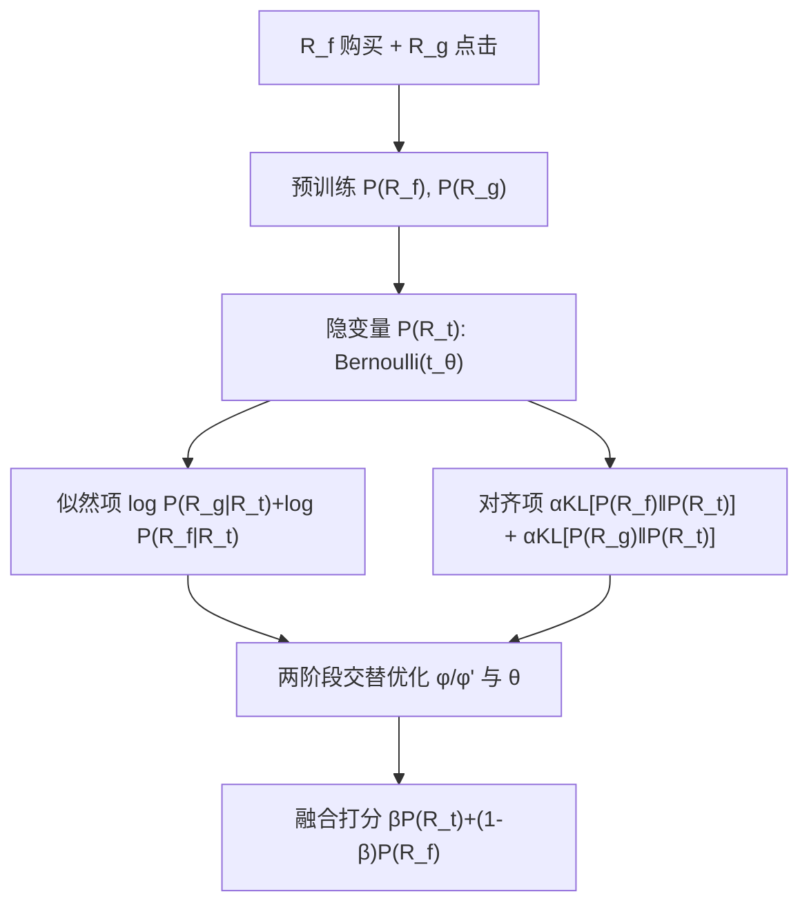
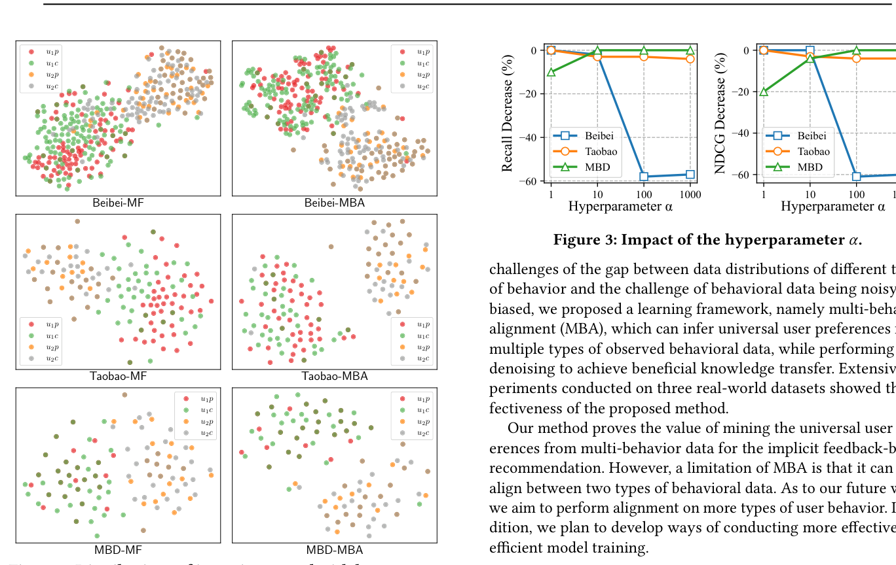

# Improving Implicit Feedback-Based Recommendation through Multi-Behavior Alignment (多行为对齐：面向隐式反馈推荐的去噪与知识迁移)

- **会议/期刊**: SIGIR 2023
- **作者与机构**: Xin Xin, Xiangyuan Liu, Hanbing Wang, Pengjie Ren, Zhumin Chen, Zhaochun Ren (山东大学) / Jiahuan Lei, Xinlei Shi, Hengliang Luo (美团) / Joemon M. Jose (Glasgow) / Maarten de Rijke (Amsterdam)
- **推荐链路定位**: 召回（隐式反馈目标行为预测，MF / LightGCN 为底座）
- **研究方向**: 自监督对比学习与交互去噪 / 跨域与多场景推荐（多行为知识迁移）
- **论文原文**: [https://arxiv.org/abs/2305.05585v1](https://arxiv.org/abs/2305.05585v1)
- **开源代码**: [https://github.com/LiuXiangYuan/MBA](https://github.com/LiuXiangYuan/MBA)

## TL;DR (1分钟核心速览)

多行为推荐的两大痛点：点击与购买的数据分布存在鸿沟、且行为本身含噪含偏，既有方法（多任务 / 异质图 / 对比学习）只做表征拼接或图卷积，无法得到"通用且准确"的用户偏好。MBA 把潜在真实偏好 $R_t$建成伯努利隐变量，用 KL 散度强制$P(R_f)\approx P(R_g)\approx P(R_t)$，以行为间"互相纠偏"作为天然去噪信号，并用两阶段交替优化解耦五个模型。在 Beibei/Taobao/MBD 三个数据集、4:1 划分 + Recall/NDCG@10,20 协议下，相对最强基线平均提升约 6.3% / 6.6% / 1.5%（$p<0.05$）。

## Background & Motivation (背景与核心矛盾)

- **主流范式**: 工业推荐多从单一隐式行为（点击）训练 BPR/MF 或 LightGCN；多行为方法则用多任务共享底层、异质图卷积 (MB-GCN)、元学习 (MB-GMN) 或对比学习 (CML) 引入辅助行为。
- **前人局限**: ①不同行为的数据分布不同（点击正/负样本分布 ≠ 购买正/负样本分布），分行为学偏好再聚合，得到的并非"真实偏好"；②辅助行为本身含流行度偏差与误点击，未曝光负样本被当作真负例，直接迁移反而引入噪声。
- **核心洞察 (Key Insight)**: 图 2（Beibei/Taobao/MBD）显示同一用户的点击物品分布与购买物品分布高度接近——同一用户的多行为应反映**同一套潜在通用偏好**，因此"行为间分布对齐"本身就可当去噪算子。
- **本文切入点**: 把真实偏好作为隐变量，用 KL 对齐 + 似然最大化同时完成去噪与知识迁移。

## Method (核心方法设计)

### 1. 整体框架 (Overall Architecture)

输入为购买矩阵 $R_f$与点击矩阵$R_g$。模型含五个组件：目标推荐器$t_\theta$（建模$P(R_t)$）、两组"真实偏好→观测行为"的转移模型$(h^f_\phi, h^f_\varphi)$与$(h^g_{\phi'}, h^g_{\varphi'})$，分别刻画"不喜欢却不点/不买"与"喜欢则点/买"的概率。训练上先用 BPR 在$R_f$、$R_g$上**预训练**两个行为偏好模型作为先验，再按样本情形（点且买 / 点未买 / 未点未买）计算四项似然损失与两项 KL，按两阶段交替更新（阶段一固定$\phi,\phi'$，阶段二固定$\varphi,\varphi'$），最终以$s=\beta P(R_t)+(1-\beta)P(R_f)$ 融合打分排序。

<figure class="paper-figure" markdown="span">
  <figcaption>图2：Beibei、Taobao和MBD数据集中两名用户所交互物品的分布。左列图中的物品表示由在购买行为数据上训练的矩阵分解模型获得，右列图中的物品表示由MBA获得。𝑢𝑖𝑐(𝑢𝑖𝑝)表示用户𝑢𝑖点击（购买）物品的分布。</figcaption>
</figure>

### 2. 关键设计拆解 (Key Designs)

1. **隐变量贝叶斯对齐（把去噪写成 KL 最小化）**：痛点是分行为学偏好不可比。作者设 $r^t_{u,i}\sim \mathrm{Bernoulli}(t_\theta(u,i))$，并假设观测数据是真实偏好加噪后的产物。直接最小化$\mathrm{KL}[P(R_f)\|P(R_t)]$不可解，于是借 Bayes 公式$P(R_t)=\frac{P(R_f)P(R_t|R_f)}{P(R_f|R_t)}$展开并整理得$\mathbb{E}_{P(R_f)}[\log P(R_g|R_t)]-\mathrm{KL}[P(R_f)\|P(R_t)] \approx \log P(R_g)-\mathrm{KL}[P(R_f)\|P(R_t|R_g)]$，构成$\log P(R_g)$的近似下界；再依据收敛时$P(R_f)\approx P(R_t)$，把期望从$P(R_f)$换成$P(R_t)$ 得到可优化式。最终损失：
   $$\mathcal{L}_{MBA}=-\mathbb{E}_{P(R_t)}[\log P(R_g|R_t)]-\mathbb{E}_{P(R_t)}[\log P(R_f|R_t)]+\alpha\,\mathrm{KL}[P(R_f)\|P(R_t)]+\alpha\,\mathrm{KL}[P(R_g)\|P(R_t)]$$
   直觉：似然项让 $t_\theta$ 解释两条行为链，KL 项则阻止它偏向任一条被噪声污染的链，等价于双向纠偏式去噪。
2. **两阶段交替训练（解耦 5 个模型的相互干扰）**：五个模型同时更新会导致 $t_\theta$学不动。阶段一假设"不喜欢则不点不买"，即$r^t=0 \Rightarrow h^f_\phi\approx 0, h^g_{\phi'}\approx 0$，只用$h^f_\varphi, h^g_{\varphi'}, t_\theta$计算$L_{CP},L_{CN},L_{PP},L_{PN}$；阶段二假设"喜欢则必点必买"（$h^f_\varphi\approx 1, h^g_{\varphi'}\approx 1$），只更新$h^f_\phi, h^g_{\phi'}, t_\theta$。用大常数$C_1,C_2$ 吸收被固定的项，避免数值退化。
3. **训练目标、负采样与推理开销**：总损失即上式加 $\alpha$缩放（$\alpha\in\{1,10,100,1000\}$），底座$t_\theta$取 MF（主实验）或 LightGCN，$d=32$，Adam + lr 1e-3 + batch 2048，每步采样 1 个交互正例 + 1 个随机负例（$1{:}1$均匀负采样）。推理时仅需$t_\theta$与预训练的$P(R_f)$ 两次前向加权，开销约为单模型的 2 倍，与行为类型数无关（但训练需预训练两份额外模型）。

## Experimental Setup & Evaluation Protocol (实验设置与评估协议)

- **数据集与预处理**: 三个电商数据集均取自"点击 + 购买"两行为，保证用户在两类行为上均有交互（即做用户级 5-core 式过滤），辅助行为 = 点击，目标行为 = 购买。

| 数据集 | #Users | #Items | #Purchases | #Clicks | 稀疏度/场景说明 |
| :--- | :---: | :---: | :---: | :---: | :--- |
| Beibei | 21,716 | 7,977 | 243,661 | 1,930,069 | 母婴电商，购买端极稀疏（用户均值 11.2 次购买） |
| Taobao | 48,658 | 39,395 | 208,905 | 1,238,659 | 阿里天池公开集，最稀疏（购买/用户 4.3 次） |
| MBD | 102,556 | 20,237 | 230,958 | 659,914 | 美团线上电商采集，密度最高 |

- **数据划分与防穿越 (Splitting Strategy)**: 随机 `比例划分` **4:1**（train/test），非时间切分，文中未做时间戳防穿越，也未设冷启动划分。
- **排名评测协议 (Ranking Protocol)**: 报告 Recall@10,20 与 NDCG@10,20，指标在全体用户上取平均；训练侧为 $1{:}1$ 均匀负采样，但**未显式声明测试为 Full-Ranking 全库排序**，从指标量级（Recall@20 达 0.17 / 0.57）推断为全库排序打分，属于复现时的协议模糊点。
- **对比基线与超参设置**: 单行为 MF-BPR / NGCF / LightGCN；多行为 MB-GCN / MB-GMN / CML；去噪 WBPR / T-CE / DeCA / SGDL。图模型统一 3 层传播，$d=32$，$\alpha\in\{1,10,100,1000\}$，$\beta\in\{0.7,0.8,1\}$，$L_2$在$10^{-6}\sim 1$搜索，以 Recall@20 早停（patience=20），三次取均值并做$p<0.05$ 显著性检验。

## Key Experimental Results (实验关键数据)

### 1. 主实验对比 (Main Results)

| 数据集 | 方法 | R@10 | R@20 | N@10 | N@20 |
| :--- | :--- | :---: | :---: | :---: | :---: |
| Beibei | MF | 0.0901 | 0.1438 | 0.0668 | 0.0855 |
| | NGCF | 0.0987 | 0.1561 | 0.0742 | 0.0939 |
| | LightGCN | 0.0988 | 0.1541 | 0.0733 | 0.0925 |
| | MB-GCN | 0.1054 | 0.1642 | 0.0784 | 0.0986 |
| | MB-GMN | 0.1046 | 0.1632 | 0.0779 | 0.0981 |
| | CML | 0.0861 | 0.1382 | 0.0618 | 0.0796 |
| | **MBA** | **0.1127** | **0.1742** | **0.0834** | **0.1046** |
| | Improv. | +6.9% | +6.1% | +6.4% | +6.1% |
| Taobao | MF / NGCF / LightGCN | 0.0303 / 0.0350 / 0.0460 | 0.0420 / 0.0518 / 0.0640 | 0.0190 / 0.0219 / 0.0290 | 0.0224 / 0.0267 / 0.0342 |
| | MB-GCN | 0.0418 | 0.0621 | 0.0250 | 0.0308 |
| | MB-GMN | 0.0542 | 0.0808 | 0.0330 | 0.0406 |
| | CML | 0.0318 | 0.0524 | 0.0176 | 0.0234 |
| | **MBA** | **0.0579** | **0.0812** | **0.0369** | **0.0435** |
| | Improv. | +6.8% | +0.5% | +11.8% | +7.1% |
| MBD | MB-GCN | 0.4625 | 0.5615 | 0.2949 | 0.3213 |
| | MB-GMN | 0.3660 | 0.4810 | 0.2323 | 0.2624 |
| | NGCF | 0.4030 | 0.4892 | 0.2623 | 0.2852 |
| | **MBA** | **0.4644** | **0.5677** | **0.3012** | **0.3285** |
| | Improv. | +0.4% | +1.1% | +2.1% | +2.2% |

### 2. 消融实验 (Ablation Study)

| 变体 | Beibei R@20 / N@20 | Taobao R@20 / N@20 | MBD R@20 / N@20 |
| :--- | :---: | :---: | :---: |
| MBA-KL（去 KL 对齐） | 0.1412 / 0.0831 | 0.0380 / 0.0185 | 0.4185 / 0.2027 |
| MBA-PT（改为联合训练、无预训练） | 0.1136 / 0.0642 | 0.0152 / 0.0072 | 0.4138 / 0.2017 |
| **MBA（完整）** | **0.1742 / 0.1046** | **0.0812 / 0.0435** | **0.5677 / 0.3285** |

### 3. 关键实验发现 (Key Findings)

1. **KL 对齐是唯一真正带来增益的算子，而非"多行为数据本身"**：去掉 KL 后 Beibei R@20 从 0.1742 掉到 0.1412，几乎回到 MF 单行为水平（0.1438），说明多行为信息的价值完全由对齐项激活；相对降幅 Beibei −18.9%、Taobao −53.2%、MBD −26.1%。
2. **预训练是训练稳定性的命门，稀疏集最敏感**：MBA-PT 在 Taobao 上 R@20 仅 0.0152（相对崩塌 −81.3%，甚至低于 MF 的 0.0420），说明五模型联合优化在极稀疏数据上根本不可收敛，先验初始化不可省。
3. **增益随基线强度递减，MBD 上已被 MB-GCN 逼平**：相对最强基线的平均提升从 Beibei 6.3% → Taobao 6.6%（但 R@20 仅 +0.5%）→ MBD 1.5%，且 MBD 改用 LightGCN 底座后 R@20 达 0.5926，说明 MBA 的上限受底座表达力与行为数据密度双重制约。

## Highlights & Limitations (亮点、对比与审稿批判)

- **与代表作对比 (vs. Prior Work)**: 相比 MB-GCN / MB-GMN 把多行为编码进异质图做卷积聚合，MBA **不构造图**，而在概率分布层面对齐，复杂度与行为类型数线性相关；相比 DeCA（两模型预测一致性）与 T-CE（大 loss 动态阈值丢弃），MBA 的去噪信号来自**异质行为间的分布一致性而非样本难易度**，是"跨行为互监督"而非"单行为内筛样本"，因此在高噪声电商数据上比 DeCA/T-CE 稳健得多（Beibei R@20 0.1742 vs 0.1378 / 0.1262）。
- **可迁移亮点**: ①"隐变量 + 双向 KL 对齐"可作为通用范式，迁移到曝光-点击、短视频完播-点赞等任意双行为场景；②用大常数 $C_1,C_2$ 吸收固定项、把联合优化拆成两阶段交替，是可复用的多模块解耦训练技巧。
- **审稿级局限批判**: ①**理论推导有跳步**：式 (9) 把期望从 $P(R_f)$换成$P(R_t)$ 时仅用"收敛后两者接近"作理由，严格的 ELBO 下界保证已失效，属启发式替换；②**协议与泛化不足**：仅支持两种行为对齐（作者自陈未来工作），测试阶段是否 Full-Ranking 未明确交代，4:1 随机划分缺时间切分，且在 MBD 上提升仅 0.4%–1.1%，统计显著但工程意义有限；③训练需预训练两份额外模型 + 五模型交替，工业部署成本明显高于单塔 MF。

## Rating (四维评分)

- **方法创新性 (Novelty)**: ⭐⭐⭐⭐ （把多行为推荐重构为"隐变量分布对齐 + 双向 KL 去噪"，视角新颖，但 ELBO 替换为启发式、缺谱/理论保证）
- **评估协议与实验扎实度 (Protocol & Experiments)**: ⭐⭐⭐⭐ （三数据集含真实线上集、8+ 基线含 4 个去噪框架、消融与双底座验证完整、$p<0.05$；扣分在划分方式单一与测试协议未明示）
- **写作与数学规范度 (Clarity & Rigor)**: ⭐⭐⭐⭐ （推导链条式 (1)→(12) 清晰、算法 1 给出样本情形分支，但期望替换一步交代偏薄、符号 $\varphi/\phi$ 复用密集）
- **工业落地与复现价值 (Industrial & Practical Value)**: ⭐⭐⭐⭐ （代码开源、底座可换 LightGCN 即插即用；代价是预训练 + 五模型交替训练开销，线上推理需双模型打分）

