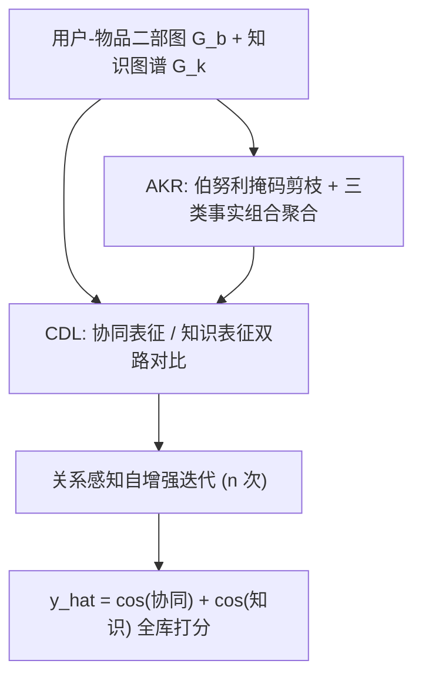
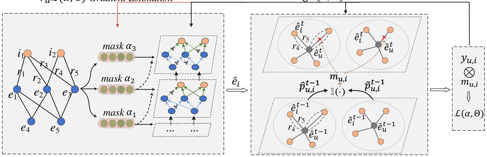
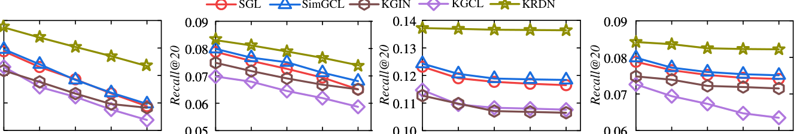

# Knowledge-refined Denoising Network for Robust Recommendation (知识精炼去噪网络：面向鲁棒推荐)

- **会议/期刊**: SIGIR 2023 (46th International ACM SIGIR Conference)
- **作者与机构**: Xinjun Zhu, Yuntao Du, Yuren Mao (通讯), Lu Chen, Yujia Hu, Yunjun Gao（浙江大学；阿里-浙大前沿技术联合研究院）
- **推荐链路定位**: 召回/排序表征学习（端到端训练后以余弦相似度全库打分）
- **研究方向**: 自监督对比学习与交互去噪 / 图神经网络与知识图谱推荐
- **论文原文**: [https://arxiv.org/abs/2304.14987v1](https://arxiv.org/abs/2304.14987v1)
- **开源代码**: [https://github.com/xj-zhu98/KRDN](https://github.com/xj-zhu98/KRDN)

## TL;DR (1分钟核心速览)

知识感知推荐直接在 KG 与用户-物品二部图上传播信息，既灌入与任务语义无关的三元组，又被隐式反馈假阳性边污染。KRDN 提出两把"剪刀"：可学习伯努利掩码 + DisARM 无偏梯度估计的自适应知识精炼（AKR），以及用"协同相似度 vs. 关系感知知识相似度"分歧判定噪声边的对比去噪学习（CDL）。在三数据集的全库排序（Full-Ranking, R@20/NDCG@20）上超越 KGIN、KGCL、SimGCL 等，NDCG@20 相对提升 12.69%/4.62%/11.56%。

## Background & Motivation (背景与核心矛盾)

- **主流范式**: Propagation-based 知识感知推荐（KGAT、KGIN、KGCL、MCCLK）把 KG 与二部图拼成协同知识图，用 GNN 递归聚合多跳邻居得到用户/物品表征。
- **前人局限 1 — 任务无关知识传播**: KG 规模大且泛化性强，既有方法对所有三元组一视同仁地聚合；如 Yelp 中用户偏好"环境氛围"，而 `(i1, WiFi, e1)` 这类边缘属性被等权注入，反而稀释偏好信号。
- **前人局限 2 — 对交互噪声脆弱**: 隐式反馈本身含假阳性，GNN 的递归消息传递会放大噪声；结构上相近（因共同访问 i3）而语义不合（i4 支持吸烟）的边会被误当作正反馈传播。
- **核心洞察 (Key Insight)**: KG 提供的"知识信号"与二部图提供的"协同信号"对同一 (u, i) 对的相似度判断会出现分歧——分歧越大，该交互越可能是噪声；同时 KG 三元组是否保留可由下游推荐损失反向监督。
- **本文切入点**: 用参数化硬掩码在训练中同时剪枝 KG 三元组与二部图边，两种去噪共享同一稀疏化目标并联合优化。

## Method (核心方法设计)

### 1. 整体框架 (Overall Architecture)

输入为二部图 $\mathcal{G}_b$与知识图谱$\mathcal{G}_k$。AKR 分支为每个 KG 三元组建一个伯努利掩码，仅保留与任务相关的三元组，并按"item-item / item-attribute / attribute-attribute"三类事实做组合式关系聚合，得到知识增强表征$\hat{\mathbf{e}}$；CDL 分支另外初始化一组纯协同表征$\tilde{\mathbf{e}}$，通过比较两条路径对$(u,i)$的相对相似度分歧（硬阈值$\gamma$判噪 + 软权重$\hat{p}_{u,i}$降权），并做关系感知图自增强迭代精修用户表征。最终两路多层表征相加、余弦打分求和输出；掩码参数$\alpha$ 由 DisARM 估计梯度，与对比损失端到端联合训练。

<figure class="paper-figure" markdown="span">
  <figcaption>图 2：所提出的 KRDN 框架示意图。利用多个掩码中断 KG 中与任务无关的知识传播（左）。根据协同信号与知识信号之间的差异识别噪声交互（右）。</figcaption>
</figure>

### 2. 关键设计拆解 (Key Designs)

1. **自适应知识精炼 (Adaptive Knowledge Refining)**：手工构造 K 跳子图或随机丢边依赖图质量、无法随任务自适应。KRDN 给每个三元组赋 $m_i\sim \mathrm{Bern}(\sigma(\alpha_i))$，把训练目标写成对掩码的期望$\tilde{\mathcal{L}}(\alpha,\Theta)=\mathbb{E}_{M}[\mathcal{L}(M,\Theta)]$（Jensen 不等式下的 ELBO），并用 DisARM 以两次前向的无偏低方差估计回传$\nabla_\alpha\tilde{\mathcal{L}}$：$\nabla_{\alpha_i}\tilde{\mathcal{L}}\approx\frac{1}{2}(f(\mathbf{b})-f(\tilde{\mathbf{b}}))(-1)^{\tilde{b}_i}\mathbb{I}[b_i\neq\tilde{b}_i]\sigma(|\alpha_i|)$。相比 REINFORCE 高方差、Gumbel-Softmax 有偏，该估计让离散剪枝可与 BPR 类目标联合优化。剪枝后的聚合为$\mathbf{e}_h^{(l)}=\frac{1}{|\mathcal{N}_h|}\sum_{(r,t)\in\mathcal{N}_h}\mathrm{ReLU}(W_\phi(\mathbf{e}_t^{(l-1)},\mathbf{e}_r))\cdot m_{h,t}^{(l-1)}$，其中组合算子$W_\phi$对同层事实用$W_1(\mathbf{e}_t\odot\mathbf{e}_r)$、跨层"item-attribute"事实用$W_2(\mathbf{e}_t\oplus\mathbf{e}_r)$，避免异构语义在同一通道内互相干扰。

2. **对比去噪学习 (Contrastive Denoising Learning)**：既有对比方法（SGL/SimGCL）靠随机扰动造视图，丢结构信息且不能显式指认假交互。KRDN 保留原图，计算协同侧 $\tilde{p}_{u,i}$与知识侧$\hat{p}_{u,i}=\mathrm{softmax}_i\!\left(\frac{1}{|\mathcal{R}(i)|}\sum_{r\in\mathcal{R}(i)}\mathbf{e}_r^{\top}\hat{\mathbf{e}}_u^{\top}\hat{\mathbf{e}}_i\right)$（多关系平均，刻画个性化语义相似度），以$m_{u,i}=\mathbb{I}\left[|\sigma(\tilde{p}_{u,i})-\sigma(\hat{p}_{u,i})|<\gamma\right]$做硬剪枝，其余边再乘软权重$\hat{p}_{u,i}$降权后聚合：$\hat{\mathbf{e}}_u^{(n)}=\frac{\hat{\mathbf{e}}_u^{(n-1)}+\sum_{i\in\mathcal{N}(u)}m_{u,i}\hat{p}_{u,i}\hat{\mathbf{e}}_i}{\hat{\mathbf{e}}_u^{(n-1)}+\sum_{i\in\mathcal{N}(u)}m_{u,i}\hat{p}_{u,i}\mathbf{e}_i}$的归一化形式迭代$n$ 次，把用户表征逐步推向偏好原型，偏差大的噪声邻居被"离心"。

3. **训练目标、负采样与推理效率**：采用自适应间隔对比损失，正样本对按掩码 $m_{u,i}$加权，负样本按$|\mathcal{N}|=200/400/400$随机采样并以 margin$\beta=0.6/0.7/0.8$惩罚：$\mathcal{L}=\sum_{u,i\in\mathcal{D}}\left[m_{u,i}(1-\hat{y}_{u,i})_+ + \frac{1}{|\mathcal{N}|}\sum_{j\in\mathcal{N}}(\hat{y}_{u,j}-\beta)_+\right]$。掩码$m_{u,i}$来自一个动态"相似度库"，使有害梯度不再回传。复杂度为 KG 聚合$O(|\mathcal{G}_k|dL)$与图侧$O(2|\mathcal{G}_b|dLn)$，与 KGIN 等同阶；额外开销仅为 DisARM 的两次前向。

## Experimental Setup & Evaluation Protocol (实验设置与评估协议)

- **数据集与预处理**: 沿用 KGAT/KGIN 的**两跳邻居实体**构建物品知识图谱，未做 5-core 显式过滤，比例划分 80%/10%/10%。

| 数据集 | #Users | #Items | #Interactions | 密度 | KG 三元组 / 实体 |
| :--- | :---: | :---: | :---: | :---: | :--- |
| Alibaba-iFashion | 114,737 | 30,040 | 1,781,093 | 0.052% | 279,155 / 59,156 |
| Last-FM | 23,566 | 48,123 | 3,034,796 | 0.268% | 464,567 / 58,266 |
| Yelp2018 | 45,919 | 45,538 | 1,185,068 | 0.057% | 1,853,704 / 90,961 |

- **数据划分与防穿越**: 固定比例 `80/10/10` 划分（沿用 KGAT/KGIN 官方切分）；另构造 **Polluted** 版本——在训练/验证集中随机替换 5% 观测交互为未交互物品，测试集保持不变。
- **排名评测协议**: 无偏 `Full-Ranking`，测试时将该用户所有未交互物品作为候选负样本；指标 Recall@20 与 NDCG@20，对全体测试用户取平均。
- **对比基线与超参设置**: 基线覆盖 KG-free（MF）、embedding（CKE）、propagation（KGNN-LS/KGAT/CKAN/KGIN/MCCLK/KGCL）与鲁棒去噪类（T-CE/SGCN/SGL/SimGCL）；维度 $d=64$，batch 4096，Adam；$L\in\{1,2,3\}$，$\gamma\in\{0.1,\dots,0.5\}$；提升标 `†` 表示$p<0.01$ 显著性。

## Key Experimental Results (实验关键数据)

### 1. 主实验对比 (Main Results)

以 R@20 / N@20 报告（加粗为全表最优，`Improv.` 为相对最强基线的 NDCG@20 提升）：

| 数据集 | MF | SGL | SimGCL | KGAT | KGIN | KGCL | **KRDN** | Improv. |
| :--- | :---: | :---: | :---: | :---: | :---: | :---: | :---: | :---: |
| Alibaba-iFashion | .1095/.0670 | .1232/.0771 | .1243/.0780 | .1030/.0627 | .1147/.0716 | .1127/.0713 | **.1372/.0879** | +12.69% |
| Yelp2018 | .0627/.0413 | .0788/.0518 | .0799/.0520 | .0705/.0463 | .0698/.0451 | .0748/.0491 | **.0842/.0544** | +4.62% |
| Last-FM | .0724/.0617 | .0879/.0775 | .0824/.0736 | .0873/.0744 | .0978/.0848 | .0686/.0629 | **.1023/.0946** | +11.56% |
| Polluted Alibaba | .0982/.0607 | .1146/.0714 | .1161/.0722 | .0902/.0542 | .1037/.0643 | .1065/.0672 | **.1312/.0839** | +16.20% |
| Polluted Yelp | .0589/.0392 | .0755/.0492 | .0759/.0495 | .0642/.0407 | .0679/.0436 | .0718/.0472 | **.0816/.0528** | +6.67% |
| Polluted Last-FM | .0711/.0610 | .0879/.0791 | .0948/.0844 | .0845/.0743 | .0960/.0849 | .0731/.0695 | **.1053/.0988** | +16.37% |

### 2. 消融实验 (Ablation Study)

| 变体 | Alibaba R@20 | Alibaba N@20 | Yelp R@20 | Yelp N@20 | Last-FM R@20 | Last-FM N@20 |
| :--- | :---: | :---: | :---: | :---: | :---: | :---: |
| KRDN (完整) | **.1372** | **.0879** | **.0842** | **.0545** | **.1023** | **.0946** |
| w/o AKR | .1317 | .0833 | .0826 | .0538 | .1008 | .0933 |
| w/o CDL | .1240 | .0794 | .0801 | .0521 | .0984 | .0905 |
| w/o AKR & CDL | .1225 | .0773 | .0789 | .0512 | .0974 | .0903 |
| $L=1$/$n=1$ | .1356 | .0866 | .0840/.0826 | .0544/.0527 | .1017/.1009 | .0939/.0929 |

### 3. 关键实验发现 (Key Findings)

1. **两条去噪链路互补且 CDL 更关键**：去掉 AKR 使 Alibaba R@20 从 .1372 降至 .1317（−4.0%），去掉 CDL 则跌至 .1240（−9.6%），两者同时移除仅 .1225——说明二部图噪声比 KG 冗余更具破坏性，而 AKR 的价值部分依赖 CDL 提供的判噪信号，单独使用收益有限。
2. **对注入噪声呈现近水平鲁棒性**：注入 5% 交互噪声后 KRDN 仍得 .1312/.0839，相对最强基线 SimGCL（.1161/.0722）提升 13.01%/16.20%；交互噪声比从 0% 增至 20% 时 KRDN 曲线近乎平坦，而 KG 三元组噪声 0→20% 下 KGCL 显著下滑、KRDN 基本不变，直接验证掩码剪枝的增益随噪声比例单调放大。
3. **细粒度去噪可替代深层传播**：$L=1$时 Alibaba 已达 .1356/.0866，$L=3$仅提升至 .1372/.0879，远不如 KGAT/KGCL 对层数的敏感度；自增强迭代$n$从 1 增至 2 带来 Yelp .0826→.0842 的稳定增益，$n=3$ 饱和并为 Alibaba 引入轻微过平滑——表明收益主要来自"剪对了边"而非"多传了几跳"。

<figure class="paper-figure" markdown="span">
  <figcaption>图 3：用户-物品图和知识图谱中不同噪声比例的影响。</figcaption>
</figure>

## Highlights & Limitations (亮点、对比与审稿批判)

- **与代表作对比 (vs. Prior Work)**: 与 KGIN/KGAT 的差别在于把 KG 三元组视为**可学习的离散变量**而非固定输入；与 KGCL/MCCLK 的差别在于不依赖随机图增广，而是保留原图结构、以"协同 vs. 知识"语义分歧显式指认噪声边；与 SGCN 的差别是引入 KG 作为额外的去噪监督源，而非仅靠稀疏/低秩约束。
- **可迁移亮点**: (1) 用"两路信号相对相似度分歧 + 阈值"做噪声边判定的范式，可直接迁移到多模态（视觉 vs. 协同）或跨域（源域 vs. 目标域）去噪；(2) DisARM 掩码 + 两次前向的梯度估计，为任何"边/特征选择"型推荐模块提供了比 Gumbel-Softmax 更省、更低偏差的落地手段。
- **审稿级局限批判**: (1) 阈值 $\gamma$与 margin$\beta$、负样本数均按数据集网格搜索（$\gamma\in[0.1,0.5]$），缺少对$\gamma$ 的自适应或灵敏度曲线的完整披露，工业部署时噪声比例漂移可能导致硬剪枝误删真阳性；(2) 评测仅报 R@20/NDCG@20，未做多随机种子方差、未做采样排序对照，也未给出训练/推理时延实测，Polluted 数据的人工合成噪声（随机替换 5%）与真实误点击分布存在差距。

## Rating (四维评分)

- **方法创新性 (Novelty)**: ⭐⭐⭐⭐ （首次把 KG 三元组与二部图边统一纳入"可学习硬掩码 + 语义分歧对比"的双去噪框架，DisARM 估计器的引入使离散剪枝可端到端联合训练，思路清晰且非简单堆叠）
- **评估协议与实验扎实度 (Protocol & Experiments)**: ⭐⭐⭐⭐ （三数据集 + 三份 Polluted 版本、无偏 Full-Ranking、$p<0.01$ 显著性标注、消融覆盖 AKR/CDL/层数/迭代次数较完整，但缺方差与效率实测）
- **写作与数学规范度 (Clarity & Rigor)**: ⭐⭐⭐⭐ （AKR 的 ELBO 推导与 DisARM 梯度、组合聚合算子定义严谨，复杂度分析到位；个别公式的自增强归一化写法略显简化、符号稍密）
- **工业落地与复现价值 (Industrial & Practical Value)**: ⭐⭐⭐⭐ （代码已开源，额外开销仅为一次掩码前向，可直接插在现有 KGAT/KGIN 式召回链路上；掩码剪枝同时带来按属性级别的可解释性，唯阈值需按业务噪声率标定）

