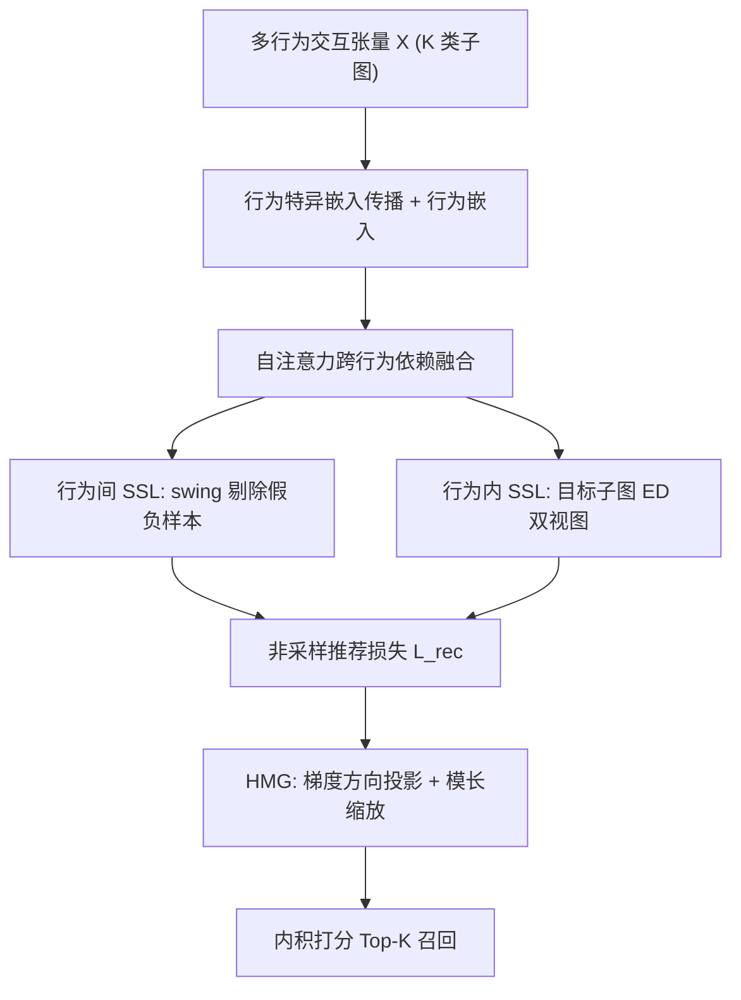
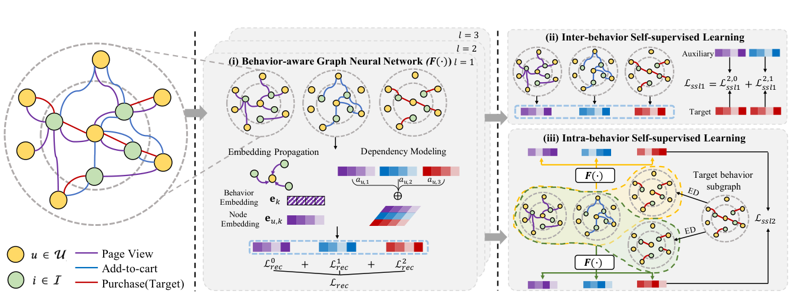

# Multi-behavior Self-supervised Learning for Recommendation (多行为自监督推荐)

- **会议/期刊**: SIGIR 2023
- **作者与机构**: Jingcao Xu, Chaokun Wang, Cheng Wu (清华大学) 与快手科技 (Yang Song, Kai Zheng, Guorui Zhou 等)
- **推荐链路定位**: 召回（多行为图召回/表征学习）
- **研究方向**: 自监督对比学习与交互去噪 / 图神经网络推荐
- **论文原文**: [https://arxiv.org/abs/2305.18238v1](https://arxiv.org/abs/2305.18238v1)
- **开源代码**: [https://github.com/Scofield666/MBSSL](https://github.com/Scofield666/MBSSL.git)

## TL;DR (1分钟核心速览)

多行为推荐的痛点有二：目标行为监督稀疏、辅助行为含噪；且已有 SSL 方案忽视自监督任务与主任务之间的**优化不平衡**。MBSSL 用「行为感知 GNN + 行为间/行为内双层对比 + 梯度方向-模长混合矫正」三件套破局：行为间对比借 swing 相似度剔除假负样本迁移辅助语义，行为内对比在目标子图上做 Edge Dropout 视图对比以抵消辅助噪声，最后用投影+缩放自适应压制辅助梯度。在 5 个真实数据集、Leave-One-Out **全库排序**协议下，Recall@10/NDCG@10 相对最优基线（GHCF）平均提升 18.6%–19.7%，Beibei 上 Recall@10 从 0.1922 提升至 0.2229。

## Background & Motivation (背景与核心矛盾)

- **主流范式**: 将 $K$类交互拆成$K$ 个 user–item 二部子图，用 GNN（EHCF/GHCF）或记忆网络/元学习（MATN/MBGMN）建模行为多重性与依赖；近期 CML、S-MBRec 引入跨行为对比学习缓解目标行为标签稀缺。
- **前人局限 1**: 辅助行为信噪比低。CML 把"任意不同节点"一律当负样本，在行为语义丰富的场景中会造出大量**假负样本**，把辅助行为的噪声分布强行对齐到目标行为，形成负迁移。
- **前人局限 2**: SSL 任务与主任务同时用固定权重联合优化，作者实测（图 2）显示训练中期 SSL 梯度与目标梯度**方向冲突比例可达 0.4–0.9**，且 SSL 梯度模长比目标梯度高一个量级，导致辅助任务主导共享底层参数。
- **核心洞察 (Key Insight)**: 梯度冲突与量级失衡是结构性而非超参问题；且仅靠行为间对比会持续注入辅助噪声，必须在目标行为**内部**再加一层自监督来"压实"目标语义。
- **本文切入点**: 用"结构性相似度筛负样本 + 目标子图自对比 + 双向梯度矫正"三处算子级改动同时解决稀疏、噪声与优化失衡。

## Method (核心方法设计)

### 1. 整体框架 (Overall Architecture)

输入为用户-物品在 $K$类行为下的交互张量$\mathbf{X}\in\mathbb{R}^{|\mathcal{U}|\times|\mathcal{I}|\times K}$。首先在各行为子图$\mathcal{G}_k$上做行为特异消息传播（节点嵌入与可学习行为嵌入逐元素相乘），再将该用户跨行为的$K$个嵌入拼成$\boldsymbol{e}_u\in\mathbb{R}^{K\times d}$，经自注意力算出行为间依赖系数并加权融合，得到行为感知表征。随后同时施加两个 SSL 分支：行为间对比（目标行为 vs 各辅助行为，使用 swing 相似度剔除 top-$N$ 假负样本）与行为内对比（目标子图 vs 两次 Edge Dropout 视图），最后与 EHCF 式非采样推荐损失联合优化，并用梯度混合矫正（HMG）在反向阶段调整辅助梯度的方向与模长。推理时仅保留前向传播与内积打分，无额外 SSL 分支开销。

<figure class="paper-figure" markdown="span">
  <figcaption>图1：MBSSL的整体架构。i) 行为感知图神经网络（𝑭(·)），执行行为特定的嵌入传播与跨行为依赖建模。ii) 行为间SSL，在目标子图与辅助子图之间进行对比，以缓解目标行为下的数据分布偏斜与数据稀疏。iii) 行为内SSL，在目标子图与Edge Dropout（ED）子图之间进行对比，以抵消来自辅助行为的交互噪声。</figcaption>
</figure>

### 2. 关键设计拆解 (Key Designs)

1. **行为特异传播 + 自注意力跨行为依赖 (CDM)**：痛点是"同一用户在不同行为下的偏好语义不同，且行为间相关强度因人而异"。传播层把行为嵌入 $\boldsymbol{e}_k$乘进消息：$\boldsymbol{e}_{u,k}^{(l+1)}=\text{LeakyReLU}\big(\mathbf{W}^{(l)}\cdot \text{mean}(\{\boldsymbol{e}_{i,k}^{(l)}\odot \boldsymbol{e}_k^{(l)} : i\in\mathcal{N}_{u,k}\})\big)$；再用行为特异打分$a_{u,k}=\text{softmax}\big((\mathbf{W}_2^k)^\top\tanh((\boldsymbol{e}_u\mathbf{W}_1^k)^\top)\big)$得到融合表征$\tilde{\boldsymbol{e}}_{u,k}=a_{u,k}\boldsymbol{e}_u$。直觉：加性/固定权重无法表达"浏览→加购→购买"的非对称依赖，自注意力让依赖系数随用户个性化。

2. **行为间 SSL（swing 假负样本剔除）**：痛点是不加区分地把不同节点当负样本会污染语义。作者用 swing 结构相似度 $\mathcal{S}_{\mathcal{G}_k}(u,v)=\sum_{i\in\mathcal{N}_{u,k}\cap\mathcal{N}_{v,k}}\sum_{j\in\mathcal{N}_{u,k}\cap\mathcal{N}_{v,k}}\frac{1}{\alpha+|\mathcal{N}_{i,k}\cap\mathcal{N}_{j,k}|}$跨子图平均后取 top-$N$记为$\text{FN}(u)$，损失中直接从负样本分母中剔除：$\mathcal{L}_{ssl1,u}^{K,k}=-\log\frac{\exp(\phi(\tilde{\boldsymbol{e}}_{u,K},\tilde{\boldsymbol{e}}_{u,k})/\tau)}{\sum_{v\in\mathcal{U}\setminus\text{FN}(u)}\exp(\phi(\tilde{\boldsymbol{e}}_{u,K},\tilde{\boldsymbol{e}}_{v,k})/\tau)}$。为何有效：swing 同时惩罚"共同邻居本身过热"的项，比余弦相似度更抗流行度偏置，因此其 top-$N$ 更可能是真同好而非热门共现。

3. **行为内 SSL + 梯度混合矫正 (HMG)**：对目标子图做两次概率 $\rho$的边丢弃$\mathcal{G}_K^1=(\mathcal{V}_K,\mathbf{M}_1\odot\mathbf{E}_K)$、$\mathcal{G}_K^2=(\mathcal{V}_K,\mathbf{M}_2\odot\mathbf{E}_K)$，再以 InfoNCE 拉近同节点双视图$\mathcal{L}_{ssl2,u}=-\log\frac{\exp(\phi(\boldsymbol{e}_{u,K}^1,\boldsymbol{e}_{u,K}^2)/\tau)}{\sum_{v\in\mathcal{U}}\exp(\phi(\boldsymbol{e}_{u,K}^1,\boldsymbol{e}_{v,K}^2)/\tau)}$，用目标行为自身信号压制辅助噪声。优化侧：总损失$\mathcal{L}=\mathcal{L}_{rec}+\sum_{k=1}^{K-1}\mu_k\mathcal{L}_{ssl1}^{K,k}+\gamma\mathcal{L}_{ssl2}$，其中$\mathcal{L}_{rec}=\sum_k\lambda_k\mathcal{L}_{rec}^k$采用非采样（全物品）损失。HMG 只在$\|\mathbf{G}_{aux,i}^t\|>\|\mathbf{G}_{tar}^t\|$时触发：先投影消冲突$\mathbf{G}_{aux,i}^t\leftarrow\mathbf{G}_{aux,i}^t-\frac{\mathbf{G}_{aux,i}^t\cdot\mathbf{G}_{tar}^t}{\|\mathbf{G}_{tar}^t\|^2}\mathbf{G}_{tar}^t$，再按松弛因子缩放$\mathbf{G}_{aux,i}^t\leftarrow r\frac{\|\mathbf{G}_{tar}^t\|}{\|\mathbf{G}_{aux,i}^t\|}\mathbf{G}_{aux,i}^t+(1-r)\mathbf{G}_{aux,i}^t$；模长更小或已一致的辅助梯度**刻意保留**以维持泛化、避免过拟合。总复杂度$O(|\mathcal{B}||\mathcal{V}|Kd+|\mathcal{E}|d)$，与 CML/GHCF 同阶；负采样策略为**免负采样**（全物品非采样损失），SSL 侧靠 in-batch 对比。

## Experimental Setup & Evaluation Protocol (实验设置与评估协议)

- **数据集与预处理**:

| 数据集 | #Users | #Items | #Interactions | 行为类型（目标行为加粗） |
| :--- | :---: | :---: | :---: | :--- |
| Beibei | 21,716 | 7,977 | 3,338,068 | PV / Cart / **Purchase** |
| Taobao | 48,749 | 39,493 | 1,952,931 | PV / Cart / **Purchase** |
| Tmall | 31,882 | 31,232 | 1,451,219 | PV / Favorite / Cart / **Purchase** |
| IJCAI-Contest | 17,435 | 35,920 | 799,368 | PV / Favorite / Cart / **Purchase** |
| Videos | 29,197 | 23,251 | 2,002,201 | Click / Like / Comment / **Download** |

- **数据划分与防穿越**: `Leave-One-Out`（每用户最后一次目标行为交互作测试，其余训练），沿用 EHCF/GHCF 公开切分，无时间戳穿越风险（各行为按原始划分，不做负采样）。
- **排名评测协议**: 无偏 `Full-Ranking`（对每个用户排序全部未交互物品），指标 Recall@{10,50}、NDCG@{10,50}；作者明确批评 CML/MBGMN 的 1:99 采样排序不可比。
- **对比基线与超参**: 10 个基线分三类 —— 单行为 (NGCF, LightGCN, 及用全行为训练的 `_all` 变体)、图 SSL (SGL, SimGCL 及 `_all`)、多行为 (MATN, MBGMN, CML, EHCF, S-MBRec, GHCF)。$d=64$，层数$L=4$，$\alpha=0.5$，$\rho=0.5$，embedding dropout 0.3，batch$\in\{256,512,1024\}$，负权重$\in\{0.1,0.01\}$，Adam lr=1e-3，$p<0.05$ t 检验。

## Key Experimental Results (实验关键数据)

### 1. 主实验对比 (Main Results)

| 基线 | Beibei R@10 | Beibei N@10 | Taobao R@10 | Taobao N@10 | Tmall R@10 | Tmall N@10 | Videos R@10 | Videos N@10 |
| :--- | :---: | :---: | :---: | :---: | :---: | :---: | :---: | :---: |
| LightGCN_all | 0.0552 | 0.0284 | 0.0405 | 0.0223 | 0.0328 | 0.0174 | 0.0887 | 0.0491 |
| SGL_all | 0.0597 | 0.0310 | 0.0506 | 0.0278 | 0.0281 | 0.0148 | 0.1002 | 0.0575 |
| SimGCL_all | 0.0603 | 0.0311 | 0.0502 | 0.0274 | 0.0327 | 0.0166 | 0.1053 | 0.0595 |
| MATN | 0.0466 | 0.0261 | 0.0259 | 0.0132 | 0.0154 | 0.0075 | 0.0053 | 0.0023 |
| CML | 0.0588 | 0.0292 | 0.0299 | 0.0150 | 0.0061 | 0.0027 | 0.0011 | 0.0005 |
| EHCF | 0.1523 | 0.0817 | 0.0717 | 0.0403 | 0.0234 | 0.0116 | 0.1036 | 0.0530 |
| S-MBRec | 0.1697 | 0.0872 | 0.0814 | 0.0446 | 0.0261 | 0.0125 | 0.0911 | 0.0461 |
| GHCF | 0.1922 | 0.1012 | 0.0807 | 0.0442 | 0.0353 | 0.0175 | 0.1687 | 0.0808 |
| **MBSSL** | **0.2229** | **0.1277** | **0.1027** | **0.0576** | **0.0400** | **0.0201** | **0.1835** | **0.0869** |
| Improv.% (vs. GHCF) | +15.97% | +26.19% | +27.26% | +30.32% | +13.31% | +14.86% | +8.77% | +7.55% |

### 2. 消融实验 (Ablation Study)

| 变体 | Beibei R@10 | Beibei N@10 | Taobao R@10 | Taobao N@10 |
| :--- | :---: | :---: | :---: | :---: |
| w/o CDM（去自注意力依赖建模） | 0.1923 | 0.1059 | 0.0936 | 0.0520 |
| w/o SSL_inter（去行为间对比） | 0.2025 | 0.1108 | 0.0902 | 0.0515 |
| w/o SSL_intra（去行为内对比） | 0.1994 | 0.1027 | 0.0943 | 0.0526 |
| w/o HMG（等权联合优化） | 0.2086 | 0.1131 | 0.0936 | 0.0530 |
| **MBSSL** | **0.2229** | **0.1277** | **0.1027** | **0.0576** |

梯度策略对照（表 4）：仅方向投影 0.2081/0.1155；仅模长缩放 0.2196/0.1247；方向+模长但**对所有梯度**操作 0.2114/0.1217；本文"仅对超大模长辅助梯度操作"最优 0.2229/0.1277。

### 3. 关键实验发现 (Key Findings)

1. **优化不平衡是真实且最大的单点损失**：w/o HMG 在 Beibei 上 NDCG@10 从 0.1277 掉到 0.1131（−11.4%），跌幅超过去掉行为间 SSL（0.1108）；且 Table 4 显示对全部梯度做矫正（Strategy C 0.1217）反而**不如**只矫正超大模长梯度，证明"让弱辅助梯度保持冲突"是隐式正则。
2. **双层 SSL 互补而非冗余**：去掉 inter 使 Taobao R@10 从 0.1027 降至 0.0902（−12.2%，最大的辅助语义迁移收益）；去掉 intra 则 Beibei NDCG@10 降至 0.1027（−19.6%，最大），说明稀疏场景靠 inter 补信号、噪声场景靠 intra 抗污染。
3. **抗噪与稀疏鲁棒性量化成立**：向辅助数据注入 10%/20%/30% 噪声时，MBSSL 的 NDCG@50 下降幅度在 Beibei/Taobao 上均为最小且随噪声比升高优势扩大；分桶实验中 Beibei 长尾用户（目标行为交互 <12 次）群体上 MBSSL 明显超越 GHCF/CML，而在极活跃用户上略逊——即收益主要来自稀疏端。

## Highlights & Limitations (亮点、对比与审稿批判)

- **与代表作对比**: 相比 CML（任意异节点即负样本 + 元学习权重），MBSSL 用 swing 结构相似度做**假负样本剔除**而非正样本增广，更保守也更抗噪；相比 S-MBRec（仅用目标行为数据找相似用户构正样本），本文在辅助行为上算相似度，稀疏下更可靠且不放大不可靠正样本；相比 GHCF（纯监督 + 行为嵌入传播），本文的增量在于把 SSL 从"辅助任务"提升为"需要与主任务梯度对齐的对象"。
- **可迁移亮点**: ①"辅助梯度超大时才矫正、弱梯度保留冲突"这一非对称 HMG 规则可直接套用到任何"主任务 + 多辅助任务"的联合训练；②用 swing（而非余弦/共现）生成对比学习的假负样本掩码，在流行度偏置严重的场景普适。
- **审稿级局限批判**: ①swing 相似度需跨 5 个子图两两计算共同邻居交集的二阶项，$N$与$\alpha$双超参敏感（图 5 显示$N$ 过大过小都掉点），大规模工业图上的预处理开销与增量更新成本未讨论；②SSL 每个 epoch 需对 4–5 个辅助分支各建一份 ED 视图并全量对比，训练成本翻数倍，而线上收益仅在离线全库排序上验证，缺少 A/B 与召回阶段的延迟/吞吐报告；③Videos 数据集为内部数据不可复现，且提升仅 +8.8%，说明在行为语义差异大（下载 vs 点击）时跨行为迁移收益递减。

## Rating (四维评分)

- **方法创新性 (Novelty)**: ⭐⭐⭐⭐ （首次把 SSL–主任务的梯度方向/模长失衡作为一等公民处理，非对称触发规则与双层对比的组合有清晰动机）
- **评估协议与实验扎实度 (Protocol & Experiments)**: ⭐⭐⭐⭐ （5 数据集 + 全库排序 + $p<0.05$ t 检验 + 稀疏分桶/噪声注入/梯度策略四组专项实验完整，唯缺线上 A/B）
- **写作与数学规范度 (Clarity & Rigor)**: ⭐⭐⭐⭐ （公式与符号紧凑、复杂度分析到位，但式 (3)(4) 中 $\mathbf{a}_{u,k}\boldsymbol{e}_u$ 的维度约定略显省略）
- **工业落地与复现价值 (Industrial & Practical Value)**: ⭐⭐⭐⭐ （代码开源、复杂度与 GHCF 同阶、推理无额外开销；但 swing 预处理与多视图训练成本需工程折衷）

