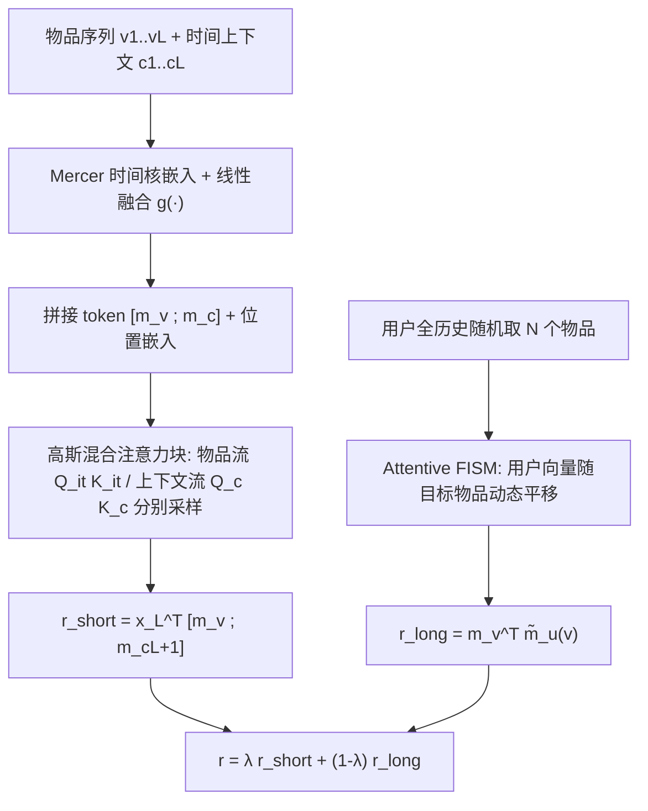
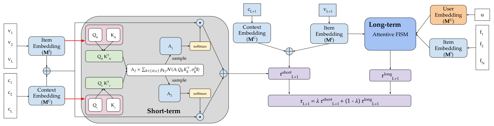

# Attention Mixtures for Time-Aware Sequential Recommendation (面向时间感知序列推荐的注意力混合)

- **会议/期刊**: SIGIR 2023 (short paper, 6 pages)
- **作者与机构**: Viet-Anh Tran, Guillaume Salha-Galvan, Bruno Sguerra, Romain Hennequin (Deezer Research, Paris)
- **推荐链路定位**: 精排（会话内 Next-Item 打分）
- **研究方向**: 序列与会话推荐 / 特征交叉与混合建模
- **论文原文**: [https://arxiv.org/abs/2304.08158v2](https://arxiv.org/abs/2304.08158v2)
- **开源代码**: [https://github.com/deezer/sigir23-mojito](https://github.com/deezer/sigir23-mojito)

## TL;DR (1分钟核心速览)

现有 Transformer 序列推荐只建模交互的相对位置，普遍忽视交互发生的绝对时间上下文（月份、星期、小时）；而已有的时间感知变体（TiSASRec、MEANTIME、CARCA）多把时间嵌入与物品嵌入做简单拼接/相加，弱化了"偏好—时间"的复杂耦合，且存在注意力头冗余。本文提出 MOJITO：把每个注意力头的注意力矩阵视为**物品流与上下文流两个高斯成分的混合**，由模型自动学习逐头权重 $p_{kj}$与方差$\sigma_k^2$，再与 Attentive FISM 长兴趣分线性加权。在 MovieLens / Amazon Book / LFM-1b 三域 1K 负采样排序协议下取得 6 项指标中 5 项最优（Amazon Book HR@10 83.26%、NDCG@10 59.94%）。

## Background & Motivation (背景与核心矛盾)

- **主流范式**: SASRec/BERT4Rec 用自注意力在序列内做 Next-Item 预测；时间感知阵营（TiSASRec 建模时间间隔、TASER 分解相对/绝对时间、MEANTIME 多头切分时间模式、TimelyRec 分层时间粒度）试图把时间信号注入注意力。
- **前人局限**: ① 时间与物品表征的融合方式过于"浅"——简单 concat 或 add，等价于假设时间上下文对所有物品、所有位置施加同构影响，无法表达"周末听摇滚、工作日听古典"这类条件性偏好；② 除 MEANTIME 外，多头注意力普遍退化为冗余头（SASRec 增加头数几乎无增益），多头容量被浪费。
- **核心洞察 (Key Insight)**: 作者假设"给定时间上下文，用户倾向消费内容相似的物品"，因此**物品相似度注意力**与**时间上下文相似度注意力**应作为两条语义先验互补，其相对重要性应随头、随数据自适应，而非由人工设计的固定融合算子决定；同时用共享全局注意力池 + 混合采样可天然拉开头间差异。
- **本文切入点**: 用高斯混合概率模型替代确定性注意力矩阵，混合权重即"时间 vs 物品"的自适应门控；长兴趣侧改用 Attentive FISM 以保证多峰兴趣表达。

## Method (核心方法设计)

### 1. 整体框架 (Overall Architecture)

输入序列 $S_{u}^{i}=(v_1,\dots,v_L)$与上下文元组序列$C_u^i=(\mathbf{c}_1,\dots,\mathbf{c}_L)$（每个$\mathbf{c}_t$含$C$种时间字段）。时间字段先用 Xu 等的平移不变时间核（Mercer kernel）映射为向量并拼接，经线性层$g(\cdot)$得到$\mathbf{m}^{C}_{\mathbf{c}_t}\in\mathbb{R}^{d}$，与物品嵌入拼接成$2d$维 token，加位置嵌入后送入$B$个混合注意力块。序列输出$\mathbf{x}_L^{(B)}$给出短期分$r^{\text{short}}$；用户全历史中随机取$N$个物品经 Attentive FISM 给出长期分$r^{\text{long}}$；两路按$\lambda$ 加权得到最终排序分。训练端对每条子序列各采 1 个负样本，分别优化两路 BPR 式二元交叉熵。

<figure class="paper-figure" markdown="span">
  <figcaption>图 1：用于时间感知 SR 的 MOJITO 架构，采用时间上下文与物品嵌入的注意力混合。</figcaption>
</figure>

### 2. 关键设计拆解 (Key Designs)

1. **高斯混合注意力 (Mixture of Item & Temporal Attention)**：痛点是把时间当"额外特征"硬拼，无法表达条件化偏好。做法是不再直接 softmax 一个 $\mathbf{Q}\mathbf{K}^\top$，而是把第$j$ 个头的注意力矩阵当作随机变量，从两成分高斯混合中采样：
$$\mathbf{A}_j \sim \sum_{k\in\{it,c\}} p_{kj}\,\mathcal{N}\!\left(\mathbf{A};\ \mathbf{Q}_k\mathbf{K}_k^{\top},\ \sigma_k^{2}\right),\quad \textstyle\sum_k p_{kj}=1,\ p_{kj}\ge 0$$
其中 $\mathbf{Q}_{it},\mathbf{K}_{it}$由 token 的物品分量投影得到、$\mathbf{Q}_{c},\mathbf{K}_{c}$由上下文分量投影得到（即同一输入被"语义解耦"成两条注意力流），$p_{kj}$为可学习混合系数，$\sigma_k^2$按元素缩放注意力温度。直觉：$p_{kj}$自动决定该头是"看内容相似"还是"看时间相似"，$\sigma^2$ 调节打分锐度，等价于给每个头一个可微的软路由，从源头抑制头冗余；混合采样让不同头从共享全局池中抽取不同成分，天然异质。

2. **Attentive FISM 长兴趣建模**：单一用户向量的做法无法刻画"既爱金属又爱古典"的多峰兴趣。作者用 FISM 的注意力聚合让用户表征随目标物品平移：
$$\tilde{\mathbf{m}}_u(v)=\mathbf{m}_u+\frac{\sum_{f\in\mathcal{F}\setminus\{v\}} e^{\mathbf{m}_f^{\top}\mathbf{m}_v}\,\mathbf{m}_f}{\sum_{f'\in\mathcal{F}\setminus\{v\}} e^{\mathbf{m}_{f'}^{\top}\mathbf{m}_v}}$$
与 FISSA 的关键差别是 $\mathcal{F}$从**用户全历史的随机$N$ 个物品**中采样，而非仅当前会话窗口，从而覆盖更久远、更分散的兴趣；测试时该路不含任何时间项，与"长期偏好不依赖上下文"的定义一致。

3. **训练目标、负采样与推理效率**：总损失 $\mathcal{L}=\lambda\mathcal{L}^{\text{short}}+(1-\lambda)\mathcal{L}^{\text{long}}$，两路共享同一$\lambda$；
$$\mathcal{L}^{x}=-\sum_{S\in\mathcal{S}}\sum_{l=1}^{L}\Big[\log\sigma\big(r^{x}_{l+1}(v_{S,l+1})\big)+\log\big(1-\sigma(r^{x}_{l+1}(o_{S,l+1}))\big)\Big]$$
$x\in\{\text{short},\text{long}\}$，每条前缀子序列只采 **1 个均匀负样本**（非 in-batch、非难负采样）。推理时只需一次前向 + 对候选库做内积打分；$B=2,H=2,d=64,L=50$ 的配置使模型比 CARCA（完整 encoder-decoder）轻得多，适合流媒体在线服务。

## Experimental Setup & Evaluation Protocol (实验设置与评估协议)

| 数据集 | #Users | #Items | #Interactions | 过滤 (k-core) | 场景说明 |
| :--- | :---: | :---: | :---: | :---: | :--- |
| MovieLens | 6,040 | 3,883 | ~1M ratings | $k_{user}=10,\ k_{item}=5$ | 电影（评分二值化为交互） |
| Amazon Book | 109,730 | 96,421 | >1M | $k_{user}=30,\ k_{item}=20$ | 图书电商 |
| LFM-1b | 120,322 | 3,190,371 | >1B listening events | $k_{user}=300,\ k_{item}=500$ | Last.fm 音乐收听 |

- **数据划分与防穿越**: `Leave-One-Out`——每条序列最后一个交互作测试、倒数第二个作验证，其余训练；对每条序列构造"前 $l$ 项"子序列做 next-item 监督，严格按时间顺序，无未来信息泄漏。
- **排名评测协议**: **Sampled Ranking**——评估集 = 1 个真实目标 + **1,000 个用户未交互负样本**，模型输出 top-10 列表，报告 HR@10 与 NDCG@10（%）。注意：非 Full-Ranking，绝对数值偏高，跨论文比较需谨慎。
- **对比基线与超参**: 8 个 Transformer 基线，非时间感知（SASRec、BERT4Rec、SSE-PT、AttRec、FISSA）与时间感知（TiSASRec、MEANTIME、CARCA）各 5/3 个；$d=64$、$L=50$、batch 512、$B=2$、$H=2$、Adam、最多 100 epoch；学习率$\in\{2\text{e-}4,5\text{e-}4,7.5\text{e-}4,1\text{e-}3\}$、$N\in\{20,50,100\}$、$\lambda\in\{0.1,0.2,0.5,0.8,1.0\}$ 在验证集网格搜索；报告 5 次训练均值 ± 标准差。

## Key Experimental Results (实验关键数据)

### 1. 主实验对比 (Main Results)

| 类型 | 模型 | MovieLens NDCG | MovieLens HR | Amazon NDCG | Amazon HR | LFM-1b NDCG | LFM-1b HR |
| :--- | :--- | :---: | :---: | :---: | :---: | :---: | :---: |
| 非时间 | SASRec | 58.27 | 80.86 | 55.23 | 78.29 | 58.01 | 73.84 |
| 非时间 | BERT4Rec | 53.75 | 75.59 | 57.17 | 79.90 | 56.08 | 68.87 |
| 非时间 | SSE-PT | 55.62 | 79.61 | 55.00 | 79.63 | 56.60 | 75.21 |
| 非时间 | FISSA | 48.53 | 74.16 | 58.94 | 81.42 | 52.40 | 68.20 |
| 时间 | TiSASRec | 58.09 | 80.86 | 52.16 | 78.53 | 55.67 | 73.25 |
| 时间 | MEANTIME | **59.97** | 79.76 | 58.95 | 82.02 | 57.03 | 71.60 |
| 时间 | CARCA | 38.65 | 64.51 | 56.82 | **82.89** | 49.38 | 66.30 |
| — | **MOJITO** | 59.82 | **82.09** | **59.94** | **83.26** | **60.14** | **75.72** |
| — | Improv. vs 最优基线 | −0.25% | **+1.52%** | **+1.68%** | +0.45% | **+3.67%** | **+0.68%** |

### 2. 消融与诊断分析 (Ablation & Diagnostics)

原文为 6 页短文，**未提供组件级消融表**（无 `w/o mixture`、`w/o long-term` 对照），仅给出注意力头多样性诊断与超参搜索：

| 诊断项 (Amazon Book, 输出层头间平均成对 $L_2$ 距离) | 数值 | 说明 |
| :--- | :---: | :--- |
| TiSASRec | 0.57 ± 0.13 | 头高度同质 |
| CARCA | 0.76 ± 0.59 | 方差极大，不稳定 |
| **MOJITO** | **0.85 ± 0.43** | 头多样性最高，冗余最低 |
| $\lambda$ 网格 | {0.1,0.2,0.5,0.8,1.0} | 需逐数据集调，敏感 |
| $N$（历史采样数） | {20,50,100} | 影响长兴趣覆盖度 |

### 3. 关键实验发现 (Key Findings)

1. **时间感知并非普适红利，而依赖领域周期性强度**：MovieLens/Amazon 上时间感知模型整体优于非时间感知（MEANTIME 58.95 vs SASRec 55.23 NDCG）；但 LFM-1b 上 TiSASRec（55.67）反不如 SASRec（58.01），说明音乐场景交互频次高、间隔短、单上下文对应曲目量巨大，粗粒度时间字段反而引入噪声——MOJITO 靠"星期几"周期信息把 NDCG 拉到 60.14（较 SASRec +3.67%），是唯一在三域全部领先的时间感知模型。
2. **融合算子的设计比"是否用时间"更决定上限**：同为时间感知，CARCA 在 MovieLens 崩到 38.65 NDCG（低于所有非时间基线 20 个点），作者归因于其完整 encoder-decoder 结构带来的优化难度；MOJITO 用浅层混合注意力（$B=2,H=2$）即取得 5/6 项最优，说明"轻量自适应融合 > 重型结构堆叠"。
3. **头多样性与性能正相关但仅呈相关性**：MOJITO 头间 $L_2$距离 0.85 显著高于 TiSASRec 的 0.57，与 NDCG 提升方向一致；然而论文自己也承认该证据为观察性（observational），缺乏"固定$p_{kj}$ 或单成分"的反事实消融来确证因果，这是本文实验设计最明显的空缺。

## Highlights & Limitations (亮点、对比与审稿批判)

- **与代表作对比 (vs. Prior Work)**: 相对 TiSASRec（把时间**间隔**作为注意力偏置项加进 $\mathbf{Q}\mathbf{K}^\top$）与 MEANTIME（多头各学一种时间模式但融合仍靠拼接/相加），MOJITO 的本质区别是把"物品流 vs 时间流"的权重提升为**逐头可学习概率单纯形上的混合系数**，等价于一个可微软路由；相对 FISSA（用当前会话内物品做 FISM 聚合），本文把聚合池扩展到全历史随机$N$ 项，直接缓解短会话下长兴趣估计偏差。
- **可迁移亮点**: ① "把两路不同语义先验的注意力矩阵做高斯混合、用 $p_{kj}$做软门控"这一算子可零成本移植到多模态推荐（视觉流 vs 文本流）、跨域推荐（源域流 vs 目标域流）；② 用元素级$\sigma_k^2$学习注意力温度，是比固定$1/\sqrt{d}$更灵活、参数仅$O(1)$ 的锐度校准技巧。
- **审稿级局限批判**: ① **评估协议偏弱**——仅 1K 均匀负采样的 Sampled Ranking，且每子序列只采 1 个负样本、无难负采样，绝对数值（HR 80%+）与真实全库排序差距大，无法反映 ANN 全库检索下的真实Recall；② **缺少严格消融**，混合模块、长兴趣模块、时间核嵌入各自的边际贡献未量化，$\lambda$与$N$需逐数据集网格搜索（$\lambda$ 网格跨度 0.1–1.0），超参敏感度与稳健性未讨论；③ 头多样性主张基于单数据集单层统计量，样本量小（5 次训练），因果性存疑。

## Rating (四维评分)

- **方法创新性 (Novelty)**: ⭐⭐⭐⭐ （把注意力矩阵显式建模为物品/时间两成分高斯混合，混合系数充当可微门控，机制简洁且与头冗余问题对症）
- **评估协议与实验扎实度 (Protocol & Experiments)**: ⭐⭐⭐ （三域数据集跨度不错、5 次训练带方差，但 1K 采样排序 + 单负样本偏弱，且缺失组件级消融表）
- **写作与数学规范度 (Clarity & Rigor)**: ⭐⭐⭐⭐ （6 页短文公式紧凑、符号一致、图 1 架构与式 (1)–(7) 一一对应；混合模型的采样与 softmax 衔接处推导略跳步）
- **工业落地与复现价值 (Industrial & Practical Value)**: ⭐⭐⭐⭐ （代码已开源、$B=2/H=2/d=64$极轻量、Deezer 真实音乐场景验证，但$\lambda$ 逐场景调参与 1K 采样评估需在线上重做）

