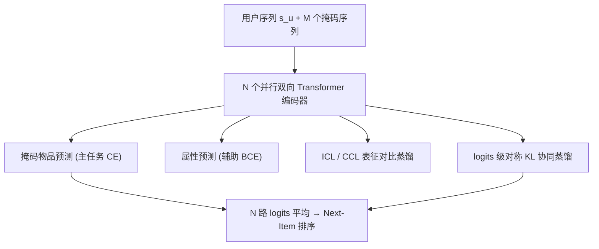
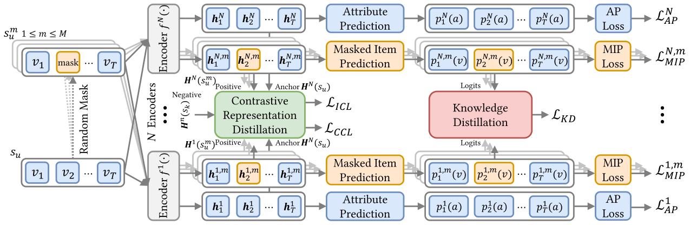

# Ensemble Modeling with Contrastive Knowledge Distillation for Sequential Recommendation (面向序列推荐的对比知识蒸馏集成建模)

- **会议/期刊**: SIGIR 2023
- **作者与机构**: Hanwen Du, Huanhuan Yuan, Pengpeng Zhao, Fuzhen Zhuang, Guanfeng Liu, Lei Zhao, Victor S. Sheng（苏州大学、北京航空航天大学、麦考瑞大学、德州理工大学）
- **推荐链路定位**: 召回（序列编码器 / Next-Item 预测）
- **研究方向**: 序列与会话推荐 / 自监督对比学习与交互去噪
- **论文原文**: [https://arxiv.org/abs/2304.14668v3](https://arxiv.org/abs/2304.14668v3)
- **开源代码**: [https://github.com/hw-du/EMKD](https://github.com/hw-du/EMKD)

## TL;DR (1分钟核心速览)

现有序列推荐几乎都在"设计更强单一序列编码器"上内卷，而简单并行多网络集成因缺少网络间知识迁移，增益常不稳定。本文提出 EMKD：以 $N$ 个并行双向 Transformer 为编码器集成，在表征层用 ICL（网内）+ CCL（跨网）对比蒸馏、在 logits 层用对称 KL 协同蒸馏打通知识流，并以掩码物品预测为主任务、属性预测为辅助任务。在 5-core 过滤、Leave-One-Out 划分、**全库未采样排序**协议下，Beauty/Toys/ML-1M 的 NDCG@10 相对最佳基线提升 20.74%~33.48%。

## Background & Motivation (背景与核心矛盾)

- **主流范式**: 以 RNN/CNN/单向或双向 Transformer 作为单一序列编码器（GRU4Rec、Caser、SASRec、BERT4Rec），再叠加属性融合（FDSA、S3-Rec、MMInfoRec）或对比学习正则（CL4SRec、DuoRec）来刻画用户动态兴趣。
- **前人局限**: (1) 单一深网只能收敛到某一局部极小，不同初始化网络预测分布各异却**无法互相借力**——文中 Table 1 显示独立训练的 2× 集成虽有效，但 GRU4Rec 在 Toys 上仅 0.0097→0.0102，增益脆弱；(2) 靠堆叠层数扩容量无效，SASRec 10 层 NDCG@10 0.0282 反低于 2 层 0.0284。
- **核心洞察 (Key Insight)**: 参数越多局部极小数目指数增长，不同种子初始化的网络几乎不可能收敛到同一极小，因此预测具备天然多样性；"每个网络都猜不准，但对多个分布投票/互蒸馏即可命中"，同时协同蒸馏可过滤噪声标签引入的错误预测。
- **本文切入点**: 把 CV 中的协同蒸馏（DML/ONE）+ 对比表征蒸馏迁移到序列推荐，让 $N$ 个网络既做 teacher 又做 student。

## Method (核心方法设计)

### 1. 整体框架 (Overall Architecture)

输入用户序列 $s_u$，先用不同随机种子初始化的$N$个双向 Transformer 编码器$f_1,\dots,f_N$并行编码；对每条序列采样$M$个不同掩码序列$s^m_u$。**原始序列**的隐表示$\boldsymbol{H}^n(s_u)$作为对比蒸馏的 anchor 并送入属性预测头；**掩码序列**的隐表示$\boldsymbol{H}^n(s^m_u)$作为正样本并送入掩码物品预测头；同 batch 其他用户序列经同一网络编码作为负样本。训练时联合优化主任务 CE、属性 BCE、ICL/CCL 与 logits KL；推理时把 `[mask]` 追加到序列尾，将$N$ 个网络对 mask 位置的 logits 取平均作为最终打分。

<figure class="paper-figure" markdown="span">
  <figcaption>图2：EMKD 的概览，包含 𝑁 个并行网络 𝑓1(·), · · ·, 𝑓𝑁(·)。对于每个原始序列 𝑠𝑢，我们生成 𝑀 个不同的掩码序列。原始序列的隐藏表示 𝑯1(𝑠𝑢), · · ·, 𝑯𝑁(𝑠𝑢) 作为对比表示蒸馏的锚点，并用于属性预测任务；而掩码序列的隐藏表示 𝑯1(𝑠𝑚 𝑢), · · ·, 𝑯𝑁(𝑠𝑚 𝑢) 作为对比表示蒸馏的正样本，并用于掩码物品预测任务。负样本 𝑯𝑛(𝑠𝑘)(1≤𝑛≤𝑁) 用于对比表示……</figcaption>
</figure>

### 2. 关键设计拆解 (Key Designs)

1. **双视角对比表征蒸馏 (ICL + CCL)**：仅做网内对比（如 CL4SRec）只是正则化，无法跨网络迁移。ICL 以同一网络的原序列表示为 anchor、其掩码序列表示为正样本：
$\mathcal{L}^{\text{ICL}}_n=-\sum_{m=1}^{M}\log\frac{\exp(g(\boldsymbol{H}^n(s_u),\boldsymbol{H}^n(s^m_u))/\tau)}{\sum_{k\neq u}\exp(g(\boldsymbol{H}^n(s_u),\boldsymbol{H}^n(s_k))/\tau)}$CCL 则把 anchor 换成网络$x$、正样本换成**另一网络$y$** 的掩码表示$\boldsymbol{H}^y(s^m_u)$，并对所有有序网络对$(x,y),x\neq y$ 求和。直觉：跨网络拉近"同一序列的不同视角表示"，等价于让弱网络对齐强网络的表征几何，比 logits 蒸馏更细粒度。

2. **logits 级对称协同知识蒸馏 (KD)**：表征对齐与排序目标仍有 gap，故在温度 $\tau$的 softmax 分布$z$ 上最小化 KL：
$\mathcal{L}^{\text{KD}}=\sum_{x=1}^{N}\sum_{y\neq x}\sum_{m=1}^{M}\sum_{t\in\mathcal{I}^m_u}\sum_{i=1}^{|\mathcal{V}|}z^{x,m}_t(v_i)\log\frac{z^{x,m}_t(v_i)}{z^{y,m}_t(v_i)}$关键细节：作 teacher 时对$z^{x}$**截断梯度**以保证稳定；且不做单向强弱指定，每个网络同时充当两者，使$N$ 个视角的信息被对称地广播，避免单向蒸馏中的"教师误导向"。

3. **属性预测辅助任务与训练目标**：不构造显式属性 embedding（缓解属性 ID 稀疏），而是用 sigmoid 线性头把位置隐表示直接映射到 $|\mathcal{A}|$ 维做**多标签 BCE**，为序列注入品类/品牌/题材上下文。总损失
$\mathcal{L}_{\text{EMKD}}=\mathcal{L}_{\text{MIP}}+\mathcal{L}_{\text{AP}}+\lambda(\mathcal{L}_{\text{ICL}}+\mathcal{L}_{\text{CCL}})+\mu\mathcal{L}_{\text{KD}}$负样本全部来自 **in-batch 其他用户序列**（免额外采样器），掩码比例$\rho=0.15$，默认$N=3$、$M\in[1,8]$、$d=256$。推理需$N$次前向（约$N\times$ 参数与算力）。

## Experimental Setup & Evaluation Protocol (实验设置与评估协议)

- **数据集与预处理**: 全部按 **5-core** 过滤（用户/物品交互数 $<5$ 剔除），去重并按时间戳排序。

| 数据集 | #Users | #Items | #Interactions | 稀疏度 | 特征/场景说明 |
| :--- | :---: | :---: | :---: | :---: | :--- |
| Beauty | 22,363 | 12,101 | 198,502 | 99.93% | Amazon 美妆；细粒度品类 + 品牌共 1,221 属性 |
| Toys | 19,412 | 11,924 | 167,597 | 99.93% | Amazon 玩具；1,027 属性 |
| ML-1M | 6,040 | 3,953 | 1,000,209 | 95.81% | 电影；18 个题材属性，序列长（人均 163.5） |

- **数据划分与防穿越**: `Leave-One-Out`——最后一条测试、倒数第二条验证、其余训练；显式评分统一视为隐式反馈。
- **排名评测协议**: 无偏 **Full-Ranking（全库未交互物品排序，不做负采样）**，指标 HR@$\{5,10\}$、NDCG@$\{5,10\}$，遵循 [21] 对采样指标不公平性的告诫。
- **对比基线与超参**: 三组基线——通用序列（GRU4Rec/Caser/SASRec/BERT4Rec）、属性感知（FDSA/S3-Rec/MMInfoRec）、对比学习（CL4SRec/DuoRec）；$d=256$、2 层 Transformer、2 头、batch 256、Adam lr=1e-3、250 epoch 取验证最优；$\lambda,\mu\in[0.01,1]$、$\tau\in[0.1,10]$ 网格调参；论文未报告显著性检验。

## Key Experimental Results (实验关键数据)

### 1. 主实验对比 (Main Results)

| Dataset | Metric | GRU4Rec | Caser | SASRec | BERT4Rec | S3-Rec | MMInfoRec | CL4SRec | DuoRec | **EMKD** | Improv. |
| :--- | :--- | :---: | :---: | :---: | :---: | :---: | :---: | :---: | :---: | :---: | :---: |
| Beauty | HR@10 | 0.0332 | 0.0436 | 0.0592 | 0.0583 | 0.0634 | 0.0739 | 0.0630 | 0.0867 | **0.0995** | +14.76% |
| Beauty | NDCG@10 | 0.0175 | 0.0212 | 0.0284 | 0.0307 | 0.0335 | 0.0445 | 0.0307 | 0.0430 | **0.0594** | +33.48% |
| Toys | HR@10 | 0.0184 | 0.0333 | 0.0652 | 0.0524 | 0.0705 | 0.0818 | 0.0736 | 0.0744 | **0.1016** | +24.21% |
| Toys | NDCG@10 | 0.0097 | 0.0168 | 0.0320 | 0.0309 | 0.0369 | 0.0484 | 0.0339 | 0.0406 | **0.0622** | +28.51% |
| ML-1M | HR@10 | 0.1344 | 0.1442 | 0.1810 | 0.2219 | 0.1969 | 0.2248 | 0.1815 | 0.2865 | **0.3239** | +13.05% |
| ML-1M | NDCG@10 | 0.0649 | 0.0734 | 0.0918 | 0.1097 | 0.0950 | 0.1203 | 0.0920 | 0.1586 | **0.1915** | +20.74% |

### 2. 消融实验 (Ablation Study)

| 变体 (NDCG@10) | Beauty | Toys | ML-1M |
| :--- | :---: | :---: | :---: |
| (1) EMKD (×3, 默认) | **0.0594** | 0.0622 | 0.1915 |
| (2) w/o ICL | 0.0529 | 0.0545 | 0.1679 |
| (3) w/o CCL | 0.0552 | 0.0560 | 0.1807 |
| (4) w/o KD | 0.0537 | 0.0571 | 0.1758 |
| (5) 独立训练（无任何迁移） | 0.0452 | 0.0484 | 0.1476 |
| (6) 单编码器 | 0.0363 | 0.0375 | 0.1183 |
| (7) EMKD (×2) | 0.0536 | 0.0568 | 0.1792 |
| (8) EMKD (×4) | 0.0591 | **0.0629** | **0.1930** |
| (9) w/o 属性预测 AP | 0.0578 | 0.0609 | 0.1831 |

### 3. 关键实验发现 (Key Findings)

1. **增益主要来自"迁移"而非"堆参数"**：Beauty 上单网络 0.0363 → 朴素 3× 集成 0.0452（+24.5%）→ 加入蒸馏后 0.0594（相对集成再 +31.4%）；参数对照实验更直接：EMKD(×3) 14.05M 参数得 0.0594，而同等 14.12M 的 10 层 BERT4Rec 仅 0.0319，几乎翻倍，说明收益源于 ICL/CCL/KD 的协同机制而非容量扩张。
2. **三个蒸馏目标互补且缺一不可**：移除 ICL 掉幅最大（Beauty 0.0594→0.0529，-10.9%），其次 KD（→0.0537）与 CCL（→0.0552）；跨网络 CCL 与网内 ICL 的差距表明"只做自监督增广"不足以在集成间传递知识。属性预测虽是辅助任务，去掉仍使 ML-1M 从 0.1915 降至 0.1831。
3. **边际收益在 $N$与$M$上均快速饱和**：$N=3$→$N=4$仅 Toys +0.0007、ML-1M +0.0015，Beauty 反降 0.0003（过拟合风险）；掩码序列数$M$增大持续有效但很快触顶，$\tau$ 需取中间值（过小分布过硬、过大过软）。效率上 EMKD(×2) 69.4 s/epoch 与 MMInfoRec 65.3 s 相当，EMKD(×3) 109.2 s（约慢 30%），收敛速度与 DuoRec 持平但后期仍持续提升。

## Highlights & Limitations (亮点、对比与审稿批判)

- **与代表作对比 (vs. Prior Work)**: 与 BERT4Rec 相比，本文不改编码器内部结构，而是把"容量"花在 $N$ 个独立初始化网络上并强制互蒸馏；与 CL4SRec/DuoRec 相比，对比学习在此不再是纯正则，而是 **anchor 与正样本跨网络的表征蒸馏通道**（CCL）+ logits 协同 KL，使对比信号具备"网络间"方向性；与 CV 的 DML/ONE 相比，首次将协同蒸馏适配到序列推荐的掩码预测任务，且教师/学生完全对称。
- **可迁移亮点**: (1) "**anchor 取原序列、正样本取另一网络的增广视图**"的跨网络对比写法，可零成本套用到图推荐 / 多模态推荐的任意多分支架构；(2) 属性预测不建属性 embedding、直接用隐表示做多标签 BCE，是缓解属性稀疏的轻量技巧；(3) 用"同参数量的深层单模型"作为对照来论证增益来源，是集成类论文值得借鉴的审稿防御实验。
- **审稿级局限批判**: (1) **成本**：$N=3$带来约 3× 参数（14.05M vs SASRec 4.69M）与 30% 训练开销，线上需$N$次前向，论文未给单塔蒸馏或参数共享的压缩方案；(2) **评估局限**：仅 3 个公开集 + Leave-One-Out 单点测试，无重复实验/显著性检验，也缺少无属性（纯 ID）数据集与线上 A/B，属性预测的适用边界不明；超参$\lambda,\mu,\tau$ 均呈明显倒 U 型，调参成本与鲁棒性未量化。

## Rating (四维评分)

- **方法创新性 (Novelty)**: ⭐⭐⭐⭐ （首次把并行集成 + 双层对比知识蒸馏引入序列推荐；机制新颖，但各组件在 CV/DML 与 CL4SRec 中均有原型，属组合式创新）
- **评估协议与实验扎实度 (Protocol & Experiments)**: ⭐⭐⭐⭐ （5-core + Leave-One-Out + Full-Ranking 无偏排序规范，9 个基线覆盖三类范式，含参数量对照与效率分析；扣分于无显著性检验、仅 3 数据集）
- **写作与数学规范度 (Clarity & Rigor)**: ⭐⭐⭐⭐ （ICL/CCL/KD 三式定义清晰、teacher 梯度截断等实现细节交代到位；但集成与蒸馏的符号略拥挤，缺复杂度分析）
- **工业落地与复现价值 (Industrial & Practical Value)**: ⭐⭐⭐ （代码开源、可直接插拔提升 GRU4Rec/Caser/SASRec/BERT4Rec；但 $N\times$ 参数与推理前向次数在低延迟召回场景代价明显，需蒸馏压缩后才易上线）

