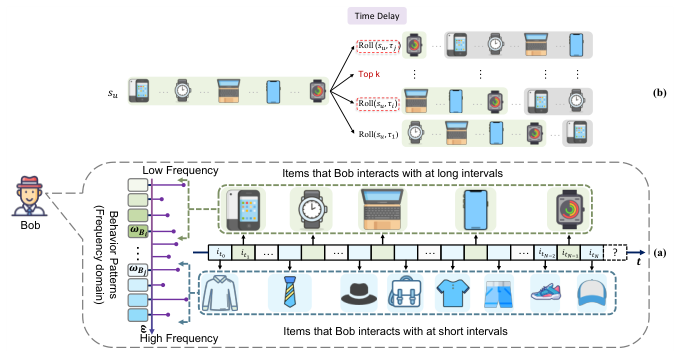
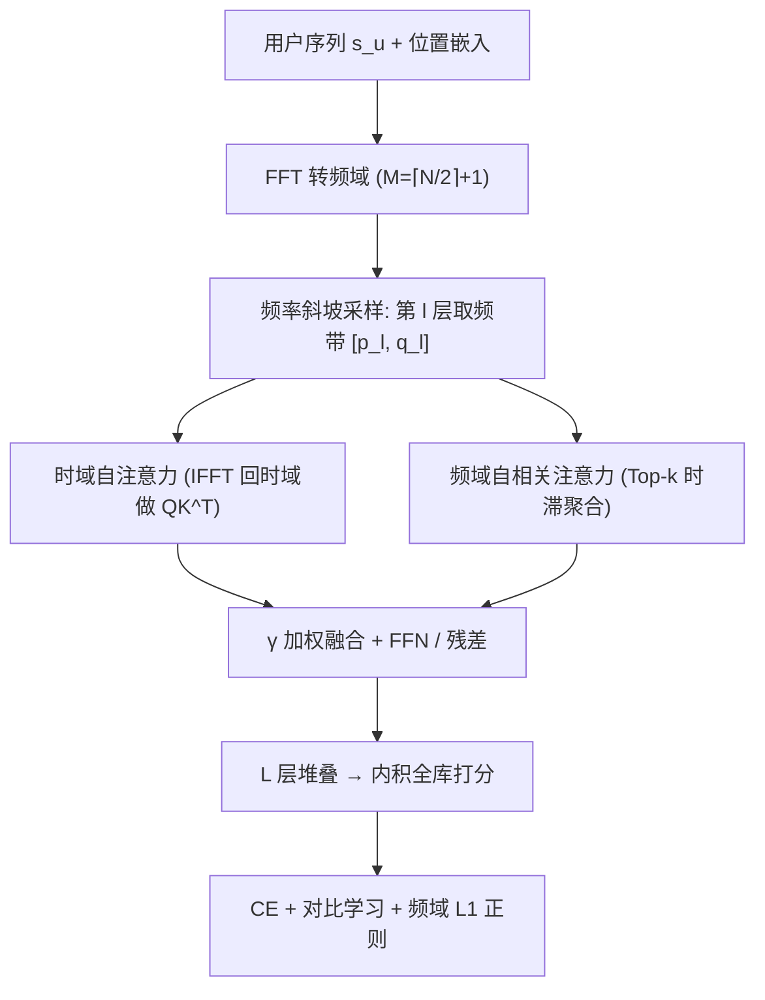
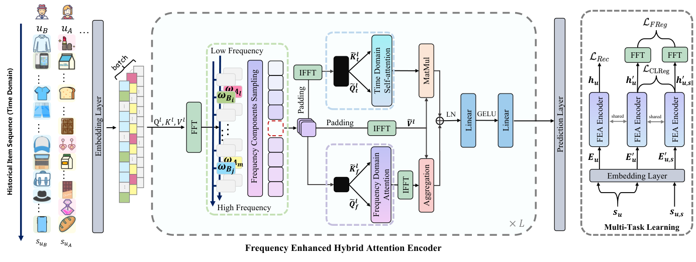

# Frequency Enhanced Hybrid Attention Network for Sequential Recommendation (频率增强混合注意力序列推荐网络)

- **会议/期刊**: SIGIR 2023（第 46 届国际 ACM SIGIR 会议，11 pages）
- **作者与机构**: Xinyu Du, Huanhuan Yuan, Pengpeng Zhao（通讯）, Jianfeng Qu（苏州大学）；Fuzhen Zhuang（北航）；Guanfeng Liu（麦考瑞大学）；Victor S. Sheng（德州理工）
- **推荐链路定位**: 精排（序列编码器，Next-Item 预测）
- **研究方向**: 序列与会话推荐 / 自监督对比学习与交互去噪
- **论文原文**: [https://arxiv.org/abs/2304.09184v3](https://arxiv.org/abs/2304.09184v3)
- **开源代码**: [https://github.com/sudaada/FEARec](https://github.com/sudaada/FEARec)

## TL;DR (1分钟核心速览)

针对 Transformer 类序列推荐器被理论证明为**低通滤波器**（抹除高频短期交互信号）、且难以从时域交织的物品串中辨认**内在周期性**这两大痛点，本文把用户序列经 FFT 搬到频域，提出 FEARec：用「频率斜坡采样」让不同层自适应关注不同频带以修复低通缺陷，并用基于 Wiener-Khinchin 定理的**自相关频域注意力**聚合 top-$k$ 时滞子序列捕捉周期模式，再以对比学习 + 频域 L1 正则对齐双域视图。在 4 个基准上按 Leave-One-Out + Full-Ranking 全库打分，HR@5 相对最强基线 DuoRec 提升 8.28%–10.88%。

## Background & Motivation (背景与核心矛盾)

- **主流范式**: SASRec/BERT4Rec 以多头自注意力编码长程依赖，DuoRec/CL4SRec/CoSeRec 再叠加序列增强 + 对比学习作辅助任务，已成为序列推荐的标配组合。
- **前人局限其一（频谱偏置）**: 自注意力核等价于低通滤波，随层数加深持续衰减高频分量，导致"短周期内高频复购/密集点击"这类局部信号被系统性擦除。LSAN/LOCKER 用卷积支路、局部编码器补高频，但仍在时域打补丁，未触及频谱本身。
- **前人局限其二（周期不可辨）**: 时域中物品按时序交织，直接算整段注意力分数无法暴露"买手机→买手表/笔记本"式的周期行为；FMLP-Rec 虽引入频域全局滤波，但其滤波器对高频一律降权，反而加剧了低通倾向。
- **核心洞察 (Key Insight)**: 如图 1(a)，沿 $\omega$轴分解后，长间隔交互聚在低频、短间隔高频，天然分层；图 1(b) 中构造滞后序列$\mathrm{Roll}(s_u,\tau)$ 后，周期模式在自相关谱上呈现为显著峰值，可被显式识别。
- **本文切入点**: 不修改注意力语义，而是**改造其输入频谱**（分层采样）+ **新增一路序列级周期注意力**（自相关），双域融合。

<figure class="paper-figure" markdown="span">
  <figcaption>图1：我们的动机示意。(a) 通过将序列行为从时域迁移到频域，每个用户的历史物品序列沿 𝜔 轴分解为具有不同频率和周期的多种行为模式。(b) 通过构造 𝑠𝑢 的 𝜏 滞后序列 Roll(𝑠𝑢,𝜏)，借助离散傅里叶变换可以将周期模式与最相似的序列区分开。</figcaption>
</figure>

## Method (核心方法设计)

### 1. 整体框架 (Overall Architecture)

输入用户序列 $s_u$经嵌入层叠加位置嵌入与 LayerNorm 得$H^0$；随后堆叠$L$个 FEA 块，每块内部先做 FFT 并**按层采样一个连续频带**，该频带同时喂给两路并行注意力：时域自注意力（在截断频谱上做 QK 内积，保留局部高频）与频域自相关注意力（在滞后序列上做 top-$k$聚合，捕捉周期），二者按$\gamma$ 加权求和后过 FFN。训练端以交叉熵为主任务，辅以 dropout 双视图对比损失与频域 L1 正则；推理端取末位表示与物品嵌入内积全库排序。

<figure class="paper-figure" markdown="span">
  <figcaption>图2：FEARec 概览。FEARec 通过嵌入层生成带有位置嵌入的物品嵌入，然后堆叠 𝐿 个混合注意力块，从物品级和频率级提取用户偏好。监督对比学习和频域正则化也作为辅助任务应用，以补充主任务。</figcaption>
</figure>

### 2. 关键设计拆解 (Key Designs)

1. **频率斜坡采样 (Frequency Ramp Structure)**：为打破"所有层共享同一低通滤波器"的退化，为第 $l$ 层分配互不重叠的频带，且方向由**高频→低频**（底层抓细节、顶层抓全局演化）：
$p_l = M(1-\alpha)\left(1-\frac{l-1}{L-1}\right),\quad q_l = p_l + \alpha M,\quad \tilde{X}^l = X^l[p_l{:}q_l,:]$其中$M=\lceil N/2\rceil+1$（实信号共轭对称，只需半谱），$\alpha=F/M$为采样比。当$\alpha \le 1/L$时改用均分采样$p_l=M(1-l/L),\,q_l=p_l+M/L$ 保证全谱覆盖。直觉：把"频谱预算"显式分账，等价于给每层配置不同的带通滤波器，低通偏置被结构性抵消。

2. **自相关频域注意力 (Auto-Correlation Attention)**：时域点级注意力无法表达"与自身历史滞后段的相似性"。基于 Wiener-Khinchin 定理，一次 FFT 即可算出全部滞后：
$R_{\tilde{Q}^l_f,\tilde{K}^l_f}(\tau)=\mathcal{F}^{-1}\!\left(\mathrm{Pad}\big(\tilde{Q}^l_f \odot (\tilde{K}^l_f)^{*}\big)\right)$取$k=\lfloor m\log N\rfloor$个峰值的滞后$\{\tau_1,...,\tau_k\}$，softmax 归一化后加权聚合$\tilde{V}^l_{\tau_i}$：$\sum_{i=1}^{k}\tilde{V}^l_{\tau_i}\hat{R}(\tau_i)$。复杂度$O(N\log N)$而非$O(N^2)$的自相关扫描，同时把"周期"变成可微、可聚合的显式算子。两路融合为$\hat{H}^l=\gamma\,\mathrm{MH}_{\text{Time}}+(1-\gamma)\mathrm{MH}_{\text{Freq}}$。

3. **训练目标、负采样与推理效率**：主损失为全库 softmax 交叉熵 $\mathcal{L}_{Rec}=-\sum_i y_i\log\hat{y}_i$；辅助项$\mathcal{L}=\mathcal{L}_{Rec}+\lambda_1\mathcal{L}_{CReg}+\lambda_2\mathcal{L}_{FReg}$，其中$\mathcal{L}_{CReg}$用同一序列两次 dropout 前向得$\mathrm{h}'_u$与同目标语义正样本$\mathrm{h}'_{u,s}$，batch 内其余样本作负例；频域正则$\mathcal{L}_{FReg}=\lVert\mathcal{F}(\mathrm{h}'_u)-\mathcal{F}(\mathrm{h}'_{u,s})\rVert_1$强制两个增强视图的**频谱一致**。无额外负采样器，训练成本主要由 FFT 的$O(N\log N)$主导，$L=2$、$d=64$ 时推理开销与 SASRec 同量级。

## Experimental Setup & Evaluation Protocol (实验设置与评估协议)

- **数据集与预处理**: 三个 Amazon 子集 + MovieLens-1M，均按 **5-core** 过滤（交互少于 5 次的用户/物品剔除），最大序列长度 $N=50$。

| 数据集 | #Users | #Items | #Interactions | 稀疏度/密度 | 特征/场景说明 |
| :--- | :---: | :---: | :---: | :---: | :--- |
| Beauty | 22,363 | 12,101 | 198,502 | 99.93% | 短序列、高稀疏电商评论 |
| Clothing | 39,387 | 23,033 | 278,677 | 99.97% | 最稀疏，平均长度仅 7.1 |
| Sports | 35,598 | 18,357 | 296,337 | 99.95% | 户外运动品，短序列 |
| ML-1M | 6,041 | 3,417 | 999,611 | 95.16% | 稠密长序列（平均 165.5） |

- **数据划分与防穿越 (Splitting Strategy)**: 逐用户 `Leave-One-Out`：末位为测试、倒数第二为验证、其余训练。
- **排名评测协议 (Ranking Protocol)**: 采用无偏 `Full-Ranking (全库未交互物品排序)`，不做负采样（遵循 Krichene & Rendle 的采样指标警示）；指标 HR@{5,10}、NDCG@{5,10}。
- **对比基线与超参设置**: 基线覆盖非序列 (BPR-MF)、RNN/CNN (GRU4Rec, Caser)、Transformer (SASRec, BERT4Rec)、全 MLP 频域 (FMLP-Rec)、对比学习 (CL4SRec, CoSeRec, DuoRec) 三类。嵌入维度 $d=64$、FFN 维度 64、混合块$L=2$、Adam 学习率 0.001、V100 32GB。原文未报告显著性检验的具体$p$ 值。

## Key Experimental Results (实验关键数据)

### 1. 主实验对比 (Main Results)

| 模型 | Beauty HR@5 | Beauty NDCG@5 | Clothing HR@5 | Clothing NDCG@5 | Sports HR@5 | Sports NDCG@5 | ML-1M HR@5 | ML-1M NDCG@5 |
| :--- | :---: | :---: | :---: | :---: | :---: | :---: | :---: | :---: |
| BPR-MF | 0.0120 | 0.0040 | 0.0067 | 0.0052 | 0.0092 | 0.0040 | 0.0078 | 0.0052 |
| GRU4Rec | 0.0164 | 0.0086 | 0.0095 | 0.0061 | 0.0137 | 0.0096 | 0.0763 | 0.0385 |
| SASRec | 0.0365 | 0.0236 | 0.0168 | 0.0091 | 0.0218 | 0.0127 | 0.1087 | 0.0638 |
| BERT4Rec | 0.0193 | 0.0187 | 0.0125 | 0.0075 | 0.0176 | 0.0105 | 0.0733 | 0.0432 |
| FMLP-Rec | 0.0398 | 0.0258 | 0.0173 | 0.0098 | 0.0218 | 0.0144 | 0.1109 | 0.0657 |
| CL4SRec | 0.0401 | 0.0223 | 0.0168 | 0.0090 | 0.0227 | 0.0129 | 0.1147 | 0.0662 |
| CoSeRec | 0.0537 | 0.0361 | 0.0175 | 0.0095 | 0.0287 | 0.0196 | 0.1262 | 0.0761 |
| DuoRec (最强基线) | 0.0546 | 0.0352 | 0.0193 | 0.0113 | 0.0326 | 0.0208 | 0.2038 | 0.1390 |
| **FEARec** | **0.0597** | **0.0366** | **0.0214** | **0.0121** | **0.0353** | **0.0216** | **0.2212** | **0.1523** |
| **Improv.** | +9.34% | +3.97% | +10.88% | +7.08% | +8.28% | +3.85% | +8.54% | +9.57% |

### 2. 消融实验 (Ablation Study)

| 变体 | Beauty HR@5 | Beauty NDCG@5 | Clothing HR@5 | Clothing NDCG@5 | ML-1M HR@5 | ML-1M NDCG@5 |
| :--- | :---: | :---: | :---: | :---: | :---: | :---: |
| FEARec 完整 | **0.0597** | **0.0366** | **0.0208** | **0.0119** | **0.2212** | **0.1523** |
| (a) w/o STD（时域不采样, $\alpha$=1） | 0.0578 | 0.0356 | 0.0214 | 0.0117 | 0.2141 | 0.1482 |
| (b) w/o SFD（频域不采样） | 0.0566 | 0.0348 | 0.0204 | 0.0115 | 0.2134 | 0.1457 |
| (c) w/o TDA（去时域注意力） | 0.0589 | 0.0358 | 0.0203 | 0.0113 | 0.2123 | 0.1441 |
| (d) w/o FDA（去频域注意力） | 0.0590 | 0.0361 | 0.0202 | 0.0116 | 0.2116 | 0.1470 |
| (e) w/o FReg（去频域正则） | 0.0582 | 0.0360 | 0.0208 | 0.0119 | 0.2114 | 0.1433 |
| (f) w/o CReg（去对比损失） | 0.0567 | 0.0342 | 0.0191 | 0.0106 | 0.2028 | 0.1408 |

混合比例敏感性（HR@5，TDA:FDA）: Beauty 在 $\gamma=0.1$最好 (0.0596)、ML-1M 在$\gamma=0.9$最好 (0.2212)；采样比$\alpha$在 Beauty/Clothing 取 0.8、Sports 取 0.6、稠密 ML-1M 需更大$\alpha$。

### 3. 关键实验发现 (Key Findings)

1. **对比学习是最不可省的组件，而非频域模块**：去掉 $\mathcal{L}_{CReg}$ 在 Clothing 掉 7.6%（0.0208→0.0191）、ML-1M 掉 8.3%（0.2212→0.2028），跌幅大于去掉任何频域模块，说明频域改造需靠强自监督信号才能被有效"点亮"。
2. **斜坡采样在稀疏短序列上收益最大**：去掉采样 (b) 在 Beauty 损失 5.2% HR@5，而在 Clothing/Sports 的时域采样消融甚至与完整模型持平/略高（0.0214 vs 0.0208），表明 $\alpha$ 应随序列长度与稠密度自适应，短序列上过度截断频谱反而丢信息。
3. **时域/频域权重与序列长度强负相关**：Amazon 三集在 FDA 主导（$\gamma=0.1$/$0.3$）时最优，ML-1M 则在 TDA 主导（$\gamma=0.9$）时最优（0.2212 vs 0.1863）——长稠密序列的 item-level 共现已足够，周期先验主要补偿稀疏短序列。

## Highlights & Limitations (亮点、对比与审稿批判)

- **与代表作对比 (vs. Prior Work)**: 相比 SASRec/BERT4Rec，本文不换编码器范式而是**改造注意力输入的频谱**，定量修复其低通缺陷；相比 FMLP-Rec 的全局固定滤波，本文用分层可变带通避免"高频一律降权"，在 Beauty 上 HR@5 0.0597 vs 0.0398；相比 DuoRec 仅做时域语义正样本，本文把对比对齐扩展到频域（L1 谱正则），在稠密 ML-1M 上 HR@5 提升 8.54%。
- **可迁移亮点**: ① "半谱 + 共轭对称 + 分层带采样"可作为任何 Transformer 序列模型的即插即用轻量层，仅增 $O(N\log N)$；② 频域 L1 正则是一种极低成本的多视图一致性约束，可替换/补充常见的表征级 InfoNCE。
- **审稿级局限批判**: ① 频域自相关的 top-$k$需按$\lfloor m\log N\rfloor$调参，$m$过大引入无关滞后即掉点，且$\alpha$/$\gamma$在四个数据集上最优值均不同（0.6/0.8、0.1/0.9），实际部署需逐场景网格搜索；② 全部实验为离线 `Leave-One-Out + Full-Ranking`，缺少线上 A/B 与延迟实测，且评测量级普遍偏低（NDCG@5 仅 0.01–0.15），未提供显著性检验$p$ 值；③ 消融表中 Clothing 的 FEARec 完整值 (0.0208) 与主表 (0.0214) 不一致，存在复现口径瑕疵。

## Rating (四维评分)

- **方法创新性 (Novelty)**: ⭐⭐⭐⭐ （"分层频率斜坡 + Wiener-Khinchin 自相关注意力"把信号处理工具真正嵌入注意力算子，而非事后滤波，思路干净且有频谱视角的理论动机）
- **评估协议与实验扎实度 (Protocol & Experiments)**: ⭐⭐⭐⭐ （4 数据集 + 无偏全库排序 + 6 组消融 + 3 组超参敏感性，基线覆盖全面；扣分在缺显著性检验与线上验证）
- **写作与数学规范度 (Clarity & Rigor)**: ⭐⭐⭐⭐ （采样索引、自相关、聚合三处公式定义完整、$O(N\log N)$ 复杂度交代清楚；但频域注意力与 FFT 细节大量下沉至附录，主表数值存在口径不一致）
- **工业落地与复现价值 (Industrial & Practical Value)**: ⭐⭐⭐⭐ （代码已开源，仅 $L=2$、$d=64$、FFT 开销与 SASRec 同级，易插拔；但$\alpha/\gamma/k$ 三处超参需按场景重调，工程调优成本不可忽略）

