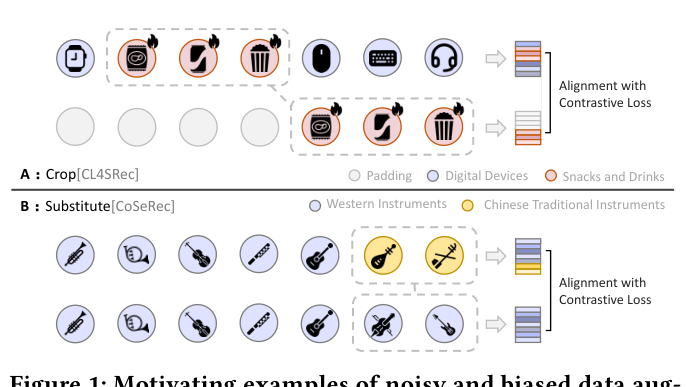
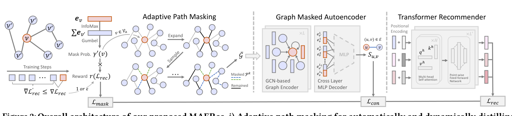
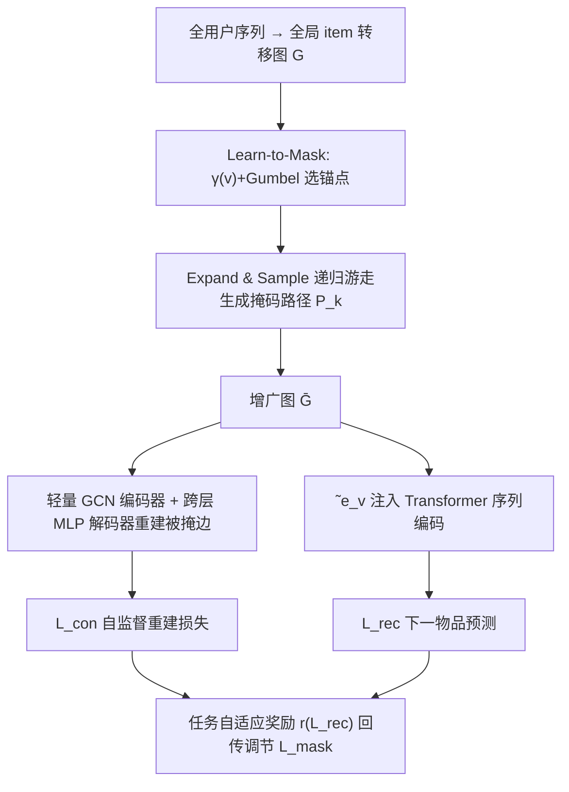

# Graph Masked Autoencoder for Sequential Recommendation (图掩码自编码器增强的序列推荐)

- **会议/期刊**: SIGIR 2023 (Full Paper)
- **作者与机构**: Yaowen Ye, Lianghao Xia, Chao Huang（香港大学 HKUDS）
- **推荐链路定位**: 召回（序列化 Next-Item 预测，端到端训练）
- **研究方向**: 序列与会话推荐 / 自监督对比学习与交互去噪
- **论文原文**: [https://arxiv.org/abs/2305.04619v3](https://arxiv.org/abs/2305.04619v3)
- **开源代码**: [https://github.com/HKUDS/MAERec](https://github.com/HKUDS/MAERec)

## TL;DR (1分钟核心速览)

序列推荐在标签稀缺时表征能力不足，主流 CL4SRec/CoSeRec/DuoRec 依靠**手工构造对比视图**自监督，视图质量不可控且会把曝光偏置、误点击等噪声放大到表征中。本文提出 MAERec：在全局 item 转移图上做**可学习锚点选择 + 长路径掩码**，用轻量 GCN 编码器 + 跨层 MLP 解码器重建被掩路径，并以**任务自适应奖励**调节掩码损失，取代启发式对比增广。三数据集留一法全库排序下，Books/Toys/Retailrocket 的 HR@20 分别达 0.8543/0.7343/0.9218，较最强基线相对提升 10.9%/11.5%/3.0%，且训练耗时仅为 CoSeRec 的 1/19。

## Background & Motivation (背景与核心矛盾)

- **主流范式**: 以 SASRec/BERT4Rec 的 Transformer 或 SRGNN/GCE-GNN/SURGE 的图增强编码器做序列建模，再叠加 InfoNCE 式对比自监督（CL4SRec 的 crop/mask/reorder、CoSeRec 的 substitute/insert、DuoRec 的 dropout 视图）缓解标签稀疏。
- **前人局限**: ①对比视图完全依赖手工启发式，跨数据集/跨序列长度难以稳定迁移；②盲目破坏序列结构会丢弃短序列中本就稀缺的转移信号，且噪声（误点击、流行度偏置）会沿 item-item 连边传播，被对比对齐进一步放大。
- **核心洞察 (Key Insight)**: 图 1 的用户案例显示，crop 会保留"新年促销零食"这类位置偏置噪声而丢掉真实兴趣，substitute 则用热门吉他替换长尾二胡/琵琶——即**增广"该增谁不该增谁"应是可学的、结构级的**，而非随机算子级。
- **本文切入点**: 把"掩码-重建"的生成式自监督搬到全局转移图上，只掩码语义一致性高、任务有用的转移路径，让模型自行学习增广策略。

<figure class="paper-figure" markdown="span">
  <figcaption>图1：现有基于CL的序列推荐器中噪声与有偏数据增强的动机示例。</figcaption>
</figure>

## Method (核心方法设计)

### 1. 整体框架 (Overall Architecture)

MAERec 由三条支路组成：先由所有用户序列按 $|t-t'|\le h$建全局 item 转移图$\mathcal{G}=(\mathcal{V},\mathcal{E})$；自适应路径掩码模块在该图上按语义相关性选出锚点集合$\mathcal{V}_a$，用 Expand–Sample 递归随机游走生成待掩路径$\mathcal{P}_k$，得到增广图$\bar{\mathcal{G}}$；轻量 GCN 编码器对$\bar{\mathcal{G}}$传播、跨层 MLP 解码器重建被掩边，产生自监督损失$\mathcal{L}_{con}$；同时 GCN 各层输出求和得到的 item 表征$\tilde{\mathbf{e}}_v$ 直接作为 Transformer 序列编码器的输入嵌入，主导 Next-Item 预测，两任务以多任务损失联合优化。

<figure class="paper-figure" markdown="span">
  <figcaption>图2：我们提出的MAERec的整体架构。i) 自适应路径掩码，用于自动且动态地蒸馏信息转移模式以进行自监督。ii) 使用轻量级图掩码自编码器重建被掩码的项目转移。iii) 使用Transformer作为主推荐任务中序列编码的主干。</figcaption>
</figure>

### 2. 关键设计拆解 (Key Designs)

1. **可学习锚点选择 (Learning to Mask)**：随机掩码等于把"噪声节点"和"可靠节点"等同对待，本文先用 $k$跳邻居的平均余弦一致性打分$\gamma(v)=\frac{1}{|\mathcal{N}_v^k|}\sum_{v'\in\mathcal{N}_v^k}\frac{\mathbf{e}_v^\top \mathbf{e}_{v'}}{\|\mathbf{e}_v\|\|\mathbf{e}_{v'}\|}$，再注入 Gumbel 噪声$\gamma'(v)=\gamma(v)-\log(-\log \mu)$做无偏采样，取 Top-$\alpha$为锚点。直觉：结构一致性高的节点，其邻域转移模式才是可重建的"真信号"；误点击节点的邻域表征发散，$\gamma$ 低而被排除。

2. **转移路径掩码 (Transition Path Masking)**：掩单点/单边只能提供局部信号，本文以 $\mathcal{P}_k=\mathcal{P}_{k-1}\cup\varphi(\mathcal{N}(\mathcal{P}_{k-1}),p)$从锚点递归 Expand 并按丢弃率$p$采样，得到最大长度$2k$ 的路径掩码。这样重建目标同时包含**跨序列（全局图）与序列内（长程）**转移，且锚点位置在序列中随机分布，天然为短/长期兴趣提供不同尺度的自监督。

3. **图自编码器重建 + 任务自适应正则**：编码器去掉变换与激活（$\mathbf{e}_v^{l+1}=\mathbf{e}_v^{l}+\sum_{v'\in\mathcal{N}_v}\mathbf{e}_{v'}^{l}$，跨层求和缓解过平滑），解码器用跨层 MLP 构造边表征$\mathbf{e}_{v,v'}=\|_{i,j=1}^{L}\mathbf{e}_v^{i}\odot \mathbf{e}_{v'}^{j}$；重建损失为对被掩边集合的 softmax 判别$\mathcal{L}_{con}=-\sum_{(v,v')\in\mathcal{E}\setminus\mathcal{P}_k}\log\frac{\exp(s_{v,v'})}{\sum_{v''}\exp(s_{v,v''})}$。关键增量是掩码损失被奖励项加权：$\mathcal{L}_{mask}=-r(\mathcal{L}_{rec})\sum_{v\in\mathcal{V}}\gamma'(v)$，其中$r(\cdot)=1$当当前步$\nabla\mathcal{L}_{rec}$下降快于近$\delta$步均值、否则取小常数$\epsilon$——即只有"对推荐真正有用"的掩码才被奖励，避免重建任务无关信息。理论上（式 16）$\|\partial\mathcal{L}_{mask}(v)/\partial \mathbf{e}_v\|$ 与邻域相似度成反比，噪声节点自动获得更大梯度而被优先掩掉。

**训练目标与开销**：$\mathcal{L}=\mathcal{L}_{rec}+\mathcal{L}_{mask}+\mathcal{L}_{con}+\lambda\|\Theta\|_F^2$，主任务对所有前缀子序列做二元交叉熵并每步采 1 个随机负例，重建任务用负边采样加速；锚点集每 10 个 epoch 重采一次。单卡 RTX 3090 上 Books 训练 1.12h（CoSeRec 需 21.01h），约 10 epoch 收敛，推理仅需 Transformer 前向，无对比视图开销。

## Experimental Setup & Evaluation Protocol (实验设置与评估协议)

| 数据集 | #Users | #Items | #Interactions | 稀疏度/密度 | 特征/场景说明 |
| :--- | :---: | :---: | :---: | :---: | :--- |
| Amazon Books | 93,403 | 54,756 | 506,637 | 9.94e-5 | 图书，长尾严重 |
| Amazon Toys | 116,429 | 54,784 | 478,460 | 7.50e-5 | 玩具，平均序列最短 (4.11) |
| Retailrocket | 91,655 | 43,886 | 452,546 | 1.12e-4 | 电商行为流，密度最高 |

- **数据划分与防穿越**: 沿用 [35,40] 预处理构建用户序列，采用 **Leave-One-Out**：每条序列最后一个交互为测试目标，前置最后一个为验证。
- **排名评测协议**: 以 HR@K / NDCG@K（K=5,10,20）度量，按序列推荐惯例为 **全库排序（1 正例 vs 全部未交互物品）**；原文未额外声明采样候选集。
- **对比基线与超参**: 13 个基线覆盖 RNN（GRU4Rec、NARM）、Transformer（SASRec、BERT4Rec）、GNN（SRGNN、GCE-GNN、HyRec、SURGE）、SSL（ContraRec、CL4SRec、CoSeRec、DuoRec、ICLRec）。Adam，lr=1e-3，batch=256，GNN 层 $L\in\{1,2,3\}$，Transformer 2 层 4 头，锚点数$\alpha\in\{50,100,200,400\}$，路径尺度$k\in\{3,5,7\}$，并提供$p<0.05$显著性检验（表 2 报$p$ 值）。

## Key Experimental Results (实验关键数据)

### 1. 主实验对比 (Main Results)

| 数据集 | Books HR@10 | Books NDCG@10 | Books HR@20 | Toys HR@10 | Toys NDCG@10 | Toys HR@20 | Retail HR@10 | Retail NDCG@10 | Retail HR@20 |
| :--- | :---: | :---: | :---: | :---: | :---: | :---: | :---: | :---: | :---: |
| SASRec | 0.4393 | 0.3058 | 0.5407 | 0.3299 | 0.2155 | 0.4333 | 0.6968 | 0.5389 | 0.7687 |
| BERT4Rec | 0.6238 | 0.4681 | 0.7121 | 0.4665 | 0.3191 | 0.5780 | 0.8084 | 0.7039 | 0.8577 |
| GCE-GNN | 0.5033 | 0.3484 | 0.6090 | 0.3628 | 0.2211 | 0.4952 | 0.5182 | 0.3676 | 0.6275 |
| SURGE | 0.6193 | 0.4068 | 0.7604 | 0.4210 | 0.2596 | 0.5752 | 0.7857 | 0.6151 | 0.8581 |
| CL4SRec | 0.6144 | 0.4310 | 0.7216 | 0.4417 | 0.3007 | 0.5638 | 0.7336 | 0.5969 | 0.8018 |
| CoSeRec | 0.6666 | 0.4858 | 0.7622 | 0.4925 | 0.3280 | 0.6135 | 0.8530 | 0.7269 | 0.8951 |
| DuoRec | 0.6830 | 0.5182 | 0.7706 | 0.5424 | 0.3777 | 0.6583 | 0.8291 | 0.7264 | 0.8703 |
| ICLRec | 0.6172 | 0.4458 | 0.7141 | 0.4416 | 0.2971 | 0.5652 | 0.8282 | 0.7055 | 0.8733 |
| **MAERec** | **0.7533** | **0.5545** | **0.8543** | **0.6033** | **0.4093** | **0.7343** | **0.8959** | **0.7784** | **0.9218** |
| Improv.% | +10.29% | +7.00% | +10.86% | +11.23% | +8.37% | +11.55% | +5.03% | +7.09% | +2.98% |

（$p$值 1e-8 ~ 1e-4，Books/Toys 的 HR@20 上 Toys$p=8e-2$ 属该列唯一未达 0.05 的例外。）

### 2. 消融实验 (Ablation Study)

| 变体 | Books HR@10 | Books NDCG@10 | Retail HR@10 | Retail NDCG@10 | 说明 |
| :--- | :---: | :---: | :---: | :---: | :--- |
| -L2M | 0.7482 | 0.5510 | 0.8800 | 0.7547 | 可学掩码退化为同比例随机掩码 |
| -PA | 0.7272 | 0.5239 | 0.8590 | 0.7056 | 路径掩码退化为单点掩码 ($k=1$) |
| -TA | 0.7507 | 0.5542 | 0.8801 | 0.7564 | 移除任务自适应奖励 $r(\cdot)$ |
| **MAERec** | **0.7723** | **0.5720** | **0.8921** | **0.7659** | 完整模型 |

### 3. 关键实验发现 (Key Findings)

- **路径掩码是最大功臣**：把 $k$ 退化为 1（-PA）在 Books 上 HR@10 掉 5.8%、Retail 上 NDCG@10 掉 7.9%，说明收益不来自"掩码"本身，而来自**跨越序列内/外的长程转移路径**重建；随机掩码（-L2M）也掉 3.1%，证明锚点选择的可学性直接决定增广质量。
- **鲁棒性来自自适应选择而非更多增广**：在 5%–35% 随机替换噪声下，MAERec 的 HR@20 绝对值与**下降比例**双低（CoSeRec 波动最大）；序列长度分桶 $[3,5)$ 的短序列上领先幅度最大，表明全局转移图把长序列知识迁移给了稀疏短序列用户。
- **效率反常识地更优**：Books 上训练 1.12h vs CoSeRec 21.01h、ICLRec 5.28h，且 5–10 epoch 即收敛——因为重建任务提供了比 InfoNCE 更密集的监督信号，无需长轮次对比对齐；超参 $p=0.5$、$k=5$、$\alpha$ 取中值附近最稳。

## Highlights & Limitations (亮点、对比与审稿批判)

- **与代表作对比 (vs. Prior Work)**: 与 CL4SRec/CoSeRec 的本质区别在于把它们"算子级手工扰动 + InfoNCE 拉近视图"替换为"结构级可学掩码 + 生成式重建"；与 GraphMAE/S2GAE 的区别是掩码对象从节点/边升级为**任务自适应选择的高阶路径**，并显式接入下游序列编码主干；与 BERT4Rec 的 Cloze 相比，掩码发生在全局图而非单条序列内，可获得跨用户转移知识。
- **可迁移亮点**: ①"梯度下降速率作为增广奖励" $r(\mathcal{L}_{rec})$是一种极廉价的自监督任务加权手段，可直接搬到多任务/多视图训练中；②用 GCN 跨层求和后的$\tilde{\mathbf{e}}_v$ 同时喂给重建任务与 Transformer 嵌入，实现了图结构与序列建模的零额外参数耦合。
- **审稿级局限批判**: ①**评测协议薄弱**——仅 Leave-One-Out 单目标、未报告采样排序设置与冷启动划分，也未给出方差/多次随机种子，$p$值在 Toys HR@20 上并未达显著（$p=8e-2$）；②**全局图构建未声明复杂度**：$h$跳建边在工业级物品库（千万级）上会产生稠密图，Alpha 每 10 epoch 重采虽省时，但 GCN 全图传播在大规模场景的显存与延迟成本未见分析；③奖励项$r(\cdot)$依赖$\delta,\epsilon$ 两个未做敏感性分析的超参，存在调参风险。

## Rating (四维评分)

- **方法创新性 (Novelty)**: ⭐⭐⭐⭐ （用可学路径掩码 + 任务自适应奖励取代启发式对比增广，思路清晰且给出式 16 的梯度模长理论解释，但"掩码重建"框架本身并非全新）
- **评估协议与实验扎实度 (Protocol & Experiments)**: ⭐⭐⭐ （三数据集 + 13 基线 + 噪声/稀疏/收敛/超参分析齐全，但仅 Leave-One-Out 单一划分、无种子方差、部分 $p$ 值不显著）
- **写作与数学规范度 (Clarity & Rigor)**: ⭐⭐⭐⭐ （三模块与损失定义完整、符号统一，式 9 的 $\|$与$\odot$ 记号略有混淆，复杂度分析缺失）
- **工业落地与复现价值 (Industrial & Practical Value)**: ⭐⭐⭐⭐⭐ （代码开源、训练比主流 SSL 方法快一个数量级、推理零额外开销，掩码增广策略可直接插入现有序列召回链路）

