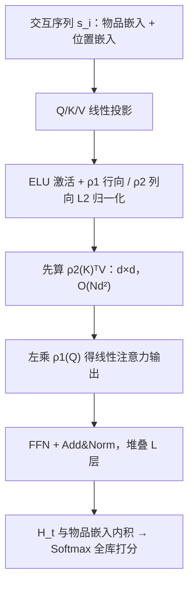
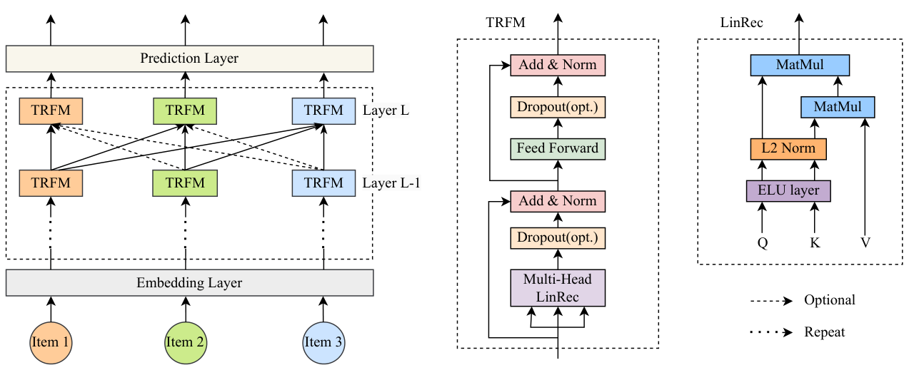

# LinRec: Linear Attention Mechanism for Long-term Sequential Recommender Systems (面向长序列推荐系统的线性注意力机制)

- **会议/期刊**: SIGIR 2023 (46th International ACM SIGIR Conference)
- **作者与机构**: Langming Liu, Xiangyu Zhao (通讯), Jingtong Gao 等 — 香港城市大学、蚂蚁集团、哈工大、港理工、联想 AI Lab 等
- **推荐链路定位**: 精排（序列编码器内部注意力层，可即插即用替换 SASRec/BERT4Rec 的自注意力）
- **研究方向**: 序列与会话推荐 / 高效 Transformer
- **论文原文**: [https://arxiv.org/abs/2411.01537v1](https://arxiv.org/abs/2411.01537v1)
- **开源代码**: [https://github.com/Applied-Machine-Learning-Lab/LinRec](https://github.com/Applied-Machine-Learning-Lab/LinRec)

## TL;DR (1分钟核心速览)

长序列推荐（$N\gg d$）中，点积注意力需先构造$N\times N$注意力矩阵，复杂度$O(N^2 d)$，显存与耗时随序列长度爆炸。LinRec 指出：只要映射函数满足"行和$\le 1$、元素非负"两条等价条件，就能把$\mathrm{softmax}(\boldsymbol{Q}\boldsymbol{K}^{\top})$拆成$\rho_1(\boldsymbol{Q})\rho_2(\boldsymbol{K})^{\top}$，先算$\boldsymbol{K}^{\top}\boldsymbol{V}$即可降为$O(Nd^2)\approx O(N)$。作者用 **ELU + 行向 L2 归一化$Q$、列向 L2 归一化$K$** 实现该映射，无需额外参数。在 ML-1M / Gowalla 上、Leave-One-Out + Full-Ranking 协议下，LinRec 增强的 SASRec/BERT4Rec/CORE/FDSA 全面持平或超越原骨干（ML-1M 对 LT/EA 提升 7.1%–28.0%），同时 ML-1M 上 SASRec 显存 21.07GB→8.72GB、训练 121s→44s。

## Background & Motivation (背景与核心矛盾)

- **主流范式**: SASRec / BERT4Rec / FDSA / CORE 均以多头点积自注意力为核心，靠 $N\times N$ 注意力矩阵区分历史物品重要度。
- **前人局限**: ① 长序列下 $O(N^2d)$ 的时间与显存不可承受；② 已有高效注意力（Linformer 低秩投影、Linear Transformer 核重排、Big Bird 稀疏模式）在推荐场景要么引入额外投影步与超参，要么破坏注意力原有性质，**精度与稳定性双降**。
- **核心洞察 (Key Insight)**: Softmax 之后的注意力矩阵具备两条本质性质——行归一化（每行和为 1）与非负性。若找到 $\rho_1,\rho_2$使$\rho_1(\boldsymbol{Q})\rho_2(\boldsymbol{K})^{\top}$仍满足这两条（松弛为"和$\le 1$"），则注意力语义不变而计算可交换顺序；且 Softmax 的指数会把权重堆到少数位置（长尾注意力），丢弃长序列远端信息，**平滑映射反而有利于长序列**。
- **本文切入点**: 用 L2 归一化（Cauchy–Schwarz 保证行和 $\le 1$）+ ELU（保证非负且避免 ReLU 零梯度与硬截断）构造可分解映射，实现"零额外参数、零额外步骤"的线性注意力替换。

## Method (核心方法设计)

### 1. 整体框架 (Overall Architecture)

输入用户交互序列 $s_i$，物品 ID 嵌入与位置嵌入相加得$\boldsymbol{E}$；经$L$层 Transformer，每层的多头自注意力被替换为 LinRec 头：$Q/K/V$线性投影 → ELU 激活 → 对$Q$逐行、对$K$逐列做 L2 归一化 → **先计算$(\rho_2(\mathrm{elu}(\boldsymbol{K})))^{\top}\boldsymbol{V}$（$d\times d$）再左乘$\rho_1(\mathrm{elu}(\boldsymbol{Q}))$** → 接 FFN 与 Add&Norm；末层取第$t$个位置表示$\boldsymbol{H}_t$ 与物品嵌入内积、Softmax 得下一物品分布，交叉熵训练。整个替换只发生在注意力算子内部，骨干其余结构、超参与训练流程完全不变，可无缝迁移到任意 Transformer 推荐器。

<figure class="paper-figure" markdown="span">
  <figcaption>图2：所提模型的整体架构。</figcaption>
</figure>

### 2. 关键设计拆解 (Key Designs)

1. **等价条件驱动的可分解注意力（LinRec 核心算子）**：痛点在于 $\rho(\boldsymbol{Q}\boldsymbol{K}^{\top})\boldsymbol{V}\neq\rho(\boldsymbol{Q})\rho(\boldsymbol{K}^{\top})\boldsymbol{V}$，必须先算$N\times N$ 矩阵。本文改成
$\boldsymbol{A}'=\rho_1(\mathrm{elu}(\boldsymbol{Q}))\left(\rho_2(\mathrm{elu}(\boldsymbol{K}))^{\top}\boldsymbol{V}\right)$，
其中 $\rho_1(\boldsymbol{Q}_i)=\frac{1}{\sqrt{d}\|\boldsymbol{Q}_i\|_2}\boldsymbol{Q}_i$（行向）、$\rho_2(\boldsymbol{K}_j)=\frac{1}{\sqrt{N}\|\boldsymbol{K}_j\|_2}\boldsymbol{K}_j$（列向）。直觉：由 Cauchy–Schwarz 得$\sum_j Q_{ij}\le\sqrt{d}\|\boldsymbol{Q}_i\|_2$，故注意力行和$\le 1$，天然满足归一化；$\sqrt{N}$缩放使列向同理，两侧缩放系数互相抵消了传统$1/\sqrt{d}$ 温度项。ELU 而非 ReLU，是因为 ReLU 的硬截零既丢信息又引发零梯度不稳定，ELU 在负区平滑压缩，保留符号鲁棒性。

2. **统计视角解释（为何共享参数也有效）**：把注意力视为概率事件，$\Pr(A_{ik})=\sum_{j=1}^{d}\Pr(B_{ij})\Pr(A_{ik}|B_{ij})=\sum_j Q^{\rho}_{ij}K^{\rho}_{kj}$，即$d$个潜在因子子事件的加权。关键性质是$\Pr(A_{i_1k}|B_{i_1j})=\Pr(A_{i_2k}|B_{i_2j})=K^{\rho}_{kj}$，**条件概率在所有 query 间共享**——这解释了为何 LinRec 无需额外参数即可表达注意力，也解释了其近似低秩本质（秩$\le d$）。

3. **训练目标、负采样与推理效率**：损失为下一物品交叉熵 $\mathcal{L}=-\sum_i y_i\log\hat{y}_i$（$\hat{y}_i=\frac{\exp(z_i)}{\sum_{v_j\in\mathcal{V}}\exp(z_j)}$），**全库 Softmax、不做负采样**；Adam 优化，$d=128/64$，层数$L=2$、头数$h=8$、FNN 256，ML-1M/Gowalla 最大序列长$N=200/100$，短序列零填充以保证$N>d$，早停 10 轮。复杂度：ELU 与 L2 归一化各$O(Nd)$，矩阵乘$O(Nd^2)$，总$O(Nd^2)\approx O(N)$；线上只需替换注意力 kernel，无额外投影矩阵与缓存开销。

## Experimental Setup & Evaluation Protocol (实验设置与评估协议)

- **数据集与预处理**:

| 数据集 | #Users | #Items | #Interactions | 稀疏度 | 特征/场景说明 |
| :--- | :---: | :---: | :---: | :---: | :--- |
| ML-1M | 6,041 | 3,884 | 1,000,209 | 95.74% | 电影评分，序列相对密集 |
| Gowalla | 64,116 | 164,533 | 2,018,421 | 99.98% | SNAP 签到，极稀疏、长尾重 |

- **数据划分与防穿越**: 按用户交互**时间戳排序**后 `Leave-One-Out`：倒数第 3 个作测试、倒数第 2 个作验证、其余训练（防止未来交互泄漏）。
- **排名评测协议**: RecBole 默认 **Full-Ranking（全库未交互物品排序）**，非采样排序，指标 Recall@10 / MRR / NDCG@10；显著性用双侧 $t$-test（$p<0.05$），除 SASRec 的 Recall 外全部显著。
- **对比基线与超参**: 传统注意力骨干 BERT4Rec、CORE、FDSA、SASRec、SASRecF；高效注意力 LT (Linear Transformer)+SASRec、EA (Efficient Attention)+SASRec。所有骨干统一 $d$、$L=2$、$h=8$、FNN 256，相同优化器与早停策略，保证对照公平。

## Key Experimental Results (实验关键数据)

### 1. 主实验对比 (Main Results)

| 模型 (ML-1M / Gowalla) | ML Recall@10 | ML MRR | ML NDCG@10 | GW Recall@10 | GW MRR | GW NDCG@10 |
| :--- | :---: | :---: | :---: | :---: | :---: | :---: |
| BERT4Rec (原) | 0.6975 | 0.3700 | 0.4483 | 0.8717 | 0.5886 | 0.6567 |
| FDSA (原) | 0.7166 | 0.4272 | 0.4964 | 0.8981 | 0.6247 | 0.6907 |
| SASRec (原) | 0.7212 | 0.4282 | 0.4974 | 0.9174 | 0.6690 | 0.7293 |
| SASRecF (原) | 0.7099 | 0.4230 | 0.4921 | 0.9077 | 0.6179 | 0.6880 |
| CORE (原) | 0.5406 | 0.2051 | 0.2835 | 0.9190 | 0.6948 | 0.7492 |
| LT+SASRec | 0.6575 | 0.3359 | 0.4124 | 0.9113 | 0.6627 | 0.7230 |
| EA+SASRec | 0.6873 | 0.4094 | 0.4760 | 0.9139 | 0.6577 | 0.7198 |
| **LinRec+SASRec** | **0.7209** | **0.4301** | **0.4997** | 0.9171 | 0.6723 | 0.7317 |
| **LinRec+CORE** | 0.6088 | 0.2792 | 0.3570 | **0.9242** | **0.7031** | **0.7569** |
| Improv. (vs LT/EA) | +7.1%~9.6% | +9.6%~28.0% | +8.8%~21.7% | +0.4%~0.6% | +1.4%~2.2% | +1.2%~1.6% |

### 2. 消融与效率实验 (Ablation & Efficiency)

| 变体 / 模型 | Recall@10 | MRR | NDCG@10 | 说明 |
| :--- | :---: | :---: | :---: | :--- |
| w/o L2 norm | 0.8796 | 0.5336 | 0.6168 | 仅 ELU，去掉归一化 |
| w/o ELU | 0.8878 | 0.6106 | 0.6776 | 仅 L2，去掉激活 |
| **LinRec+SASRec** | **0.9171** | **0.6723** | **0.7317** | Gowalla 完整模型 |
| SASRec (ML-1M) | — | — | 21.07GB / 121s (train) | $O(N^2)$ 基线 |
| LinRec+SASRec (ML-1M) | — | — | **8.72GB / 44s** | 显存与耗时降至约 1/3 |
| BERT4Rec (ML-1M) | — | — | 20.74GB→**10.42GB**，246s→**157s** | 骨干无关的通用加速 |

### 3. 关键实验发现 (Key Findings)

1. **LinRec 与骨干正交、可叠加增益**：同一注意力替换在四类骨架上均不降点，最戏剧性的是 CORE（ML-1M Recall 0.5406→0.6088，+12.6%；NDCG 0.2835→0.3570，+25.9%）——原本过度依赖少数位置、被 Softmax 长尾压制的弱骨干，在"平滑注意力"下收益最大，说明增益来自信息覆盖而非参数容量。
2. **"满足等价条件"比"更高效"更关键**：LT/EA 在 ML-1M 上把 SASRec 的 Recall 从 0.7212 拉低到 0.6575/0.6873，属负迁移；而 LinRec 在 Recall 持平的同时 NDCG 反超（0.4997 vs 0.4974），证明破坏注意力归一化/非负性质才是高效注意力在推荐上掉点的根因。
3. **归一化是命门，激活是补丁**：消融中 w/o L2 norm 使 Gowalla NDCG 从 0.7317 掉到 0.6168（−15.7%），w/o ELU 掉到 0.6776（−7.4%）；效率侧 ML-1M 显存 21.07→8.72GB、训练 121→44s，但 Gowalla 仅 112→90s，说明加速收益强依赖 $N/d$ 量级。

## Highlights & Limitations (亮点、对比与审稿批判)

- **与代表作对比 (vs. Prior Work)**: 相比 Linformer 需对 $K$ 做低秩投影（引入额外参数与精度损失），LinRec 零参数、零额外步骤；相比 Linear Transformer 的核重排（ELU+1 后归一化在分母），LinRec 显式用行/列 L2 构造归一化与非负的**可证明等价条件**；相比 Big Bird 的稀疏模式，LinRec 不丢位置、保留全序列信息。
- **可迁移亮点**: ①"等价条件 + 松弛"的推导范式可直接用于设计其他任务的高效注意力；②统计视角下的 $\Pr(A_{ik})=\sum_j\Pr(B_{ij})\Pr(A_{ik}|B_{ij})$ 分解，可作为注意力可解释性与低秩压缩的通用分析工具。
- **审稿级局限批判**: ① 实验仅 ML-1M/Gowalla 两个中等数据集、$N$最大仅 200，与"$N\gg d$的长序列"设定有偏差，Gowalla 上加速比仅 1.24× 也印证$N/d$ 不足时收益有限，缺少百万级序列或工业 A/B 验证；② 等价条件被"松弛"为和一个上界，缺乏近似误差界与收敛性分析，且 ELU 输出的注意力分布既非行和为 1 也非严格概率，理论上不再是原 Softmax 的一致估计；③ 高效注意力基线只对比 LT 与 EA，未涉及 cosFormer、Performer、Nyströmformer 等更强线性注意力。

## Rating (四维评分)

- **方法创新性 (Novelty)**: ⭐⭐⭐⭐ （从注意力等价条件反推映射设计，并用 Cauchy–Schwarz 与贝叶斯子事件分解给出双重理论支撑，思路干净且有普适性）
- **评估协议与实验扎实度 (Protocol & Experiments)**: ⭐⭐⭐ （Full-Ranking + Leave-One-Out + 显著性检验规范，骨干与高效注意力双线对比完整，但仅两个数据集、序列长度偏短）
- **写作与数学规范度 (Clarity & Rigor)**: ⭐⭐⭐⭐ （条件推导链条清晰、复杂度分析到位，附录统计解释有洞见；不足是松弛后的近似误差未量化）
- **工业落地与复现价值 (Industrial & Practical Value)**: ⭐⭐⭐⭐⭐ （代码已开源、基于 RecBole 可一行替换注意力层，ML-1M 显存/耗时降至 1/3，对长行为序列在线服务直接可用）

