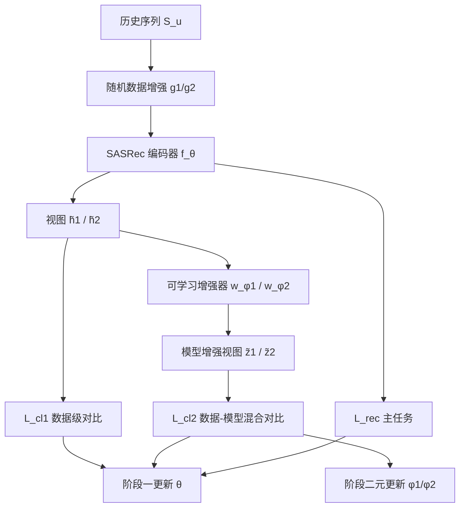
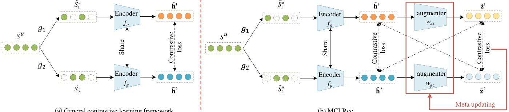
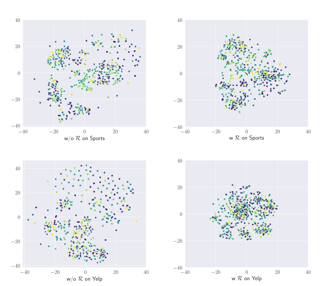

# Meta-optimized Contrastive Learning for Sequential Recommendation (面向序列推荐的元优化对比学习)

- **会议/期刊**: SIGIR 2023
- **作者与机构**: Xiuyuan Qin、Huanhuan Yuan、Pengpeng Zhao 等（苏州大学；北航；麦考瑞大学；德州理工）
- **推荐链路定位**: 召回（序列 Next-Item 建模）
- **研究方向**: 序列与会话推荐 / 自监督对比学习
- **论文原文**: [论文原文链接](https://arxiv.org/abs/2304.07763v5)
- **开源代码**: [开源代码仓库链接](https://github.com/QinHsiu/MCLRec)

## TL;DR

现有基于对比学习的序列推荐几乎全部依赖"手工随机"的数据增强（crop/mask/reorder）或模型增强（dropout）来构造对比对，操作不可学习，无法跨数据集泛化；且为抵消输入不足导致的表示坍缩往往被迫加大 batch。本文提出 MCLRec：在随机数据增强之上叠加两个**可学习 MLP 增强器**，再用**两阶段元学习**让增强器按编码器表现自适应更新，并以**对比正则化项**拉开正负对相似度间隔。在 Amazon-Sports/Beauty、Yelp 上采用 Leave-One-Out + Full-Ranking 评估，HR@20/NDCG@20 相对最强基线 DuoRec 提升 **2.47%–8.41%**，且 batch=64 时仍优于全部基线在 batch=256 的结果。

## Background & Motivation

- **主流范式**: CL4SRec、CoSeRec（数据级 mask/crop/reorder）、DuoRec（dropout 模型级）、SRMA/LMA4Rec（多种模型增强+数据增强）把 InfoNCE 作为辅助任务，靠最大化同序列增强视图一致性来抗稀疏。
- **前人局限**: (1) 增强算子**手工指定且随机采样**，不同数据集的最优增强操作差异大，难以自适应；(2) 编码器面对小 batch 易学出**坍缩表示**，现有方法靠加大 batch/memory bank 弥补，但并非所有对比对都足够 informative。
- **核心洞察 (Key Insight)**: 数据增强后的视图 $\tilde{h}_1,\tilde{h}_2$ 中仍隐藏着未被挖掘的判别信息，可以用**另一组可学习函数**将其变换到更具区分度的空间，而变换函数本身可借助编码器反馈做元优化。
- **本文切入点**: 数据增强负责"制造差异"，可学习模型增强负责"放大差异"，元学习负责"筛选差异"。

## Method (核心方法设计)

### 1. 整体框架 (Overall Architecture)

输入用户序列 $S_u$经两次随机数据增强得$\tilde{S}_u^1,\tilde{S}_u^2$，SASRec 编码器输出去噪视图$\tilde{h}_1,\tilde{h}_2$；二者再各自通过**参数独立的 3 层 MLP 增强器**$w_{\phi_1},w_{\phi_2}$生成模型增强视图$\tilde{z}_1,\tilde{z}_2$。训练分两阶段交替：阶段一以推荐损失 + 两类对比损失 + 正则项更新编码器$\theta$；阶段二冻结$\theta$后仅以$\mathcal{L}_{cl2}+\gamma\mathcal{R}$更新$\phi_1,\phi_2$。推理时**增强器与对比损失全部丢弃**，仅保留编码器，开销与 SASRec 同阶。

<figure class="paper-figure" markdown="span">
  <figcaption>图 1：通用对比学习框架 (a) 与 MCLRec (b) 对比。在通用对比学习中，所应用的数据增强操作被随机选择，生成的增强视图直接相互对比。在 MCLRec 中，我们利用可学习增强器生成两个额外的模型增强视图用于对比学习，并以元优化方式利用对比损失指导这些增强器的训练。</figcaption>
</figure>

### 2. 关键设计拆解 (Key Designs)

1. **可学习模型增强器 (Learnable Model Augmenter)**：痛点在于 dropout 等模型增强的随机性既不可微也不可调 —— 改为两条 MLP 通路 $\tilde{z}_1=w_{\phi_1}(\tilde{h}_1)$、$\tilde{z}_2=w_{\phi_2}(\tilde{h}_2)$，参数量仅$O(d^2)$ 但可端到端求导，且参数共享实验（变体 E）证明**必须独立**才能保证两视图差异度，否则性能下降。

2. **两阶段元优化 (Meta-Optimized Updating)**：编码器目标是判别准确、增强器目标是对比可分，两者存在梯度冲突，联合训练易陷入次优。阶段一损失 $\mathcal{L}_0=\mathcal{L}_{rec}+\lambda\mathcal{L}_{cl1}+\beta\mathcal{L}_{cl2}+\gamma\mathcal{R}$；阶段二用更新后的$\theta'$重编码再算：$\mathcal{L}_1=\mathcal{L}_{cl2}+\gamma\mathcal{R}\ (\text{仅对 }\phi_{1},\phi_{2}\text{ 求导})$。$\mathcal{L}_{cl2}=\mathcal{L}_{con}(\tilde{z}_1,\tilde{z}_2)+\mathcal{L}_{con}(\tilde{h}_1,\tilde{z}_2)+\mathcal{L}_{con}(\tilde{h}_2,\tilde{z}_1)$引入"跨层"正对，等价于**免负采样的样本内扩增**（负样本直接复用 batch 内其它序列的$2(|B|-1)+2(|B|-1)$ 个视图）。

3. **对比正则化 (Contrastive Regularization)**：仅用 InfoNCE 时正负相似度分布会有交叠导致视图坍缩。设正/负相似度得分集合 $\sigma^+,\sigma^-$，取$\sigma^+$最小值与$\sigma^-$最大值$o_{min},o_{max}$，则
   $\mathcal{R}=\frac{1}{|\sigma^+|}\sum[\sigma^{+}-o_{min}]_++\frac{1}{|\sigma^-|}\sum[o_{max}-\sigma^{-}]_+$。
   作用机制是给正负对相似度**留硬间隔 (margin)**，使得 T-SNE（图 2）上正对更紧、负对更散，从物理上限制增强器输出退化。

## Experimental Setup & Evaluation Protocol

- **数据集与预处理**（5-core 过滤，与 CoSeRec/DuoRec 一致）：

| 数据集 | #Users | #Items | #Interactions | 稀疏度 | 场景 |
| :--- | :---: | :---: | :---: | :---: | :--- |
| Sports | 35,598 | 18,357 | 296,337 | 99.95% | Amazon 电商评论 |
| Beauty | 22,363 | 12,101 | 198,502 | 99.93% | Amazon 电商评论 |
| Yelp | 30,431 | 20,033 | 316,354 | 99.95% | 本地商家 |

- **数据划分**: `Leave-One-Out`（最后一行为测试、倒数第二行为验证，其余为训练）。
- **排名评测协议**: **无偏 Full-Ranking（全库未交互物品排序，无负采样）**，report HR@{5,10,20} 与 NDCG@{5,10,20}。
- **对比基线与超参**: 基线 13 个，覆盖 BPR、GRU4Rec、Caser、SASRec、BERT4Rec、S³-Rec_MIP、CL4SRec、CoSeRec、LMA4Rec、ICLRec、DuoRec、SRMA。编码器为 2 层 self-attention（2 heads），$d=64$，序列长$\le 50$，Adam，$lr=0.001$，batch=256，增强器为 3 层 MLP，$\gamma=0.1\beta$，早停于验证集。

## Key Experimental Results

### 1. 主实验对比 (Main Results，HR@20 / NDCG@20，粗体最优)

| Model | Sports HR | Sports NDCG | Beauty HR | Beauty NDCG | Yelp HR | Yelp NDCG |
| :--- | :---: | :---: | :---: | :---: | :---: | :---: |
| SASRec | 0.0500 | 0.0224 | 0.0894 | 0.0386 | 0.0443 | 0.0179 |
| BERT4Rec | 0.0604 | 0.0251 | 0.0984 | 0.0391 | 0.0564 | 0.0223 |
| CL4SRec | 0.0557 | 0.0238 | 0.0974 | 0.0428 | 0.0623 | 0.0254 |
| CoSeRec | 0.0636 | 0.0293 | 0.1034 | 0.0487 | 0.0649 | 0.0263 |
| ICLRec | 0.0646 | 0.0291 | 0.1058 | 0.0483 | 0.0659 | 0.0270 |
| DuoRec | 0.0696 | 0.0302 | 0.1193 | 0.0518 | 0.0868 | 0.0447 |
| SRMA | 0.0649 | 0.0297 | 0.1025 | 0.0474 | 0.0646 | 0.0266 |
| **MCLRec** | **0.0734** | **0.0319** | **0.1243** | **0.0539** | **0.0941** | **0.0467** |
| **Improv.%** | +5.46 | +5.63 | +4.19 | +4.05 | +8.41 | +4.47 |

### 2. 消融实验 (Ablation，HR@20 / NDCG@20)

| Variant | Sports | Beauty | Yelp |
| :--- | :---: | :---: | :---: |
| (A) MCLRec 完整 | 0.0734 / 0.0319 | 0.1243 / 0.0539 | 0.0941 / 0.0467 |
| (B) w/o $\mathcal{L}_{cl1}$（$\lambda{=}0$） | 0.0705 / 0.0299 | 0.1243 / 0.0539 | 0.0918 / 0.0462 |
| (C) w/o $\mathcal{L}_{cl2}$（退化为 CL4SRec） | 0.0557 / 0.0238 | 0.1056 / 0.0394 | 0.0623 / 0.0254 |
| (D) w/o $\mathcal{R}$（正则化） | 0.0691 / 0.0291 | 0.1236 / 0.0529 | 0.0873 / 0.0445 |
| (E) share（$\phi_1{=}\phi_2$） | 0.0707 / 0.0299 | 0.1231 / 0.0532 | 0.0923 / 0.0456 |

<figure class="paper-figure" markdown="span">
  <figcaption>图 2：在 Sports 和 Yelp 上使用 w/o R 与 w R 训练的模型增强视图 ˜z1 和 ˜z2 的 T-SNE 可视化。不同颜色表示负样本对。</figcaption>
</figure>

### 3. 关键实验发现 (Key Findings)

1. **可学习模型增强是主力增益**：去掉 $\mathcal{L}_{cl2}$（即等价退化为 CL4SRec）在 Yelp 上从 0.0941 暴跌至 0.0623（-33.8%），远超去掉$\mathcal{L}_{cl1}$ 的 -2.4%，说明模型级增强对稀疏数据的边际价值远大于数据级。
2. **正则项 $\mathcal{R}$抗坍缩效果可量化**：去掉$\mathcal{R}$在 Yelp 上 HR@20 降 7.2%，T-SNE 显示$w/o\mathcal{R}$时正负对混叠，$w/\mathcal{R}$时正对聚团、负对散开；但作者也发现把$\mathcal{R}$硬加到 CL4SRec/DuoRec 上反而变差，说明$\mathcal{R}$ 是**为增强器定制**的约束，不可简单移植。
3. **无需大 batch 且抗噪**：batch=64 的 MCLRec 已超过所有基线在 batch=256 的表现；在 15% 随机负样本注入时，MCLRec 仍优于其他模型**无噪声**时的结果，验证元学习+正则协同提升鲁棒性；在交互频次 $\le 5$ 的短序列用户组上相对 DuoRec 增益最大。

## Highlights & Limitations

- **与代表作对比**: vs CL4SRec/CoSeRec（仅固定数据增强）→ 引入可微增强器；vs DuoRec（dropout 式随机模型增强）→ 用元学习让增强器**有目标地**学习；vs LMA4Rec/SRMA（多增强组合）→ 把增强器参数化为一等公民并纳入优化图，只在两阶段之间切换梯度来源。
- **可迁移亮点**: (1) "**随机增强 $\to$可学习增强器$\to$元更新**"这一通用模板可平移到 SGL/SimGCL 等图对比推荐；(2) 正负相似度 margin 正则$\mathcal{R}$ 可作为轻量插件用于任何需要抑制对比视图坍缩的框架，只需在增强器输出层加。
- **审稿级局限批判**: (1) 训练复杂度从单阶段 $\mathcal{O}(|U|^2 d)$变为**两阶段交替**，且需保留两份增强器中间激活，训练显存/时间成本上升，论文未给出 wall-clock 对比；(2) 超参极度数据集敏感：$\beta$ 在 Sports=0.4、Beauty=0.05、Yelp=0.1，跨数据集部署需重调；且仅在 3 个公开数据集离线验证，**缺工业级线上 A/B 或 latency 评估**，元学习在真实千万级物品候选下的稳定性存疑。

## Rating (四维评分)

- **方法创新性 (Novelty)**: ⭐⭐⭐⭐ （首次将可学习模型增强器与两阶段元训练结合进对比式序列推荐，配套 margin 正则提供反坍缩机制，思路清晰但组合式创新）
- **评估协议与实验扎实度 (Protocol & Experiments)**: ⭐⭐⭐⭐ （3 数据集 × 13 基线 × 6 指标，Leave-One-Out + Full-Ranking 协议严格，消融/鲁棒性/TSNE 完整，通过 $p<0.05$ 检验，扣分在缺线上验证）
- **写作与数学规范度 (Clarity & Rigor)**: ⭐⭐⭐⭐ （公式、算法伪代码、复杂度分析完整且无误，$\mathcal{L}_{cl1}/\mathcal{L}_{cl2}/\mathcal{R}$区分清楚；扣分在部分符号（如$\sigma^+, \sigma^-$,$o_{min},o_{max}$ 的中间量）未严格定义边界）
- **工业落地与复现价值 (Industrial & Practical Value)**: ⭐⭐⭐⭐ （代码已开源，推理零额外开销、与 SASRec 同阶 $O(d|\mathcal{I}|)$，训练和超参成本是主要落地壁垒，值得做序列召回的团队直接试用）

