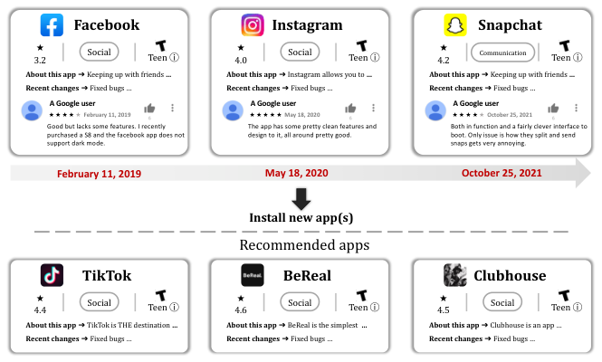
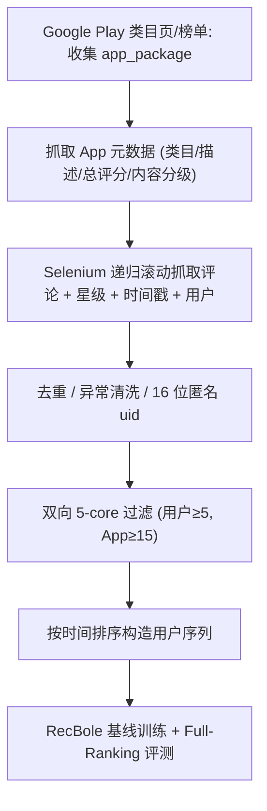

# MobileRec: A Large-Scale Dataset for Mobile Apps Recommendation (面向移动应用推荐的大规模序列数据集)

- **会议/期刊**: SIGIR 2023 (Resource/Track, under submission 版本)
- **作者与机构**: M.H. Maqbool, Hassan Foroosh (University of Central Florida)；Umar Farooq (Independent Researcher)；Adib Mosharrof, A.B. Siddique (University of Kentucky)
- **推荐链路定位**: 召回（序列 Next-App 预测）
- **研究方向**: 序列与会话推荐 / 冷启动与长尾推荐
- **论文原文**: [论文原文链接](https://arxiv.org/abs/2303.06588v1)
- **开源代码**: 数据已开源：[recmeapp/mobilerec](https://huggingface.co/datasets/recmeapp/mobilerec)（基线代码暂未开源，仅说明基于 RecBole 复现）

## TL;DR (1分钟核心速览)

移动 App 推荐长期缺乏可用基准：已有 App 数据集要么无用户 uid/时间戳，要么每个用户仅一条记录，无法构造用户行为序列。本文从 Google Play 抓取并清洗出 MobileRec——19.3M 条带时间戳评论交互、10,173 个 App、48 个类目、700,111 个用户（每人 ≥5 次交互），并提供 App 名称/类目/长描述/开发者等元数据；在 `Leave-One-Out` + `Full-Ranking (10K 全库排序)` 协议下评测 9 个基线，SASRec 取得最佳 Hit@10 = 0.0181（较 Pop 提升 19.86%），同时暴露出与 Amazon-Beauty 上完全相反的模型排序结论。

## Background & Motivation (背景与核心矛盾)

- **主流范式**: 电商/影视/新闻域的序列推荐（SASRec、BERT4Rec、GRU4Rec、LightSANs 等）依托 Amazon Reviews、MovieLens-25M、Yelp 等含 uid 与时间戳的大规模 5-core 数据快速迭代。
- **前人局限（一）**: 移动 App 数据集规模与可用性不可兼得——Top 20 Apps（200K 评论/20 App）、RRGen（309K/58 App）量小且没有 uid 与时间戳；AARSynth、Srisopha 等虽有百万级评论却缺少用户唯一标识，**根本无法构造序列**。
- **前人局限（二）**: 最新的 PPrior 虽覆盖 48 类、9,869 App，但只保留 1–2 星负面评论且无 uid 与元数据，训练出的模型存在严重标签偏置。
- **核心洞察 (Key Insight)**: App 消费天然是"安装→使用→评论"的连续事件流，且用户跨类目、跨价格档迁移极其剧烈（图 2 显示付费→免费、高评分→中等评分的单向漂移），因此需要一个既含 uid+时间戳、又保留全评分分布与元数据的序列数据集。
- **本文切入点**: 用 Selenium 递归滚动抓取 Google Play 全类目 + 榜单 App 的元数据与评论，经去重、匿名化与双向 5-core 过滤后发布，并统一以严格的全库排序协议建立基线。

<figure class="paper-figure" markdown="span">
  <figcaption>图1：用户活动序列示例。基于过去的用户交互（例如应用安装），应用推荐系统推荐要安装的新应用。</figcaption>
</figure>

## Method (核心方法设计)

### 1. 整体框架 (Overall Architecture)

该文属数据集/基准论文，其"方法"即数据构建管线与评测协议闭环：先遍历 Google Play 全部类目页与 Top Charts 收集 App 包名 → 逐 App 抓取元数据（名称、类目、长描述、开发者、内容分级、总体评分）→ 用 Selenium 模拟滚动与展开，递归抓取评论区直至无更多评论，记录评论文本、星级、评论时间与（匿名化后的）用户信息 → 去重并剔除异常记录 → 转换为 16 字符匿名 `uid` → 施加"用户 ≥5、物品 ≥15"的双向过滤得到 5-core 版本 → 按时间排序形成用户序列 → 在 RecBole 上以统一超参训练 9 个基线并做全库排序评测。

### 2. 关键设计拆解 (Key Designs)

1. **时序可辨识的抓取与匿名化管线**：痛点是 Google Play 评论随滚动动态加载、长评论默认折叠，常规爬虫只能拿到首页少量样本。作者用 Selenium WebDriver 自动滚动 + 点击展开，并按"最新/评分"等多种排序切换以最大化召回，最后把真实用户 ID 替换为 16 字符 `uid`，使 $\text{uid}=f(\text{raw\_id})$ 为单向映射，既保留跨 App 的序列可连接性又满足隐私要求——这是本数据集区别于所有前作（无 uid）的关键一步。

2. **双向 5-core 过滤构造可用序列**：单向 5-core 会留下大量只有一两条交互的"僵尸 App"，导致全库排序下候选空间噪声过大。本文同时约束两侧：保留 $|\mathcal{I}_u|\ge 5$的用户与$|\mathcal{U}_i|\ge 15$的 App，最终$\mathcal{D}=\{(u,i,t,r) : |\mathcal{I}_u|\ge 5,\ |\mathcal{U}_i|\ge 15\}$。效果是平均每用户 27.56 条、每 App 1,896.88 条交互，明显高于 Amazon 的 5.32/15.45，使序列模型有足够上下文可学。

3. **训练目标、负采样与推理效率**：把 Next-App 预测建模为多类分类，$\mathcal{L}=-\frac{1}{|\mathcal{S}|}\sum_{(u,i^+)\in\mathcal{S}}\log\frac{\exp(s(u,i^+))}{\sum_{j\in\mathcal{I}}\exp(s(u,j))}$，即**免负采样**（全库 softmax，softmax 分母覆盖 10,173 个 App），与评测阶段的 Full-Ranking 保持一致；序列截断长度 50、batch 4096、早停 patience 10。推理时对全部 App 打分排序，单用户开销为一次前向 + 10K 维 softmax，工程上可直接接 ANN 索引降本。

## Experimental Setup & Evaluation Protocol (实验设置与评估协议)

- **数据集与预处理**（MobileRec，5-core 双向过滤后）：

| 数据集 | #Users | #Items | #Interactions | 平均交互/用户 | 平均交互/物品 |
| :--- | :---: | :---: | :---: | :---: | :---: |
| MobileRec (Ours) | 700,111 | 10,173 | 19.3M | 27.56 | 1,896.88 |
| Amazon Reviews (2018) | 10.6M (≥5) | 2.07M (≥15) | 233.1M | 5.32 | 15.45 |
| Yelp (2022) | 0.29M (≥5) | 77.58K (≥15) | 6.99M | 3.52 | 46.49 |
| ML-25M | 0.16M (≥5) | 20.59K (≥15) | 25.0M | 153.81 | 423.39 |

- **数据划分与防穿越 (Splitting Strategy)**: `Leave-One-Out`——每个用户序列最后一条作测试、倒数第二条作验证、其余训练；序列按 `formated_date` 时间戳升序排列。**注意：未做全局时间戳切分**，测试样本可能落在训练样本之前，存在轻度未来信息泄漏。
- **排名评测协议 (Ranking Protocol)**: 无偏 `Full-Ranking`，即对全部 10,173 个 App 打分排序（论文明确指出这比 SASRec 原文的 100 负采样排序更严格，因此绝对指标数值偏低、相对增益被压缩）。
- **对比基线与超参设置**: 共 9 个基线，涵盖 General（Pop）、RNN/Session（GRU4Rec、GCSAN）、Transformer 序列（SASRec、BERT4Rec、LightSANs）、生成式（ELECRec）、多兴趣（SINE）、门控（HGN）。统一最大序列长 50、batch 4096；SASRec 2 层 2 头、dropout 0.5、GELU、lr 0.001；SINE/HGN 隐维 64；LightSANs 潜在兴趣维 5、2 层 2 头；GCSAN 图卷积 1 层、ffn 256。全部基于 RecBole 实现，未报告显著性检验。

## Key Experimental Results (实验关键数据)

### 1. 主实验对比 (Main Results)

| Method | Hit@1 | Hit@5 | Hit@10 | Hit@20 | NDCG@5 | NDCG@10 | NDCG@20 |
| :--- | :---: | :---: | :---: | :---: | :---: | :---: | :---: |
| Pop | **0.0027** | 0.0086 | 0.0151 | 0.0256 | 0.0056 | 0.0077 | 0.0103 |
| GRU4Rec | 0.0021 | 0.0086 | 0.0153 | 0.0261 | 0.0053 | 0.0074 | 0.0102 |
| BERT4Rec | 0.0024 | 0.0083 | 0.0140 | 0.0221 | 0.0054 | 0.0072 | 0.0092 |
| SINE | 0.0022 | 0.0087 | 0.0163 | 0.0280 | 0.0054 | 0.0078 | 0.0107 |
| GCSAN | 0.0024 | 0.0094 | 0.0161 | 0.0266 | 0.0059 | 0.0081 | 0.0107 |
| ELECRec | 0.0020 | 0.0094 | 0.0174 | 0.0293 | 0.0056 | 0.0082 | 0.0112 |
| LightSANs | 0.0024 | **0.0102** | 0.0172 | 0.0280 | **0.0062** | 0.0085 | 0.0112 |
| SASRec | 0.0026 | 0.0098 | **0.0181** | **0.0295** | 0.0061 | **0.0088** | **0.0117** |
| **Improv. (SASRec vs Pop)** | -3.70% | +13.95% | **+19.86%** | +15.23% | +8.93% | **+14.28%** | +13.59% |

### 2. 消融实验 (Ablation Study)

原文未设计模块级消融（非新模型论文），其"消融等价物"是**跨数据集结论反转分析**——把同一模型对的相对增益在原始数据集与 MobileRec 上对照，用以验证本数据集分布对方法假设的检验力：

| 模型对 (A vs B) | 原数据集 Δ (Hit@5) | MobileRec Δ (Hit@5) | 原数据集 Δ (Hit@10) | MobileRec Δ (Hit@10) |
| :--- | :---: | :---: | :---: | :---: |
| ELECRec vs GRU4Rec | +329.87% (Beauty) | +9.30% | +242.04% (Beauty) | +13.72% |
| LightSANs vs SASRec | — | 落后 | +3.91% (Books) | **−5.23%（反转）** |
| SASRec vs Pop | — | +13.95% | +41.37% (Beauty) | +19.86% |
| SINE vs GRU4Rec | 正增益 (Hit@50/100) | +7.27% (Hit@20) | — | 落后于 SASRec |

### 3. 关键实验发现 (Key Findings)

1. **绝对性能极低，任务难度被严重低估**：最强基线 SASRec 的 Hit@10 仅 0.0181、NDCG@10 仅 0.0088，即 10K 候选全库排序下 Top-10 命中率不足 2%；同一模型在 Amazon-Beauty 上相对 Pop 的 NDCG@10 增益为 41.37%，在此仅 14.28%，说明 App 场景的兴趣漂移显著压缩了序列建模的边际收益。
2. **生成式与低秩注意力假设在此失效**：ELECRec 对 GRU4Rec 的 Hit@5 增益从 Beauty 的 +329.87% 骤降至 +9.30%；LightSANs 在 Books 上超 SASRec 3.91% Hit@10，在 MobileRec 反被 SASRec 超出 5.23%。作者归因为 19M 级、跨 48 类的剧烈迁移序列使生成器难以产出高质量伪样本、潜在兴趣分解难以收敛。
3. **严格指标下"热门度"与"双向掩码"反而占优**：Hit@1 冠军是零参数的 Pop（0.0027）而非任何神经模型，BERT4Rec（0.0024）也高于 SASRec（0.0026 附近但 NDCG 更高）之下的多数模型，说明 Top-1 位置仍被少数头部 App 垄断，而 cloze 式双向上下文目标对极严格指标更友好——这为后续工作指明了"头部纠偏 + 双向目标"的改进方向。

## Highlights & Limitations (亮点、对比与审稿批判)

- **与代表作对比 (vs. Prior Work)**: 相比 Top 20 Apps / RRGen，本文规模提升约两个数量级且首次引入 uid + 时间戳；相比 PPrior（2.1M、仅负评、无 uid）与 Srisopha（9.3M、不公开、无 uid），MobileRec 是首个同时具备多交互序列、全评分分布、App 元数据且公开可下载的 App 推荐基准；相比 Amazon/Yelp/ML 系列，其"物品少而交互密"（每 App 1,896.88 次交互）的分布恰好补足了稀疏—稠密谱系的另一端。
- **可迁移亮点**: (1) "双向 5-core（用户 ≥5 且物品 ≥15）+ Leave-One-Out + Full-Ranking"的三元组可作为新垂直领域数据集的标准化评测模板；(2) 用"原数据集结论是否反转"来检验新基准的诊断价值，是一种低成本、高说服力的基准论证方式，值得其他数据集论文借鉴。
- **审稿级局限批判**: (1) **评估不完整**——仅 Leave-One-Out 单点切分且未做全局时间戳切分，存在未来信息穿越风险，也缺少长尾/冷启动分桶与显著性检验；(2) **信号维度单一**——数据仅来自"写评论"的用户（自选择偏差），缺少曝光/安装/点击日志，因而无法研究曝光偏置去偏或 CTR 类任务，且 48 类目元数据与评论文本在基线中完全未被利用；(3) 未提出任何新模型或消融，纯粹 benchmark 定位使其对新方法的指导深度有限。

## Rating (四维评分)

- **方法创新性 (Novelty)**: ⭐⭐⭐ （无新模型，但"首个带 uid+时间戳+元数据+多交互"的 App 序列数据集本身填补了明确的空白）
- **评估协议与实验扎实度 (Protocol & Experiments)**: ⭐⭐⭐ （Full-Ranking + 9 个基线难能可贵，但单一 Leave-One-Out 切分、无显著性检验、无长尾分桶分析）
- **写作与数学规范度 (Clarity & Rigor)**: ⭐⭐⭐⭐ （数据构建流程、字段定义与统计对比表清晰完整，HR/NDCG 公式规范；但部分增益归因为事后推测，缺定量验证）
- **工业落地与复现价值 (Industrial & Practical Value)**: ⭐⭐⭐⭐ （数据已在 HuggingFace 公开、直接对接 RecBole，全库 softmax 训练与 10K 候选推理开销可控；仅缺基线代码与真实安装日志）

