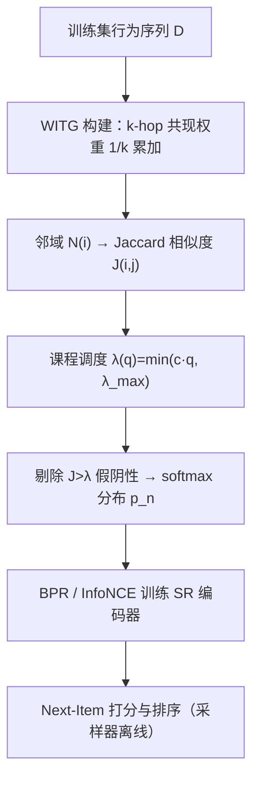

# Neighborhood-based Hard Negative Mining for Sequential Recommendation (基于邻域重叠的序列推荐难负例挖掘)

- **会议/期刊**: SIGIR 2023 (short paper, 5 页)
- **作者与机构**: Lu Fan, Xiao-Ming Wu (香港理工大学)；Jiashu Pu, Rongsheng Zhang (网易伏羲 AI Lab)
- **推荐链路定位**: 训练阶段负采样（作用于精排/序列编码器，不改推理结构）
- **研究方向**: 序列与会话推荐 / 自监督对比学习与交互去噪
- **论文原文**: [arXiv:2306.10047](https://arxiv.org/abs/2306.10047v1)
- **开源代码**: [floatSDSDS/GNNO](https://github.com/floatSDSDS/GNNO)

## TL;DR (1分钟核心速览)

序列推荐（SR）的负采样几乎默认均匀随机，或用嵌入空间自适应难负例，但**极少利用用户行为序列中隐含的图结构信息**。本文提出 GNNO：先由训练序列构建全局加权物品转移图 (WITG)，再用图上的 **Jaccard 邻域重叠度**定义负采样分布——重叠中等者视为优质难负例、重叠过高者判为假阴性直接剔除，并用**课程学习**逐步抬高"假阴性阈值 λ"。在 Beauty/Phone/Toys 三个 5-core Amazon 数据集、Leave-One-Out + 1000 候选采样排序协议下，GNNO 即插即用于 ContraRec，NDCG@20 相对最强负采样基线 MixGCF 提升 1.05%–2.03%，相对骨干 ContraRec 提升 1.65%–2.34%。

## Background & Motivation (背景与核心矛盾)

- **主流范式**: SR 模型以 BPR / InfoNCE 训练，研究精力集中于序列编码器（GRU4Rec / Caser / SASRec / BERT4Rec / TiMiRec）与辅助对比任务（ContraRec），负样本多取 uniform 随机采样。
- **前人局限**: 采样类方法（DNS 取模型打分最高的样本、MCNS 用亚线性分布 + Metropolis-Hastings 加速）只看模型置信度或物品热度，**丢弃了序列先后顺序中的转移结构**；生成类方法（MixGCF 跨跳混合正样本注入负样本）合成的负例不保证落在"真实但未被点击"的语义区，易引入噪声。
- **核心洞察 (Key Insight)**: 作者在 Beauty 上按 WITG 上的 Jaccard 重叠度把物品对分四组（零组无共同邻居、低组 $J\in(0,0.15]$、中组$(0.15,0.3]$、高组$(0.3,1.0]$），可视化 epoch 0→20 的嵌入相似度分布：零组/低组几乎不动（易负例，但需保多样性），**中组分布显著漂移（可判别难负例）**，高组强连通、极可能是假阴性。见 <figure class="paper-figure" markdown="span">
  ![图 1：Beauty 数据集上不同组节点对相似度分布在训练轮次 0 和 20 时的可视化。根据节点在全局加权物品转移图上的 Jaccard 相似度 𝐽(𝑖, 𝑗)，将节点分为四组。零组中的节点/物品对没有共同邻居；低组中的节点/物品对满足 𝐽(𝑖, 𝑗) ∈ (0, 0.15\]；中组中的节点/物品对满足 𝐽(𝑖, 𝑗) ∈ (0.15, 0.3\]；高组中的节点/物品对满足 𝐽(𝑖, 𝑗) ∈ (0.3, 1.0\]。注意，由于各组规模差异较大，不同组采用不同的分箱值。](../../../../assets/papers/2306.10047v1/figure_1.png)<figcaption>图 1：Beauty 数据集上不同组节点对相似度分布在训练轮次 0 和 20 时的可视化。根据节点在全局加权物品转移图上的 Jaccard 相似度 𝐽(𝑖, 𝑗)，将节点分为四组。零组中的节点/物品对没有共同邻居；低组中的节点/物品对满足 𝐽(𝑖, 𝑗) ∈ (0, 0.15]；中组中的节点/物品对满足 𝐽(𝑖, 𝑗) ∈ (0.15, 0.3]；高组中的节点/物品对满足 𝐽(𝑖, 𝑗) ∈ (0.3, 1.0]。注意，由于各组规模差异较大，不同组采用不同的分箱值。</figcaption>
</figure>。
- **本文切入点**: 把"负例硬度"直接写成图上的邻域重叠度，用一个可调阈值 $\lambda$ 做假阴性闸门，再用课程学习控制闸门随时间收紧。

## Method (核心方法设计)

### 1. 整体框架 (Overall Architecture)

GNNO 是挂在任意 SR 编码器上的**采样器插件**，不改打分函数。离线阶段遍历训练集中全部序列，把序列内 $k$-跳共现的物品对写入全局加权转移图并累加距离衰减权重；在线训练时，对每个目标物品$i$计算它与全库物品在 WITG 上的 Jaccard 相似度，按当前训练步$q$推出的阈值$\lambda(q)$剔除高重叠"假阴性"物品，剩余物品按$\exp(J)$ 归一化成采样分布，抽出若干难负例（外加若干随机负例保底），与正样本一起送入 BPR/InfoNCE 训练；推理阶段只保留原编码器，采样器完全卸载，因此**零额外在线开销**。

### 2. 关键设计拆解 (Key Designs)

1. **距离衰减的加权物品转移图 (WITG)**：user-item 图只能表达"谁买过"，无法表达"先后顺序"。作者对每条序列 $s$中位置$i_m$与其$k$-跳后继$i_{m+k}$连边并累加$w(i_m,i_{m+k}) \leftarrow w(i_m,i_{m+k}) + 1/k$。$1/k$ 的物理直觉是：相邻点击才是强意图信号，越远越可能是偶然共现，衰减抑制长程噪声，使图成为"全局意图流"的稠密代理。

2. **基于 Jaccard 的相对重叠采样分布**：直接按 hop 距离划分采样区（如 RecNS 的三区原则）在不同度分布物品上不可比。GNNO 改用归一化重叠度 $J(i,j)=\frac{|N(i)\cap N(j)|}{|N(i)\cup N(j)|}$，分母自动惩罚高度数物品，再定义采样分布
$$p_n(i^-|i)=\frac{\exp J(i,i^-)}{\sum_{j\in \mathcal{N}'(i)}\exp J(i,j)},\quad \mathcal{N}'(i)=\mathcal{I}\setminus\{j\mid J(i,j)>\lambda\}$$
即"越重叠越容易被采、但重叠超过 $\lambda$ 者彻底禁采"。这一步同时完成难负例加权与假阴性屏蔽，是对 ProGCL 式"拟合真假阴性混合分布"的轻量替代。

3. **课程式阈值调度与训练目标**：训练早期强行喂难负例易导致表征塌陷，因此用线性 pacing $f(q)=c\cdot q+b$（取$b=0$）与上限裁剪$\lambda(q)=\min(f(q),\lambda_{max})$让采样池"由易到难"收缩。总目标仍是标准 BPR：$\mathcal{L}=\sum - \log\sigma(\hat{y}(s_t,i_t)-\hat{y}(s_t,i^-_t))$，其中负例按"#neg_hard 个来自$p_n$ + #neg_rand 个均匀随机"混合（Beauty 9+16、Toys 2+10、Phone 4+10）。推理时无负采样、无图查询，延迟与骨干一致。

## Experimental Setup & Evaluation Protocol (实验设置与评估协议)

- **数据集与预处理**: Amazon 三子集，采用 `5-core` 过滤，剔除无正反馈的用户/物品。

| 数据集 | #Users | #Items | #Interactions | 稀疏度 | 特征/场景说明 |
| :--- | :---: | :---: | :---: | :---: | :--- |
| Beauty | 22,363 | 12,101 | 198,502 | 20.01% | 美妆评论序列，WITG 边 530,266 |
| Toys | 19,413 | 11,925 | 148,455 | 16.32% | 玩具评论序列，WITG 边 486,740 |
| Phone | 22,364 | 12,102 | 176,139 | 24.55% | 手机评论序列，WITG 边 530,266¹ |

¹原文表格中 Phone 的 #Items/#edge 与 Beauty 数值完全一致，疑为排版重复，笔记按原文照录。

- **数据划分与防穿越**: `Leave-One-Out`（每个序列最后 1 个交互作测试、倒数第 2 个作验证），WITG **仅用训练集序列**构建，避免测试交互泄漏入图。
- **排名评测协议**: `Sampled Ranking` —— 目标物品与从全库随机抽取的候选混成 1000 大小候选集（隐含正负比约 1:999），指标 HR@5/20、NDCG@5/20；**未使用 Full-Ranking**。
- **对比基线与超参**: SR 基线 BPRMF、Caser、GRU4Rec、BERT4Rec、SASRec、TiMiRec、ContraRec（ReChorus 实现）；负采样基线 DNS、MCNS、MixGCF。骨干固定为 ContraRec（BERT4Rec 编码器），Adam、batch 4096、隐维 $d=64$，GNNO 超参$(c,\lambda_{max})$ 网格搜索于验证集；全文未报告显著性检验。

## Key Experimental Results (实验关键数据)

### 1. 主实验对比 (Main Results)

与负采样策略对比（骨干同为 ContraRec）：

| 数据集 | 方法 | HR@5 | NDCG@5 | HR@20 | NDCG@20 |
| :--- | :--- | :---: | :---: | :---: | :---: |
| Beauty | DNS | 0.3858 | 0.2984 | 0.5890 | 0.3561 |
| | MCNS | 0.4101 | 0.3141 | 0.6135 | 0.3721 |
| | MixGCF | 0.4123 | 0.3168 | 0.6140 | 0.3743 |
| | **GNNO** | **0.4149** | **0.3215** | **0.6174** | **0.3792** |
| | Improv. vs MixGCF | +0.63% | +1.48% | +0.55% | +1.31% |
| Phone | DNS | 0.4307 | 0.3300 | 0.6563 | 0.3943 |
| | MCNS | 0.4794 | 0.3646 | 0.7179 | 0.4334 |
| | MixGCF | 0.4810 | 0.3655 | 0.7197 | 0.4342 |
| | **GNNO** | **0.4897** | **0.3754** | **0.7249** | **0.4430** |
| | Improv. vs MixGCF | +1.81% | +2.71% | +0.72% | +2.03% |
| Toys | DNS | 0.3470 | 0.2666 | 0.5598 | 0.3266 |
| | MCNS | 0.4035 | 0.3084 | 0.6238 | 0.3711 |
| | MixGCF | 0.4049 | 0.3097 | 0.6252 | 0.3723 |
| | **GNNO** | **0.4074** | **0.3148** | 0.6245 | **0.3762** |
| | Improv. vs MixGCF | +0.62% | +1.65% | −0.11% | +1.05% |

与主流 SR 模型对比（GNNO 行即以 ContraRec 为骨干）：

| 数据集 | BPRMF | GRU4Rec | SASRec | BERT4Rec | TiMiRec | ContraRec | **GNNO** |
| :--- | :---: | :---: | :---: | :---: | :---: | :---: | :---: |
| Beauty NDCG@20 | 0.3202 | 0.3030 | 0.3372 | 0.3266 | 0.3433 | 0.3727 | **0.3792** (+1.74%) |
| Phone NDCG@20 | 0.3352 | 0.3777 | 0.4032 | 0.3849 | 0.3925 | 0.4358 | **0.4430** (+1.65%) |
| Toys NDCG@20 | 0.2864 | 0.2934 | 0.3328 | 0.3164 | 0.3287 | 0.3676 | **0.3762** (+2.34%) |
| Toys HR@5 | 0.3107 | 0.3113 | 0.3594 | 0.3457 | 0.3535 | 0.4013 | **0.4074** (+1.52%) |

### 2. 消融实验 (Ablation Study)

原文为 5 页短文，**未提供 `w/o WITG`、`w/o CL` 的逐组件消融**；此处以"负采样器替换"的组件级对照 + 缺失项标注呈现：

| 配置（Beauty, 骨干 ContraRec） | NDCG@5 | NDCG@20 | 说明 |
| :--- | :---: | :---: | :--- |
| 均匀随机负采样（ContraRec 默认） | 0.3158 | 0.3727 | 无结构信息 |
| DNS（模型自适应，非图） | 0.2984 | 0.3561 | 仅用置信度，反降 |
| MCNS（图分布采样） | 0.3141 | 0.3721 | 用度分布，无假阴性门控 |
| MixGCF（图合成难负例） | 0.3168 | 0.3743 | 跨跳混合，无课程调度 |
| **GNNO 完整** | **0.3215** | **0.3792** | Jaccard 分布 + λ 课程 |
| GNNO w/o curriculum（$\lambda$ 固定） | — | — | 原文未报告 |
| GNNO w/o 假阴性剔除（保留 $J>\lambda$） | — | — | 原文未报告 |

### 3. 关键实验发现 (Key Findings)

1. **图结构本身是主要增益来源**：三个图类采样器在 Beauty 上 NDCG@20 均高于非图 DNS（MixGCF 0.3743 / MCNS 0.3721 vs DNS 0.3561，即 +5.1%/+4.5%），而 DNS 甚至低于均匀采样（0.3561 < 0.3727），说明"仅按模型置信度挖难负例"在 SR 中已饱和甚至有害。
2. **相对重叠优于离散分区与合成混合**：GNNO 在 12 个指标格中 11 个最优，Phone 增益最大（NDCG@5 +2.71%、NDCG@20 +2.03%），提示在大类目、序列较长的场景，Jaccard 的度归一化比 MixGCF 的 hop-mixing 更抗噪。
3. **增益不来自编码器而来自采样**：ContraRec 已比 SASRec 高 8.2%–10.5%（Toys NDCG@20 0.3676 vs 0.3328），GNNO 在其上仍稳定再提 1.65%–2.34%，但绝对增量仅 0.4–0.9 个百分点，属于"稳定小步"而非量级跃迁；唯一负向格为 Toys HR@20（0.6245 vs MixGCF 0.6252，−0.11%），说明阈值剔除在超长尾候选上略有召回损失。

## Highlights & Limitations (亮点、对比与审稿批判)

- **与代表作对比**: ① vs **RecNS**：同样做区域划分，但 RecNS 用 $k$-hop 距离硬分区且主张"远区少采"，GNNO 改用连续相对 Jaccard 分布并明确保留零/低组以维持多样性；② vs **MixGCF**：不合成假负例，避免注入不存在于真实分布的混合向量；③ vs **ProGCL**：不做 beta 混合模型拟合真假阴性，而以单阈值$\lambda(q)$ 显式闸门 + 课程学习控制，工程上更轻。
- **可迁移亮点**: (a) $1/k$ 距离衰减的全局转移图可作为任意序列模型的免费结构先验（不含可学习参数）；(b) "用随训练步递增的阈值屏蔽假阴性"可平移至图对比学习、双塔召回的去噪阶段。
- **审稿级局限批判**: ① **复杂度与延迟缺失**：每个训练步都要为 batch 内目标物品计算 Jaccard 并归一化，最坏涉及 $O(|I|^2)$邻域交集，论文未给图重构频率、采样开销与时延实测；② **评估偏弱**：仅 `Sampled Ranking`（1000 候选、1:999）而无 Full-Ranking，无显著性检验、无逐组件消融，且$\lambda_{max}$ 跨数据集从 0.2 到 0.9、难度负例数从 2 到 9，超参敏感度高，读者难以判断哪一项真正在起作用；③ 数据集表格存在与 Beauty 重复的可疑数值，削弱可复现信心。

## Rating (四维评分)

- **方法创新性 (Novelty)**: ⭐⭐⭐⭐ （首个把"序列转移图邻域重叠"作为 SR 难负例硬度度量，配假阴性阈值 + 课程的组合干净；但各零件在 CF/图对比领域均有前身，属巧妙重组）
- **评估协议与实验扎实度 (Protocol & Experiments)**: ⭐⭐⭐ （三数据集 + 两类基线较完整，但仅 1000 候选采样排序、无 Full-Ranking、无显著性检验、无组件消融，硬结论支撑不足）
- **写作与数学规范度 (Clarity & Rigor)**: ⭐⭐⭐⭐ （WITG/Jaccard/课程三式定义利落、motivation 图直观，5 页内讲清闭环；采样复杂度与 λ 更新成本未分析）
- **工业落地与复现价值 (Industrial & Practical Value)**: ⭐⭐⭐⭐ （插件式、推理零开销、代码开源，落地门槛极低；但离线图为静态图、需定期重建以适配兴趣漂移，超参逐域调优成本需警惕）

