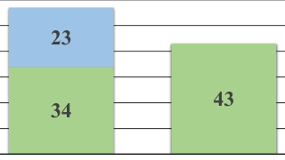
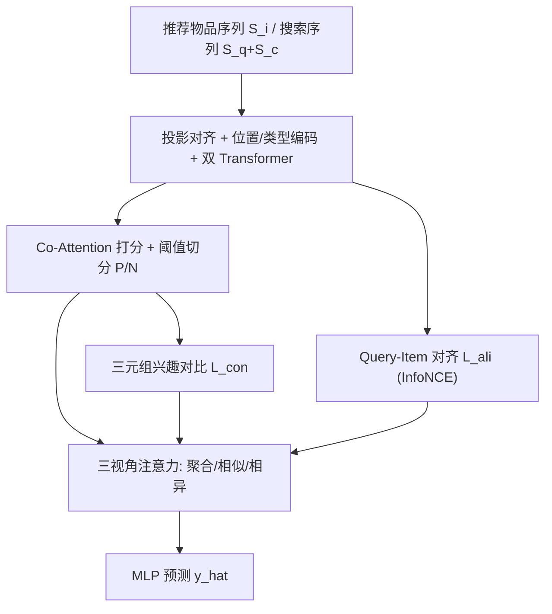
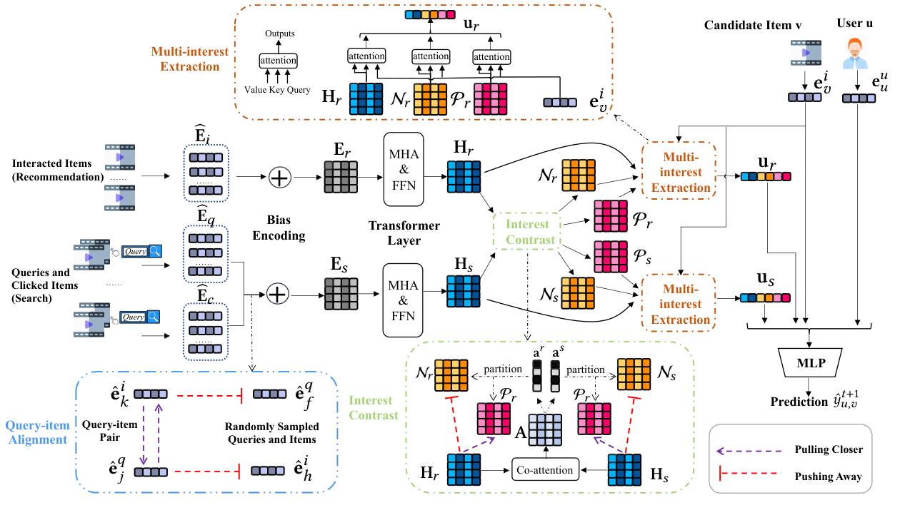

# When Search Meets Recommendation: Learning Disentangled Search Representation for Recommendation (当搜索遇见推荐：为推荐学习解耦的搜索表征)

- **会议/期刊**: SIGIR 2023
- **作者与机构**: Zihua Si, Zhongxiang Sun, Xiao Zhang, Jun Xu, Ji-Rong Wen (中国人民大学高瓴人工智能学院)；Xiaoxue Zang, Yang Song (快手)；Kun Gai
- **推荐链路定位**: 召回（序列式 Next-Item 召回/排序）
- **研究方向**: 序列与会话推荐 / 自监督对比学习与交互去噪
- **论文原文**: [论文原文链接](https://arxiv.org/abs/2305.10822v1)
- **开源代码**: [开源代码仓库链接](https://github.com/Ethan00Si/SESREC-SIGIR-2023)

## TL;DR (1分钟核心速览)

短视频/电商平台同时存在搜索与推荐（S&R）两条行为流，现有方法要么分开建模，要么简单拼进同一编码器，忽视了"搜索兴趣"与"推荐兴趣"既重叠又分叉的本质。SESRec 先用 InfoNCE 把 query 与物品拉到同一语义空间，再用 co-attention + 三元组损失把两条序列自监督地切分为"相似兴趣"与"相异兴趣"子序列，最后从聚合/相似/相异三视角做候选物品感知的注意力抽取。在 Kuaishou 工业数据与 Amazon Kindle 上，Leave-One-Out + 99 负采样排序协议下 NDCG@10 分别达 0.4054 / 0.4663，较最强基线相对提升 7.05% / 2.48%。

## Background & Motivation (背景与核心矛盾)

- **主流范式**: 以 SASRec/BERT4Rec/FMLP-Rec 为代表的 Transformer/MLP 序列推荐只吃物品序列；搜索增强派（NRHUB、Query-SeqRec、IV4REC、SRJGraph）则把 query 塞进同一编码器或异构图，试图"一次性"挖掘用户兴趣。
- **前人局限**: ① 把 S&R 行为送入统一编码器，隐含假设二者兴趣同分布，而快手实测显示 57% 的搜索是**自发搜索**（与当前推荐流无关），其中 23% 的兴趣与推荐兴趣不相似；② 缺少 query 与 item 的语义对齐，两类表征处于不同向量空间，跨行为相似度无法可靠度量，导致"增强"反而引入噪声——Query-SeqRec 甚至劣于 SASRec。
- **核心洞察 (Key Insight)**: 相似兴趣应被**强化**（反映稳定偏好），相异兴趣应被**保留为探索信号**（未被推荐流满足的新需求）；因此需要的不是"融合"，而是"解耦后分别建模"。
- **本文切入点**: 用 query-item 交互做弱监督对齐，再用对比学习在无标签条件下把序列自动切成相似/相异两支，三视角注意力汇总。

<figure class="paper-figure" markdown="span">
  <figcaption>图 1：短视频场景中的 S&amp;R 行为。(a) 观看一个关于狗的视频后，用户选择点击推荐的查询（被动搜索）以探索更多。之后，观看美食视频后，用户搜索“world cup 2022”，这是与所观看视频无关的自发搜索。(b) 从快手 App 收集的搜索行为统计。57% 的搜索行为是自发搜索，43% 是被动搜索。23% 的自发搜索与推荐兴趣具有不相似兴趣。</figcaption>
</figure>

## Method (核心方法设计)

### 1. 整体框架 (Overall Architecture)

输入为用户的三条时间序：推荐交互物品序列 $S_i^u$、搜索 query 序列$S_q^u$、以及 query 下点击物品序列$S_c^u$。SESRec 先做 embedding 与线性投影把 query/物品映射到同一$d$维空间，搜索侧把同一 query 下的点击物品均值池化后与该 query 相加，并叠加位置编码与**搜索来源类型编码**（用户手打/历史 query/当前物品相关 query）。随后两条 Transformer 编码器独立建模，输出$H_s, H_r$；再由 query-item 对齐损失与兴趣对比损失完成解耦；最终对聚合/相似/相异三组表征做候选物品感知注意力，拼成$u_r\|u_s\|e_v\|e_u$ 送入两层 MLP 打分。全流程端到端多任务训练。

<figure class="paper-figure" markdown="span">
  <figcaption>图 2：SESRec 的架构。从左到右为对 S&amp;R 历史建模的过程。最右侧为最终预测过程。三个带虚线的彩色模块执行兴趣解耦。</figcaption>
</figure>

### 2. 关键设计拆解 (Key Designs)

1. **Query-Item 对齐（让跨行为相似度可比）**：query 与 item 特征异构、原始空间不可比，因此先用带可学习温度 $\tau$的双向 InfoNCE 把 query 拉向其被点击物品，相似度用独立于预测打分的度量$s(p,q)=\tanh(p^{\top}W_A q)$，避免对齐准则与最终排序准则耦合。物理直觉：只有 query 与 item 落在同一语义球面上，后续 co-attention 算出的"相似/相异"才有意义。

2. **Co-Attention 软对齐 + 三元组硬切分（无标签解耦）**：先算亲和矩阵 $A=\tanh(H_sW_lH_r^{\top})$，再双向归一化得每个行为元素在另一序列上的相似度$a_s=\mathrm{softmax}(W_rH_r^{\top}A^{\top})$、$a_r=\mathrm{softmax}(W_sH_s^{\top}A)$；以**均值阈值**$\gamma_r=1/T_r,\gamma_s=1/T_s$硬切为$P_s,N_s,P_r,N_r$。锚点取注意力加权整体$\boldsymbol{i}^A_s=\sum_j a_{sj}\boldsymbol{h}_{sj}$，正/负样本取子序列均值，损失为$\mathcal{L}_{tri}=\max\{d(\boldsymbol{i}^A,\boldsymbol{i}^P)-d(\boldsymbol{i}^A,\boldsymbol{i}^N)+m,0\}$，$m=0.1$、欧氏距离。选三元组而非 InfoNCE 的关键理由：相似/相异兴趣本身边界模糊，pairwise 间隔损失只要求"相似比相异更近"，不会对仍有重叠的样本施加过强惩罚。两条行为各用独立三元组损失，因为 S&R 序列长度与更新频率差异极大。

3. **三视角兴趣抽取、训练目标与推理开销**：对候选物品 $v$，分别对全序列、$P$、$N$做注意力池化得$u_r^{all},u_r^{sim},u_r^{diff}$（搜索侧同理），拼接为$u_r\in\mathbb{R}^{3d}$、$u_s\in\mathbb{R}^{3d}$并送入 MLP。总损失$\mathcal{L}=\sum_{u,t}\left(\mathcal{L}_{rec}+\alpha\mathcal{L}_{ali}+\beta\mathcal{L}_{con}\right)+\lambda\|\Theta\|^2$，$\alpha=0.1$、$\beta=0.001$；训练负采样为"1 正 +$N-1$ 随机负"，无额外难负采样挖掘。推理时仅需两次 Transformer 前向 + 两次注意力，额外开销集中在搜索序列（长度 25/15），线上可离线缓存在用户侧。

## Experimental Setup & Evaluation Protocol (实验设置与评估协议)

| 数据集 | #Users | #Items | #Queries | Actions-S | Actions-R | 说明 |
| :--- | :---: | :---: | :---: | :---: | :---: | :--- |
| Kuaishou | 35,721 | 822,832 | 398,924 | 922,531 | 11,381,172 | 短视频真实 S&R 日志，2022 年一个月，5-core 过滤 |
| Amazon (Kindle Store) | 68,223 | 61,934 | 4,298 | 934,664 | 989,618 | 公开 5-core 评论集，搜索行为由商品标题程序化构造 |

- **数据划分**: `Leave-One-Out`——每用户最后一个行为为测试、倒数第二个为验证、其余训练；并额外过滤未同时具备 S、R 历史的交互，防止跨服务信息穿越。
- **排名评测协议**: `Sampled Ranking`——真值物品与 **99 个用户从未交互的随机负样本**共同排序，报告 HIT@{1,5,10}、NDCG@{5,10}、MRR，均为全用户平均；未采用 Full-Ranking，故数值偏高但基线间可比。
- **对比基线与超参**: 序列侧 STAMP/DIN/GRU4Rec/SASRec/DIEN/FMLP-Rec，搜索增强侧 NRHUB/JSR/IV4REC/Query-SeqRec/SRJGraph；序列长度 150(25)/15(15)，$d_i,d_q,d=48,64,48$（Amazon 统一 32），batch 256，Adam lr=1e-3，显著性用 paired t-test$p<0.01$。

## Key Experimental Results (实验关键数据)

### 1. 主实验对比 (Main Results)

| 模型 | Kuaishou N@5 | N@10 | H@1 | MRR | Amazon N@5 | N@10 | H@1 | MRR |
| :--- | :---: | :---: | :---: | :---: | :---: | :---: | :---: | :---: |
| SASRec | 0.3252 | 0.3693 | 0.1904 | 0.3187 | 0.3822 | 0.4312 | 0.2187 | 0.3675 |
| DIEN | 0.3217 | 0.3704 | 0.1914 | 0.3192 | 0.3336 | 0.3803 | 0.1871 | 0.3246 |
| FMLP-Rec | 0.3354 | 0.3787 | 0.1953 | 0.3270 | **0.4073** | **0.4550** | 0.2349 | 0.3883 |
| IV4REC | 0.3114 | 0.3591 | 0.1877 | 0.3116 | 0.3473 | 0.3960 | 0.1853 | 0.3331 |
| Query-SeqRec | 0.3117 | 0.3581 | 0.1740 | 0.3055 | 0.3692 | 0.4142 | 0.2187 | 0.3572 |
| SRJGraph | 0.3297 | 0.3762 | 0.2046 | 0.3277 | 0.3670 | 0.4043 | **0.2760** | 0.3708 |
| **SESRec** | **0.3541** | **0.4054** | **0.2173** | **0.3490** | 0.4224 | 0.4663 | 0.2580 | **0.4046** |
| Improv.% | +5.58% | +7.05% | +6.21% | +6.50% | +3.71% | +2.48% | −6.52% | +4.20% |

### 2. 消融实验 (Ablation Study)

| 模型 (Kuaishou) | N@5 | N@10 | H@1 | H@5 | H@10 | MRR |
| :--- | :---: | :---: | :---: | :---: | :---: | :---: |
| Base（双 Transformer + 聚合兴趣） | 0.3394 | 0.3770 | 0.2027 | 0.4618 | 0.6094 | 0.3294 |
| + $\mathcal{L}_{ali}$ | 0.3464 | 0.3982 | 0.2106 | 0.4762 | 0.6308 | 0.3421 |
| + $\mathcal{L}_{con}$ | 0.3507 | 0.4021 | 0.2139 | 0.4812 | 0.6406 | 0.3459 |
| + MIE（完整） | **0.3541** | **0.4054** | **0.2173** | **0.4848** | **0.6436** | **0.3490** |

阈值策略对比：常数 $1/8$ → N@10 0.3940、MRR 0.3415；中位数 → 0.4035 / 0.3462；均值（默认）→ 0.4054 / 0.3490。

### 3. 关键实验发现 (Key Findings)

1. **"搜索增强"并非免费午餐，解耦才是增益来源**：Query-SeqRec 仅为 0.3581 (N@10)，甚至低于无搜索的 SASRec 0.3693；SRJGraph 也仅 0.3762。而 SESRec 比最强无搜索基线 FMLP-Rec 提升 7.05%，说明盲目拼接 S&R 序列会把相异兴趣当作噪声灌入，只有先切分再分别加权才能转为正向信号。
2. **三个模块的增益可加且量级递减，对齐是地基**：单独加入 $\mathcal{L}_{ali}$即带来 N@10 +2.12pt（0.3770→0.3982），占全部增益的 74%；$\mathcal{L}_{con}$ 再加 +0.39pt，MIE 再加 +0.33pt。反证是 Figure 4：无对齐时 query-item 余弦相似度均值明显偏低，对齐后分布右移，说明跨空间可比性是后续解耦生效的前提。
3. **阈值自适应优于固定切分**：常数阈值 1/16 时 N@10 仅 0.3927，均值阈值达 0.4054（+1.27pt）；因为 softmax 归一化后的分数随序列长度衰减，固定阈值会系统性偏向长序列。JS 散度可视化亦证实，切出的 $P_s,P_r$间散度显著小于$N_s,N_r$，即"相似子序列确实更相似"，解耦在语义层面成立。此外在人工构造搜索的 Amazon 上增益（+2.48%）明显小于真实日志的快手（+7.05%），提示 query 稀疏、多物品共享同一 query 时对齐与对比信号会退化。

## Highlights & Limitations (亮点、对比与审稿批判)

- **与代表作对比 (vs. Prior Work)**: 相比 IV4REC 用搜索 query 作因果工具变量重构 embedding，SESRec 不改造表征而是改造**序列的分解方式**；相比 SRJGraph 把 query 作为异构图边属性，本文保留序列结构并显式区分相似/相异兴趣；相比 FMLP-Rec 等纯序列模型，本文的增益来自跨服务信号而非更强的序列编码器（Base 已用同构 Transformer）。三元组损失替代 InfoNCE 的论证（兴趣边界模糊、不宜强惩罚）是本任务特定的合理设计。
- **可迁移亮点**: ① "均值阈值硬切分 + 锚/正/负三元组"是一个无需人工标签的通用双序列解耦模板，可直接用于"浏览 vs 购买""短视频 vs 直播"等多行为场景；② 用独立度量矩阵 $W_A$ 做对齐、与排序打分解耦，避免辅助任务污染主任务表征。
- **审稿级局限批判**: ① 评估采用 99 负采样的 Sampled Ranking，未做 Full-Ranking，工业库规模（82 万物品）下的真实召回损失未知；② Amazon 搜索数据为程序化构造，两数据集结论一致性不足，"搜索增强在公开数据上是否普遍成立"仍缺证据；③ 每个用户需跑两次 Transformer 且搜索/推荐序列异构，线上在线推理与实时更新的工程成本未讨论；④ $\alpha,\beta$敏感性明显（$\alpha$ 从 1e-1 增至 1e0 时 NDCG@10 掉至约 0.395），需要逐场景调参。

## Rating (四维评分)

- **方法创新性 (Novelty)**: ⭐⭐⭐⭐ （首次把 S&R 兴趣显式解耦为相似/相异两支，co-attention 打分 + 均值阈值 + 三元组的组合简洁且有数据统计支撑，但各组件本身均为已有技术的重组）
- **评估协议与实验扎实度 (Protocol & Experiments)**: ⭐⭐⭐⭐ （工业级快手日志 + 公开 Amazon 双验证，11 个基线、显著性检验、阈值/超参/JS 散度/余弦分布多维分析完整，扣分在于仅 Sampled Ranking 与构造式搜索数据）
- **写作与数学规范度 (Clarity & Rigor)**: ⭐⭐⭐⭐ （符号体系清晰、四类损失与三视角抽取公式完整，三元组优于 InfoNCE 的论证有洞察；对锚点与正负样本的梯度交互缺少量理论分析）
- **工业落地与复现价值 (Industrial & Practical Value)**: ⭐⭐⭐⭐ （代码开源、结构轻量可直接嵌入现有序列召回；但双编码器与搜索侧实时特征在低延迟场景需额外工程优化）

