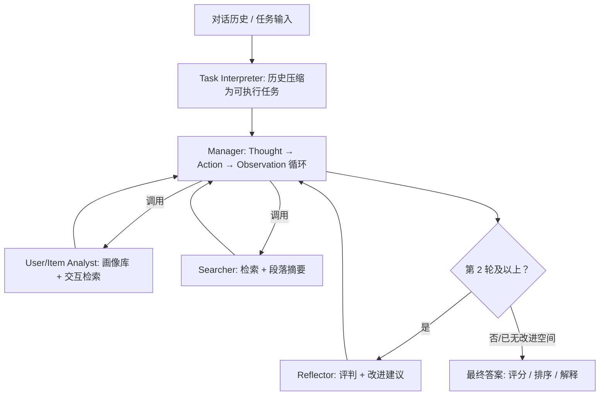
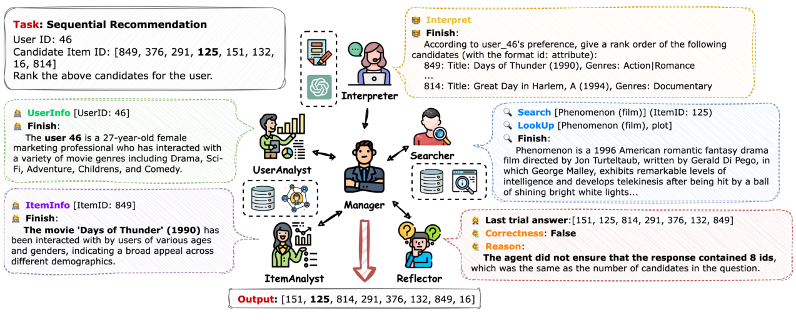

# MACRec: a Multi-Agent Collaboration Framework for Recommendation (面向推荐的多智能体协作框架)

- **会议/期刊**: SIGIR 2024（Demo/Resource Track，5 页短文）
- **作者与机构**: Zhefan Wang, Yuanqing Yu, Wendi Zheng, Weizhi Ma, Min Zhang（清华大学 DCST / AIR）
- **推荐链路定位**: 端到端（智能体直接产出评分 / 排序 / 解释，非传统召回-精排级联）
- **研究方向**: 对话推荐与智能体仿真（主）/ 大语言模型推荐（次）
- **论文原文**: [https://arxiv.org/abs/2402.15235v3](https://arxiv.org/abs/2402.15235v3)
- **开源代码**: [https://github.com/wzf2000/MACRec](https://github.com/wzf2000/MACRec)

## TL;DR (1分钟核心速览)

针对"用 LLM 智能体做推荐"的两条既有路线（① RecAgent/Agent4Rec 等**用户/物品仿真**，无法真正接入推荐系统；② RecMind/InteRecAgent 等**单智能体**推荐，难以胜任多步复杂决策；RAH 虽有多种智能体却协作模式固定且未开源），本文提出 MACRec：以 Manager 为调度核心，配 Task Interpreter（对话→可执行任务）、User/Item Analyst（画像+交互检索工具）、Searcher（Wikipedia 检索摘要）、Reflector（对上一轮答案做反思并给出改进建议）共 6 类角色，按 Thought-Action-Observation 循环协作，**全程免训练、零参数更新**，并提供网页可视化。需强调：本文为框架/演示论文，**未报告任何量化指标、数据划分或 Full-Ranking 评测**，仅以 4 个任务的功能适配表与 1 个对话推荐案例（"Schindler's List" → "Amistad"）佐证可用性。

## Background & Motivation (背景与核心矛盾)

- **主流范式**: 一是 simulation-oriented，把 LLM 智能体当作虚拟用户（RecAgent、Agent4Rec）或用户-物品双端（AgentCF）来增强评估与偏好理解；二是 recommender-oriented，用单个带 planning/memory 组件的智能体直接完成推荐（RecMind、InteRecAgent）。
- **前人局限**: 仿真路线的智能体**不参与推荐系统本身**，只做离线代餐；单智能体路线面对序列推荐、多候选排序、长对话意图解析等**多阶段决策**任务时，一个 prompt 难以同时完成意图解析、偏好推理、格式校验与纠错。
- **核心洞察 (Key Insight)**: 人类推荐工作流本就是"任务解析 → 查资料 → 画像分析 → 出结果 → 复盘纠错"的分工协作，而现有多智能体推荐工作（RAH）智能体类型少、协作拓扑**写死**，无法按任务裁剪角色，且无开源实现阻碍复现。
- **本文切入点**: 把推荐任务重构成 **可配置角色 + 可插拔工具 + 反思回环** 的多智能体流水线，用"角色选择表"适配不同场景（表 2），并开源框架与 Web UI。

## Method (核心方法设计)

### 1. 整体框架 (Overall Architecture)

框架以任务为中心、Manager 为唯一控制中枢。输入先经 **Task Interpreter** 压缩长对话历史为一句可执行任务描述；Manager 随后在 Thought（判断信息是否充分）/ Action（直接作答或调用某个智能体）/ Observation（接收被调用者回复）三态间交替循环；被调用的 Analyst 与 Searcher 各自挂载工具（info database、interaction retriever、搜索引擎+段落摘要），返回结构化观察；若 Manager 进入第 2 次及以上尝试，**Reflector** 介入评判上一轮答案并给出自然语言改进建议（如"未考虑用户历史中少数高评分物品"或"答案格式未遵循任务要求"），Manager 据此重作答；若 Reflector 判定"已无改进空间"则提前收敛。整套流程无损失函数、无梯度更新，纯靠 prompt 编排; 推理成本为 $O(n_{\text{agent}} \times T_{\text{round}})$ 次 LLM 调用。

<figure class="paper-figure" markdown="span">
  <figcaption>图1：MACRec 的框架。我们以序列推荐任务为例，展示这些智能体如何协同工作。</figcaption>
</figure>

### 2. 关键设计拆解 (Key Designs)

1. **ReAct 式 Manager 调度器（把推荐拆成可中断的多步决策）**：痛点是单次前向无法同时"想清楚再回答"，也容易漏掉候选 ID。形式化地，第 $t$轮有$(\tau_t, a_t) = \mathcal{M}(\tilde{q}, \mathcal{O}_{<t})$，其中$\mathcal{O}_{<t}$为累计观察，动作空间为$a_t \in \{\textsc{Answer}, \textsc{Call}(u)\}$。Thought 显式写出"当前信息是否充分"，使模型把隐性推理外化，从而可被后续 Reflector 检视——这是纠错得以生效的前提。
2. **Reflector 的固定点式反思回环（免训练的自纠正）**：痛点是一次生成的结果没人复核，格式与遗漏错误直接流出。设计为 $r_t = \mathcal{R}(\tilde{q}, a_{t-1})$，若$r_t = \varnothing$则终止；否则$a_t = \mathcal{M}(\tilde{q}, \mathcal{O}_{<t}, r_t)$。直观上它把"评估"从生成器中剥离成一个独立角色，避免模型自评时的一致性偏差（自己写的答案自己看不出错）。
3. **Task Interpreter 的角色专用化（长对话 → 单句任务）**：对话推荐中用户话语往往不含明确指令，故取历史末 $k$轮$H_{[n-k:n]}$经$\tilde{q} = \mathcal{I}(H_{[n-k:n]})$ 得到任务描述，必要时调摘要工具。截断 + 摘要把上下文长度从"整段会话"降到常数级，是控制 token 成本的关键工程技巧。
4. **训练目标、工具与推理开销**: 无 $\mathcal{L}$，无负采样，纯 zero-shot 提示编排；"知识注入"完全依赖 Analyst 的 info database / interaction retriever 与 Searcher 的外部检索，因此新增场景只需改配置文件（表 2 的角色勾选）而非重训。

## Experimental Setup & Evaluation Protocol (实验设置与评估协议)

- **数据集与预处理**: **本文未使用任何公开基准数据集**，无 `5-core` 过滤、无用户/物品统计表，也未给出数据规模与稀疏度。所用数据仅为 MovieLens 类电影数据的少量样本，用于构造案例与 UI 演示。
- **数据划分与防穿越 (Splitting Strategy)**: 未声明任何划分方式（无 `Leave-One-Out`、无比例划分、无全局时间戳切分）；Analyst 的 interaction retriever 声称"只取当前时刻之前的历史"，但未见形式化的时间穿越校验。
- **排名评测协议 (Ranking Protocol)**: 未定义任何评测协议，既无无偏 `Full-Ranking`，也无 `Sampled Ranking`，更无 Recall@K / NDCG@K / RMSE 等指标；序列推荐的"候选排序"仅作定性展示。
- **对比基线与超参设置**: 唯一"对比"是表 1 的功能维度对比（是否为仿真/推荐器、单类型/多类型智能体、是否覆盖多场景、是否开源），非性能对比；未报告 Embedding 维度、LLM 基座型号、温度、max_tokens 等复现关键超参，也无显著性检验。

### 表 1：与前作的功能维度对比（原文 Table 1 改写）

| 工作 | 目标 | 单一类型智能体 | 多类型智能体 | 多推荐场景 | 开源 |
| :--- | :--- | :---: | :---: | :---: | :---: |
| RecAgent / Agent4Rec | 用户仿真 | ✓ | ✗ | ✗ | ✗ |
| AgentCF | 用户-物品联合仿真 | ✗ | ✓（仅 2 类） | ✗ | ✗ |
| RAH | 推荐器 | ✗ | ✓（固定协作） | ✗ | ✗ |
| RecMind / InteRecAgent | 推荐器 | ✓ | ✗ | ✗ | ✗ |
| **MACRec（本文）** | **推荐器** | ✗ | **✓** | **✓（4 任务）** | **✓** |

### 表 2：四个场景的角色配置（原文 Table 2 改写，✓必选 / ○可选 / —不需要）

| 任务 | Task Interpreter | User Analyst | Item Analyst | Searcher | Reflector |
| :--- | :---: | :---: | :---: | :---: | :---: |
| 评分预测 (RP) | — | ✓ | ✓ | ○ | ○ |
| 序列推荐 (SR) | — | ✓ | ○ | ○ | ✓ |
| 解释生成 (EG) | — | ✓ | ✓ | ✓ | ○ |
| 对话推荐 (CR) | ✓ | ✓ | ○ | ○ | ○ |

## Key Experimental Results (实验关键数据)

### 1. 主实验对比 (Main Results)

原文**不存在主实验数值表**。可提取的定量事实为结构性的：6 类角色（Manager、Reflector、User Analyst、Item Analyst、Searcher、Task Interpreter）、4 个推荐任务（RP/SR/EG/CR）、1 套开源代码 + 1 个 Web UI；表 1 中 MACRec 是唯一同时满足"多类型智能体 + 多场景 + 开源"三项的行。

### 2. 组件必要性（原文未做消融，此处按论述归因，非数值结果）

| 移除组件 | 论文声称的后果 | 证据类型 |
| :--- | :--- | :--- |
| w/o Reflector | SR 的排序答案易出现格式错误、漏候选 ID、忽略长期兴趣 | 叙述性（§4.2） |
| w/o Task Interpreter | CR 中含糊对话无法转为明确任务，Manager 无从下手 | 抽样式（图 2 案例） |
| w/o Searcher | EG 无法获取数据集外信息（如导演） | 叙述性（§4.3） |
| w/o Analyst 工具 | 仅剩参数化记忆，画像与交互史不可追溯 | 叙述性（§3.2.3） |

### 3. 关键实验发现 (Key Findings)

1. **场景适配靠配置而非重训**：表 2 显示 4 个任务的角色组合互不相同（RP 需双 Analyst、SR 强依赖 Reflector、CR 强依赖 Interpreter），说明"按任务裁剪角色"确有实际必要性，但论文未量化每种裁剪带来的收益差异。
2. **唯一端到端案例只有 1 条链路**：图 2 中用户提到 "Schindler's List" → Interpreter 改写 → Manager **两次**调用 Searcher → 输出 "Amistad"，全程 3 个智能体、2 轮检索，属**单例演示**，无法推断成功率或稳定性。
3. **能力覆盖度优于既有工作但缺性能证据**：表 1 的四项 +/− 组合是本文最强的"结果"，恰好也暴露其定位——贡献在**工程可复现性（开源框架 + UI）**，而非推荐效果提升。

## Highlights & Limitations (亮点、对比与审稿批判)

- **与代表作对比**: vs **RecAgent/Agent4Rec**：后者是仿真器、不接入真实推荐流程，MACRec 直接输出推荐结果；vs **RecMind/InteRecAgent**：单智能体靠 planning+memory 硬扛全部环节，MACRec 用角色分解把"生成"与"评估"解耦；vs **RAH**：同属多类型智能体，但 RAH 协作拓扑固定、无代码，MACRec 以表 2 式配置支持可变工作流并开源。
- **可迁移亮点**: ①"Reflector 作为独立评估角色 + 无改进即提前终止"可直接嵌进现有 LLM 重排/解释生成流水线，作为廉价的自检模块；②Task Interpreter 的"末 k 轮截断 + 摘要"是对话推荐里控制上下文成本的低成本范式。
- **审稿级局限批判**: ①**评估近乎空白**——无数据集、无划分、无指标、无消融、无显著性检验，作为 SIGIR 正式论文仅能以 Demo 定位成立，任何"效果更好"的主张均不受证据支撑；②**成本与稳定性未讨论**——多智能体多轮调用使 token 与时延成本成倍上升，Reflector 终止条件未给出上界，存在**反思死循环**风险；③工具依赖 Wikipedia 与结构化 info database，跨域迁移需重建工具层，泛化性被高估。

## Rating (四维评分)

- **方法创新性 (Novelty)**: ⭐⭐⭐ （角色分工 + 反思回环的组合在 Agent 工程层面新颖，但每个组件均可追溯到 ReAct/Reflexion 类通用范式，缺少理论或机制层面的新算子）
- **评估协议与实验扎实度 (Protocol & Experiments)**: ⭐ （无数据集、无划分、无 Full-Ranking/采样排行、无消融与显著性检验，仅 1 条案例与 2 张功能表）
- **写作与数学规范度 (Clarity & Rigor)**: ⭐⭐⭐ （框架叙述与图示清晰、表 1/表 2 概括力强，但全文无形式化定义、无复杂度与成本分析）
- **工业落地与复现价值 (Industrial & Practical Value)**: ⭐⭐⭐⭐ （代码与 Web UI 完整开源、配置式装配易上手，是多智能体推荐工作里少见的可跑基线，但线上部署需另行解决时延与费用）

