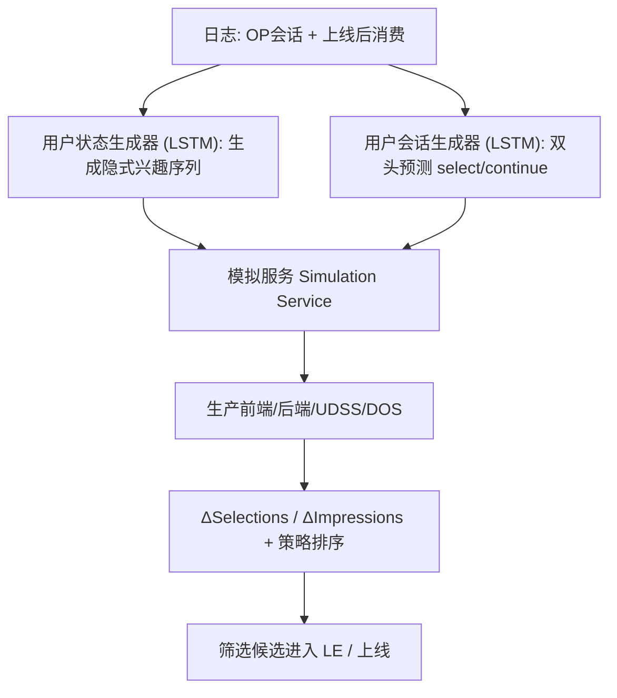

# Minimizing Live Experiments in Recommender Systems: User Simulation to Evaluate Preference Elicitation Policies (最小化推荐系统中的在线实验：用用户模拟评估偏好引导策略)

- **会议/期刊**: SIGIR 2024
- **作者与机构**: Chih-Wei Hsu, Martin Mladenov, Ofer Meshi, Craig Boutilier 等，Google Research & YouTube
- **推荐链路定位**: 冷启动偏好引导（召回前）
- **研究方向**: 对话推荐与智能体仿真 / 冷启动与长尾推荐
- **论文原文**: [论文原文链接](https://arxiv.org/abs/2409.17436v1)
- **开源代码**: 暂未开源

## TL;DR (1分钟核心速览)

新用户 onboarding 的偏好引导（PE）策略通常依赖在线 A/B 实验评估，但 onboarding 仅发生一次，实验成本与留存风险极高。本文提出“用户状态生成器 + 用户会话生成器 + 生产级模拟器”三件套：用 LSTM 从日志中学习反事实鲁棒的用户行为，并让模拟用户走完整 YouTube Music 生产栈。在移动端流量切片上，20 万模拟用户预测新 pCTR 策略 selections +1.36%，与 50 万真实上线用户 +1.17% 同号且置信区间重叠，而 13.4 万真实 LE 给出 -0.76% 的误导性符号；模拟对三个 λ 策略的排序也与上线数据完全一致。

## Background & Motivation (背景与核心矛盾)

- **主流范式**: 新用户冷启动常通过 onboarding 阶段的显式偏好引导（如询问喜欢的艺人）快速构建用户画像；新 PE 策略上线前必须经过在线 A/B 实验验证。
- **前人局限**: 在线实验周期长、样本需求大，且 onboarding 一次性体验失败后无法补救；传统离线模拟器多为 stylized 模型，只预测短期点击，不接入生产栈，难以评估 long-term 指标与全链路影响。
- **核心洞察 (Key Insight)**: 若用户模型在多个行为策略的数据上训练、具备一定反事实鲁棒性，并让模拟用户与真实生产基础设施交互，则模拟指标可逼近上线指标，且方差远小于小样本 LE。
- **本文切入点**: 不做单一算法优化，而是搭建“可预测上线效果”的仿真评估方法论，把模拟从算法开发工具升级为 LE 的替代/筛选器。

<figure class="paper-figure" markdown="span">
  <figcaption>图 1. 艺人选择界面。用户选择喜欢的艺人，跳过不喜欢的艺人。可滚动界面允许按需选择任意数量的艺人，点击“完成”确认引导流程结束。随着用户滚动，显示的艺人会根据先前的选择和未选择（或跳过）动态选取。</figcaption>
</figure>

## Method (核心方法设计)

### 1. 整体框架 (Overall Architecture)

系统输入为 YouTube Music onboarding 会话日志与用户上线后前 $W$周消费记录。用户状态生成器从可观测上下文$c_u$ 与隐式音乐兴趣序列中采样合成用户；用户会话生成器在每一轮根据静态状态与会话历史，决定“选择/跳过某艺人”及“是否终止”。两者通过模拟服务接入生产前端、后端、用户数据服务（UDSS）与数据叠加服务（DOS），输出 selections、impressions 等指标及候选策略排序，用于筛选进入 LE 的候选或直接支持上线决策。

### 2. 关键设计拆解 (Key Designs)

1. **变长兴趣序列生成器（User State Generator）**：隐式兴趣的联合分布不可直接建模。本文把上线后 top-$K$ 消费艺人当作“真实兴趣”监督，将联合分布因子分解为自回归形式：

   $$P(C_u)=P(c_u)\prod_{k=1}^{K}P(q_{uk}\mid c_u,q_{u1},\dots,q_{u,k-1})$$

   用 MLP 将 one-hot $c_u$编码为 LSTM 初始隐状态，艺术家嵌入$\phi(q)$ 直接复用 PE 模块；下一艺人以 multinomial logit 采样，并引入 null artist 支持变长：

   $$P(q_{u,k+1}\mid o_{uk})=\frac{\exp(\phi(q_{u,k+1})^\top o_{uk})}{\sum_{q\in\mathcal{Q}\setminus\{q_{ui}\}_{i\le k}}\exp(\phi(q)^\top o_{uk})+\exp(\phi_\varnothing^\top o_{uk})}$$

   直觉：这样生成的兴趣“数量分布”和“组成”能与真实用户对齐（用 Wasserstein 距离与 precision/recall 校验）。

2. **双头会话生成器（User Session Generator）**：PE 会话既要预测选择，又要预测中途退出。LSTM 输入拼接 $E(C_u)$、当前艺人嵌入$\phi(q_{ut})$、响应嵌入$\phi_r(r_{ut})$、累计选择数$y_t$与轮次$t$，输出经两个 sigmoid 头并做终止门控：

   $$P(r_{ut}=1\mid\cdot)=\sigma(\mathrm{MLP}(o_{u,t-1},\bar{x}_{u,t-1}))\cdot s_{u,t-1}$$

   $$P(s_{ut}=1\mid\cdot)=\sigma(\mathrm{MLP}(o_{u,t-1},\bar{x}_{u,t-1}))\cdot s_{u,t-1}$$

   把“已选数量”和“轮次”显式喂入，是复现真实 selection count 与 session length 分布的关键；终止后不再预测选择，避免逻辑矛盾。

3. **生产级模拟器与数据隔离**：模拟必须经过完整生产栈，又不能污染真实用户。前端服务与后端使用相同内容库和控制流；写路径由 DOS 将合成数据写入独立测试账户；读路径由 UDSS 识别模拟器请求后 overlay 模拟数据，上游服务零改动。该设计使模拟指标包含真实 UI、排序与下游推荐的全部细节。

**训练目标、负采样与推理效率**：状态生成器与会话生成器均用最大似然估计，$\max_\theta\sum_{u\in\mathcal{U}}\log P(C_u;\theta)$；艺人采样在候选集$\mathcal{Q}$ 上做全 softmax（隐式负采样 + null artist），无额外负样本构造。推理为自回归逐艺人生成，单会话截断 300 轮；模拟 20 万用户可在离线服务中并行完成，成本远低于同等样本量的 LE。

## Experimental Setup & Evaluation Protocol (实验设置与评估协议)

- **数据集与实验规模**: 工业 YouTube Music onboarding 日志，仅移动端。无公开数据集统计，核心规模如下：

| 阶段 | 用户规模 | 用途 |
| :--- | :---: | :--- |
| 模型训练 | 未披露（OP 日志 + 首 $W$ 周消费） | 训练状态/会话生成器 |
| 离线模拟 | 200,000 synthetic | 预测新 pCTR 策略 |
| Live Experiment | ~134,000 real | 对照评估 |
| Post-launch | 500,000 real | 真实上线指标 |

- **数据划分与防穿越**: 采用 pre-post 分析，假设指标与用户行为在观察窗口内稳定；训练数据来自已部署行为策略，测试策略为未见过的 pCTR 策略或不同 $\lambda$ 的 PE 策略。
- **排名/评估协议**: 不采用传统 Top-N 排序指标，而是评估指标相对变化 $\Delta\%$ 及 95% 置信区间、会话长度/选择数的 CDF 匹配、兴趣生成的 Wasserstein 距离与 precision/recall、选择预测 AUCLoss，以及策略排序一致性。
- **对比基线与超参**: 基线为 incumbent production policy（$\lambda=0.1$）与 original pCTR policy；新策略包括三个 pCTR 候选与九个$\lambda\in\{0.001,\dots,10\}$ 的 pCTR-coverage 折中策略。无显著性检验，以 95% CI 重叠作为主要判断依据。

## Key Experimental Results (实验关键数据)

### 1. 主实验对比 (Main Results)

新 pCTR 策略相对 incumbent 的指标变化（95% CI）：

| 评估方式 | 用户数 | Selections Δ% | Impressions Δ% |
| :--- | :---: | :---: | :---: |
| Live Experiment | ~134,000 | -0.76 [-5.05, 3.04] | -1.25 [-3.57, 1.07] |
| **Simulation** | 200,000 | **+1.36 [-0.11, 2.83]** | **-1.02 [-1.74, -0.31]** |
| Post-launch | 500,000 | +1.17 [-0.03, 2.36] | -0.78 [-1.15, -0.41] |

策略排序对比（$\lambda$ 对 selections 的影响，95% CI）：

| 评估 | $\lambda=0.001$|$\lambda=0.05$|$\lambda=0.2$ | 排序 |
| :--- | :---: | :---: | :---: | :--- |
| LE 1 | +0.71±3.35 | +1.60±1.91 | +1.17±3.81 | 0.05>0.2>0.001 |
| LE 2 | +1.62±3.40 | +0.54±2.96 | +0.52±3.38 | 0.001>0.05>0.2 |
| LE 3 | -2.11±2.50 | +0.07±3.02 | +0.61±3.36 | 0.2>0.05>0.001 |
| Launch | -0.12±1.88 | +0.75±1.22 | +0.79±1.98 | 0.2>0.05>0.001 |
| **Simulation** | **+0.07±3.42** | **+0.84±3.16** | **+2.35±3.32** | **0.2>0.05>0.001** |

### 2. 消融/敏感性实验 (Ablation & Sensitivity)

| 变体/组件 | 关键结果 | 结论 |
| :--- | :--- | :--- |
| RNN (LSTM) vs. Transformer | 生成质量相近 | 选 LSTM 为主，Transformer 无显著增益 |
| 状态生成器 w/o null artist | 无法匹配兴趣数量分布 | 变长机制必要 |
| 会话生成器 w/o $y_t,t$ 输入 | 选择数/会话长度分布偏移 | 计数与轮次特征是关键 |
| $\lambda=0.001/0.01/0.05/0.2/1/10$| selections 增益 0.07/0.20/0.84/2.35/-0.48/0.24% |$\lambda=0.2$ 最优，过大 coverage 反而伤害选择 |

### 3. 关键实验发现 (Key Findings)

1. **模拟显著降低评估方差**：LE 仅 13.4 万用户，selections CI 宽度约 8.1%，给出 -0.76% 的错误符号；模拟 20 万用户 CI 宽度仅 2.94%，预测 +1.36%，与上线后 50 万用户 +1.17% 同号且区间重叠。
2. **大规模 in-silico 排序比小样本 LE 更可靠**：三个小 LE 对 $\lambda$ 策略的排序互不一致，且均与 launch 排序不符；模拟排序 0.2>0.05>0.001 与 launch 完全一致，说明模拟可用于策略筛选与排序。
3. **反事实鲁棒性在相近策略上成立**：选择预测 AUCLoss 在训练数据为 0.763、上线后日志为 0.760，几乎无衰减；离线模拟选出的最佳 pCTR 候选上线后取得 +2.06% [0.20%, 3.92%] 的 CTR 增益，验证了“模拟筛选→LE 确认→上线”的闭环有效性。

## Highlights & Limitations (亮点、对比与审稿批判)

- **与代表作对比**: 相比 RecSim NG 等仅用于算法开发的模拟平台，本文将模拟器接入完整生产栈并用多策略数据训练；相比 Meta WW 等社交模拟工作，本文进一步用模拟直接预测上线指标并做策略排序，而不仅是分析用户动态。
- **可迁移亮点**: (1) 用上线后长期消费反推 onboarding 阶段的“真实兴趣”，为隐式状态生成提供监督；(2) 通过 UDSS/DOS 在读路径 overlay 模拟数据，实现模拟与真实用户数据隔离且不修改上游服务，适合工业级仿真部署。
- **审稿级局限批判**: (1) 会话生成依赖线性化 UI 假设，仅验证移动端，桌面端多艺人同屏场景可能失效；(2) 反事实鲁棒性无统计保证，当新策略与训练行为策略差异过大时模拟可能系统性偏差，且 impressions 排序在 Table 4 中模拟与 launch 并不一致，说明多指标排序仍不稳定。

## Rating (四维评分)

- **方法创新性 (Novelty)**: ⭐⭐⭐⭐ （将用户模拟从算法开发工具推进为 LE 替代方案，生产栈耦合与反事实鲁棒性验证有较强系统创新）
- **评估协议与实验扎实度 (Protocol & Experiments)**: ⭐⭐⭐⭐ （同时对比 LE、模拟与上线后真实指标，策略排序实验设计巧妙；但缺少多场景、多产品验证与正式显著性检验）
- **写作与数学规范度 (Clarity & Rigor)**: ⭐⭐⭐⭐ （生成模型公式清晰、假设明确；部分工业细节与数据统计披露有限）
- **工业落地与复现价值 (Industrial & Practical Value)**: ⭐⭐⭐⭐⭐ （直接面向 YouTube Music 生产环境，数据隔离与模拟服务架构对工业界极具参考价值；但代码未开源，复现门槛高）

