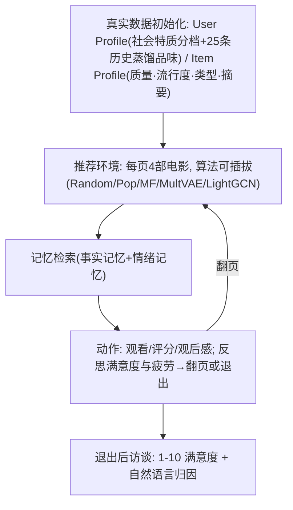

# On Generative Agents in Recommendation (论推荐场景中的生成式智能体)

- **会议/期刊**: SIGIR 2024 (Perspective Paper)
- **作者与机构**: An Zhang, Yuxin Chen, Leheng Sheng, Xiang Wang, Tat-Seng Chua（NUS / 清华 / USTC）
- **推荐链路定位**: 端到端仿真评测（替代线上 A/B 的用户侧模拟器）
- **研究方向**: 对话推荐与智能体仿真 / 大语言模型推荐
- **论文原文**: [https://arxiv.org/abs/2310.10108v3](https://arxiv.org/abs/2310.10108v3)
- **开源代码**: [https://github.com/LehengTHU/Agent4Rec](https://github.com/LehengTHU/Agent4Rec)

## TL;DR (1分钟核心速览)

针对"离线指标与线上表现严重脱节、真实用户数据昂贵"这一根本矛盾，本文提出 Agent4Rec——用 1000 个 gpt-3.5-turbo 驱动的生成式智能体作为虚拟用户，为其设计画像（社会特质+品味蒸馏）、记忆（事实+情绪双通道、情绪驱动反思）与动作（品味驱动/情绪驱动）三模块，在按页推荐环境中与 Random/Pop/MF/MultVAE/LightGCN 交互。实验表明 agent 在 1:1 判别下品味对齐准确率约 69%、召回约 75%，且能复现信息茧房与流行度偏差的因果闭环。

## Background & Motivation (背景与核心矛盾)

- **主流范式**: 推荐研究依赖离线监督指标（Recall/NDCG）与静态日志，系统评估则以线上 A/B 为金标准。
- **前人局限**: 传统仿真器（Virtual Taobao、RecSim、RecoGym）依赖手写规则或简单反馈模型，**行为空间僵化**、无法表达疲劳/满足等心理过程；而 RecAgent 等先驱仅做行为集成，未验证 agent 与真人的**分布级对齐**。
- **核心洞察 (Key Insight)**: LLM 已具备常识与人物角色扮演能力，若把"用户"显式建模为拥有记忆与情绪的智能体，其群体行为分布应能与真实日志的宏观统计（评分分布、活跃度长尾）吻合，从而支撑可控、可解释的仿真实验。
- **本文切入点**: 以**社会特质三层分档 + 情绪记忆反思 + 退出决策**三个推荐域专属设计，把通用生成式智能体改造为推荐用户，并首次系统回答"agent 能在多大程度上忠实模拟真人"。

## Method (核心方法设计)

### 1. 整体框架 (Overall Architecture)

系统由"智能体侧"与"推荐环境侧"构成。每个 agent 由真实数据集（MovieLens-1M / Steam / Amazon-Book）初始化：画像模块写入社会特质分档与 LLM 依据 25 条历史蒸馏出的品味；推荐环境每页推送 4 部电影（含质量、流行度、类型、LLM 摘要），推荐算法为可插拔独立模块。agent 先做记忆检索，再执行品味驱动动作（观看/评分/观后感），情绪记忆累积到阈值后触发反思，用 Chain-of-Thought 输出当前页满意度与疲劳度，据此决定翻页或退出（上限 5 页）；退出后接受访谈给出 1–10 满意度与自然语言理由。全流程无参数训练，仅由 LLM 前向推理驱动。

<figure class="paper-figure" markdown="span">
  <figcaption>图 2</figcaption>
</figure>

### 2. 关键设计拆解 (Key Designs)

1. **社会特质画像（Profile）**：通用 agent 画像缺乏推荐域语义，导致所有虚拟用户行为趋同。本文用三条可计算统计量把用户分为高/中/低三档写入 prompt——活跃度 $T_u^{act}=\sum_{i\in\mathcal{I}}y_{ui}$、从众度$T_u^{conf}=\frac{1}{\sum_i y_{ui}}\sum_{i}y_{ui}\,|r_{ui}-R_i|^2$（与物品均分$R_i$的偏离）、多样性$T_u^{div}=|\bigcup_{i:y_{ui}=1}G_i|$。直觉：这三者对应"看多少/多独立/多宽"，是行为节奏而非内容偏好的决定量，因而能解释同样口味下的行为分化。

2. **情绪驱动记忆与反思（Memory）**：前人记忆只摘要事实（self-summarization/correction），忽略情绪对决策的主导作用。本文把记忆分为事实（推荐列表、反馈）与情绪（疲劳、满足）双通道，以自然语言+向量双格式存储；当交互步数超过阈值触发反思，令 LLM 自评"当前满意度/疲劳度"，作为退出概率的隐变量。直觉：退出行为本质是情绪耗竭，而非内容耗尽，因此必须显式建模。

3. **情绪驱动动作与访谈（Action）**：退出决策由 CoT 串联"识别当前页→检索历史满意→表达疲劳→结合活跃度决定退出"，避免单步 prompt 的短视；退出后访谈产出可解释评价。**训练/推理开销**：无损失函数、无负采样，成本即每 agent 每页 2–4 次 LLM 调用（观看判别、评分、反思、访谈），1000 agent × 5 页约需万级 API 调用，是主要瓶颈。

## Experimental Setup & Evaluation Protocol (实验设置与评估协议)

- **数据集与预处理**：三个域各初始化 1000 个 agent；仅保留 LLM 能正确预测类型的物品（类型误判即剪枝），以抑制幻觉。

| 数据集 | #Agents | #Items(可用) | 特征/场景 | 说明 |
| :--- | :---: | :---: | :--- | :--- |
| MovieLens-1M | 1,000 | 经类型剪枝 | 电影，18 类 | 主实验 + 茧房/因果分析 |
| Amazon-Book | 1,000 | 经类型剪枝 | 图书 | 仅品味对齐 |
| Steam | 1,000 | 经类型剪枝 | 游戏 | 仅品味对齐 |

- **数据划分与防穿越**: 采用"历史/判别集切分"——画像初始化只用 25 条历史；对齐测试时另取用户**未参与初始化**的正反馈与未交互物品混合，属于严格防泄漏设计。
- **排名评测协议**: 非 Full-Ranking，而是**固定候选的二分类判别 + 分布对齐**（Acc/Recall/Precision/F1），另以互动模拟指标（$P_{view}$、$N_{like}$、$P_{like}$、$N_{exit}$、$S_{sat}$）与离线 Recall@20/NDCG@20 双轨评估。
- **对比基线与超参**: 推荐侧基线 Random、MostPop、MF、MultVAE、LightGCN；正负比 $1{:}m,\;m\in\{1,2,3,9\}$；LLM 固定 gpt-3.5-turbo。

## Key Experimental Results (实验关键数据)

### 1. 主实验对比 (Main Results)

**表 1 品味对齐（判别正负比 1:1 与 1:9）**

| 数据集 | 正负比 | Accuracy | Recall | Precision | F1 |
| :--- | :---: | :---: | :---: | :---: | :---: |
| MovieLens | 1:1 | **0.6912** | 0.7460 | **0.6914** | **0.6982** |
| MovieLens | 1:9 | 0.6175 | **0.7753** | 0.2139 | 0.3232 |
| Amazon-Book | 1:1 | **0.7190** | **0.7276** | **0.7335** | **0.7002** |
| Amazon-Book | 1:9 | 0.6617 | 0.6939 | 0.2369 | 0.3183 |
| Steam | 1:1 | **0.6892** | 0.7059 | **0.7031** | **0.6786** |
| Steam | 1:9 | 0.6021 | 0.7213 | 0.1901 | 0.2822 |

**表 2 推荐策略评估（MovieLens，仿真侧指标）**

| 策略 | $P_{view}$|$N_{like}$|$P_{like}$|$N_{exit}$|$S_{sat}$ |
| :--- | :---: | :---: | :---: | :---: | :---: |
| Random | 0.312 | 3.30 | 0.269 | 2.99 | 2.93 |
| MostPop | 0.398 | 4.45 | 0.360 | 3.01 | 3.42 |
| MF | 0.488 | **6.07** | 0.462 | **3.17** | 3.80 |
| MultVAE | 0.495 | 5.69 | 0.452 | 3.10 | 3.75 |
| LightGCN | **0.502** | 5.73 | **0.465** | 3.02 | **3.85** |
| Improv. (vs Random) | +60.9% | +83.9% | +72.9% | +6.0% | +31.4% |

**表 3 逐页反馈增强（+Viewed 视为正样本重训）**

| 算法 | Recall@20 | NDCG@20 | $N_{exit}$|$S_{sat}$ |
| :--- | :---: | :---: | :---: | :---: |
| MF Origin | 0.1506 | 0.3561 | 3.17 | 3.80 |
| MF + Viewed | **0.1570** | **0.3604** | **3.27** | **3.83** |
| MultVAE Origin | 0.1609 | 0.3512 | 3.10 | 3.75 |
| MultVAE + Viewed | **0.1613** | **0.3540** | **3.18** | **3.87** |
| LightGCN Origin | 0.1757 | 0.3937 | 3.02 | 3.85 |
| LightGCN + Viewed | **0.1765** | **0.3943** | **3.10** | **3.92** |

### 2. 消融实验 (Ablation Study)

| 配置 | 观测指标 | 变化 | 结论 |
| :--- | :--- | :--- | :--- |
| w/o Activity 特质 | 高/中/低活跃组交互数分布（图 5） | 三档分布显著重叠，长尾消失 | 社会特质是行为异质性的必要来源 |
| w/ Diversity 特质（弱） | 个体多样性分布（图 6） | 仿真分布与真值仍有偏移 | ML 类型重叠过强，该维度区分度不足 |
| + Unviewed 作为正样本 | MF/LightGCN 的 NDCG、$S_{sat}$| NDCG 0.3937→0.3849，$S_{sat}$ 3.85→3.81 | 噪声增强会同时劣化离线与仿真指标，验证仿真反馈的可判别性 |

### 3. 关键实验发现 (Key Findings)

1. **对齐稳定但存在"固定点赞数"幻觉**：正负比从 1:1 恶化到 1:9 时，MovieLens 召回仅由 0.746 升至 0.775（几乎恒定），但精确率从 0.691 崩到 0.214——说明 agent 倾向恒定挑选固定数量物品，而非按比例判别，这是 LLM 幻觉的直接量化证据。
2. **仿真指标与真实世界排序先验一致**：LightGCN 的 $P_{view}$0.502 比 Random 0.312 高 60.9%、$S_{sat}$ 3.85 vs 2.93，且 LightGCN > MF > MultVAE > Pop > Random 的序关系与文献结论吻合，支持其作为低成本 A/B 替代的可行性。
3. **agent 的"观看"动作携带真实偏好信号**：把 viewed 作为正样本重训可让 LightGCN 的 $S_{sat}$ 从 3.85 提到 3.92、NDCG 0.3937→0.3943；而把 unviewed 当作正样本则全面下降——证明仿真产生的隐式反馈具备可用的信噪结构，而非随机噪声。
4. **茧房与因果闭环被复现**：MF 连续 4 轮重训后 $N_{genres}$单调下降、$P_{top1\text{-}genre}$ 单调上升；DirectLiNGAM 学出的 DAG 中"质量→评分"权重 0.86 远高于"流行度→评分"0.13，但"流行度→曝光率"高达 0.97、曝光率→观看数 0.41，构成流行度自我放大的反馈回路。

## Highlights & Limitations (亮点、对比与审稿批判)

- **与代表作对比 (vs. Prior Work)**: 相较 RecSim/Virtual Taobao 的规则化用户模型，本文用 LLM 内生常识替代手写转移概率；相较 RecAgent 侧重行为种类堆叠，本文把评估重心放在**分布级对齐检验**（评分分布、特质分布、统计检验），方法论上更接近"仿真器可信度验证"；相较 RecMind/InteRecAgent 把 LLM 当推荐器，本文反向把 LLM 当用户。
- **可迁移亮点**: (1) 用三条可计算统计量把连续用户行为离散成 prompt 可读的特质分档，是低成本人格注入范式；(2) "情绪记忆 + 阈值反思"可直接迁到对话推荐的用户耐心/流失建模与多轮退出预测。
- **审稿级局限批判**: (1) **缺乏真人对照闭环**——所有"对齐"都是与离线日志的宏观分布比较，无同一批用户在线行为的配对检验，无法排除"分布巧合"；(2) **成本与稳定性**：1000 agent × 5 页即万级 API 调用，且论文自承存在虚构物品、拒绝给低分、格式违规等幻觉，长时仿真的一致性未量化；(3) 因果发现用 DirectLiNGAM 线性假设，且数据本身由 LLM 生成，所"发现"的因果可能只是 LLM 先验的镜像。

## Rating (四维评分)

- **方法创新性 (Novelty)**: ⭐⭐⭐⭐ （首个面向推荐的千级 LLM 用户仿真器，情绪记忆与反思退出机制是明确增量，但整体架构沿用 Generative Agents 骨架）
- **评估协议与实验扎实度 (Protocol & Experiments)**: ⭐⭐⭐ （三数据集 + 双轨指标 + 多比率鲁棒性检验较完整，但缺少真人配对基线、无显著性检验、无 Full-Ranking 协议）
- **写作与数学规范度 (Clarity & Rigor)**: ⭐⭐⭐⭐ （三特质定义式简洁可复现，仿真流程图文清晰；但对齐度量缺乏形式化误差界）
- **工业落地与复现价值 (Industrial & Practical Value)**: ⭐⭐⭐ （代码与接口开源、算法可插拔，适合做冷启动/茧房沙盒；但 LLM 调用成本与幻觉稳定性使其短期难替线上 A/B）

