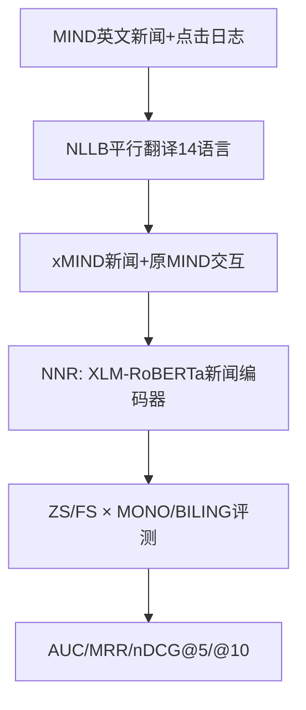

# MIND Your Language: A Multilingual Dataset for Cross-lingual News Recommendation (MIND Your Language：面向跨语言新闻推荐的多语言数据集)

- **会议/期刊**: SIGIR 2024
- **作者与机构**: Andreea Iana, Goran Glavaš, Heiko Paulheim；University of Mannheim, CAIDAS University of Würzburg
- **推荐链路定位**: 精排/候选排序（内容侧新闻编码）
- **研究方向**: 冷启动与长尾推荐（跨语言低资源迁移）
- **论文原文**: [论文原文链接](https://arxiv.org/abs/2403.17876v1)
- **开源代码**: [xMIND](https://github.com/andreeaiana/xMIND) / [NewsRecLib](https://github.com/andreeaiana/newsreclib)

## TL;DR (1分钟核心速览)

针对新闻推荐长期局限英语/单语、低资源语言缺基准的问题，本文用NLLB将MIND平行翻译为14种语言，发布xMIND，并在零样本(ZS-XLT)与少样本(FS-XLT)、单语/双语消费四类协议下系统评测NNR。结果显示：即便用XLM-RoBERTa，ZS-XLT的nDCG@10仍平均下降3.78%–8.11%，FS注入目标语收益有限，双语场景尤甚。

## Background & Motivation (背景与核心矛盾)

- **主流范式**: 内容型神经新闻推荐器(NNR)以新闻编码器+用户编码器+点积打分排序为主，几乎全部在英语MIND等单语基准上开发。
- **前人局限**: 现有新闻推荐数据集多为单语；少数多语数据仅覆盖高资源语言、规模小/主题受限，或为私有数据。且NNR默认用户单语消费，无法支持多语用户跨语言浏览。
- **核心洞察 (Key Insight)**: 多语用户同时消费英语与低资源语言新闻，需“平行多语言”数据以隔离语言因素，直接比较跨语言迁移；仅换多语预训练模型(mPLM)未必解决。
- **本文切入点**: 用机器翻译构造14语言平行xMIND，并以ZS/FS×MONO/BILING四类协议系统诊断NNR跨语言失效模式。

## Method (核心方法设计)

### 1. 整体框架 (Overall Architecture)

xMIND以MIND英文新闻为源，用NLLB 3.3B将标题与摘要平行翻译到14种语言，保留MIND新闻ID、类别、实体与点击日志；实验时将各NNR的新闻编码器替换为XLM-RoBERTa，在英语训练后分别做零样本/少样本、单语/双语消费评测，统一用AUC、MRR、nDCG@5/@10排序。

### 2. 关键设计拆解 (Key Designs)

1. **平行多语言数据构建与多样性度量**：痛点是非平行数据无法公平比较语言间迁移。本文选14种语言，覆盖5个地理宏区、13个语系、6种文字、5种低资源语言；用三个指数量化多样性：$D_{\text{typ}}=\frac{1}{103}\sum_{f=1}^{103}H(f)$，$D_{\text{fam}}=|\mathcal{F}|/|\mathcal{L}|$，$D_{\text{geo}}=-\sum_{m=1}^{6}p_m\log p_m$。xMIND得0.42/0.93/1.13，显著高于NeMig与Wu等私有数据，使跨语言对比可复现。
2. **翻译质量与鲁棒性控制**：NLLB采用4-beam解码，6个验证语言对上sacreBLEU=19.03；人工标注检查可理解性/忠实度，并用GNMT商业翻译对照。虽然人工更偏好GNMT，但NNR在两种翻译上的排序差异不显著($p=0.05$ T-test)，说明结论不被翻译源主导。
3. **跨语言评测协议与训练目标**：定义ZS-XLTMONO、ZS-XLTBILING、FS-XLTMONO、FS-XLTBILING；FS按$r\in\{10\%,\ldots,90\%\}$用目标语新闻替换英文训练样本。NNR用交叉熵$\mathcal{L}_{\text{CE}}=-\log\frac{\exp(s^+)}{\exp(s^+)+\sum_{j=1}^{4}\exp(s_j^-)}$，每正样本采4负；MANNeR用SCL；推理按曝光候选打分，不重训。

## Experimental Setup & Evaluation Protocol (实验设置与评估协议)

- **数据集与预处理**: 未采用5-core；沿用MIND原始新闻/曝光日志。xMIND共130,379条唯一新闻，14个目标语言；实验用xMINDsmall，平均用户历史长度33。

| 数据集/版本 | #Users | #Items(News) | #Interactions | 稀疏度/说明 |
| :--- | :---: | :---: | :---: | :--- |
| xMIND | 原文未报告 | 130,379 | 复用MIND点击日志 | 14语言平行；5.4%新闻无摘要 |
| xMINDsmall实验 | 原文未报告 | Train 51,282 / Dev 42,416 | 原文未报告 | MINDsmall曝光；验证集作测试 |

- **数据划分与防穿越 (Splitting Strategy)**: 各语言对齐MIND原始train/dev/test；因MIND测试标签未公开，实验用验证集作测试，并将训练集按时间切为前4天训练、最后1天验证。
- **排名评测协议 (Ranking Protocol)**: `Sampled Ranking`，即MIND曝光候选内排序（含负候选），非全库Full-Ranking；指标为AUC、MRR、nDCG@5、nDCG@10，14语言平均，3个随机种子取均值。
- **对比基线与超参设置**: 8个内容型NNR：NAMLCAT、NAML、LSTUR、MINS、CAUM、TANR、MINER、MANNeR；XLM-RoBERTa仅微调最后4层，TransE实体向量100维，batch=8，10 epochs early stopping，Adam，lr搜索$[10^{-3},10^{-4},10^{-5}]$。

## Key Experimental Results (实验关键数据)

### 1. 主实验对比 (Main Results)

ZS-XLTMONO下nDCG@10（ENG为英语同分布，AVG为14语言平均；“Improv.”相对语言无关NAMLCAT）：

| 模型 | ENG nDCG@10 | AVG nDCG@10 | %Δ vs ENG | Improv. vs NAMLCAT |
| :--- | :---: | :---: | :---: | :---: |
| NAMLCAT | 35.81 | 35.81 | 0.00 | 0.00 |
| CAUM-PLM | 37.49 | 35.96 | -4.08 | +0.42 |
| LSTUR-PLM | 37.45 | 36.03 | -3.78 | +0.61 |
| MINER | 36.45 | 35.02 | -3.90 | -2.21 |
| MINS-PLM | 39.35 | 37.64 | -4.35 | +5.11 |
| MANNeR | 40.17 | 37.64 | -6.28 | +5.11 |
| NAML-PLM | **40.43** | **38.38** | -5.06 | **+7.18** |
| TANR-PLM | 40.03 | 36.78 | -8.11 | +2.71 |

### 2. 消融实验 (Ablation Study)

原文无模型组件消融；以下为受控场景/因素分析：

| 分析项 | 变体/设置 | 代表结果 | 结论 |
| :--- | :--- | :--- | :--- |
| 内容 vs 类别 | NAMLCAT vs NAML-PLM | 35.81→38.38 | 文本内容带来+7.18% |
| ZS-MONO | NAML-PLM英语→14语言 | 40.43→38.38 | -5.06%；TANR最大-8.11% |
| FS-MONO | 目标语比例<30–40% | 低于ZS-XLT | 少量目标语会混淆用户编码 |
| FS-BILING | NAML-PLM多比例混合 | 多不优于ZS-BILING | 双语下FS收益有限 |
| 翻译源 | NLLB vs GNMT | 差异不显著 | NNR对翻译源鲁棒 |

### 3. 关键实验发现 (Key Findings)

1. **mPLM不等于跨语言可用**：ZS-XLTMONO平均掉点3.78%–8.11%；英语最强NAML-PLM在目标语仍最高(38.38)，但相对英语掉5.06%。HAT/GRN（XLM-R未见过）最差，VIE/IND/RON/FIN较好。
2. **FS只在目标语占比足够时有用**：目标语<30–40%时反低于ZS；>40%后低资源/未登录语言收益更明显。双语消费下，NAML-PLM多数混合比例不优于纯英语训练，说明FS不是通用解药。
3. **翻译噪声不是主要瓶颈**：人工判断GNMT整体优于NLLB，但NNR在两种翻译上的nDCG@10无显著差异；真正瓶颈在用户编码器对多语历史的鲁棒性与语言覆盖。

## Highlights & Limitations (亮点、对比与审稿批判)

- **与代表作对比 (vs. Prior Work)**: MIND仅英语；NeMig仅英德、主题受限且小；Wu等私有且全高资源。xMIND以14语言平行、开放、含低资源语言，首次支撑可控跨语言新闻推荐基准。
- **可迁移亮点**: “平行翻译+多样性指数+ZS/FS×MONO/BILING”协议可迁移到多语电商/短视频；NewsRecLib加载脚本降低复现成本。
- **审稿级局限批判**: 数据为机器翻译且新闻主题偏美国语境，低资源语言翻译质量仍有限；评测基于MINDsmall曝光候选而非全库排序，且无线上A/B与推理时延分析。

## Rating (四维评分)

- **方法创新性 (Novelty)**: ⭐⭐⭐⭐ （资源与基准贡献突出，14语言平行设计新颖；但无新推荐模型）
- **评估协议与实验扎实度 (Protocol & Experiments)**: ⭐⭐⭐⭐ （四类迁移协议+8个NNR+3种子+T检验；但采样排序非全库）
- **写作与数学规范度 (Clarity & Rigor)**: ⭐⭐⭐⭐ （数据构造、语言统计与质控清晰，公式克制；部分表格排版较密）
- **工业落地与复现价值 (Industrial & Practical Value)**: ⭐⭐⭐⭐ （数据与加载代码开源，低资源迁移结论可直接指导多语新闻产品；线上时延未评估）

