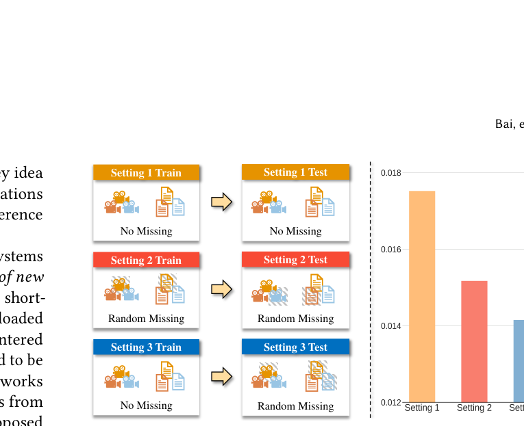
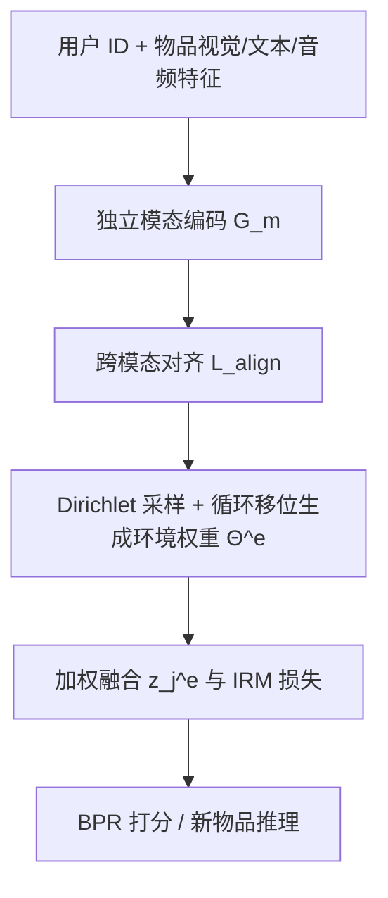
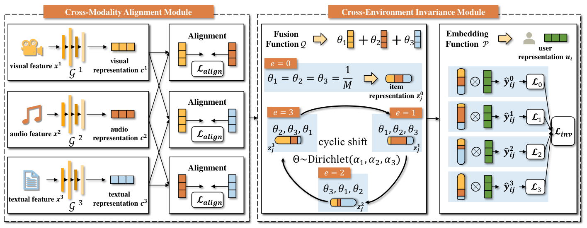

# Multimodality Invariant Learning for Multimedia-Based New Item Recommendation (多模态不变学习用于多模态新物品推荐)

- **会议/期刊**: SIGIR 2024
- **作者与机构**: Haoyue Bai, Le Wu, Min Hou, Miaomiao Cai, Zhuangzhuang He, Yuyang Zhou, Richang Hong, Meng Wang；合肥工业大学、数据空间研究院等
- **推荐链路定位**: 召回（新物品内容召回）
- **研究方向**: 冷启动与长尾推荐 / 多模态推荐
- **论文原文**: [https://arxiv.org/abs/2405.15783v1](https://arxiv.org/abs/2405.15783v1)
- **开源代码**: [https://github.com/HaoyueBai98/MILK](https://github.com/HaoyueBai98/MILK)

## TL;DR (1分钟核心速览)

针对新物品无交互且多模态特征任意缺失导致训练/测试分布偏移的问题，MILK 用独立模态编码+跨模态对齐保持语义一致，再用 Dirichlet 采样与循环移位构造多模态异构环境，以 IRM 方差惩罚学习对缺失不变的用户内容偏好。在 Baby/Clothing/TikTok 的新物品全库 Recall/NDCG 评测中，FTMT 与 MTMT 两种缺失设置均优于 7 个主流基线，NDCG@20 最高相对提升约 17.5%（Clothing FTMT）。

## Background & Motivation (背景与核心矛盾)

- **主流范式**: 多模态新物品推荐依赖预训练视觉/文本/音频特征，将用户 ID 与物品内容映射到同一偏好空间；图多模态方法则依赖用户-物品交互图传播。
- **前人局限**: (1) 新物品无历史交互，图/转导式模型难以在推理阶段直接适配；(2) 真实物品常随机缺失模态，现有方法多假设模态完整或靠插补预处理，训练/测试分布 $P_{\text{train}}\neq P_{\text{test}}$ 时性能明显下降。
- **核心洞察 (Key Insight)**: 用户对内容的内在偏好应稳定，且对任意模态缺失环境保持不变；图 1 显示 DUIF 在训练/测试缺失模式不一致时跌幅更大，简单插补或删缺失样本无效。
- **本文切入点**: 将“模态缺失”视为不同环境，用不变学习强制跨环境预测一致，并用有限行为数据构造可泛化的缺失环境。

<figure class="paper-figure" markdown="span">
  <figcaption>图 1</figcaption>
</figure>

## Method (核心方法设计)

### 1. 整体框架 (Overall Architecture)

输入用户 ID 与物品视觉/文本/音频预训练特征；各模态经独立 MLP 得 $\mathbf{c}_j^m$，对齐损失拉近同一物品任意可用模态；融合权重$\Theta^e$由 Dirichlet 采样并循环移位生成$M+1$个环境（$e=0$ 为等权）；每个环境内用 BPR 打分，IRM 惩罚各环境损失方差，总损失再加对齐项。推理时对缺失模态做均值插补，采用等权融合一次前向，直接对无交互新物品打分。

<figure class="paper-figure" markdown="span">
  <figcaption>图 2</figcaption>
</figure>

### 2. 关键设计拆解 (Key Designs)

1. **CMAM（跨模态对齐）**：共享拼接编码器会被缺失模态污染，故先为每个模态设独立 $G_m$：$\mathbf{c}_{j}^{m}=\mathbf{W}_m\mathbf{x}_{j}^{m}+\mathbf{b}_m$；再用$\mathcal{L}_{\text{align}}=\sum_j\sum_{m<m'}a_{jm}a_{jm'}\|\mathbf{c}_j^m-\mathbf{c}_j^{m'}\|^2$ 只对齐可用模态。直觉：独立通道保底，跨模态拉近使任一模态可从其余模态借语义。
2. **循环 Mixup 异构环境 + IRM**：无环境标签时，用 $\Theta^1\sim\mathrm{Dirichlet}(\alpha_1,\ldots,\alpha_M)$生成非均衡权重，再$\Theta^m=\mathrm{circleShift}(\Theta^{m-1})$让每个模态轮流主导；$e=0$始终保留等权环境。环境内 BPR 损失$\mathcal{L}_e$，不变约束$\mathcal{L}_{\text{inv}}=\mathbb{E}_e[\mathcal{L}_e]+\beta\mathrm{Var}_e(\mathcal{L}_e)$ 迫使预测跨缺失模式稳定。
3. **优化与推理**：总损失 $\mathcal{L}=\mathbb{E}_e[\mathcal{L}_e]+\beta\mathrm{Var}_e(\mathcal{L}_e)+\lambda\mathcal{L}_{\text{align}}+\|\Phi\|_2^2$；BPR 每正例采 1 负例。训练需$M+1$ 个环境前向/反向，推理仅等权一次前向，故线上新物品打分开销与普通内容模型同阶。

## Experimental Setup & Evaluation Protocol (实验设置与评估协议)

- **数据集与预处理**: 原文称使用预处理后的公开数据，未额外声明 5-core；新物品从训练交互中删除，验证/测试各占一半。

| 数据集 | #Users | #Items（训练/新物品） | #Interactions | 密度 | 模态/场景 |
| :--- | :---: | :---: | :---: | :---: | :--- |
| Baby | 19,442 | 5,640 / 705 | 128,963 | 0.118% | 视觉+文本 |
| Clothing | 39,384 | 18,427 / 2,303 | 222,759 | 0.031% | 视觉+文本 |
| TikTok | 9,319 | 5,368 / 671 | 55,126 | 0.110% | 视觉+音频+标题 |

- **数据划分与防穿越 (Splitting Strategy)**: 随机选 20% 物品删除训练交互作为新物品，其中一半验证、一半测试；新物品在训练集完全不可见。
- **排名评测协议 (Ranking Protocol)**: 使用 Recall@10/20、NDCG@10/20；候选为验证/测试新物品全集，按 Full-Ranking 计算（原文未报告采样负例比）。训练 BPR 每正例采 1 个负例。
- **对比基线与超参设置**: 对比 DUIF、MICRO、DropoutNet、MTPR、Heater、CLCRec、CCFCRec、GAR、GoRec；MMGCN 等图模型因需交互图未比。Embedding $d=64$，batch 2048，Adam，lr$10^{-3}$，5 次平均，未报告显著性检验。FTMT：训练完整、测试 50% 物品随机缺一模态；MTMT：训练 30% 物品随机缺一模态，测试仍含缺失。

## Key Experimental Results (实验关键数据)

### 1. 主实验对比 (Main Results)

指标为 NDCG@20；F=FTMT，M=MTMT。

| 模型 | Baby F | Baby M | Clothing F | Clothing M | TikTok F | TikTok M |
| :--- | :---: | :---: | :---: | :---: | :---: | :---: |
| DUIF | 0.0163 | 0.0125 | 0.0137 | 0.0140 | 0.1803 | 0.1706 |
| DropoutNet | 0.0071 | 0.0098 | 0.0123 | 0.0100 | 0.0956 | 0.0860 |
| MTPR | 0.0208 | 0.0139 | 0.0165 | 0.0140 | 0.1211 | 0.1229 |
| Heater | 0.0222 | 0.0185 | 0.0237 | 0.0223 | 0.1016 | 0.0975 |
| CLCRec | 0.0181 | 0.0143 | 0.0210 | 0.0185 | 0.1249 | 0.1080 |
| CCFCRec | 0.0209 | 0.0154 | 0.0259 | 0.0207 | 0.1802 | 0.1596 |
| GoRec | 0.0249 | 0.0206 | 0.0292 | 0.0300 | 0.1124 | 0.0988 |
| MILK | **0.0277** | **0.0234** | **0.0343** | **0.0329** | **0.1852** | **0.1779** |
| 相对最强基线 | +11.2% | +13.6% | +17.5% | +9.7% | +2.7% | +4.3% |

注：提升按表中 NDCG@20 相对最强基线计算；Clothing FTMT 原文正文报告 14.0%，与表值实算 17.5% 略有出入。

### 2. 消融实验 (Ablation Study)

均 FTMT；NDCG@20。

| 变体 | Baby | Clothing |
| :--- | :---: | :---: |
| w/o CMAM&CEIM + Zero | 0.0215 | 0.0322 |
| + Mean 插补 | 0.0228 | 0.0320 |
| + Map 插补 | 0.0220 | 0.0294 |
| 仅 CMAM | 0.0255 | 0.0330 |
| 仅 CEIM | 0.0264 | 0.0335 |
| MILK | **0.0277** | **0.0343** |

### 3. 关键实验发现 (Key Findings)

1. **全设置领先，但增益随数据模态丰富度收窄**：Baby/Clothing 的 NDCG@20 相对最强基线提升 +11.2%～+17.5%，TikTok 仅 +2.7%/+4.3%；说明三模态且 DUIF/CCFCRec 已较强时，缺失鲁棒性收益更边际。
2. **CMAM 与 CEIM 互补而非重复正则**：Baby 上仅 CMAM/仅 CEIM 相比 Zero 分别提升约 18.6%/22.8%，二者合并 +28.8%；对齐提供“可用模态互补”，IRM 提供“跨缺失环境稳定”。
3. **动态环境构造是鲁棒性核心**：Baby 从 FTFT 到 FTMT 的跌幅由无模块 37.15% 降至 24.59%；去掉等权环境 $e=0$ 后 NDCG@20 从 .0277 跌至 .0179，去掉循环移位跌至 .0205，固定随机权重跌至 .0237。

## Highlights & Limitations (亮点、对比与审稿批判)

- **与代表作对比 (vs. Prior Work)**: DUIF 只做内容建模且假设模态完整；GoRec/CCFCRec 借 CF 或生成器补新物品，但仍未显式建模缺失模态导致的分布偏移；MILK 将缺失视为环境，无需环境标签即可学习不变偏好。
- **可迁移亮点**: Dirichlet+循环移位的环境构造可迁移到跨域/多场景缺失建模；独立模态编码+可用模态对齐适合冷启动多模态召回。
- **审稿级局限批判**: 推理仍用均值插补，未真正生成缺失模态；训练需 $M+1$个环境，计算约线性增加，且$\alpha,\beta,\lambda$ 数据集敏感；仅三数据集离线实验，无显著性检验/线上 A/B，Clothing 提升正文与表值有出入。

## Rating (四维评分)

- **方法创新性 (Novelty)**: ⭐⭐⭐⭐ （将模态缺失转为环境分布偏移，循环 Mixup 构 env 与 IRM 结合较新颖）
- **评估协议与实验扎实度 (Protocol & Experiments)**: ⭐⭐⭐⭐ （三数据集、两种缺失设置、9 个基线、5 次平均；但采样协议与显著性检验不足）
- **写作与数学规范度 (Clarity & Rigor)**: ⭐⭐⭐⭐ （模块与公式清晰，环境/推理链路完整；个别提升数值前后不完全一致）
- **工业落地与复现价值 (Industrial & Practical Value)**: ⭐⭐⭐⭐ （代码开源，推理单次前向；训练多环境开销与超参敏感需工程权衡）

