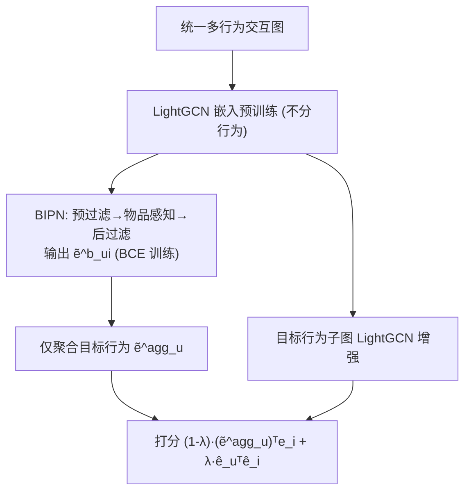
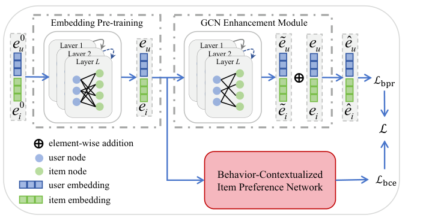

# Behavior-Contextualized Item Preference Modeling for Multi-Behavior Recommendation (面向多行为推荐的行为上下文化物品偏好建模)

- **会议/期刊**: SIGIR 2024
- **作者与机构**: Mingshi Yan, Fan Liu, Jing Sun, Fuming Sun, Zhiyong Cheng, Yahong Han（天津大学 / 新加坡国立大学 / 大连民族大学 / 合肥工业大学）
- **推荐链路定位**: 召回（用户-物品表示学习与 Top-K 排序）
- **研究方向**: 协同过滤与双塔召回 / 自监督对比学习与交互去噪
- **论文原文**: [https://arxiv.org/abs/2404.18166v1](https://arxiv.org/abs/2404.18166v1)
- **开源代码**: [https://github.com/MingshiYan/BIPN](https://github.com/MingshiYan/BIPN)

## TL;DR (1分钟核心速览)

多行为推荐常把点击/加购等辅助行为的偏好**直接迁移**到购买目标行为，但用户在不同行为乃至同一行为的不同物品上关注的决策因素（item-aware preference）并不一致，直接融合会注入噪声。BCIPM 将辅助行为**降级为纯训练信号**：BIPN 以三元组 $\langle \boldsymbol{e}_u,\boldsymbol{e}_i,\boldsymbol{e}_b\rangle$学习物品级偏好，推理时**只聚合目标行为内的物品级偏好**，再与目标行为图上的 LightGCN 增强表征按$\lambda=1/N_u$ 融合。四数据集 Leave-One-Out、Full-Ranking 评测下 HR@10 相对次优提升 12.15%–26.48%。

## Background & Motivation (背景与核心矛盾)

- **主流范式**: MBR 方法（MBGCN、CRGCN、MB-CGCN、PKEF、S-MBRec）或按行为建多张子图分别卷积后加权聚合用户表征，或用投影/序列传播把辅助行为偏好搬到目标行为空间。
- **前人局限**: ①无论聚合还是投影，辅助行为偏好都**直接进入最终表征**，而用户在各行为上的关注点不同（如 Lily 因纯棉点开纸巾却因折扣换品牌），迁移即引入偏差；②这种偏差不仅跨行为存在，**同一行为内对不同物品**也存在，而现有 CF/MBR 方法统一用"一个用户一个向量"抹平了物品级差异。
- **核心洞察 (Key Insight)**: 既然噪声源于"把辅助偏好写进表征"，那么只要把辅助行为的作用限制在**梯度/参数层**而不进入表征，就能既享受数据增广（缓解稀疏）又避免噪声注入——这正是本文与"融合派"的根本分野。
- **本文切入点**: 用行为上下文化的偏好过滤网络学习"用户 $u$在行为$b$下对物品$i$的偏好"，推理只取目标行为的$b_K$ 分支求和。

<figure class="paper-figure" markdown="span">
  <figcaption>图1：受决策因素影响的用户行为示例。</figcaption>
</figure>

## Method (核心方法设计)

### 1. 整体框架 (Overall Architecture)

输入为用户/物品随机嵌入与行为 one-hot 嵌入。首先在**不区分行为类型的统一交互图**上用 LightGCN 做嵌入预训练，得到富含协同信号的 $\boldsymbol{e}_u,\boldsymbol{e}_i$；随后 BIPN 以$\langle\boldsymbol{e}_u,\boldsymbol{e}_i,\boldsymbol{e}_b\rangle$为输入，经预过滤层、物品感知层、后过滤层输出物品级偏好$\tilde{\boldsymbol{e}}^b_{ui}$，并在**所有行为**上用 BCE 训练参数；另一支路在目标行为子图上再做一次 LightGCN 得$\hat{\boldsymbol{e}}_u,\hat{\boldsymbol{e}}_i$。推理阶段只对目标行为内交互过的物品求和得到$\tilde{\boldsymbol{e}}^{agg}_u$，与 GCN 增强支路加权内积打分。

<figure class="paper-figure" markdown="span">
  <figcaption>图2：我们提出的 BCIPM 概览。</figcaption>
</figure>

### 2. 关键设计拆解 (Key Designs)

1. **行为上下文化物品偏好网络 BIPN（预过滤 + 后过滤）**：痛点是把"用户偏好"压成单向量会混入无关物品语义。做法是用行为嵌入作门控，先在用户侧做**元素级过滤**保留与当前行为相关的维度，再与物品交互得到物品级偏好，最后再次门控去噪：
$\boldsymbol{h}_1=\sigma(\boldsymbol{W}_1(\boldsymbol{e}_u\|\boldsymbol{e}_i\|\boldsymbol{e}_b)+\boldsymbol{b}_1),\ \boldsymbol{e}^b_u=\boldsymbol{h}_1\odot\boldsymbol{e}_u$，$\boldsymbol{e}^b_{ui}=\tanh(\boldsymbol{W}_2(\boldsymbol{e}^b_u\|\boldsymbol{e}_i\|\boldsymbol{e}_b)+\boldsymbol{b}_2)$，$\tilde{\boldsymbol{e}}^b_{ui}=\boldsymbol{h}_2\odot\boldsymbol{e}^b_{ui}$。双端过滤等价于"行为条件的信息瓶颈"，只让与$\langle u,i,b\rangle$ 三元组一致的偏好分量通过。
2. **辅助行为仅作训练、推理只用目标行为**：训练时用全部行为的正负样本优化 $\mathcal{L}_{bce}=-\sum y\log\sigma(y')+(1-y)\log(1-\sigma(y'))$，$y'=(\tilde{\boldsymbol{e}}^b_{ui})^\top\boldsymbol{e}_i$；推理时$\tilde{\boldsymbol{e}}^{agg}_u=\sum_{i\in\mathcal{I}^{b_K}}\tilde{\boldsymbol{e}}^{b_K}_{ui}$。这样辅助行为只改变网络权重（相当于多任务正则/数据增广），**不污染最终表征**，从结构上切断噪声通路，是本文最核心的"零迁移"设计。
3. **目标行为 GCN 增强与自适应 $\lambda$+ 训练目标**：目标行为记录少时$\tilde{\boldsymbol{e}}^{agg}_u$不可靠，故并行训练目标行为图上的 LightGCN 得$\hat{\boldsymbol{E}}=\boldsymbol{E}\oplus\boldsymbol{E}'$提供高阶邻域泛化信号，打分$y_{ui}=(1-\lambda)(\tilde{\boldsymbol{e}}^{agg}_u)^\top\boldsymbol{e}_i+\lambda(\hat{\boldsymbol{e}}_u)^\top\hat{\boldsymbol{e}}_i$，$\lambda=1/N_u$随交互数自适应（冷用户偏向 GCN 支路）。总损失$\mathcal{L}=\beta\mathcal{L}_{bce}+(1-\beta)\mathcal{L}_{bpr}+\gamma\|\boldsymbol{\Theta}\|_2^2$；BCE 每正样本采 4 个均匀负样本，BPR 用未观测负样本，2 层 GCN、$d=64$，推理为内积检索，无额外在线开销。

## Experimental Setup & Evaluation Protocol (实验设置与评估协议)

- **数据集与预处理**: 保留每条交互的最早一次以去重；Yelp/ML10M 将评分离散为 dislike($r\le2$)/neutral/like 三行为，like 为目标行为。

| 数据集 | #Users | #Items | #Interactions | 目标行为均值 | 行为类型 |
| :--- | :---: | :---: | :---: | :---: | :--- |
| Taobao | 48,749 | 39,493 | 2.0×10⁶ | 3 | click, cart, purchase |
| Tmall | 41,738 | 11,953 | 2.3×10⁶ | 4 | click, collect, cart, purchase |
| Yelp | 19,800 | 22,734 | 1.4×10⁶ | 33 | tips, dislike, neutral, like |
| ML10M | 67,788 | 8,704 | 9.9×10⁶ | 72 | dislike, neutral, like |

- **数据划分与防穿越**: `Leave-One-Out`（每用户最后一条目标行为作测试、倒数第二条作验证）。
- **排名评测协议**: 无偏 `Full-Ranking`（对全部未交互物品排序），指标 HR@10 / NDCG@10。
- **对比基线与超参设置**: 2 个单行为基线（MF-BPR、LightGCN）+ 7 个多行为基线（R-GCN、NMTR、MBGCN、S-MBRec、CRGCN、MB-CGCN、PKEF）；统一 $d=64$、batch 1024、2 层 GCN；学习率$\{1e^{-2},3e^{-3},1e^{-3},1e^{-4}\}$、$\beta\in[0.1,0.9]$、$\gamma\in\{1e^{-2},1e^{-3},1e^{-4}\}$ 网格搜索，基线均按原文调参。

## Key Experimental Results (实验关键数据)

### 1. 主实验对比 (Main Results)

| 数据集 | 指标 | LightGCN | MBGCN | S-MBRec | CRGCN | MB-CGCN | PKEF | **BCIPM** | Improv. |
| :--- | :--- | :---: | :---: | :---: | :---: | :---: | :---: | :---: | :---: |
| Tmall | HR@10 | 0.0393 | 0.0549 | 0.0694 | 0.0840 | 0.1073 | 0.1118 | **0.1414** | 26.48% |
| Tmall | NDCG@10 | 0.0209 | 0.0285 | 0.0362 | 0.0442 | 0.0416 | 0.0630 | **0.0741** | 17.62% |
| Taobao | HR@10 | 0.0254 | 0.0434 | 0.0571 | 0.1152 | 0.0989 | 0.1097 | **0.1292** | 12.15% |
| Taobao | NDCG@10 | 0.0138 | 0.0259 | 0.0331 | 0.0629 | 0.0470 | 0.0627 | **0.0716** | 13.83% |
| Yelp | HR@10 | 0.0400 | 0.0356 | 0.0353 | 0.0367 | 0.0355 | 0.0423 | **0.0502** | 18.68% |
| Yelp | NDCG@10 | 0.0202 | 0.0183 | 0.0173 | 0.0178 | 0.0164 | 0.0210 | **0.0244** | 16.19% |
| ML10M | HR@10 | 0.0662 | 0.0469 | 0.0340 | 0.0502 | 0.0627 | 0.0591 | **0.0810** | 22.36% |
| ML10M | NDCG@10 | 0.0319 | 0.0228 | 0.0164 | 0.0239 | 0.0302 | 0.0264 | **0.0392** | 22.88% |

### 2. 消融实验 (Ablation Study)

| 变体 | Tmall HR | Tmall NDCG | Taobao HR | Taobao NDCG | Yelp HR | Yelp NDCG | ML10M HR | ML10M NDCG |
| :--- | :---: | :---: | :---: | :---: | :---: | :---: | :---: | :---: |
| w/o. pre.（去预训练） | 0.0559 | 0.0277 | 0.0346 | 0.0179 | 0.0400 | 0.0195 | 0.0775 | 0.0372 |
| w/o. enh.（去 GCN 增强） | 0.0863 | 0.0405 | 0.1025 | 0.0560 | 0.0343 | 0.0159 | 0.0803 | 0.0374 |
| w/o. net.（去 BIPN） | 0.1043 | 0.0580 | 0.1147 | 0.0667 | 0.0296 | 0.0132 | 0.0710 | 0.0327 |
| **BCIPM (our)** | **0.1414** | **0.0741** | **0.1292** | **0.0716** | **0.0502** | **0.0244** | **0.0810** | **0.0392** |

预训练策略对比（agg. vs. sep.）：Tmall HR 0.1414 vs. 0.0948、Taobao 0.1292 vs. 0.0919，统一图显著优于分行为卷积后求和。

### 3. 关键实验发现 (Key Findings)

1. **冗余辅助行为是"负资产"**：R-GCN/NMTR 等在 Yelp、ML10M 上甚至**低于**单行为 LightGCN（Yelp HR 0.0348 vs. 0.0400），而 BCIPM 仍达 0.0502，说明"融合即涨"的假设不成立，切断表征级迁移才是正解。
2. **预训练模块在稀疏场景是命脉**：去掉预训练后 Taobao HR 从 0.1292 崩至 0.0346（−73%）、Tmall 从 0.1414 降至 0.0559；而在目标行为稠密的 Yelp/ML10M 上掉幅仅约 20%/4%，验证预训练的价值来自"用辅助行为扩充协同图"而非通用正则。
3. **BIPN 与 GCN 增强呈互补分工**：目标行为均值仅 3–4 的 Taobao/Tmall 上，去掉 BIPN 仍保有 0.1147/0.1043（GCN 支路兜底）；而在均值 33/72 的 Yelp/ML10M 上去掉 BIPN 反而降到 0.0296/0.0710，且 $\lambda$ 从 0.3 增至 0.7 时性能单调下滑——证实主增益来自物品级偏好，GCN 增强是稀疏场景的"保险丝"。

## Highlights & Limitations (亮点、对比与审稿批判)

- **与代表作对比 (vs. Prior Work)**: MBGCN/CRGCN 把多行为子图表征加权或顺序传播后直接拼接进用户表征，S-MBRec 用星型对比学习对齐跨行为表征，PKEF 用投影解耦多专家；BCIPM 与三者的本质差别是**辅助行为完全不进表征**，只调参数，属"训练期增广、推理期隔离"。
- **可迁移亮点**: ①"辅助信号只训参数、不写表征"的解耦范式可平移到跨域/多场景推荐与多任务精排；②用三元组门控（$\boldsymbol{h}=\sigma(\boldsymbol{W}[\boldsymbol{e}_u\|\boldsymbol{e}_i\|\boldsymbol{e}_b])$）做元素级信息瓶颈，代价极低、可插入任意双塔结构。
- **审稿级局限批判**: ①$\lambda=1/N_u$是手工启发式，论文自承在 Taobao/Tmall 上对大量低交互用户并非最优，缺少可学习门控；②BIPN 需对每个$\langle u,i,b\rangle$ 三元组前向计算，训练开销随行为数线性增长，且文中未给出收敛/时延对比；③Yelp/ML10M 的"行为"由评分阈值人为离散，行为相关性较弱的设定下增益解释力有限。

## Rating (四维评分)

- **方法创新性 (Novelty)**: ⭐⭐⭐⭐ （"辅助行为仅训练不推理"的解耦思路清晰有效，物品级偏好三元组建模有一定新意，但网络结构本身仍是 MLP 门控，理论支撑偏弱）
- **评估协议与实验扎实度 (Protocol & Experiments)**: ⭐⭐⭐⭐ （四数据集 + Leave-One-Out + Full-Ranking + 9 个基线齐备，消融覆盖组件/过滤层/辅助行为/预训练策略四层，惟缺显著性检验）
- **写作与数学规范度 (Clarity & Rigor)**: ⭐⭐⭐⭐ （公式与符号定义规范、模块边界清楚，但对"为何 $\lambda=1/N_u$ 合理"仅有直觉论述，缺复杂度分析）
- **工业落地与复现价值 (Industrial & Practical Value)**: ⭐⭐⭐⭐ （推理为标准内积检索、无额外在线延迟，代码已开源；瓶颈在 BIPN 的训练期三元组前向开销）

