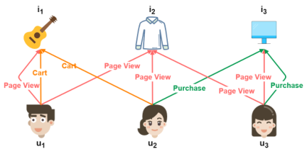
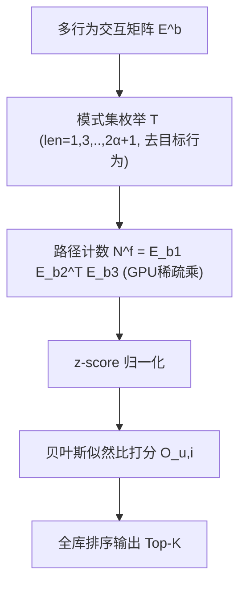
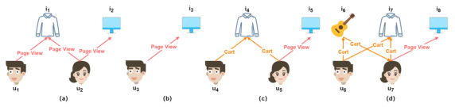

# Behavior Pattern Mining-based Multi-Behavior Recommendation (基于行为模式挖掘的多行为推荐)

- **会议/期刊**: SIGIR 2024 (短论文, 5 pages)
- **作者与机构**: Haojie Li, Jinhuan Liu, Junwei Du (青岛科技大学); Zhiyong Cheng (合肥工业大学); Xu Yu (中国石油大学); Guanfeng Liu (Macquarie University)
- **推荐链路定位**: 召回 (候选全库打分)
- **研究方向**: 协同过滤与双塔召回 / 图神经网络与知识图谱推荐
- **论文原文**: [https://arxiv.org/abs/2408.12152v1](https://arxiv.org/abs/2408.12152v1)
- **开源代码**: [https://github.com/rookitkitlee/BPMR](https://github.com/rookitkitlee/BPMR)

## TL;DR (1分钟核心速览)

多行为推荐普遍依赖 GNN 在异构/分行为子图上做消息传递，导致细粒度行为组合模式被邻居聚合"抹平"，且陷入过平滑与深层堆叠开销。BPMR 把用户—物品间的**行为模式路径计数**（如 `PageView∘PageView∘Cart`）当作显式特征，用贝叶斯似然比闭式打分排序，无需梯度训练。在 Beibei/Taobao/IJCAI-Contest 三个数据集、Leave-One-Out + Full-Ranking 协议下，Recall@10 相对最优基线 MBSSL 提升 118.66%/291.92%/393.98%。

## Background & Motivation (背景与核心矛盾)

- **主流范式**: 多行为推荐分两支——「分解增强」先按行为拆子图独立嵌入（S-MBRec、MBSSL 用自监督迁移辅助行为结构），「统一编码」把多行为图当异构图上做 GCN 消息传递（GHCF、MBGMN）。
- **前人局限**: ①分解式只编码单行为子图，无法刻画跨节点、跨行为的**组合路径**（如 $u_1$浏览$i_2$、$u_2$也浏览$i_2$并购买$i_3$所隐含的$u_1\!\to\!i_3$ 兴趣传递）；②统一编码把不同邻居、不同行为的信号混合进同一向量，丢失特定模式的可辨识性，并随层数加深过平滑。
- **核心洞察 (Key Insight)**: 图结构预测往往只依赖**少数特定结构特征**（某种长度与行为类型组合的路径条数），因此不必学稠密嵌入，可直接把"模式路径计数"作为判别特征。
- **本文切入点**: 将多行为图枚举出的路径数当作特征、目标行为共现当作标签，用朴素贝叶斯似然比做闭式推断，从根上绕开 GNN 的过平滑与训练成本。

<figure class="paper-figure" markdown="span">
  <figcaption>图1：用户-物品交互图。</figcaption>
</figure>

## Method (核心方法设计)

### 1. 整体框架 (Overall Architecture)

输入各行为的 0/1 交互矩阵 $\{E^{b}\}_{b\in\mathcal{B}}$；先按预定义模式集$\mathcal{T}$（长度为$1,3,\dots,2\alpha+1$的行为序列，且剔除含目标行为的模式，因为路径必须从用户出发止于物品，长度只能为奇数）为每个$(u,i)$对统计路径条数$N^{f}_{u,i}$，该步骤等价于稀疏矩阵连乘，GPU 可加速；随后对特征做 z-score 归一化，用全语料统计出的似然比权重对候选物品做乘性打分，按 odds 降序生成推荐列表。整个过程**无参数、无迭代训练、无负采样**，只做一次模式计数+一次打分。

### 2. 关键设计拆解 (Key Designs)

1. **行为模式特征化（把"结构"变成"列"）**：O($|B|^l$) 模式中真正有判别力的是少数几类；BPMR 直接用路径条数$N^{f}_{u,i}$作特征，例如$N^{v\circ v\circ c}_{u_3,i_1}=2$表示存在两条"浏览-浏览-加购"链。由于三跳模式可写作$E_{b_1}E_{b_2}^{\top}E_{b_3}$，原本昂贵的路径挖掘退化为 3 次稀疏矩阵乘，这是方法能落地的关键工程洞察。

2. **贝叶斯似然比闭式打分（免训练的判别器）**：把多行为推荐转成"给定模式计数预测目标行为"的二分类，则
$$O_{u,i}=\frac{P(Y{=}1\mid\mathcal{T},N_{u,i})}{P(Y{=}0\mid\mathcal{T},N_{u,i})}\propto\prod_{f\in\mathcal{T}}\Big(\frac{P(f\mid Y{=}1)}{P(f\mid Y{=}0)}\Big)^{N^{f}_{u,i}}$$
其中 $P(f\mid Y{=}1)$、$P(f\mid Y{=}0)$由全语料共现频次统计得到。取对数后即$\log O_{u,i}=\sum_{f}N^{f}_{u,i}\cdot w_{f}$，$w_f$ 是固定权重——本质是一个**权重闭式解出的线性 log-count 模型**。物理直觉：某模式在"已购买"对中出现的相对频率越高，权重越大，其计数就成为正证据；不同行为类型（浏览 vs 加购）因条件概率不同而自动获得不同可信度，无需人工设权。

3. **训练目标、负采样与推理效率**：无损失函数、无负采样；超参仅 $\alpha$（原文取$\alpha=1$，即用长度 1 与 3 的模式），理由是三跳邻居已覆盖 Taobao 平均用户 97.12% 的物品。推理开销在于为全部$(u,i)$计算$|\mathcal{T}|$个$|U|\times|I|$ 计数矩阵，需 GPU 稀疏乘与分块存储。

<figure class="paper-figure" markdown="span">
  <figcaption>图2：节点之间不同类型的行为模式。</figcaption>
</figure>

## Experimental Setup & Evaluation Protocol (实验设置与评估协议)

- **数据集与预处理**: 三个公开电商数据集，均为"浏览/加购/收藏/购买"多行为日志；原文未显式声明 $k$-core 过滤细节。

| 数据集 | #Users | #Items | #Interactions | 行为类型 | 场景说明 |
| :--- | :---: | :---: | :---: | :---: | :--- |
| Beibei | 21,716 | 7,977 | 3,338,068 | PV, Cart, Purchase | 母婴电商 |
| Taobao | 48,749 | 39,493 | 1,952,931 | PV, Cart, Purchase | 淘宝，物品数最多 |
| IJCAI-Contest | 17,237 | 33,799 | 811,582 | PV, Favorite, Cart, Purchase | B2C 零售，行为类别最多 |

- **数据划分与防穿越**: `Leave-One-Out`（每用户留最后一次目标行为作测试）。
- **排名评测协议**: 无偏 `Full-Ranking`，对每个用户对全库物品排序并剔除已交互正例；指标 Recall@{10,50}、NDCG@{10,50}。
- **对比基线与超参**: 单行为 NGCF / LightGCN / SGL / SimGCL，多行为 MATN / MBGMN / CML / EHCF / S-MBRec / GHCF / MBSSL；BPMR 关键超参 $\alpha=1$，特征 z-score 归一化。原文未报告显著性检验与嵌入维度。

## Key Experimental Results (实验关键数据)

### 1. 主实验对比 (Main Results)

| 模型 | Beibei R@10 | Beibei N@10 | Taobao R@10 | Taobao N@10 | IJCAI R@10 | IJCAI N@10 |
| :--- | :---: | :---: | :---: | :---: | :---: | :---: |
| LightGCN | 0.0555 | 0.0285 | 0.0410 | 0.0226 | 0.0276 | 0.0149 |
| SGL | 0.0590 | 0.0305 | 0.0503 | 0.0279 | 0.0262 | 0.0161 |
| SimGCL | 0.0615 | 0.0303 | 0.0502 | 0.0282 | 0.0285 | 0.0158 |
| MBGMN | 0.0416 | 0.0233 | 0.0497 | 0.0250 | 0.0307 | 0.0174 |
| EHCF | 0.1532 | 0.0808 | 0.0712 | 0.0401 | 0.0267 | 0.0148 |
| S-MBRec | 0.1705 | 0.0865 | 0.0814 | 0.0448 | 0.0285 | 0.0147 |
| GHCF | 0.1933 | 0.1011 | 0.0817 | 0.0435 | 0.0315 | 0.0172 |
| MBSSL | 0.2235 | 0.1271 | 0.1027 | 0.0583 | 0.0399 | 0.0207 |
| **BPMR** | **0.4887** | **0.2500** | **0.4025** | **0.2233** | **0.1971** | **0.0961** |
| **Improv.%** | +118.66% | +96.70% | +291.92% | +283.02% | +393.98% | +364.25% |

### 2. 消融实验 (Ablation Study)

原文**未提供逐组件消融表**，仅以模式长度超参与鲁棒性实验替代，此处如实汇总其证据强度：

| 设置 / 变体 | 观测指标 | 原文结论 |
| :--- | :--- | :--- |
| $\alpha=1$（长度 1+3 模式） | Recall/NDCG@{10,50} | 兼顾性能与成本的最优设置，$\alpha=0,2$ 的数值未报告 |
| 目标行为模式从 $\mathcal{T}$ 中剔除 | — | 避免标签自证，仅作设计约束说明 |
| 按目标行为度数分 5 组用户 | NDCG@50 | 各稀疏度分组均优于所有基线（图 3） |
| 辅助行为注入 10%/20%/30%/40% 随机噪声 | NDCG/Recall | 各噪声水平仍最优，归因于模式权重自适应下调（图 4） |

### 3. 关键实验发现 (Key Findings)

1. **增益随"行为类别数"与"物品规模"放大**：Taobao（39,493 物品）与 IJCAI-Contest（4 类行为）上的相对提升（+291.92%、+393.98% R@10）远高于 Beibei（+118.66%），说明模式路径计数在候选空间大、行为组合丰富时信息量更高，而在小物品集上收益被压缩。
2. **对目标行为稀疏性不敏感**：按购买度数分 5 组后 BPMR 在所有组均领先，作者归因于使用的是"路径比例/条数"这类与节点度数弱相关的结构量，度数下降时模式密度同步缩放，评分尺度不失衡。
3. **对辅助行为噪声具备一定鲁棒性**：在 10%–40% 随机噪声下仍全面领先，机制上是因为噪声模式在 $P(f\mid Y{=}1)$与$P(f\mid Y{=}0)$ 中同时抬升、似然比权重被自动削弱，无需额外去噪模块。

## Highlights & Limitations (亮点、对比与审稿批判)

- **与代表作对比 (vs. Prior Work)**: MBSSL/S-MBRec 走"分行为子图 + 自监督迁移"，靠对比学习间接传递辅助行为信息，但从不显式建模 $b_1\!\circ\!b_2\!\circ\!b_3$ 组合；GHCF 用异构 GCN 统一编码，多层聚合把具体行为语义糊化。BPMR 的差别是**用可枚举的结构特征替代学习式表征**，把"表示学习"问题降维成"计数+加权"。
- **可迁移亮点**: ①把 $l$跳行为模式计数写成$\prod E_{b}$ 稀疏矩阵乘，可作为任何 GNN 推荐的**结构特征增强项**（拼到双塔输入端）；②对数似然比闭式权重可用于冷启动场景的快速先验打分，或作为精排模型的先验偏置特征。
- **审稿级局限批判**: ①$P(f\mid Y{=}1)$/$P(f\mid Y{=}0)$在全量交互（含测试标签$E^{|B|}$）上统计，存在**标签泄露**风险，且 100%–400% 的异常提升幅度提示需核对基线复现与划分一致性；②推理需为每个模式保存一张$|U|\times|I|$计数矩阵，长度 3 时组合数$|\mathcal{B}|^3$增长，存储与算力随$\alpha$ 与行为数急剧膨胀；③模型无任何可学习嵌入，无法利用内容特征，对**零路径新用户/新物品**退化为先验，冷启动能力未验证。

## Rating (四维评分)

- **方法创新性 (Novelty)**: ⭐⭐⭐⭐ （把多行为推荐重构为路径计数+朴素贝叶斯似然比，视角反潮流且数学上等价于闭式 log-count 线性模型，洞见清晰）
- **评估协议与实验扎实度 (Protocol & Experiments)**: ⭐⭐⭐ （Full-Ranking 与三数据集跨度值得肯定，但缺逐组件消融、无显著性检验，且似然比统计疑似使用测试标签，增益幅度需复核）
- **写作与数学规范度 (Clarity & Rigor)**: ⭐⭐⭐⭐ （模式定义、矩阵乘加速与打分公式推导简洁自洽，但 $\mathcal{T}$的枚举边界与$\alpha$ 选择依据说明偏薄）
- **工业落地与复现价值 (Industrial & Practical Value)**: ⭐⭐⭐⭐ （代码已开源、无训练无需调参、纯稀疏矩阵乘易上 GPU，天然适配召回侧离线特征；代价是计数矩阵存储随行为数与模式长度膨胀）

