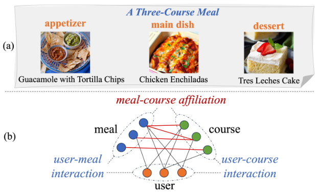
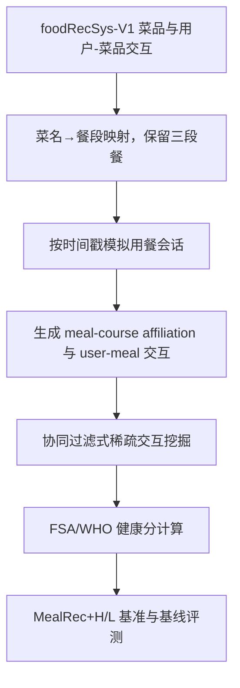

# MealRec⁺: A Meal Recommendation Dataset with Meal-Course Affiliation for Personalization and Healthiness（面向个性化与健康性的餐食-菜品关联推荐数据集）

- **会议/期刊**: SIGIR 2024
- **作者与机构**: Ming Li, Lin Li, Xiaohui Tao, Jimmy Xiangji Huang；武汉理工大学、南昆士兰大学、约克大学
- **推荐链路定位**: 召回（Top-K 餐食列表推荐）
- **研究方向**: 协同过滤与双塔召回 / 餐食 Bundle 数据集与基准
- **论文原文**: [论文原文链接](https://arxiv.org/abs/2404.05386v2)
- **开源代码**: [开源代码仓库链接](https://github.com/WUT-IDEA/MealRecPlus)

## TL;DR (1分钟核心速览)

针对餐食推荐缺少同时含用户-菜品交互、用户-餐食交互与餐食-菜品关联的公开数据，本文构建 MealRec⁺：以食谱交互为底，模拟用餐会话生成关联与交互，按协同过滤扩展并计算 FSA/WHO 健康分；在 Full-Ranking 的 8:1:1 划分上，CrossCBR 的 Recall@20 较最佳分离式基线提升 72.1%。

## Background & Motivation (背景与核心矛盾)

- **主流范式**: 现有餐食推荐要么只学 user-course 交互做 meal plan，要么把 meal 当 item 只学 user-meal 交互；bundle 推荐虽有 item-bundle 关联，但缺营养与餐食场景约束。
- **前人局限**: 真实 user-meal 交互涉及健康隐私，平台不愿公开；实验环境采集一餐只能发生有限次，周期长、成本高。更关键的是，缺 meal-course affiliation 就无法把菜级表征聚合为餐级表征，两级交互只能分离学习。
- **核心洞察 (Key Insight)**: 一顿餐是受类别约束的 bundle（开胃菜/主菜/甜点），meal-course affiliation 是连接两级交互的桥；用户对健康性的偏好在菜级与餐级并不一致，且历史交互整体偏不健康。
- **本文切入点**: 用“模拟用餐会话 + 协同过滤式交互挖掘 + 营养标准评分”构造可复现 benchmark，再系统比较分离式与协同式交互学习。如图1所示，用户、菜品与餐食构成三层关联。

<figure class="paper-figure" markdown="span">
  <figcaption>图1：(a) 三道菜餐食示例。(b) 用户、菜品与餐食之间的复杂关系。</figcaption>
</figure>

## Method (核心方法设计)

### 1. 整体框架 (Overall Architecture)

MealRec⁺ 不是新模型，而是“数据构造 + 基准评测”闭环：以 foodRecSys-V1 的 49,698 道菜与 379 万条 user-course 交互为底，先将菜名映射到 11 个餐段并保留开胃菜/主菜/甜点三段餐；再按时间戳切分用餐会话，排列候选菜生成 meal-course affiliation 与 user-meal 交互；随后按协同过滤补全稀疏交互，并用 FSA/WHO 计算健康分；最后在 High/Low 两个密度子集上统一评测分离式与协同式交互学习。

### 2. 关键设计拆解 (Key Designs)

1. **用餐会话模拟与餐食关联构造**：痛点是无真实 user-meal 标签；本文将用户时间窗内 user-course 交互视作一次用餐会话，按餐段从候选菜中排列组合成 $m=\{c_a,c_m,c_d\}$，一个会话可派生多餐时按概率保留，避免大量近重复餐食。直觉是类别约束把“任意菜品组合”压到符合真实用餐习惯的 bundle 空间。  
2. **协同过滤式交互挖掘**：模拟交互仍稀疏，作者利用“相似用户行为相似”的先验：若 $u_i$与$m_k$已交互，且$u_j$交互过$m_k$的全部菜品，则概率性添加$(u_j,m_k)$，即$P(B(u_i)=B(u_j))\propto sim(u_i,u_j)$。该步扩大 user-meal 规模，同时用概率添加模拟曝光偏差，而非确定性全补。  
3. **健康度量化与基线训练**：对每道菜按 FSA 四大营养素颜色值求和，$\mathrm{FSA}=\sum_{i=1}^{4}color\_value(n_i)$（4 健康—12 不健康）；WHO 按 7 类营养素是否落入范围计分，$\mathrm{WHO}=\sum_{i=1}^{7}\mathbb{I}(n_i\in range_i)$（0—7，越高越健康）。餐食健康分为菜品均值$H(m)=\frac{1}{|m|}\sum_{c\in m}H(c)$。本文不设统一自研损失，CFR/BGCN/DAM/HyperMBR/CrossCBR 按原损失训练；未统一报告负采样，候选为训练集未交互餐食，全库打分排序。

## Experimental Setup & Evaluation Protocol (实验设置与评估协议)

- **数据集与预处理**: 基础集 foodRecSys-V1 经交互阈值 5/2 过滤得到高/低密度两个子集；每餐固定 3 餐段，附 FSA/WHO 分数。

| 数据集 | #Users | #Meals | #Courses | #User-Meal | #User-Course | #Meal-Course | 密度(UM/UC) |
| :--- | :---: | :---: | :---: | :---: | :---: | :---: | :---: |
| MealRec⁺H | 1,575 | 3,817 | 7,280 | 46,767 | 151,148 | 11,451 | 0.77% / 1.30% |
| MealRec⁺L | 1,928 | 3,578 | 10,589 | 11,807 | 181,087 | 10,734 | 0.17% / 0.88% |

- **数据划分与防穿越**: 按 8:1:1 比例划分 train/valid/test，非 Leave-One-Out；测试候选为训练集未交互餐食，属 All-unrated-item 全库排序。
- **排名评测协议**: Full-Ranking，不采样负例；指标 Recall@20/40/80、NDCG@20/40/80。健康性用 FSA/WHO 均值、相对历史差值 $\Delta$ 与 ExpoGap（正値表示健康餐曝光更高）。
- **对比基线与超参**: 分离式 CFR/CourseLevel/MealLevel/BGCN，协同式 DAM/HyperMBR/CrossCBR；embedding $d=64$，batch 1024，GNN 2 层，patience 10，取最佳 Recall@20；未报告显著性检验。

## Key Experimental Results (实验关键数据)

### 1. 主实验对比 (Main Results)

K=20 的个性化结果如下，CrossCBR 全面最优：

| 模型 | 类型 | H R@20 | H N@20 | L R@20 | L N@20 |
| :--- | :---: | ---: | ---: | ---: | ---: |
| CFR | 分离 | 0.1352 | 0.0777 | 0.0330 | 0.0145 |
| CourseLevel | 分离 | 0.2181 | 0.1345 | 0.1181 | 0.0668 |
| MealLevel | 分离 | 0.1450 | 0.0812 | 0.0514 | 0.0194 |
| BGCN | 分离 | 0.2083 | 0.1263 | 0.0882 | 0.0438 |
| DAM | 协同 | 0.2043 | 0.1266 | 0.0986 | 0.0498 |
| HyperMBR | 协同 | 0.3144 | 0.2153 | 0.1497 | 0.0786 |
| CrossCBR | 协同 | **0.3753** | **0.2588** | **0.1920** | **0.1018** |

CrossCBR 相对最佳分离式 CourseLevel：H R@20 `+72.1%`、NDCG@20 `+92.4%`；L R@20 `+62.6%`。

### 2. 消融与健康干预 (Ablation / Health Intervention)

以 CrossCBR 为骨架，比较 Hard Filtering (HF) 与 Re-Weighting (RW)：

| 变体 | H R@20 | H N@20 | H FSA(Δ)↓ | H ExpoGap↑ | L R@20 | L FSA(Δ)↓ | L ExpoGap↑ |
| :--- | ---: | ---: | ---: | ---: | ---: | ---: | ---: |
| CrossCBR | **0.3753** | **0.2588** | 9.3229(-0.0423) | -0.0737 | **0.1920** | 9.3475(0.0128) | -0.1346 |
| +HF | 0.0682 | 0.0582 | **7.5916(-1.7736)** | **1.0000** | 0.0277 | **7.6275(-1.7072)** | **1.0000** |
| +RW | 0.2817 | 0.1702 | 8.3673(-0.9979) | 0.7931 | 0.1544 | 8.3925(-0.9422) | 0.7273 |

### 3. 关键实验发现 (Key Findings)

1. **两级协同有效，但“简单相加”无效**：BGCN 在 H 仅 R@20=0.2083，低于 CourseLevel 的 0.2181；而对比学习式 CrossCBR 达 0.3753，说明 meal-course affiliation 必须用于表征协同，而非仅做分数融合。
2. **user-meal 级单独学习受稀疏性拖累**：CFR/MealLevel 在 H 的 R@20 仅 0.1352/0.1450，远低于 CourseLevel 的 0.2181；对应 user-meal 密度 0.77% 低于 user-course 的 1.30%，稀疏级需要菜级信号反哺。
3. **健康干预存在“健康—精度”硬 trade-off**：HF 将 FSA 降到 7.5916、ExpoGap 提至 1.0000，但 R@20 崩至 0.0682；RW 保留 R@20=0.2817，并把 FSA 降到 8.3673、ExpoGap 提到 0.7931，明显优于硬过滤。

## Highlights & Limitations (亮点、对比与审稿批判)

- **与代表作对比 (vs. Prior Work)**: 相比 CFR/MealLevel 只学餐级、CourseLevel 只学菜级，本文首次提供同时含两级交互与 meal-course affiliation 的公开数据；相比 Clothing/Youshu 等 bundle 数据，MealRec⁺ 增加餐段约束与 FSA/WHO 健康分。
- **可迁移亮点**: “时间窗会话模拟 + 相似用户全菜品匹配挖掘”可迁移到隐私敏感、交互稀缺的 bundle/套餐数据构造；RW 后处理是模型无关的健康性提升手段。
- **审稿级局限批判**: ① user-meal 与关联来自模拟和概率补全，不能完全等价真实用餐行为，且可能放大曝光偏差；② 健康评测主要报告 K=20/FSA，缺多 K、多标准完整表与显著性检验，HF/RW 的精度损失也缺线上或用户研究验证。

## Rating (四维评分)

- **方法创新性 (Novelty)**: ⭐⭐⭐⭐ （数据集填补 meal-course affiliation 空白，模拟+CF 构造有场景针对性，但非新推荐模型）
- **评估协议与实验扎实度 (Protocol & Experiments)**: ⭐⭐⭐⭐ （Full-Ranking、双密度子集、两套营养标准与 7 个基线较完整，缺显著性检验）
- **写作与数学规范度 (Clarity & Rigor)**: ⭐⭐⭐⭐ （构造流程、算法与评分公式清晰，健康指标定义明确，但基线训练细节略简）
- **工业落地与复现价值 (Industrial & Practical Value)**: ⭐⭐⭐ （开源数据与代码利于复现，健康重加权可落地，但模拟标签与隐私场景限制直接上线）

