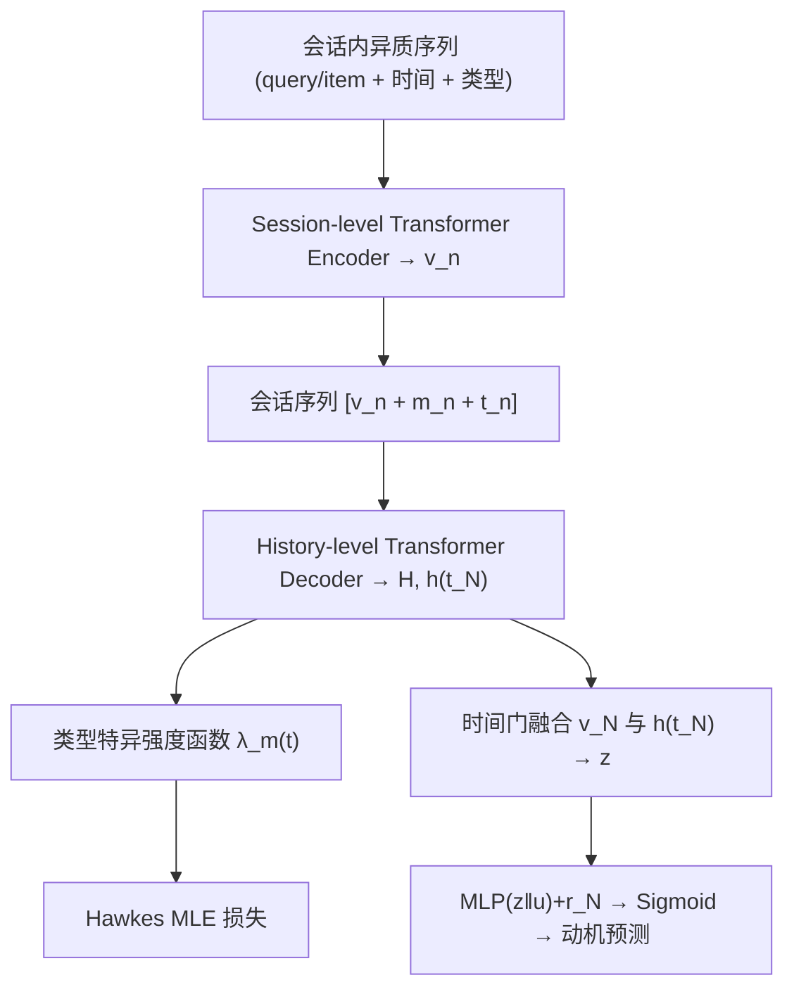
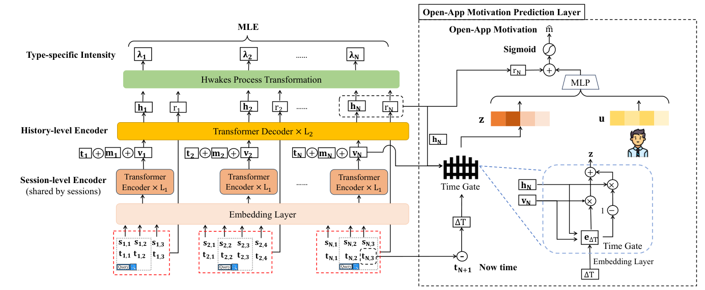

# To Search or to Recommend: Predicting Open-App Motivation with Neural Hawkes Process (搜索还是推荐：用神经 Hawkes 过程预测用户开屏动机)

- **会议/期刊**: SIGIR 2024
- **作者与机构**: Zhongxiang Sun, Zihua Si, Xiao Zhang, Hongteng Xu, Jun Xu (中国人民大学高瓴人工智能学院)；Xiaoxue Zang, Yang Song (快手科技)
- **推荐链路定位**: 召回前置的用户表征 / 开屏场景分发（搜索 vs. 推荐入口）
- **研究方向**: 协同过滤与双塔召回 / 序列与会话推荐
- **论文原文**: [https://arxiv.org/abs/2404.03267v1](https://arxiv.org/abs/2404.03267v1)
- **开源代码**: [https://github.com/Jeryi-Sun/NHP_OAM](https://github.com/Jeryi-Sun/NHP_OAM)

## TL;DR (1分钟核心速览)

搜索+推荐双入口 App 中，"用户此次开屏是为了搜还是为了刷"这一动机预测此前无人系统研究，而它对入口调权与开屏广告/弹窗推荐至关重要。本文提出 NHP-OAM：用层级 Transformer 编码会话内 query/点击序列与会话间动机序列，再用带「搜索比感知项」的类型特异强度函数建模不规则到达时间，最后用时间门融合长短期意图与用户 ID 输出动机概率。在自建 OAMD 与扩展 ZhihuRec 上，F0.5 达 0.8284 / 0.5950，相对最强 NHP 基线提升 2.9% / 1.4%，AUC 提升 2.8% / 4.0%。

## Background & Motivation (背景与核心矛盾)

- **主流范式**: 相关工作分为 User Retention Prediction（预测"是否再来"）与 User Intent Prediction（预测"进来后想干什么"），均未刻画"开屏那一刻的入口级动机"。
- **前人局限**: ① 留存预测只做二值回访，粒度太粗，无法区分搜索/推荐；② 序列推荐与时间感知序列模型（TiSASRec/RESETBERT4Rec）假定等间隔采样、只能吃单一模态历史，无法处理"开屏时刻不规则 + query 与 item 异质混排"。
- **核心洞察 (Key Insight)**: 在 OAMD 上统计出三条行为规律——**周期性**（搜索/推荐比呈 24 小时与工作日-周末双周期，周末与午晚高峰偏向搜索）、**重复查询**（越活跃用户重复 query 比例越高）、**相关性**（上一会话 search-click/rec-click 比值与下次开屏搜索动机正相关，Spearman/Kendall/Pearson/D 系数一致为正）。
- **本文切入点**: 用 Hawkes 过程天然适配的不规则事件到达建模周期性，用层级 Transformer 吃掉多因素（query、item、动机），并把"搜索比"直接写进强度函数。

## Method (核心方法设计)

### 1. 整体框架 (Overall Architecture)

输入是用户按时间排序的 $N$个会话，每个会话为 query 动作与 item 点击混排的异质序列，并附带开屏时刻$t_n$与该次开屏动机标签$m_n\in\{0,1\}$。先由**会话级 Transformer Encoder** 将会话内行为压成会话向量$\boldsymbol{v}_n$；再把$[\boldsymbol{v}_n+\boldsymbol{e}_{m,n}+\boldsymbol{e}_{t,n}]$序列送入**历史级 Transformer Decoder**（因果掩码防泄漏）得到历史隐状态$\mathbf{H}$，用于计算类型特异强度函数并做 Hawkes 似然训练；同时取$t_N$时刻的最后隐状态$\boldsymbol{h}(t_N)$（长期意图）与末会话向量$\boldsymbol{v}_N$（短期意图）经**时间门**融合，拼上用户 embedding 过两层 MLP，输出下一次开屏动机概率；训练完成后$\boldsymbol{z}$ 可直接作为下游召回侧的用户表征注入双塔。

<figure class="paper-figure" markdown="span">
  <figcaption>图 4：所提出模型 NHP-OAM 的整体架构，包含 §4.2 的会话级编码器和历史级编码器、§4.3 的类型特定强度函数，以及 §4.4 的 Open-App Motivation 预测层。</figcaption>
</figure>

### 2. 关键设计拆解 (Key Designs)

1. **层级 Transformer 历史编码器（解决"多因素 + 不规则到达"）**：前人 NHP 只吃单一事件序列，无法处理 query 与点击混排。本文先会话内编码再会话间解码，使会话向量 $\boldsymbol{v}_n=\mathrm{MEAN}(\mathrm{Encoder}(\mathbf{E}_n))$承担短期意图、$\boldsymbol{h}(t_N)$承担长期意图；因 Decoder 只可见前序会话，强度函数所需的$\mathcal{T}_t$ 天然无穿越。

2. **搜索比感知的类型特异强度函数（把统计规律直接写成先验）**：经典 NHP 强度只依赖隐状态与时间衰减，无法体现"上次会话搜得多则这次更可能搜"。本文在强度中加入批归一化后的搜索/推荐交互比 $r_{t,m}$：

$$\lambda_m(t\mid\mathcal{T}_t)=f\!\left(\alpha_m\frac{t-t_n}{t_n}+\phi(\mathbf{w}^{\top}\boldsymbol{h}(t_n))+r_{t,m}\right)$$

其中 $f=\mathrm{softplus}$保证正值、$\phi$为 GELU/Tanh、$\alpha_m$控制线性插值衰减。直觉是：周期性与重复查询被"时间项 + 历史项"共同吸收，相关性被$r_{t,m}$ 显式注入，三者互补而非互相竞争。

3. **时间门融合与联合训练目标**：用户开屏间隔 $\Delta t=t_{N+1}-t_{N,\lvert S_N\rvert}$编码后作为门控信号$\boldsymbol{g}=\sigma(\mathbf{W}_l\boldsymbol{h}(t_N)+\mathbf{W}_s\boldsymbol{v}_N+\boldsymbol{e}_{\Delta t})$，$\boldsymbol{z}=\boldsymbol{g}\otimes\boldsymbol{v}_N+(1-\boldsymbol{g})\otimes\boldsymbol{h}(t_N)$，预测$\hat{m}_{N+1}=\sigma(\mathrm{MLP}(\boldsymbol{z}\Vert\boldsymbol{u})+r_N)$。总损失为 Hawkes 对数似然（第二项用 Monte Carlo 近似积分）与 BCE 的加权和$\mathcal{L}=\sum_{u}(-\alpha\mathcal{L}^u_{\lambda}+\mathcal{L}^u_m)$，免负采样、按用户全历史一次性优化，推理仅需一次前向。

## Experimental Setup & Evaluation Protocol (实验设置与评估协议)

- **数据集与预处理**: 自建工业数据集 OAMD（标签定义：开屏 30 秒内发生主动搜索即为 search，否则 recommendation）与扩展的公开 ZhihuRec（以 30 分钟静默切会话，并打上同样口径的动机标签）：

| 数据集 | #Users | #Sessions/用户 | #交互/用户 (R-C, Q, Q-C) | 时间跨度 | 类别分布 (Search : Rec) |
| :--- | :---: | :---: | :---: | :---: | :--- |
| OAMD | 25,355 | 20.31 | 285.73 / 17.51 / 22.64 | 16 天 | 66,546 : 340,842（强不平衡） |
| ZhihuRec (扩展) | 798,086 | 5.27 | 33.81 / 4.89 / — | 10 天 | 715,792 : 3,314,396 |

- **数据划分与防穿越 (Splitting Strategy)**: **时间比例切分**——前 3 天作历史集（保证用户画像充分），倒数第 1 天为测试集、倒数第 2 天为验证集，其余训练；ZhihuRec 需先删去原采集末日以避免大量行为塌缩到测试集造成分布漂移。
- **排名/分类评测协议**: 属二分类任务而非全库排序，报告 Accuracy、Precision、F1、**F0.5**（因误判"搜索动机"体验代价高，偏重 precision）与 AUC；阈值在验证集上按最优 F0.5 以 0.01 步长从 $(0,1)$ 搜索后固定用于测试集。
- **对比基线与超参**: 5 类共 13 个基线——SR（GRU4Rec/SASRec/BERT4Rec）、联合搜索-推荐（NRHUB/Query-SeqRec/USER）、时间感知 SR（TiSASRec/RESETBERT4Rec/TLSRec）、时序预测（LSTNet/Autoformer/DLinear）、NHP（CTNHP/SAHP/THP）。$d=32$，$L_1=L_2=2$，batch$\in\{64,128,256\}$，lr$\in\{10^{-5},10^{-4},10^{-3}\}$，$\alpha$五档网格搜索；显著性用$t$-test ($p<0.05$)。

## Key Experimental Results (实验关键数据)

### 1. 主实验对比 (Main Results)

| 类别 | 模型 | OAMD Acc | OAMD Prec | OAMD F0.5 | OAMD AUC | ZhihuRec F0.5 | ZhihuRec AUC |
| :--- | :--- | :---: | :---: | :---: | :---: | :---: | :---: |
| SR | SASRec | 0.9193 | 0.8156 | 0.6472 | 0.7162 | 0.5399 | 0.6611 |
| SR | GRU4Rec | 0.9228 | 0.8789 | 0.6778 | 0.7181 | 0.5814 | 0.6827 |
| SRS | USER | 0.9103 | 0.7304 | 0.5591 | 0.7986 | 0.5821 | 0.7254 |
| TS | LSTNet | 0.9226 | 0.7973 | 0.6688 | 0.8352 | 0.5248 | 0.7003 |
| TSR | RESETBERT4Rec | 0.9159 | 0.7429 | 0.6109 | 0.8117 | 0.5866 | 0.6937 |
| NHP | CTNHP | 0.9409 | 0.8883 | 0.7974 | 0.9017 | 0.5295 | 0.7085 |
| NHP | THP | 0.9393 | 0.9019 | 0.8050 | 0.9063 | 0.5292 | 0.7064 |
| NHP | SAHP | 0.9409 | 0.9014 | 0.7885 | 0.9076 | 0.5289 | 0.7064 |
| **NHP** | **NHP-OAM** | **0.9463** | **0.9320** | **0.8284** | **0.9326** | **0.5950** | **0.7541** |
| — | Improv. | +0.6% | +3.3% | **+2.9%** | **+2.8%** | **+1.4%** | **+4.0%** |

### 2. 消融实验 (Ablation Study)

| 变体 | F0.5 | AUC | ΔF0.5 |
| :--- | :---: | :---: | :---: |
| w/o HP（Hawkes 换 LSTM） | 0.7623 | 0.9212 | −7.97% |
| w/o SLE（去会话级编码器） | 0.8002 | 0.9144 | −3.40% |
| w/o PL（去预测层） | 0.8005 | 0.9289 | −3.37% |
| w/o TG（去时间门） | 0.8039 | 0.9307 | −2.96% |
| w/o QR（去搜索比感知项） | 0.8137 | 0.9302 | −1.77% |
| w/o UE（去用户 ID） | 0.8177 | 0.9323 | −1.29% |
| NHP-OAM (full) | **0.8284** | **0.9326** | — |

### 3. 关键实验发现 (Key Findings)

1. **点过程骨架是性能分水岭**：三类 NHP 基线在 OAMD 的 AUC 全部 $\ge 0.90$，远超 SR/TS 类的 0.72–0.84，因为不规则到达时间才是周期性的载体；而把 Hawkes 替换为 LSTM（w/o HP）直接掉 7.97 个点，是所有消融中最深的坑，说明"能建模时间 ≠ 能利用强度"。OAMD 会话数从 0 增到 10 时 F0.5 从 0.6465 单调升至 0.8284 后饱和，印证点过程对序列长度的依赖。
2. **搜索比 $r_N$ 是廉价的强先验**：仅移除 QR 就损失 1.77%，且 w/o QR 的 Precision (0.9153) 明显低于 full (0.9320)，说明统计上 0.4082 vs 0.0474 的点击比差异被强度函数与预测层双重吸收，替代了昂贵的行为注意力。层级编码器（w/o SLE −3.40%）与预测层（w/o PL −3.37%）贡献次之，验证"会话内上下文 + 时间门"不可省略。
3. **下游增益可迁移**：把 $\boldsymbol{z}$注入 SASRec/GRU4Rec/DIN 与 NRHUB/USER 后，AUC/GAUC 全部正向提升（稀疏基线 GRU4Rec 提升最显著）；在只有单次曝光机会的开屏广告/弹窗推荐场景同样显著，说明$\boldsymbol{z}$ 捕捉的是"开屏瞬时兴趣"，而非普通长期偏好。扩展的 ZhihuRec 指标整体更低（F0.5 0.5950），原因是其会话由 30 分钟规则人工切分、且缺失 Q-C 特征。

## Highlights & Limitations (亮点、对比与审稿批判)

- **与代表作对比 (vs. Prior Work)**: 与 THP/SAHP 相比，本文不再把强度函数当作纯时间隐变量模型，而是把 session 内异质行为与会话间动机做层级分离，并将统计量 $r_{t,m}$ 显式注入 CIF；与 USER、Query-SeqRec 等联合搜索-推荐序列模型相比，本文多了一条"事件到达时间"的建模通道，避免了等间隔假设；与留存/意图预测相比，粒度从"是否回来/想买什么"收敛到"开屏走哪个入口"。
- **可迁移亮点**: ① 把领域统计量（如搜索比、位置比）作为**可直接解释的加性项**塞进强度函数或 logit，几乎零成本且可解释；② 用 $\Delta t$ 相对时间编码构造门控，融合长短期表征，可平移到多场景兴趣融合。
- **审稿级局限批判**: ① 标签口径依赖"30 秒内主动搜索"这一人工阈值，无独立人工标注校验，跨 App 迁移时阈值需重新校准；② 强度函数中的 $r_{t,m}$与预测层的$r_N$重复使用同一统计量，存在信息冗余与超参$\alpha_m$敏感风险，文中却未给出$\alpha_m$ 敏感性曲线；③ 仅有离线实验，缺乏入口调权带来的留存/时长类线上 A/B 结果，商业价值证据仍偏间接；④ OAMD 仅 16 天、25K 用户，周周期性结论的统计稳定性有限。

## Rating (四维评分)

- **方法创新性 (Novelty)**: ⭐⭐⭐⭐ （把 NHP 从"单序列事件预测"改造为"异质会话 + 开屏动机"层级结构，强度函数注入统计比是清晰增量，理论深度偏工程化但问题定义新颖）
- **评估协议与实验扎实度 (Protocol & Experiments)**: ⭐⭐⭐⭐ （自建工业数据集 + 扩展公开数据集双验证，13 个跨 5 类基线、$t$ 检验与 6 组消融齐备；扣分在阈值调优依赖验证集 F0.5 且无线上实验）
- **写作与数学规范度 (Clarity & Rigor)**: ⭐⭐⭐⭐ （任务定义、强度函数与损失推导完整，符号统一；$\alpha$ 与 BN 细节在正文中被省略，复现需查代码）
- **工业落地与复现价值 (Industrial & Practical Value)**: ⭐⭐⭐⭐⭐ （代码与 OAMD 已开源，推理仅一次前向、$d=32$ 极轻量，直接服务开屏广告与弹窗推荐这类单次曝光场景）

