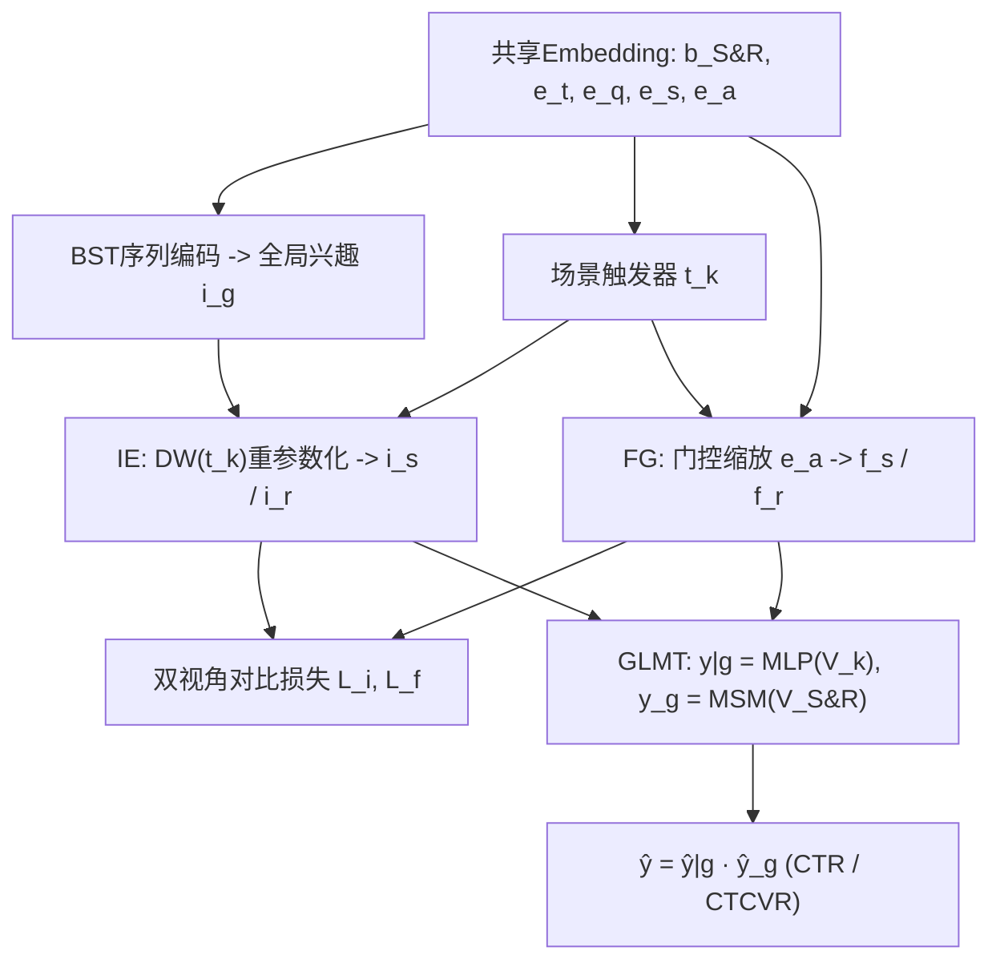

# A Unified Search and Recommendation Framework Based on Multi-Scenario Learning for Ranking in E-commerce (面向电商排序的搜索-推荐统一多场景学习框架)

- **会议/期刊**: SIGIR 2024 (short paper, 5 页)
- **作者与机构**: Jinhan Liu, Qiyu Chen, Junjie Xu, Junjie Li, Baoli Li, Sulong Xu（京东 JD.com）
- **推荐链路定位**: 精排（S&R 双场景 CTR/CTCVR 预估）
- **研究方向**: 跨域与多场景推荐 / 多任务学习与重排
- **论文原文**: [https://arxiv.org/abs/2405.10835v2](https://arxiv.org/abs/2405.10835v2)
- **开源代码**: 暂未开源

## TL;DR (1分钟核心速览)

电商中搜索（S）与推荐（R）共享用户但行为分布差异巨大，传统多场景模型（MMoE/PLE/STAR/APG）用"共享+场景私有"的粗粒度参数切分，既无法从混在一起的 S&R 行为序列里抽出场景特异兴趣，也没利用跨场景标签互为正样本的增益。本文提出 USR：用场景触发器（scenario trigger）驱动的双视角兴趣抽取层 IE 与特征生成层 FG 显式解耦 S/R 表征，加双视角对比损失拉开分布；再用全局标签 $y_g=y_s\vee y_r$以条件概率$\hat{y}=\hat{y}_{|g}\cdot\hat{y}_g$ 构造辅助任务。在 7Fresh 工业数据上对 6 种 MSL 骨干全线上涨（搜索 AUC-CTR +0.08~+0.41，推荐 +0.09~+0.62），线上 UCVR 搜索 +2.85%、推荐 +3.35%。

## Background & Motivation (背景与核心矛盾)

- **主流范式**: Tower-based（SharedBottom/MMoE/PLE/STAR/M2M）与 Dynamic-Weight（APG）两类 MSL 模型，靠"共享底层学共性 + 场景私有塔学差异"处理多场景。
- **前人局限 1**: 粗粒度切分只在**塔层**分家，底层仍把 S&R 行为序列拼成一个 $b_{S\&R}$编码成单一$i_g$，场景特异兴趣在源头就被抹平；对场景无关特征$e_a$ 更是不加区分地等权喂给两个场景。
- **前人局限 2**: 传统 MSL 的各场景标签空间彼此封闭，忽略了"用户在某场景点击/下单"可作另一场景的正样本信号，正样本利用率低。
- **核心洞察**: S&R 的差异是**表征级**而非**参数级**——同一用户在两场景下兴趣表达不同、同一特征（如点击率类特征）在两场景的判别力不同；同时 label 空间可跨场景做数据增广。
- **本文切入点**: 引入场景触发器作为先验条件，让"特征如何被加权"随场景动态生成，并把全局标签作为辅助监督显式注入。

## Method (核心方法设计)

### 1. 整体框架 (Overall Architecture)

输入为共享 Embedding 层产出的 S&R 混合行为序列 $b_{S\&R}$、目标物品$e_t$、 query$e_q$、场景独有特征$e_s$与场景无关特征$e_a$；先用 BST 式序列编码得全局兴趣$i_g$。核心是"一分为二"：IE 层以场景触发器为条件、用动态权重网络把$i_g$重参数化为$i_s,i_r$；FG 层以门控把$e_a$缩放为$f_s,f_r$。两路表征均加对比损失强制同场景聚拢、跨场景推远。顶层 GLMT 用$V_k=[i_g\oplus i_k\oplus f_k\oplus e_s]$估场景条件概率、用$V_{S\&R}$ 估全局概率，相乘得最终打分；联合交叉熵与对比损失端到端训练，线上推理与常规精排 MLP 同量级。

### 2. 关键设计拆解 (Key Designs)

1. **场景触发器 + 双视角兴趣/特征抽取（IE & FG）**：痛点是 $i_g$与$e_a$场景不可分。本文定义触发器$t_k=e_{rv}$（推荐）、$t_k=e_{sv}+e_q$（搜索），作为场景先验：
   $i_k=f_{MLP}\big(\mathrm{DW}(t_k\oplus \mathrm{sg}(i_g)),\, i_g\big),\quad f_k=f_{MLP}\big(e_a\cdot\sigma(f_{MLP}(t_k\oplus \mathrm{sg}(e_a)))\big)$其中$\mathrm{sg}(\cdot)$为 stop-gradient（防止$i_g$被两视角同时拉扯而坍缩），$\mathrm{DW}(\cdot)$ 为按条件生成 FC 权重。直觉：把"场景"从隐式的塔参数搬到显式的条件变量上，使同一底层表征在不同条件下生成不同投影，等价于细粒度条件化而非粗粒度分塔。
2. **双视角对比损失（S/R 解耦正则）**：仅靠条件化生成仍可能学到冗余方向。对 $i$与$f$各施一份 InfoNCE：批内同视角采样正样本，跨视角样本作为负样本，温度$\tau=1$：
   $\mathcal{L}^{i}_{CL}=-\mathbb{E}_n\Big[\log\frac{e^{i^n_s\cdot i^+_s/\tau}+e^{i^n_r\cdot i^+_r/\tau}}{e^{i^n_s\cdot i^+_s/\tau}+e^{i^n_r\cdot i^+_r/\tau}+\sum_{k=1}^{N}e^{i^n_s\cdot i^k_r/\tau}}\Big]$
   物理直觉：把"S 兴趣"与"R 兴趣"当互斥类做实例判别，迫使表征空间按场景语义分簇（图 2(a) T-SNE 验证：加 CL 后簇内紧、簇间远）。
3. **GLMT 全局标签条件概率多任务**：痛点是跨场景标签被浪费。定义 $y_g=1$当且仅当$y_s=1$或$y_r=1$，借鉴 ESMM 概率分解$\hat{y}=\hat{y}_{|g}\cdot\hat{y}_g$，其中$\hat{y}_{|g}=f_{MLP}(V_k)$为主任务、$\hat{y}_g=f_{MSM}(V_{S\&R})$为辅助任务（$V_{S\&R}$同时含 S 与 R 两视角表征）。这样全局任务天然获得约 2 倍正样本密度，相当于跨域数据增广，同时$V_{S\&R}$ 强制两视角信息在顶层交互。

**训练目标、负采样与推理效率**：$\mathcal{L}_{final}=\lambda_1\mathcal{L}_{main}+\lambda_2\mathcal{L}_{aux}+\lambda_3\mathcal{L}_i+\lambda_4\mathcal{L}_f$，取$\lambda=(0.9,0.08,0.01,0.01)$；负样本为曝光未点击（真实曝光负采样，非随机负采样），对比学习用 in-batch 负样本、免额外采样器。推理仅需单次前向，DW 生成的是轻量 FC 权重，时延可控。

## Experimental Setup & Evaluation Protocol (实验设置与评估协议)

- **数据集与预处理**: 京东 7Fresh 线上真实流量日志（2023-10-01 至 2023-12-01）。曝光未点击即负样本，无 5-core 过滤（工业全量日志）。

| 数据集 | #Sessions (Search) | #Sessions (Rec) | 正/负定义 | 稀疏度/密度 | 场景说明 |
| :--- | :---: | :---: | :---: | :---: | :--- |
| 7Fresh 工业数据 | 5,304,568 | 540,471 | 点击=CTR正样本，下单=CTCVR正样本，曝光未交互=负 | 未披露（工业级高稀疏） | O2O 生鲜，含 query、双场景行为序列 |

- **数据划分与防穿越 (Splitting Strategy)**: 论文未显式交代训练/测试切分方式（仅记为 10-01~12-01 的日志划分），属该 short paper 的可复现性缺口。
- **排名评测协议 (Ranking Protocol)**: 未采用 Full-Ranking / Sampled Ranking，而是在**曝光样本级**做 AUC（ROC 曲线下面积）二分类评估，分场景分别报告 CTR 与 CTCVR 两任务；这是工业精排的常规协议，但与 RecSys 榜单的 Top-K 全库排序指标不可直接横比。
- **对比基线与超参设置**: 以 SharedBottom、MMoE、PLE、STAR、M2M、APG 六种 MSL 骨干为 Backbone，逐一比较 "Base" 与 "Base+USR"；统一 $d=32$、AdamW、lr=1E-4、batch=1024；辅助任务隐层 {128, 64, 32}。未报告显著性检验。

## Key Experimental Results (实验关键数据)

### 1. 主实验对比 (Main Results)

| Backbone | S-CTR Base → +USR (Δ) | S-CTCVR Base → +USR (Δ) | R-CTR Base → +USR (Δ) | R-CTCVR Base → +USR (Δ) |
| :--- | :---: | :---: | :---: | :---: |
| SharedBottom | 0.8227 → 0.8268 (**+0.41**) | 0.8298 → 0.8347 (**+0.49**) | 0.6529 → 0.6569 (+0.40) | 0.6894 → 0.6951 (+0.57) |
| MMoE | 0.8250 → 0.8270 (+0.20) | 0.8327 → 0.8352 (+0.25) | 0.6541 → 0.6578 (+0.37) | 0.6909 → 0.6960 (+0.51) |
| PLE | 0.8257 → 0.8271 (+0.14) | 0.8331 → **0.8359** (+0.28) | 0.6568 → 0.6577 (+0.09) | 0.6917 → 0.6979 (+0.62) |
| STAR | 0.8259 → **0.8274** (+0.15) | 0.8330 → 0.8358 (+0.28) | 0.6524 → **0.6581** (+0.17) | 0.6921 → 0.6977 (+0.56) |
| M2M | 0.8231 → 0.8266 (+0.35) | 0.8316 → 0.8343 (+0.27) | 0.6527 → 0.6571 (+0.44) | 0.6904 → 0.6963 (+0.59) |
| APG | 0.8261 → 0.8269 (+0.08) | 0.8337 → 0.8353 (+0.16) | 0.6561 → **0.6584** (+0.23) | 0.6919 → **0.6981** (+0.62) |

（指标为 AUC(%)；加粗为该列 +USR 后的最优；搜索场景总体 AUC 0.83 量级、推荐仅 0.69 量级，说明 R 侧任务更难。）

### 2. 消融实验 (Ablation Study)

以 STAR 为骨干（原图 2(b) 仅给柱状图未列表值，下表为相对完整 USR 的定性幅度）：

| 变体 | S-CTR | S-CTCVR | R-CTR | R-CTCVR | 归因 |
| :--- | :---: | :---: | :---: | :---: | :--- |
| full USR | 基准 | 基准 | 基准 | 基准 | — |
| w/o S&R Views IE | 明显↓ | 明显↓ | 明显↓ | 明显↓ | 失去场景化兴趣，$i_g$ 两场景混用 |
| w/o S&R Views FG | 明显↓ | 明显↓ | 明显↓ | 明显↓ | $e_a$ 等权进入两场景，判别力失衡 |
| w/o GLMT | **最大↓** | **最大↓** | **最大↓** | **最大↓** | 丢失跨场景正样本增广与条件概率分解 |
| STAR (no USR) | 0.8259 | 0.8330 | 0.6524 | 0.6921 | 粗粒度多场景基线 |

### 3. 关键实验发现 (Key Findings)

1. **框架正交可插拔，增益与骨干强弱互补**：最朴素的 SharedBottom 获益最大（搜索 CTCVR +0.49、推荐 CTCVR +0.57），而已经较强的 APG 增益最小（+0.16/+0.08），说明 USR 补的是"场景表征解耦 + 标签增广"这一 MSL 共同短板，而非与某个骨干的私有机制重叠。
2. **GLMT 是第一贡献项，IE/FG 次之**：消融中移除 GLMT 造成最大跌幅，印证跨场景标签的 OR 合并（正样本密度近似翻倍）比表征层面的场景化更"值钱"；IE 与 FG 各自移除也均显著下降，说明"兴趣解耦"与"特征解耦"缺一不可，二者不冗余。
3. **场景难度与数据量倒挂**：搜索样本量约为推荐 10 倍（530 万 vs 54 万），但搜索 AUC 稳定在 0.83、推荐仅 0.69 且提升幅度更大（+0.51~+0.62），表明 R 侧才是信息瓶颈所在，跨场景知识从 S 向 R 的迁移是主要收益来源。
4. **线上验证**：一周 A/B 中搜索 UCVR +2.85%、UCTR +1.05%，推荐 UCVR +3.35%、UCTR +1.17%，已在 7Fresh App 全量上线；维度敏感性上 $d=32$ 最优，增大到 64/96/128 反而过拟合。

## Highlights & Limitations (亮点、对比与审稿批判)

- **与代表作对比 (vs. Prior Work)**: 相比 STAR/APG 这类"用场景 ID 生成塔参数"的路线，USR 把条件化下沉到**表征生成**（$i_k,f_k$）而非仅塔参数，并用对比损失显式施加几何约束；相比 ESMM 类纯 CVar 分解，USR 的全局任务跨的是**场景**而非**行为层级**，本质是把 S&R 视作共享标签空间的两个 domain 做 data augmentation。
- **可迁移亮点**: (1) 用 `stop-gradient + 条件化重参数化` 从共享序列表征中派生多视角表征，可直接搬到多业务线共用一个行为序列骨干的精排架构；(2) "全局标签 = 各场景标签 OR" 的增广思路，可平移到多目标（点击/收藏/加购）或多端（App/小程序）场景的正样本扩充。
- **审稿级局限批判**: (1) **评估体系薄弱**——仅单一工业数据集、无公开基准、未报告切分方式与显著性检验，AUC 在曝光样本上计算，无法证明召回头部排序收益；(2) **全局标签语义偏强**——$y_g=y_s\vee y_r$ 隐含"搜索点击 ⇒ 推荐曝光也会点击"的强假设，忽略曝光机制（position/exposure bias）差异，可能给辅助任务注入系统性噪声，且与 CTCVR 的 ESMM 假设叠加后误差会双重累积；(3) 对比损失的正样本是"批内随机采样的同视角样本"，缺乏语义正例构造，负样本仅跨视角，判别难度偏低。

## Rating (四维评分)

- **方法创新性 (Novelty)**: ⭐⭐⭐ （把场景条件化从塔参数下沉到表征生成，配 OR 全局标签的条件概率分解，工程上巧但理论增量有限，属 MSL 的组合式改良）
- **评估协议与实验扎实度 (Protocol & Experiments)**: ⭐⭐⭐ （6 种骨干 × 双场景 × 双任务的主实验矩阵较完整且有线上 A/B，但单数据集、切分与显著性未交代、消融仅给柱状图无表值）
- **写作与数学规范度 (Clarity & Rigor)**: ⭐⭐⭐ （公式与符号基本自洽、结构清晰，但对比损失公式书写有排版噪声，stop-gradient 与 DW 的作用仅有直觉解释、无梯度层面分析）
- **工业落地与复现价值 (Industrial & Practical Value)**: ⭐⭐⭐⭐ （已在 7Fresh 全量部署并给出 UCVR/UCTR 双指标提升，框架与骨干解耦、易于插拔；但数据与代码均未开源，复现需自建 S&R 双场景日志）

