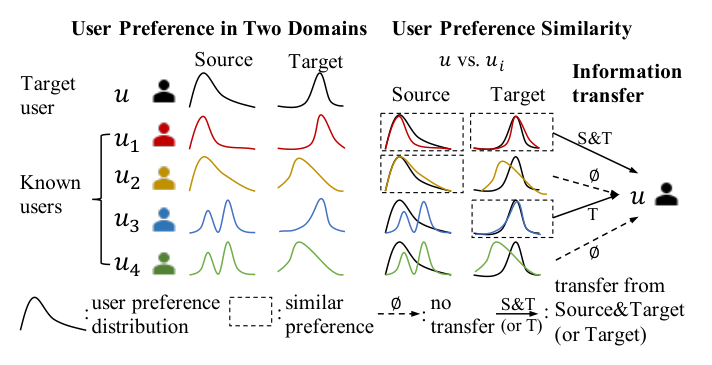
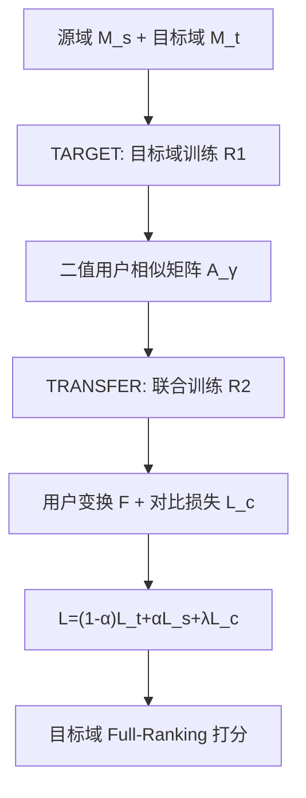
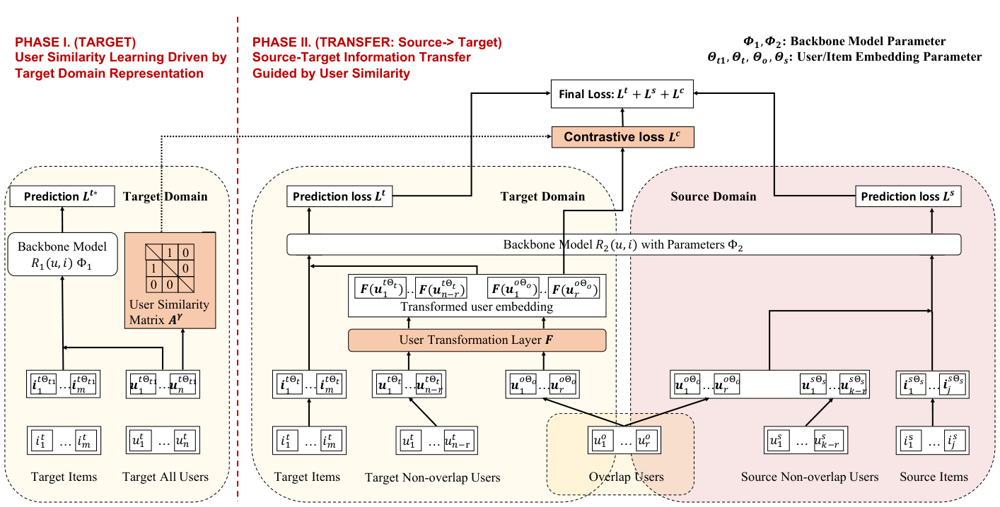

# Aiming at the Target: Filter Collaborative Information for Cross-Domain Recommendation (瞄准目标域：过滤跨域推荐中的协同信息)

- **会议/期刊**: SIGIR 2024
- **作者与机构**: Hanyu Li、Weizhi Ma、Peijie Sun、Jiayu Li、Min Zhang、Shaoping Ma（清华大学）；Cunxiang Yin、Yancheng He、Guoqiang Xu（腾讯）
- **推荐链路定位**: 召回/排序（通用 Top-K）
- **研究方向**: 跨域与多场景推荐 / 自监督对比学习与交互去噪
- **论文原文**: [https://arxiv.org/abs/2403.20296v1](https://arxiv.org/abs/2403.20296v1)
- **开源代码**: [https://anonymous.4open.science/r/CUT_anonymous-9815](https://anonymous.4open.science/r/CUT_anonymous-9815)（匿名仓库）

## TL;DR (1分钟核心速览)

跨域推荐常把源域协同信息无差别注入目标域，导致用户相似关系漂移与负迁移。CUT 先以目标域 backbone 学二值用户相似矩阵，再用用户变换层和监督对比损失约束跨域表征，过滤误导性源域协同边。在 Amazon/Douban 六个任务、5-core + 8:1:1 + Full-Ranking 协议下，CUT-LightGCN 在 Cloth→Sports 上 Recall@10/NDCG@10 较 UniCDR 提升 4.6%/7.1%；Douban Movie→Music 上 CUT-MF 较最佳单域基线提升约 15.8%/18.1%。

## Background & Motivation (背景与核心矛盾)

- **主流范式**: 跨域推荐通过共享 embedding、embedding 映射或自适应表征（DisenCDR、CAT-ART、UniCDR）迁移源域知识。
- **前人局限**: ①源域相似用户未必在目标域也相似，直接迁移会引入“相似性扭曲”；②现有方法多只调整单用户表征，缺少用户对级显式约束，难以从根源过滤源域噪声。
- **核心洞察 (Key Insight)**: 负迁移可视为目标域用户协同关系被源域信息污染；若目标域用户相似结构在跨域训练中保持不变，则可过滤误导性协同信息。
- **本文切入点**: 用目标域学到的用户相似度作为显式正则，只允许与目标协同结构一致的源域信息进入目标表征。

<figure class="paper-figure" markdown="span">
  <figcaption>图 1</figcaption>
</figure>
图 1：源域相似但目标域偏好不同的用户会造成负迁移。

## Method (核心方法设计)

### 1. 整体框架 (Overall Architecture)

CUT 是 model-agnostic 两阶段框架。TARGET 阶段仅在目标域训练 backbone $R_1$（MF/LightGCN），用其用户向量计算二值相似矩阵；TRANSFER 阶段在源+目标联合数据上训练同构$R_2$，目标域用户与重叠用户先经一层 MLP 变换$F$再进入 backbone，源域用户不变换；目标 mini-batch 内按$A_\gamma$ 构造相似对，用监督对比损失约束变换后目标表征，最终联合优化目标损失、源损失和对比项。推理仍走原 backbone 打分，额外开销仅一次线性变换与相似度缓存。

<figure class="paper-figure" markdown="span">
  <figcaption>图 2</figcaption>
</figure>
图 2：CUT 的 TARGET/TRANSFER 两阶段框架。

### 2. 关键设计拆解 (Key Designs)

1. **目标域驱动的二值相似矩阵**：不直接用交互历史余弦，而用 $R_1$学到的目标域用户向量，$A_{ij}=\mathbb{I}(\phi(\boldsymbol{u}_i^{t},\boldsymbol{u}_j^{t})>\gamma)$。二值化避免连续相似度过度约束；backbone 驱动使约束与具体推荐器校准一致，$\gamma=0.9$。
2. **用户变换层 $F$**：重叠用户若共享同一 embedding 会混淆域间行为，若完全分离又丢失共享知识。对目标域用户和重叠用户做$\boldsymbol{z}_u=F(\boldsymbol{u}_u)=\mathbf{W}\boldsymbol{u}_u+\mathbf{b}$，物品不变换；$F$ 充当域标识，只增加极少参数。
3. **训练目标、负采样与推理效率**：仅约束单用户变换仍假设跨域相似关系不变。按 $A_\gamma$构造相似对$S_b$，batch 内所有用户对$A_b$作分母：$\mathcal{L}_c=-\frac{1}{|S_b|}\sum_{(i,j)\in S_b}\log\frac{\exp(F(\boldsymbol{u}_i)\cdot F(\boldsymbol{u}_j)/\tau)}{\sum_{(x,y)\in A_b}\exp(F(\boldsymbol{u}_x)\cdot F(\boldsymbol{u}_y)/\tau)}$，保留目标域用户相似结构。总损失$(1-\alpha)\mathcal{L}_t+\alpha\mathcal{L}_s+\lambda\mathcal{L}_c$；无额外全库负采样，对比分母只用 batch 内用户对；无需维护$|U|^2$ 矩阵，只缓存 TARGET 固定用户向量。Amazon Cloth&Sports 每 epoch 5.13s vs LightGCN 4.87s，约 +5.3%。

## Experimental Setup & Evaluation Protocol (实验设置与评估协议)

- **数据集与预处理**: 采用 5-core 过滤，评分转隐式 0/1；Amazon 与 Douban 各两组域对，共六个跨域任务。

| 数据集 | 域 | #Users | #Items | #Interactions | 重叠用户/物品 | 说明 |
| :--- | :--- | :---: | :---: | :---: | :---: | :--- |
| Amazon | Sports | 35,599 | 18,358 | 296,337 | 3,908 / 704（与 Cloth） | 稀疏、域相关 |
| Amazon | Cloth | 39,388 | 23,034 | 278,677 | 3,908 / 704；999 / 0（与 Video） | 稀疏 |
| Amazon | Video | 24,034 | 10,673 | 231,780 | 999 / 0（与 Cloth） | 远域 |
| Douban | Music | 16,041 | 40,405 | 1,140,090 | 14,000 / 0（与 Movie） | 稠密 |
| Douban | Movie | 22,254 | 27,432 | 2,760,500 | 14,000 / 0（与 Music） | 稠密 |

- **数据划分与防穿越**: 目标域按用户历史 `8:1:1` 划分 train/valid/test；源域按 `8:2` 划分 train/valid；测试集不参与相似矩阵构造。
- **排名评测协议**: 无偏 `Full-Ranking`，在目标域全部物品上排序，报告 `Recall@10` 与 `NDCG@10`。
- **对比基线与超参**: 单域 MF/LightGCN-T；双域 LightGCN-B；跨域 EMCDR、DTCDR、CAT-ART、UniCDR；CUT-MF/CUT-LightGCN。$d=64$，Adam lr=1e-3，batch=2048，$\alpha=0.2$，$\gamma=0.9$；$\lambda=10^{-4}$（Amazon）/$5\times10^{-5}$（Douban）；Amazon 用 BCE，Douban 用 BPR；paired t-test$p<0.05$。

## Key Experimental Results (实验关键数据)

### 1. 主实验对比 (Main Results)

表 1：六个跨域任务主结果（R@10 / N@10；最佳加粗，次优下划线；均为 Full-Ranking）。

| 任务 | 指标 | MF | LGCN-T | LGCN-B | EMCDR | DTCDR | CAT-ART | UniCDR | CUT-MF | CUT-LGCN |
| :--- | :---: | :---: | :---: | :---: | :---: | :---: | :---: | :---: | :---: | :---: |
| Cloth→Sports | R@10 | 0.0492 | 0.0604 | 0.0614 | 0.0538 | 0.0558 | 0.0515 | <u>0.0624</u> | 0.0601 | **0.0653** |
|  | N@10 | 0.0270 | 0.0331 | 0.0335 | 0.0288 | 0.0332 | 0.0276 | <u>0.0340</u> | 0.0335 | **0.0364** |
| Sports→Cloth | R@10 | 0.0243 | 0.0385 | 0.0421 | 0.0234 | 0.0263 | 0.0240 | <u>0.0433</u> | 0.0393 | **0.0441** |
|  | N@10 | 0.0137 | 0.0207 | 0.0231 | 0.0127 | 0.0141 | 0.0130 | <u>0.0239</u> | 0.0222 | **0.0252** |
| Cloth→Video | R@10 | 0.1153 | 0.1181 | 0.1171 | 0.1165 | 0.1085 | 0.1133 | 0.1249 | <u>0.1275</u> | **0.1303** |
|  | N@10 | 0.0623 | 0.0639 | 0.0639 | 0.0633 | 0.0584 | 0.0609 | 0.0684 | <u>0.0704</u> | **0.0720** |
| Video→Cloth | R@10 | 0.0243 | **0.0385** | 0.0379 | 0.0232 | 0.0241 | 0.0245 | 0.0349 | 0.0362 | <u>0.0381</u> |
|  | N@10 | 0.0137 | <u>0.0207</u> | 0.0206 | 0.0124 | 0.0126 | 0.0123 | 0.0191 | 0.0203 | **0.0213** |
| Movie→Music | R@10 | 0.1004 | 0.1069 | 0.0972 | 0.1014 | 0.0881 | 0.0901 | 0.1073 | **0.1238** | <u>0.1205</u> |
|  | N@10 | 0.0733 | 0.0806 | 0.0772 | 0.0756 | 0.0658 | 0.0685 | 0.0754 | **0.0952** | <u>0.0946</u> |
| Music→Movie | R@10 | 0.1053 | 0.1004 | 0.0966 | 0.1064 | 0.0943 | 0.1055 | 0.1095 | <u>0.1390</u> | **0.1393** |
|  | N@10 | 0.0997 | 0.0997 | 0.1096 | 0.1156 | 0.0982 | 0.1048 | 0.0994 | <u>0.1413</u> | **0.1437** |

**Improv.**（CUT-LGCN vs 最佳基线）：Cloth→Sports +4.6%/+7.1%，Sports→Cloth +1.8%/+5.4%，Cloth→Video +4.3%/+5.3%，Video→Cloth NDCG +2.9%；Douban Movie→Music 以 CUT-MF 计较最佳单域基线 +15.8%/+18.1%。

### 2. 消融实验 (Ablation Study)

表 2：TRANSFER 阶段关键组件消融（六任务总体趋势）。

| 变体 | 目标域性能趋势 | 归因 |
| :--- | :--- | :--- |
| CUT（完整） | 最优 | 相似度约束 + 变换层协同 |
| w/o 目标驱动相似模块（去 $\mathcal{L}_c$） | 严重下降，多数任务低于仅目标域 MF | 失去显式过滤，$F$ 学到不匹配目标域的参数 |
| w/o 用户变换层 | 小幅下降 | 重叠用户共享单表征，跨域行为建模受限；对比损失仍保目标相似关系 |
| 历史相似度替代 backbone 相似度 | 一致下降 | 静态 one-hot 余弦无法适配 MF/LightGCN 的协同结构 |

### 3. 关键实验发现 (Key Findings)

1. **负迁移真实存在且可被显式过滤**：LightGCN 双域训练在 Cloth→Video 的 Recall 0.1171 低于单域 0.1181，Douban Movie→Music 仅 0.0972 vs 0.1069；CUT-LightGCN 将 Cloth→Video 提至 0.1303/0.0720，说明相似度约束能保留有用源域信息并剔除误导协同边。
2. **域差异越大，CUT 收益越明显**：Douban Movie→Music 上 CUT-MF 达 0.1238/0.0952，较最佳单域 LightGCN 的 0.1069/0.0806 提升 15.8%/18.1%；Cloth→Sports 上 CUT-LightGCN 较 UniCDR 的 0.0624/0.0340 提升 4.6%/7.1%。
3. **对比正则比变换层更关键，且稀疏目标域不退化**：去掉 $\mathcal{L}_c$ 的下降最重，甚至低于目标域 MF；目标域仅保留 20% 交互时 CUT 仍优于 UniCDR，最差情况不退化；Amazon Cloth&Sports 每 epoch 仅 5.13s vs 4.87s，开销可控。

## Highlights & Limitations (亮点、对比与审稿批判)

- **与代表作对比 (vs. Prior Work)**: CAT-ART/UniCDR 侧重单用户自适应表征或域共享/特有余表征，未显式约束用户对相似度；DisenCDR 解耦域相关/无关成分，但仍缺少跨用户协同结构约束。CUT 以目标域相似矩阵直接过滤源域协同信息，且不修改 backbone 结构与损失，model-agnostic 更强。
- **可迁移亮点**: ①用 backbone 自身表征构造二值相似矩阵，比静态交互余弦更贴合推荐器；②监督对比损失只在目标 batch 内取用户对，避免维护 $|U|^2$ 矩阵，适合大规模型号低成本接入。
- **审稿级局限批判**: ①相似度阈值 $\gamma$与对比权重$\lambda$ 依赖数据集调参，二值化可能损失细粒度偏好；②仅验证两个数据集、六个任务和用户重叠场景，缺少线上 A/B 与非重叠用户/物品的严格冷启动评估；③TARGET 阶段需目标域预训练，极稀疏目标域早期相似矩阵噪声会削弱收益。

## Rating (四维评分)

- **方法创新性 (Novelty)**: ⭐⭐⭐⭐ （从“用户相似性扭曲”重新定义负迁移，用户对级显式过滤视角新颖，且有清晰公式与两阶段设计）
- **评估协议与实验扎实度 (Protocol & Experiments)**: ⭐⭐⭐⭐ （六任务、两数据集、Full-Ranking、5-core、8:1:1 与显著性检验较完整；但仅离线、两数据集）
- **写作与数学规范度 (Clarity & Rigor)**: ⭐⭐⭐⭐ （TARGET/TRANSFER、变换层与对比损失定义清楚；部分消融仅以图呈现，缺精确数值表）
- **工业落地与复现价值 (Industrial & Practical Value)**: ⭐⭐⭐⭐ （model-agnostic、额外参数与 epoch 开销小，匿名代码可复现；阈值调参与预训练成本仍需工程权衡）

