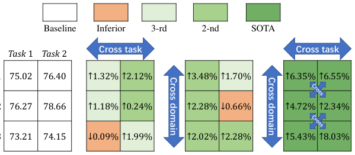
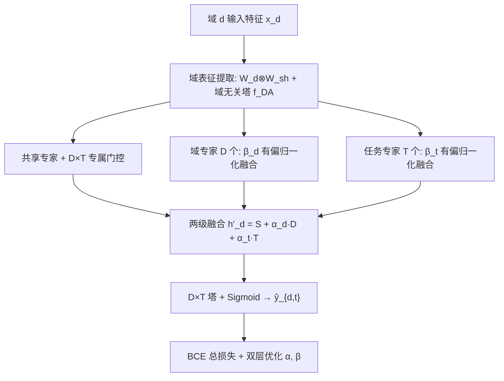
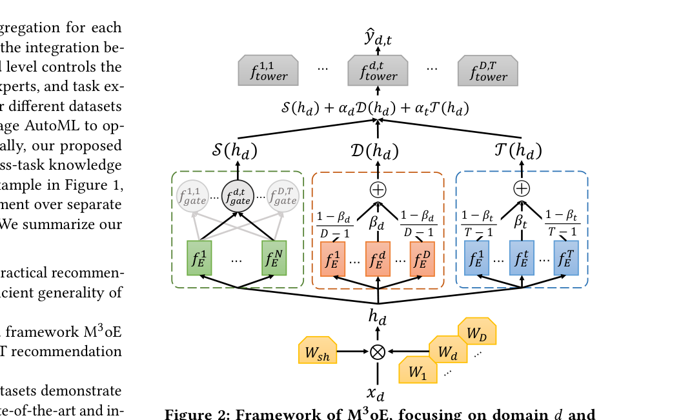

# M3oE: Multi-Domain Multi-Task Mixture-of-Experts Recommendation Framework (多域多任务混合专家推荐框架)

- **会议/期刊**: SIGIR 2024
- **作者与机构**: Zijian Zhang, Chunxu Zhang, Hongwei Zhao (吉林大学)；Xiangyu Zhao, Ziru Liu (香港城市大学)；Shuchang Liu, Jiaao Yu, Qingpeng Cai, Lantao Hu, Peng Jiang (快手)；Kun Gai
- **推荐链路定位**: 精排 (多域多任务 CTR/参与度预估)
- **研究方向**: 跨域与多场景推荐 / 多任务学习与多目标精排
- **论文原文**: [https://arxiv.org/abs/2404.18465v3](https://arxiv.org/abs/2404.18465v3)
- **开源代码**: [https://github.com/Applied-Machine-Learning-Lab/M3oE](https://github.com/Applied-Machine-Learning-Lab/M3oE)

## TL;DR (1分钟核心速览)

真实业务常同时存在多域与多目标，但纯 MDR（STAR）或纯 MTR（MMoE/PLE）直接搬进 MDMT 场景会出现"域跷跷板 × 任务跷跷板"叠加：跨域迁移方式不泛化到任务，多任务平衡策略不泛化到域。本文提出 M3oE，用共享/域/任务三组专家解耦三种视角，配两级融合（域内、任务内归一化有偏融合 + 模块间加法平衡），并用 AutoML 双层优化端到端学习全部融合权重。在 MovieLens 与 KuaiRand-Pure（3 域 × 2 任务）上平均 AUC 分别相对最佳基线提升 2.54% 与 5.48%，LogLoss 同步下降。

## Background & Motivation (背景与核心矛盾)

- **主流范式**: MDR 侧以 STAR 的域共享-私有星型拓扑、DDTCDR 的正交隐空间映射为代表；MTR 侧以 Shared Bottom、MMoE、PLE、AdaTT 的"专家 + 门控"为代表，二者各自在本领域内已相当成熟。
- **前人局限**: ① 同一套跨域迁移算子无法适配不同任务——图 1 中 MMoE 在 d3t2 提升 8.03%，却在若干域-任务格子上低于单域 MLP 基线；② 同一套多任务平衡策略无法适配不同域——表 2 中 PLE-MDMT（75.68）反而低于 PLE-MDL（75.84），STAR 亦非处处最优，两种方案互有胜负、均不 Consistently 领先。
- **核心洞察 (Key Insight)**: 作者将该现象命名为 **MDMT seesaw**，并指出根因不在专家数量不足，而在"域知识"与"任务知识"被纠缠进同一组专家参数：同一次梯度更新既要服务域区分又要服务任务区分，任一维度上的强约束都会在另一维度上造成负迁移。
- **本文切入点**: 把 common / domain-aspect / task-aspect 三种用户偏好显式解耦到三组独立专家，再用两级可学习权重按需配比，从而在同一模型内同时获得跨域与跨任务的收益。

<figure class="paper-figure" markdown="span">
  <figcaption>图1：MovieLens 上的多域多任务 AUC 比较。我们报告了 MMoE、STAR 和我们的 M3oE 相较于单域单任务 MLP 基线的相对提升。不同颜色表示同一域和任务中的不同性能排名。</figcaption>
</figure>

## Method (核心方法设计)

### 1. 整体框架 (Overall Architecture)

输入为某域 $d$的稠密特征$\boldsymbol{x}_d$，先经域表征提取层做"乘性共享-私有分解 + 域无关映射"，把三域特征压到统一隐空间得到$\boldsymbol{h}_d$；随后三组专家并行：共享专家（跨域跨任务）走$D\times T$个专属门控学习共性，域专家（每域一个、跨任务共享）与任务专家（每任务一个、跨域共享）分别经有偏归一化融合突出本域/本任务视角；两级融合把三者按$\alpha_d,\alpha_t$加权相加得到最终表征，再交给$D\times T$ 个独立二层 MLP 塔输出各域各任务的 sigmoid 概率。全部融合权重由 AutoML 双层优化在训练中自动更新，无需人工调结构。

<figure class="paper-figure" markdown="span">
  <figcaption>图2：M3oE 框架，为清晰起见聚焦于域 d 和任务 t。在多视图层内，从左到右排列三个模块：共享专家模块</figcaption>
</figure>

### 2. 关键设计拆解 (Key Designs)

1. **乘性共享-私有域表征提取（避免加性共享的语义错位）**: 纯 shared-bottom 让所有域共用一套权重，域特异性被稀释。本文将域权重与共享权重做逐元素相乘再加偏置，得到"共享调制"的域变换 $\tilde{\boldsymbol{W}}_d=\boldsymbol{W}_d\otimes\boldsymbol{W}_{sh}$，并保留域无关塔抑制跨域噪声：
$$\boldsymbol{h}_d=\boldsymbol{W}_c f_{DR}(\boldsymbol{x}_d)+\boldsymbol{b}_c+f_{DA}(\boldsymbol{x}_d),\quad f_{DR}(\boldsymbol{x}_d)=\tilde{\boldsymbol{W}}_d\boldsymbol{x}_d+\boldsymbol{b}_d+\boldsymbol{b}_{sh}$$
直觉上乘法比加法更"硬"：域向量只在共享子空间内旋转，既保留域差异又不产生新的语义漂移。

2. **三视角专家与两级解耦融合（本文最核心的 delta）**: 针对跷跷板，模块内采用"主角 + 配角均分"的有偏融合，让本域/本任务专家拿主导权重 $\beta$，其余专家等权分摊残差，权重和为 1 保证无偏聚合：
$$D(\boldsymbol{h}_d)=\beta_d f_d^{E}(\boldsymbol{h}_d)+\frac{1-\beta_d}{D-1}\sum_{\tilde d\neq d}f_{\tilde d}^{E}(\boldsymbol{h}_d)$$
$$T(\boldsymbol{h}_d)=\beta_t f_t^{E}(\boldsymbol{h}_d)+\frac{1-\beta_t}{T-1}\sum_{\tilde t\neq t}f_{\tilde t}^{E}(\boldsymbol{h}_d),\qquad \boldsymbol{h}'_d=S(\boldsymbol{h}_d)+\alpha_d D(\boldsymbol{h}_d)+\alpha_t T(\boldsymbol{h}_d)$$
第二级改为**加法而非拼接**：三者同处一个嵌入空间，加法使跨域跨任务信息可直接梯度贯通（消融中 Concat 掉点即证）。共享专家则为每个 $(d,t)$配独立门控$S(\boldsymbol{h}_d)=f_{gate}(\boldsymbol{h}_d)f^{E}(\boldsymbol{h}_d)$，共$D\times T$ 套，避免共性知识被单一门控平均化。

3. **训练目标、AutoML 与推理开销**: 将 $\alpha_d,\alpha_t,\beta_d,\beta_t$各自参数化为 1 维可训练张量经 Sigmoid 生成$w=\mathrm{Sigmoid}(\boldsymbol{e}_w)$，与模型参数做双层优化：
$$\min_{\alpha,\beta}\mathcal{L}\big(\boldsymbol{W}^{*}(\alpha,\beta),\alpha,\beta\big)\ \ \text{s.t.}\ \ \boldsymbol{W}^{*}=\arg\min_{\boldsymbol{W}}\mathcal{L}(\boldsymbol{W},\alpha,\beta)$$
即先训一个 epoch 主干，再用单 mini-batch 更新权重（开销近似可忽略）；损失为 $D\times T$个二值目标的 BCE 求和。推理阶段无额外分支，仅多一次专家前向，参数量约为$N+D+T+|D\times T|$ 组 MLP，线上可直接以塔为粒度分批打分，无需负采样。

## Experimental Setup & Evaluation Protocol (实验设置与评估协议)

- **数据集与预处理**: 两套公开基准，均按属性切出 3 域 × 2 任务，做 8:1:1 随机划分：

| 数据集 | #Users (d1/d2/d3) | #Items (d1/d2/d3) | #Interactions (d1/d2/d3) | 分布 | 特征/场景说明 |
| :--- | :---: | :---: | :---: | :---: | :--- |
| MovieLens-1M | 1,325 / 2,096 / 2,619 | 3,429 / 3,508 / 3,595 | 210,747 / 395,556 / 393,906 | 21.1% / 39.6% / 39.4% | 按 `age` 分域；任务 = click, like |
| KuaiRand-Pure | 15,398 / 27,049 / 11,809 | 6,233 / 7,580 / 4,633 | 178,087 / 2,236,414 / 93,165 | 7.1% / 89.2% / 3.7% | 按 `tab` 分域；任务 = click, long-view |

- **数据划分与防穿越 (Splitting Strategy)**: 采用 `比例划分` 8:1:1 随机切分，**未做全局时间戳切分**（此处存在未来信息泄漏风险，见局限）。
- **排名评测协议 (Ranking Protocol)**: 本文是**逐样本二分类打分**（CTR/CVR 式），报告 `AUC` 与 `LogLoss`，**未做 Full-Ranking 也未做 Sampled Ranking**；5 个随机种子取均值，并以双侧 t-test $p<0.05$ 标注显著性。
- **对比基线与超参设置**: 四类基线——单域单任务 MLP、MTR（ShBot-MTL / PLE-MTL / MMoE-MTL / AdaTT）、MDR（ShBot-MDL / MMoE-MDL / PLE-MDL / STAR）、MDMT（三种 -MDMT 版本 + M2M）。Embedding 维度 $d=16$，学习率 1e-2 (MovieLens) / 3e-3 (KuaiRand)，专家为单层 MLP，预测塔为两层 MLP，共享专家数$N=1$（MovieLens）/$N=4$（KuaiRand）。

## Key Experimental Results (实验关键数据)

### 1. 主实验对比 (Main Results)

| 类型 | 方法 | ML AUC↑ | ML LogLoss↓ | KR AUC↑ | KR LogLoss↓ |
| :--- | :--- | :---: | :---: | :---: | :---: |
| (a) 单域单任务 | MLP | 75.62 | 51.51 | 62.05 | 44.68 |
| (b) 多任务 | MMoE-MTL | 75.90 | 51.27 | 65.05 | 44.07 |
| (b) 多任务 | PLE-MTL | 75.18 | 56.49 | 62.74 | 54.05 |
| (b) 多任务 | AdaTT-sp | 74.49 | 54.65 | 62.27 | 48.80 |
| (c) 多域 | STAR | 76.08 | 51.11 | 64.72 | 44.68 |
| (c) 多域 | ShBot-MDL | 75.92 | 51.53 | 65.34 | 44.04 |
| (d) 多域多任务 | MMoE-MDMT | 76.35 | 51.02 | 65.52 | 44.20 |
| (d) 多域多任务 | PLE-MDMT | 75.68 | 51.90 | 64.07 | 44.67 |
| (d) 多域多任务 | M2M | 74.59 | 54.14 | 61.74 | 44.55 |
| — | **M3oE (ours)** | **77.02\*** | **50.71\*** | **66.37\*** | **43.76\*** |
| — | **RelaImpr** | **+2.54%** | — | **+5.48%** | — |

细粒度上，MovieLens 六个域-任务格子全部最优（如 d1t1 76.61 vs STAR 75.89、d3t2 76.09 vs MMoE-MDMT 75.41），相对提升 2.07%–3.15%；KuaiRand 上 d1t2 相对提升 **11.12%**、d3t2 **9.31%**，仅在样本占 89.2% 的 d2 的 task1 上以 66.03 略低于 MMoE-MDL 的 66.16。

### 2. 消融实验 (Ablation Study)

| 变体 | MovieLens AUC | KuaiRand AUC |
| :--- | :---: | :---: |
| w/o AutoML（β,α 固定 0.5） | 76.37 | 65.41 |
| Concat 融合三模块 | 76.89 | 66.08 |
| 全门控融合（统一 gate） | 76.92 | 65.87 |
| w/o 域专家模块 | 76.89 | 65.86 |
| w/o 任务专家模块 | 76.85 | 65.92 |
| w/o 域 & 任务专家 | 76.80 | 65.80 |
| **M3oE (full)** | **77.02** | **66.37** |

### 3. 关键实验发现 (Key Findings)

1. **自适应权重的贡献大于模块本身**：去掉 AutoML 使 MovieLens 掉 0.65、KuaiRand 掉 0.96，跌幅甚至超过彻底删除域+任务双专家模块（76.80 / 65.80）；说明 MDMT 场景中"按域-任务对配比"比"多堆专家"更关键，也印证了固定 0.5 的人工权重在多域数据分布不均时严重次优。
2. **解耦后必须加法融合，拼接会破坏共享空间**：Concat 融合比加法低 0.13（MovieLens）/0.29（KuaiRand），统一单门控也低 0.10/0.50；只有让三路输出留在同一嵌入空间做加权和，跨域跨任务梯度才能互哺，这与 T-SNE 中"融合嵌入无法被任一单模块替代"的分布观察一致。
3. **跷跷板确实被削弱，且代价集中在头部域**：MDMT 版 PLE 反而低于其 MDL 版（75.68 vs 75.84），体现原方法的 seesaw；M3oE 在 KuaiRand 尾部域 d1t2 拿到 11.12% 提升、d3t2 拿到 9.31%，而头部域 d2 仅退让 0.13 AUC，整体平均 AUC 仍净增 5.48%，即"牺牲 89% 头部域的边际收益换取长尾域的大幅抬升"。

## Highlights & Limitations (亮点、对比与审稿批判)

- **与代表作对比 (vs. Prior Work)**: 相比 STAR（域共享-私有星型拓扑，只处理域维度），M3oE 把"私有"拆成域私有与任务私有两类并各自配平；相比 PLE/AdaTT（任务私有专家，跨任务但单域），它把任务专家改为**跨域共享**，使任务视角可吃到跨域样本；相比 M2M（meta-unit + meta-attention 的元学习路线），M3oE 不做元学习而在融合权重层面做 AutoML，结构更轻且消融显示 M2M 在 KuaiRand 上甚至劣于 MLP。
- **可迁移亮点**: ① "主角 $\beta$+ 其余专家均分$1-\beta$" 的归一化有偏融合，可直接替换 MMoE/PLE 中未归一化的 gate，天然防梯度尺度失衡；② 用 1 维张量 + Sigmoid 参数化融合权重再双层优化，是给任何多目标加权损失（如多任务 loss 权重、蒸馏温度）做自动调参的极低成本模板。
- **审稿级局限批判**: ① **评估协议偏弱**——仅 3 域 × 2 任务的公开数据、随机 8:1:1 切分（时序泄漏未处理），且只用 AUC/LogLoss，缺少工业界更关心的 Full-Ranking/GAUC 与线上 A/B；② **双层优化实现细节不足**——每 epoch 只用一个 mini-batch 更新 $\alpha,\beta$，方差大且对 batch 组成敏感，论文未给出权重收敛曲线或稳定性分析；③ 公式 (7) 中$\alpha_d$乘$D$、$\alpha_t$乘$T$与正文文字描述存在符号不一致，复现时需以代码为准；④ 域数/任务数增长时$D\times T$ 塔与门控线性膨胀，论文未报告参数量与推理延迟的实测。

## Rating (四维评分)

- **方法创新性 (Novelty)**: ⭐⭐⭐⭐ （首次把 MDMT seesaw 形式化并提出三视角解耦 + 两级融合的自适应框架，思路干净，但本质是 MMoE/PLE 的结构化组合，理论刻画止于直觉）
- **评估协议与实验扎实度 (Protocol & Experiments)**: ⭐⭐⭐ （四类基线覆盖完整、5 次重复 + t-test 规范，但仅两数据集、随机切分无时序防穿越、缺少排序类指标与线上验证）
- **写作与数学规范度 (Clarity & Rigor)**: ⭐⭐⭐⭐ （三模块推导清晰、融合语义解释到位，公式 (7) 的 $\alpha_d/\alpha_t$ 对应关系与符号一致性有小瑕疵）
- **工业落地与复现价值 (Industrial & Practical Value)**: ⭐⭐⭐⭐ （代码开源、专家与塔结构可直接嵌入现有精排 DNN、AutoML 权重几乎零额外开销；但 $D\times T$ 塔的扩展性与在线延迟未量化）

