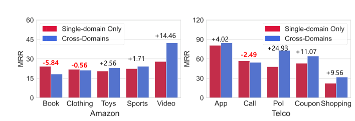
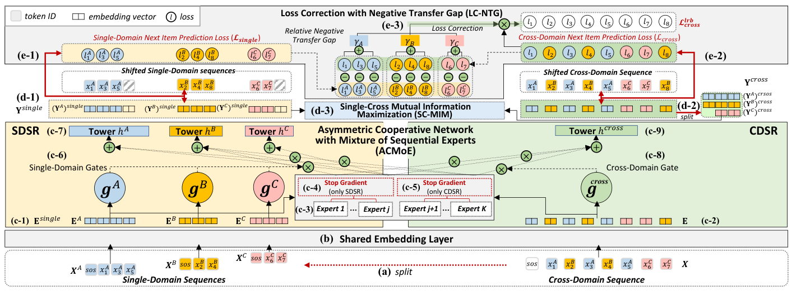
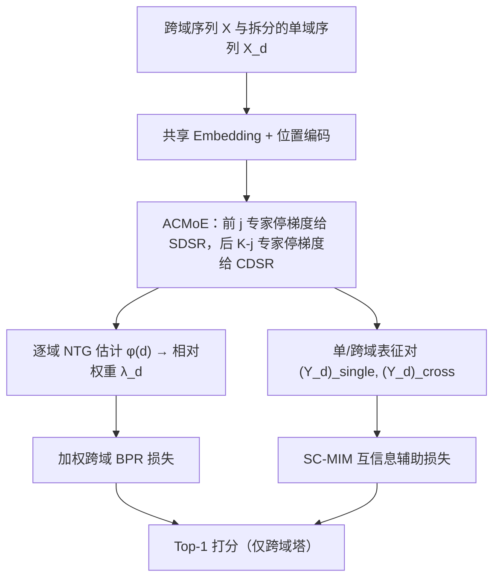

# Pacer and Runner: Cooperative Learning Framework between Single- and Cross-Domain Sequential Recommendation (领跑者与陪跑者：单域/跨域序列推荐协同学习框架)

- **会议/期刊**: SIGIR 2024 (Best Paper Honorable Mention)
- **作者与机构**: Chung Park, Taesan Kim, Hyungjun Yoon, Junui Hong, Yelim Yu, Mincheol Cho, Minsung Choi (SK Telecom), Jaegul Choo (KAIST)
- **推荐链路定位**: 精排（多业务域 Next-Item 预测）
- **研究方向**: 跨域与多场景推荐 / 序列推荐
- **论文原文**: [https://arxiv.org/abs/2407.11245v2](https://arxiv.org/abs/2407.11245v2)
- **开源代码**: [https://github.com/cpark88/SyNCRec](https://github.com/cpark88/SyNCRec)

## TL;DR (1分钟核心速览)

跨域序列推荐（CDSR）并非总优于单域（SDSR）：弱相关域与稀疏度差异会带来负迁移。本文提出 SyNCRec，用停梯度非对称 MoE 解耦两任务、以“负迁移差 NTG”为跨域损失动态赋权，并用逐域 InfoNCE 对齐单/跨域表征。在 Amazon 与 SKT 工业数据共 10 个域、Leave-One-Out + 1:99 采样排序协议下，HR@5 相对最优基线在 Toys 提升 9.65%、e-comm 提升 38.81%，且 10 个域全部反超 SDSR；线上 CTR 较 SASRec 提升 17.3%。

## Background & Motivation (背景与核心矛盾)

- **主流范式**: 工业界按域各建一套 SDSR 模型（SASRec/BERT4Rec 系），或用一个 CDSR 模型（C2DSR、MIFN、MAN、CGRec）同时建模多域序列以共享知识。
- **前人局限**: ① 负迁移被实证——Amazon 的 Book/Clothing、Telco 的 Call-Use 上，跨域训练的 CGRec 反而比单域训练低 5.84%/0.56%（图 1），说明“域间关系弱 + 稀疏度差异”会让共享梯度污染特定域；② 现有 CDSR 多为成对域建模，$|\mathcal{D}|$增大时需$O(|\mathcal{D}|^2)$个域对；CGRec 用 Shapley 值近似负迁移，组合爆炸到$O(|\mathcal{D}|!)$。
- **核心洞察 (Key Insight)**: 负迁移可由“同一模型在单域序列 vs 跨域序列上的损失差”逐域量化，只要能拿到**互不干扰**的纯损失，就能把这个差值当作梯度阀门。
- **本文切入点**: SDSR 做“陪跑者（pacer）”，为 CDSR“领跑者（runner）”提供配速参照——既约束其过快（负迁移）也防其过慢（漏迁移）。

<figure class="paper-figure" markdown="span">
  <figcaption>图 1</figcaption>
</figure>

## Method (核心方法设计)

### 1. 整体框架 (Overall Architecture)

一条跨域序列 $X$按时间戳拆成$|\mathcal{D}|$条单域子序列$X_d$（图 2a），共享 embedding + 位置编码后，送入分块停梯度的 MoE：前$j$个 Transformer 专家只由 CDSR 梯度更新，后$K-j$个只由 SDSR 更新，两条塔各自输出逐域表征$Y_{single}^d$与$Y_{cross}$。由此可算得每个域的纯 NTG 并转成软权重修正跨域交叉熵，同时以单/跨域表征对的 InfoNCE 作辅助损失。训练时$|\mathcal{D}|+1$ 个预测任务联合优化，推理时只用跨域塔打分。

<figure class="paper-figure" markdown="span">
  <figcaption>图 2</figcaption>
</figure>

### 2. 关键设计拆解 (Key Designs)

1. **ACMoE 非对称协同网络（拿到“纯损失”才算得准 NTG）**：普通 MoE 中两任务梯度互相渗透，损失差被污染。本文用停梯度算子把专家分段隔离：

$$f_d(E_d)=\sum_{k=1}^{j}g_d(E_d)_k\,\mathrm{SG}\big(f_k^{TRM}(E_d)\big)+\sum_{k=j+1}^{K}g_d(E_d)_k f_k^{TRM}(E_d)$$

跨域分支对称地在前 $j$个专家上不加 SG、后$K-j$个加 SG。直觉：让$K-j$个专家成为“纯 SDSR 参照系”，$j$个成为“纯 CDSR 专家”，二者共享底层 embedding 但梯度通道分离，$j$设为$0.2K$（实验中$K=4/5$、$j=3$ 反更优，说明难任务应多分专家）。

2. **LC-NTG：把负迁移差变成损失权重（替代 Shapley 的 $O(|\mathcal{D}|)$方案）**：逐域定义$\phi_\pi(d)=\sum_{t=1}^{T}\big(l_t^{d}-l_t\big)$，其中$l_t^d,l_t$为同一步 SDSR/CDSR 的 BPR 损失；再用可学习标量$\alpha,\beta$与温度$\delta$做批级滑动归一：$\lambda_d\leftarrow\mathrm{softmax}(\alpha\lambda_d+\beta\phi_\pi(d);\delta)$，最终交叉域损失按域重加权$\mathcal{L}_{cross}^{lc}=\sum_t\sum_d \lambda_d\, l_t$。物理直觉：$\phi$越负（跨域反而更差）则$\lambda_d$ 越小，自动掐细该域回传梯度，避免无关域“拖后腿”；相比 Shapley 值不需要枚举域子集。

3. **SC-MIM 与训练目标**：仅控梯度会浪费正向可迁移信号，故逐域最大化单域与跨域表征的互信息（InfoNCE 下界），负样本取 batch 内其他用户：

$$\mathcal{L}^{d}_{SC\text{-}MIM}=\rho\big((Y_d)_{single},(Y_d)_{cross}\big)-\log\!\!\sum_{u^-}\exp\rho\big((Y_d)_{single}^{-},(Y_d)_{cross}\big),\quad \rho(U,V)=\sigma(U^{\top}W_H V)$$

总损失 $\mathcal{L}=\eta\big(\sum_d \mathcal{L}^d_{single}+\mathcal{L}^{lc}_{cross}\big)+(1-\eta)\sum_d \mathcal{L}^d_{SC\text{-}MIM}$；负采样为均匀采样单负例（BPR pairwise），推理为点积 Top-1，复杂度$O(|\mathcal{D}|)$而非$O(|\mathcal{D}|!)$。

## Experimental Setup & Evaluation Protocol (实验设置与评估协议)

| 数据集 | #Users | #Items | #Interactions | 稀疏度 | 特征/场景说明 |
| :--- | :---: | :---: | :---: | :---: | :--- |
| Amazon | 105,364 | 1,000,427 | 3,780,150 | 99.97%–99.99% | Books/Clothing/Video/Toys/Sports 五域 |
| Telco (工业) | 99,936 | 13,828 | 42,303,552 | 92.08%–99.60% | App-Use/Call-Use/Navi/Coupon/e-comm，含 48,887 跨域非重叠用户 |

- **数据划分与防穿越**: `Leave-One-Out`——每用户序列最后一项作测试、倒数第二项作验证、其余训练；按测试项所属域分别汇报，各域指标来自不同用户群。
- **排名评测协议**: `Sampled Ranking`——1 个正样本 + 99 个用户未交互过的随机负样本，在 100 候选内排序，报 HR@{5,10}、NDCG@{5,10}、MRR@10。
- **对比基线与超参**: 4 类共 25 个基线（GR: BPRMF/GCMC；SR: GRU4Rec/SASRec/BERT4Rec/S3Rec/CARCA/SINE/NextItNet 等；CDR: CMF/CLFM/DTCDR/BiTGCF/CAT-ART；CDSR: π-net/MIFN/MAN/C2DSR/CGRec/MMoE）。$r=128$、batch=128、$T=128$、Adam，专家数 Amazon 4 / Telco 5，专家内 2 层单头注意力。

## Key Experimental Results (实验关键数据)

### 1. 主实验对比 (Main Results)

HR@5 对比（**粗体为最优**，下划线为次优）：

| 模型 | Books | Clothing | Toys | Sports | Video | App-Use | Call-Use | Navi | Coupon | e-comm |
| :--- | :---: | :---: | :---: | :---: | :---: | :---: | :---: | :---: | :---: | :---: |
| SASRec | 0.261 | 0.306 | 0.345 | 0.352 | 0.623 | 0.952 | 0.713 | 0.905 | 0.879 | 0.391 |
| S3Rec | 0.236 | 0.336 | 0.335 | 0.382 | 0.500 | 0.953 | 0.714 | 0.925 | 0.884 | 0.406 |
| CAT-ART | 0.314 | 0.267 | 0.265 | 0.236 | 0.359 | 0.952 | 0.727 | 0.639 | 0.868 | 0.395 |
| MIFN | 0.219 | 0.229 | 0.235 | 0.253 | 0.398 | 0.886 | 0.688 | 0.661 | 0.761 | 0.417 |
| C2DSR | <u>0.320</u> | 0.234 | 0.265 | 0.256 | 0.362 | 0.936 | 0.682 | 0.677 | 0.803 | 0.420 |
| CMF | 0.288 | 0.247 | 0.234 | 0.228 | 0.304 | **0.962** | 0.625 | 0.633 | 0.847 | 0.302 |
| CGRec | 0.261 | **0.339** | **0.384** | **0.394** | **0.655** | 0.951 | **0.744** | **0.920** | **0.912** | 0.417 |
| **Ours** | **0.337** | **0.366** | **0.442** | **0.438** | **0.724** | <u>0.956</u> | **0.833** | **0.968** | **0.971** | **0.583** |
| Improv.% | +3.13% | +1.18% | +9.65% | +5.28% | +7.29% | −0.63% | +11.96% | +4.65% | +6.47% | +38.81% |

（Improv.% 为原文报告值，相对各域次优基线。）

### 2. 消融实验 (Ablation Study)

MRR@10 逐域对比（Amazon 三项 + Telco 三项）：

| 变体 | Books | Toys | Sports | Call-Use | Navi | e-comm |
| :--- | :---: | :---: | :---: | :---: | :---: | :---: |
| Full SyNCRec | **0.248** | 0.307 | **0.574** | **0.651** | 0.851 | 0.443 |
| (A) w/o LC-NTG | 0.232 | 0.293 | 0.519 | 0.594 | 0.809 | 0.331 |
| (B) w/o SC-MIM | 0.212 | 0.309 | 0.550 | 0.642 | 0.842 | 0.413 |
| (C) w/o ACMoE（普通 MoE） | 0.220 | 0.298 | 0.566 | 0.647 | **0.857** | 0.445 |

### 3. 关键实验发现 (Key Findings)

1. **负迁移被真正压住而非被稀释**：与“纯 SDSR（CGRec 单域训练）”相比，DTCDR/CAT-ART/MAN/C2DSR 在 10 个域中有 2–9 个域出现 −5% 至 −37% 的退化；SyNCRec 是唯一全域正增益的模型，Clothing HR@5 +10.6%、Call-Use +12.7%、e-comm +58.1%，且 Video/Coupon 的 MRR 增益达 +104.9%/+63.4%。
2. **LC-NTG 是最大贡献项，且依赖 ACMoE 解耦**：去掉 LC-NTG 后，负迁移最重的 Sports/Call-Use/e-comm MRR 分别掉 0.055/0.057/0.112；而换成无停梯度的普通 MoE（(C)）虽在 Navi/e-comm 略好，却在 Books/Clothing 掉 0.028/0.021，说明“权重算得准”比“权重存在”更关键。
3. **SC-MIM 增益稳定但边界有限**：去掉后在 Books/Clothing/Call-Use 掉 0.036/0.017/0.009，但在 Toys/Coupon 反而略升（0.309 > 0.307、0.876 > 0.872），提示跨域与单域表征在强相关域上信息冗余，互信息对齐更适用于弱相关/稀疏域；线上九域 1200 万用户 A/B 中，CTR 较 SASRec 版 +17.3%、较规则策略 +25.6%（摘要口径 21.4%）。

## Highlights & Limitations (亮点、对比与审稿批判)

- **与代表作对比 (vs. Prior Work)**: C2DSR/MIFN/MAN 只建成对域关系，$|\mathcal{D}|$大时不可扩展；CAT-ART 一次性建模多域但忽略序列性；CGRec 虽支持多域并用 Shapley 近似负迁移，但 (i) 仍存在负迁移退化、(ii) 复杂度$O(|\mathcal{D}|!)$。本文以“双任务损失差”替代 Shapley 采样，降至$O(|\mathcal{D}|)$ 且效果更稳。
- **可迁移亮点**: ① 用停梯度把“辅助任务”做成纯净参照系，从而把任何“迁移收益”变成可微权重——可搬到多任务精排（如 CTR/CVR 冲突）与跨场景迁移；② 用 batch 内其他用户作负例的逐域 InfoNCE，实现零额外采样成本的双视图对齐。
- **审稿级局限批判**: ① 评测仅用 1:99 随机负样本的 Sampled Ranking，未做 Full-Ranking，也未与 popularity/hard negative 对比，排序结论可能偏乐观；② 停梯度专家比例 $j$与温度$\delta$需逐数据集调（$r$在 Amazon 取 16、Telco 取 64），且 SDSR 分支带来约$|\mathcal{D}|+1$ 条前向计算，训练开销约为单塔模型的 2 倍，论文未报告推理/训练时延与显存实测。

## Rating (四维评分)

- **方法创新性 (Novelty)**: ⭐⭐⭐⭐ （把“负迁移”从定性现象做成可微损失权重，停梯度解耦 + 互信息对齐的组合在 CDSR 中属首次，但组件本身均为已有技术的巧妙拼装）
- **评估协议与实验扎实度 (Protocol & Experiments)**: ⭐⭐⭐⭐ （25 个基线、10 个域、消融+超参+线上 A/B 齐全，但仅采样排序、缺 Full-Ranking 与显著性检验）
- **写作与数学规范度 (Clarity & Rigor)**: ⭐⭐⭐⭐ （NTG 定义清晰、公式与本位对齐，pacer/runner 类比贴切；但 InfoNCE 推导略冗，复杂度分析只给量级）
- **工业落地与复现价值 (Industrial & Practical Value)**: ⭐⭐⭐⭐⭐ （已在 SKT 个人助理服务上线，代码开源，$O(|\mathcal{D}|)$ 复杂度与“一模型多域”显著降低运维成本）

