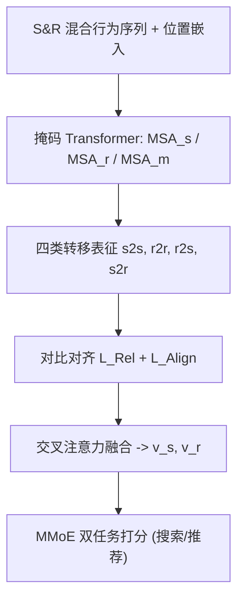

# UniSAR: Modeling User Transition Behaviors between Search and Recommendation (统一建模搜索与推荐间的用户转移行为)

- **会议/期刊**: SIGIR 2024
- **作者与机构**: Teng Shi, Zihua Si, Jun Xu, Xiao Zhang（中国人民大学）；Xiaoxue Zang, Kai Zheng, Dewei Leng, Yanan Niu, Yang Song（快手科技）
- **推荐链路定位**: 召回（用户表征/序列编码器，可插拔至搜索与推荐两侧）
- **研究方向**: 跨域与多场景推荐 / 序列与会话推荐
- **论文原文**: [https://arxiv.org/abs/2404.09520v1](https://arxiv.org/abs/2404.09520v1)
- **开源代码**: [https://github.com/TengShi-RUC/UniSAR](https://github.com/TengShi-RUC/UniSAR)

## TL;DR (1分钟核心速览)

同一 App 内搜索与推荐（S&R）行为互相触发，但既有联合模型要么双塔独立编码、要么把两侧历史按时间戳混成一条序列，无法区分"同类延续"与"跨场景跳转"两种语义。UniSAR 用掩码 Transformer 显式抽取 r2r/s2s/r2s/s2r 四类转移，再用对比学习对齐、交叉注意力融合，并以 MMoE 联合训练。在 KuaiSAR 与 Amazon 上采用 99 负采样排序评测，推荐 HR@1 相对提升 8.9%、搜索 NDCG@5 提升 5.7%。

## Background & Motivation (背景与核心矛盾)

- **主流范式**: 联合 S&R 分为两支——以 SESRec、UnifiedSSR 为代表的双编码器（分别编码搜索与推荐历史）和以 USER 为代表的单序列混排编码器；JSR 则用两套参数共享 item 表联合优化。
- **前人局限**: (1) 双编码器只建模 s2s 与 r2r，跨场景的 r2s/s2r 被丢弃；(2) 单序列混排虽隐含跨行为依赖，但同类与跨类转移共享同一套注意力，无法区分语义差异，且输出存在冗余。
- **核心洞察 (Key Insight)**: 在 KuaiSAR 上统计"紧邻前一点击项与当前项同类目"的比例：同类延续（r→r 7.99%、s→s 17.14%）显著高于跨场景跳转（s→r 仅 4.86%、r→s 仅 3.67%）。即**跨场景转移往往意味着用户产生了新的信息需求**，必须与同类延续区别建模。
- **本文切入点**: 把"转移"当作一等公民，分抽取（Extraction）—对齐（Alignment）—融合（Fusion）三步显式建模四类转移。

## Method (核心方法设计)

### 1. 整体框架 (Overall Architecture)

用户时空有序的 S&R 行为序列先经嵌入层转为稠密向量（查询用词嵌入均值 + 所点击 item 嵌入均值表示）。随后进入转移建模模块：三路带掩码的 Transformer 分别抽取 s2s、r2r 与跨行为的 r2s/s2r；对比学习把同一场景下的"同类转移"与"跨类转移"拉近；交叉注意力将二者融合为搜索侧与推荐侧的用户表征。目标 item 经注意力聚合得到 $v_s, v_r$，与用户/物品/查询嵌入拼接后送入 MMoE 输出双任务打分，并以联合损失端到端训练。

### 2. 关键设计拆解 (Key Designs)

1. **掩码解耦的转移抽取**：若把混合序列直接喂入 Transformer，输出会同时含有同类与跨类依赖，与独立编码的 s2s/r2r 冗余。作者在 MSA 的注意力矩阵上做 Hadamard 掩码，仅允许**不同行为之间**计算注意力：
$\mathrm{Attention} = \mathrm{Softmax}\left(\hat{\mathbf{E}}_u\hat{\mathbf{E}}_u^{\top}/\sqrt{d/h}\odot \mathbf{M}\right)\hat{\mathbf{E}}_u,\quad \mathbf{M}_{ij}=\mathbb{I}[b_i \neq b_j]$
这样单层注意力就只承载 r2s/s2r，物理上把"跨场景需求切换"从"同类兴趣延续"中剥离出来。

2. **两类对比对齐**：$H_{s2s}$与$H_{r2s}$都含搜索侧信息，但语义分布不同，直接融合易冲突。作者对二者做均值池化得$h_{s2s}, h_{r2s}$，以 batch 内其他用户为负样本做 InfoNCE：
$\mathcal{L}^{S}_{Align}=-\log\frac{\exp(\mathrm{sim}(h_{s2s},h_{r2s})/\tau_2)}{\sum_{h^{-}\in \mathcal{H}^{r2s}_{neg}}\exp(\mathrm{sim}(h_{s2s},h^{-})/\tau_2)}+\text{(对称项)}$另有$\mathcal{L}_{Rel}$将查询与其点击 item 拉近（正样本$\langle q, C_q\rangle$，随机负样本），为跨行为转移提供统一语义空间。图 5 显示引入$\mathcal{L}_{Align}$ 后两类转移的余弦相似度由集中于 0 附近明显右移。

3. **交叉注意力融合 + MMoE 联合训练**：以 $H_{s2s}$为 K/V、$H_{r2s}$为 Q 得$V_s$，反向得$V_r$，使跨场景信号以"查询"身份注入同类序列。总损失$\mathcal{L}_{Total}=\mathcal{L}^{R}+\gamma\mathcal{L}^{S}+\lambda\|\Theta\|^2$，其中$\mathcal{L}=\mathcal{L}_{Click}+\alpha\mathcal{L}_{Rel}+\beta\mathcal{L}_{Align}$。预测层用共享专家 + 场景专属专家的 MMoE 缓解 S&R 数据量悬殊导致的跷跷板效应；无负采样以外的额外在线开销，推理仅需一次前向。

## Experimental Setup & Evaluation Protocol (实验设置与评估协议)

| 数据集 | #Users | #Items | #Queries | #Action-S | #Action-R | 说明 |
| :--- | :---: | :---: | :---: | :---: | :---: | :--- |
| KuaiSAR | 25,877 | 6,890,707 | 453,667 | 5,059,169 | 14,605,716 | 真实双场景工业日志，搜索侧极稀疏 |
| Amazon (Kindle) | 68,223 | 61,934 | 4,298 | 934,664 | 989,618 | 半合成：由推荐数据构造搜索行为 |

- **过滤与划分**: KuaiSAR 仅保留同时具备 S&R 行为的用户，剔除搜索稀疏的最后两天，再按 5-core 过滤用户/物品，并采用**全局时间戳切分**（最后一天测试、倒数第二天验证）；Amazon 采用 5-core 子集与 `Leave-One-Out` 划分。
- **排名评测协议**: `Sampled Ranking`——每个 ground-truth 配 99 个用户未交互的随机负样本，报告 HR@{1,5,10} 与 NDCG@{5,10}；未做 Full-Ranking，故指标绝对值偏高。
- **基线与超参**: 对比 5 个纯序列模型（DIN/GRU4Rec/SASRec/BERT4Rec/FMLP-Rec）、6 个个性化搜索模型（QEM/HEM/AEM/ZAM/TEM/CoPPS）与 5 个联合 S&R 模型（NRHUB/Query-SeqRec/SESRec/JSR/USER/UnifiedSSR）；$d=64$，历史截断 30，MMoE 三组专家各 4 个，$\tau\in[0.1,1.0]$，$\alpha,\beta$网格搜索，$t$-test$p<0.01$。

## Key Experimental Results (实验关键数据)

### 1. 主实验对比 (Main Results)

推荐任务（节选核心指标，加粗为最优）：

| Method | KuaiSAR HR@10 | KuaiSAR NDCG@5 | KuaiSAR NDCG@10 | Amazon HR@10 | Amazon NDCG@5 | Amazon NDCG@10 |
| :--- | :---: | :---: | :---: | :---: | :---: | :---: |
| SASRec | 0.6007 | 0.2671 | 0.3298 | 0.6772 | 0.3747 | 0.4225 |
| BERT4Rec | 0.5885 | 0.2381 | 0.3083 | 0.6658 | 0.3954 | 0.4390 |
| FMLP-Rec | 0.6159 | 0.2851 | 0.3453 | 0.6879 | 0.3739 | 0.4232 |
| Query-SeqRec | 0.5890 | 0.2552 | 0.3186 | 0.6860 | 0.3859 | 0.4333 |
| SESRec | 0.6643 | 0.3432 | 0.3978 | 0.6864 | 0.4245 | 0.4648 |
| JSR | 0.6453 | 0.3315 | 0.3853 | 0.6779 | 0.3970 | 0.4396 |
| USER | 0.5627 | 0.2820 | 0.3318 | 0.6854 | 0.3964 | 0.4422 |
| UnifiedSSR | 0.5939 | 0.2617 | 0.3249 | 0.6707 | 0.3662 | 0.4151 |
| **UniSAR** | **0.6792** | **0.3632** | **0.4158** | **0.7020** | **0.4513** | **0.4885** |
| Improv. | +2.2% | +5.8% | +4.5% | +2.0% | +6.3% | +5.1% |

搜索任务（NDCG@{5,10}）：

| Method | KuaiSAR NDCG@5 | KuaiSAR NDCG@10 | Amazon NDCG@5 | Amazon NDCG@10 |
| :--- | :---: | :---: | :---: | :---: |
| HEM | 0.5029 | 0.5400 | 0.4736 | 0.5221 |
| TEM | 0.4887 | 0.5254 | 0.6303 | 0.6587 |
| CoPPS | 0.4977 | 0.5331 | 0.6281 | 0.6570 |
| JSR | 0.5962 | 0.6221 | 0.5173 | 0.5563 |
| USER | 0.6069 | 0.6342 | 0.6000 | 0.6348 |
| UnifiedSSR | 0.5991 | 0.6297 | 0.5847 | 0.6196 |
| **UniSAR** | **0.6417** | **0.6708** | **0.6875** | **0.7132** |
| Improv. | +5.7% | +5.8% | +9.1% | +8.3% |

### 2. 消融实验 (Ablation Study)

| 变体 | Rec NDCG@5 | Rec NDCG@10 | Search NDCG@5 | Search NDCG@10 |
| :--- | :---: | :---: | :---: | :---: |
| UniSAR 完整 | **0.3632** | **0.4158** | **0.6417** | **0.6708** |
| w/o r2r | 0.3258 | 0.3798 | 0.6007 | 0.6319 |
| w/o r2s | 0.3606 | 0.4136 | 0.6376 | 0.6690 |
| w/o s2r | 0.3512 | 0.4036 | 0.6292 | 0.6584 |
| w/o s2s | 0.3399 | 0.3941 | 0.6404 | 0.6706 |
| w/o 掩码 $\mathbf{M}$ | 0.3503 | 0.4024 | 0.6217 | 0.6507 |
| w/o $\mathcal{L}_{Align}$ | 0.3458 | 0.3956 | 0.6069 | 0.6381 |
| w/o $\mathcal{L}_{Rel}$ | 0.3472 | 0.3988 | 0.6177 | 0.6465 |
| w/o MCA$_r$ | 0.3384 | 0.3924 | 0.6094 | 0.6397 |
| w/o MCA$_s$ | 0.3561 | 0.4091 | 0.6257 | 0.6545 |
| w/o MMoE | 0.3132 | 0.3692 | 0.6143 | 0.6438 |
| w/o 联合训练 | 0.3569 | 0.4105 | 0.5850 | 0.6167 |

### 3. 关键实验发现 (Key Findings)

- **细粒度转移是主要增益源，且贡献不对称**：删去 r2r 使推荐 NDCG@5 从 0.3632 跌至 0.3258（-10.3%），是四类转移中最大跌幅；而删去 r2s 对搜索几乎无影响（0.6417→0.6376），说明同类延续决定主体兴趣、跨场景转移只做增量微调。
- **掩码解耦不可替代**：去掉掩码 $\mathbf{M}$ 后搜索 NDCG@5 掉至 0.6217（-3.1%），比删去任一单类转移都更严重——证明"混排注意力产生冗余"这一诊断成立，解耦本身比某类转移更重要。
- **跷跷板效应需要 MMoE 而非简单联合训练**：w/o MMoE 时推荐 NDCG@5 崩至 0.3132（-13.8%），w/o 联合训练时搜索跌至 0.5850（-8.8%）；因 KuaiSAR 推荐交互量约为搜索的 2.9 倍，纯联合训练让搜索"蹭"到收益却牺牲推荐，MMoE 共享+专属专家才能双向提升。此外 $\alpha$增大持续提升搜索但压低推荐，$\beta=10^{-1}$ 时为双任务最优折中。

## Highlights & Limitations (亮点、对比与审稿批判)

- **与代表作对比 (vs. Prior Work)**: 相比 SESRec（仅用搜索增强推荐、双编码器丢弃跨行为依赖）与 UnifiedSSR（并行双分支只编码 s2s/r2r），UniSAR 首次把 r2s/s2r 作为独立表征并用掩码从混合序列中"切"出来；相比 USER 的隐式混排，它以显式掩码 + 对比对齐避免同类/跨类语义混叠，同时用单套参数 + MMoE 服务双任务，参数量显著少于 JSR 的两套模型。
- **可迁移亮点**: (1) "Hadamard 掩码限制注意力只在异质行为间计算"这一算子可平移到任意多场景/多行为序列（如曝光-点击-加购、短视频-直播）中抽取跨域转移；(2) 用对比学习把"同场景异类转移"与"同类转移"对齐，是一种低成本的正样本构造范式，无需额外标注。
- **审稿级局限批判**: (1) 评测仅用 99 负采样的 `Sampled Ranking`，未做 Full-Ranking，且 Amazon 为半合成搜索数据，结论的工业外推性有限；(2) 序列截断 30、四类转移需三路 Transformer + 双对比损失 + MMoE，训练显存与调参成本（$\alpha,\beta,\gamma,\tau_1,\tau_2$ 五组超参）偏高，论文未给出推理时延与线上 A/B 结果。

## Rating (四维评分)

- **方法创新性 (Novelty)**: ⭐⭐⭐⭐ （以掩码把"跨行为注意力"从混合序列中解耦，配合四类转移的显式对齐，机制清晰且有真实数据统计支撑）
- **评估协议与实验扎实度 (Protocol & Experiments)**: ⭐⭐⭐ （KuaiSAR 时间切分合理、消融覆盖 12 个变体，但仅 99 负采样排序且 Amazon 为半合成，缺 Full-Ranking 与在线验证）
- **写作与数学规范度 (Clarity & Rigor)**: ⭐⭐⭐⭐ （三类 MSA 的掩码公式与损失定义一目了然，图 4 直观对比注意力模式；复杂度与参数量分析略缺）
- **工业落地与复现价值 (Industrial & Practical Value)**: ⭐⭐⭐⭐ （代码开源、可插到现有 S&R 双引擎前端，MMoE 缓解数据不均衡的经验对真实平台极具参考价值）

