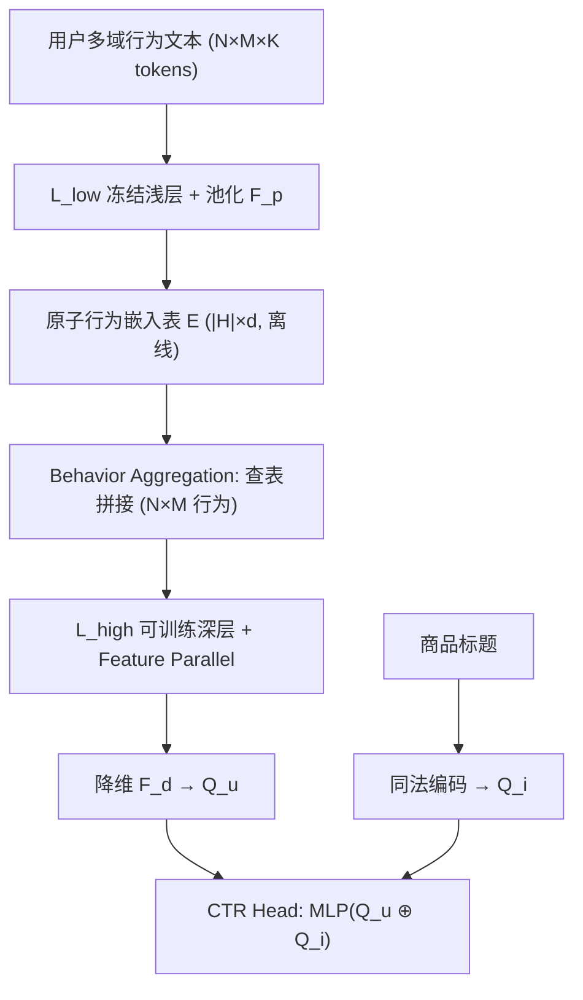
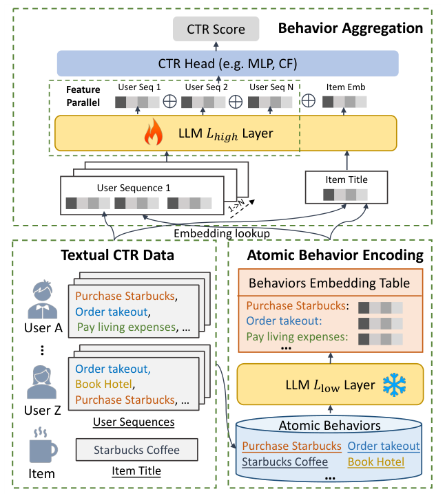

# Breaking the Length Barrier: LLM-Enhanced CTR Prediction in Long Textual User Behaviors (打破长度壁垒：长文本用户行为下的 LLM 增强 CTR 预估)

- **会议/期刊**: SIGIR 2024 (Industry Track)
- **作者与机构**: Binzong Geng, Zhaoxin Huan, Xiaolu Zhang, Yong He, Jun Zhou, Linjian Mo 等（蚂蚁集团；西湖大学 Fajie Yuan）
- **推荐链路定位**: 精排（CTR 预估，可下沉至召回侧用户表征）
- **研究方向**: CTR/CVR 预估与特征交叉 / 大语言模型推荐 (LLM4Rec)
- **论文原文**: [https://arxiv.org/abs/2403.19347v1](https://arxiv.org/abs/2403.19347v1)
- **开源代码**: 暂未开源（基座为 [Qwen-1_8B](https://huggingface.co/Qwen/Qwen-1_8B)）

## TL;DR (1分钟核心速览)

LLM 增强 CTR 的核心落地障碍不是效果而是**效率**：用户行为文本变长后，注意力是 $O(l^2)$，且同一行为在千万用户序列中被反复编码。本文提出 BAHE，把 LLM 切成「预训练浅层离线编码原子行为建表」+「深层可训练层做行为级交互」，并用 Feature Parallel 阻断跨域序列的注意力爆炸。在 5000 万条工业 CTR 日志（按时间切分、AUC 评估）上，序列长度 2048 时训练 GPU 时从 928 降至 164（约 5.7 倍）、显存从 75.4G 降至 12.6G，下游 AUC 从 0.7219 升至 0.7372；线上两周 A/B 提升 CTR 9.65%、CPM 2.41%。

## Background & Motivation (背景与核心矛盾)

- **主流范式**: CTRL / FLIP 用对比学习与 MLM 把 LLM 语义注入 ID 类模型，KAR 用三阶段蒸馏把 LLM 知识搬到 CTR 塔，M6-Rec 把交互重写成 prompt 交给 LLM 直接打分。
- **前人局限**: ① 拼接式长序列的 LLM 前向开销随 token 数二次增长，工业上只能退化为「小语言模型 + 短序列」，长行为序列的收益拿不到；② 行为表征抽取与行为间交互建模被强耦合在同一前向里，同一原子行为在不同用户序列中被重复编码，行为集更新需全量重算。
- **核心洞察 (Key Insight)**: 原子行为集合 $H$ 的规模远小于「用户 × 行为」实例数（本文 5000 万样本仅对应约 1000 万个原子行为，每用户 50 条行为），且原子行为语义在预训练浅层就已足够稳定、几乎不随时间改变——这正是可缓存、可复用的部分。
- **本文切入点**: 不改模型结构，改**计算图与编码粒度**：把编码从 token 级降到 behavior 级，把「不可变的语义抽取」离线化，把「可变的偏好交互」留给可训练深层。

## Method (核心方法设计)

### 1. 整体框架 (Overall Architecture)

BAHE 把 Qwen-1.8B 按层劈成 $L_{low}$与$L_{high}$。离线阶段：所有原子行为$a_i\in H$经冻结的$L_{low}$编码 + 池化，落成行为嵌入表$E\in\mathbb{R}^{|H|\times d}$（行为级 KV 表）。在线/训练阶段：按用户行为序列查表，把原来$N\times M\times K$个 token 直接替换为$N\times M$个行为向量送进可训练深层$L_{high}$；每条域序列独立并行前向（FP）后拼接得用户表征$Q_u$，商品标题同法得$Q_i$，二者拼接进 MLP CTR Head 输出点击概率。深层用 LoRA 微调，浅层与行为表异步低频刷新。

<figure class="paper-figure" markdown="span">
  <figcaption>图1：所提出的BAHE方法架构。</figcaption>
</figure>

### 2. 关键设计拆解 (Key Designs)

1. **原子行为编码 ABE + 行为聚合 BA（把编码粒度从 token 降到 behavior）**：原做法对 $NMK$个 token 做全序列注意力。BAHE 先对每个原子行为做池化压缩为单向量并存表，再用查表拼接替代 token embedding 层：$E_{a_i}=F_p(L_{low}(a_i))$，$E(s_u^n)=[E(a_{u1}^n)\oplus\cdots\oplus E(a_{uM}^n)]$。直觉：序列长度从$NMK$降为$NM$，且跨用户复用了$|H|$ 个共享语义单元，把冗余计算一次性摊销到离线。
2. **Feature Parallel（切断多域序列间的注意力耦合）**：$N$个域（点击/收藏/加购…）若拼成一条长序列，注意力代价是$(NM)^2$。BAHE 让每条域序列独立过$L_{high}$再拼接：$Q_u=[Q_{u1}\oplus\cdots\oplus Q_{uN}]$，使代价由$(NM)^2$降为$N\cdot M^2$。代价是丢失跨域 token 级交互，仅保留行为级、域级拼接交互——这也是精度与效率的显式取舍。
3. **训练目标、负采样与推理效率**：目标为点式 BCE，$\mathcal{L}=\frac{1}{|D|}\sum_{u,i}\ell(Y,F(s_u,t_i))$，无负采样（全部曝光样本为正负混合的真实分布），LoRA rank=64、batch=16、单 epoch、lr=$5\times10^{-5}$余弦衰减。复杂度由$O(L(NMK)^2)$降为$O(L_{low}HK^2)+O(L_{high}NM^2)$；推理时浅层完全离线、行为表可异步低频更新，线上只跑$L_{high}$ 这一小段。

## Experimental Setup & Evaluation Protocol (实验设置与评估协议)

- **数据集与预处理**: 单一真实工业日志（蚂蚁/电商广告场景），未做 5-core 过滤，无可比公开基准：

| 数据集 | #Users | #Items | #Interactions | 稀疏度/密度 | 特征/场景说明 |
| :--- | :---: | :---: | :---: | :---: | :--- |
| 工业 CTR 日志（1 周） | 未披露 | 未披露 | 5,000 万 | — | 6 类文本特征：用户账单、搜索、小程序访问等 + 商品标题；每用户 50 条行为、每条行为均值 5 token，约 1000 万原子行为 |

- **数据划分与防穿越 (Splitting Strategy)**: 按日志时间（log time）切分 train/valid/test，属全局时间戳切分，避免未来行为泄漏。
- **排名评测协议 (Ranking Protocol)**: 未采用 Full-Ranking 或 Sampled Ranking，而是 CTR 点式 **AUC**（以及把 LLM 表征迁移给下游 DNN 后的 $\text{AUC}_d$）；效率指标为训练 GPU 小时与峰值显存。
- **对比基线与超参设置**: 基线为拼接式 LLM-CTR（CTRL/FLIP/KAR 类范式）+ 纯 ID 的 DNN；backbone Qwen-1.8B，$F_d$为 [2048,512,128] MLP，$F_\theta$ 为 [256,32,1] MLP，默认 mean pooling，8×A100；未报告显著性检验。

## Key Experimental Results (实验关键数据)

### 1. 主实验对比 (Main Results)

| 模型 | AUC@1024 | GPU-h@1024 | Mem@1024 | AUC@2048 | GPU-h@2048 | Mem@2048 | $\text{AUC}_d$ |
| :--- | :---: | :---: | :---: | :---: | :---: | :---: | :---: |
| DNN (纯 ID) | — | — | — | — | — | — | 0.7219 |
| LLM-CTR (拼接式) | 0.7161 | 448 | 43.8 | 0.7276 | 928 | 75.4 | 0.7323 |
| + FP | 0.7143 | 420 | 36.8 | 0.7326 | 864 | 67.8 | 0.7369 |
| + ABE | 0.7150 | 256 | 23.0 | **0.7332** | 416 | 38.0 | **0.7372** |
| **+ BA (BAHE)** | 0.7132 | **116** | **9.8** | 0.7309 | **164** | **12.6** | 0.7352 |

（效率列越低越好，加粗为最优；$\text{AUC}$为 LLM 自身建模效果，$\text{AUC}_d$ 为表征迁移给下游模型后的效果。）

### 2. 消融实验 (Ablation Study)

| 配置 | AUC@2048 | GPU-h | Mem(G) | 相对上一行变化 |
| :--- | :---: | :---: | :---: | :--- |
| w/o FP, w/o ABE, w/o BA (LLM-CTR) | 0.7276 | 928 | 75.4 | 基线 |
| w/o ABE, w/o BA (仅 +FP) | 0.7326 | 864 | 67.8 | AUC +0.0050，显存 −10% |
| w/o BA (FP+ABE) | **0.7332** | 416 | 38.0 | GPU-h 再降 52% |
| Full BAHE (FP+ABE+BA) | 0.7309 | **164** | **12.6** | 再降 60%，AUC −0.0023 |

### 3. 关键实验发现 (Key Findings)

1. **效率是可量化的 5 倍级跃迁，且收益随长度放大**：2048 token 场景 GPU 时 928→164（5.7×）、显存 75.4G→12.6G（6×）；序列从 1024 增到 2048 时基线开销近乎翻倍，而 BAHE 增长平缓（图 2a），因为深层只处理 $NM$个行为向量而非$NMK$ 个 token。
2. **「长序列才划算」是本文的隐含边界**：1024 长度下 BAHE 三档变体 AUC（0.7132–0.7150）均略低于拼接式基线 0.7161，而 2048 时 +FP/+ABE 反超基线（0.7326/0.7332 vs 0.7276）；即行为级压缩在短序列上是信息损失，在长序列上才转为净收益，论文对此未做归因。
3. **最终 BA 聚合是「以精度换极致效率」的显式折点**：加入 BA 后 AUC 从 0.7332 回退到 0.7309（$\text{AUC}_d$ 0.7372→0.7352），但 GPU-h 416→164、显存 38.0→12.6，换来的是 5000 万样本日更（原先需 5 天跑完）；同时 mean pooling 优于 EOS 末位隐状态，说明生成式 LLM 的语义应取全局池化而非 last-token。

## Highlights & Limitations (亮点、对比与审稿批判)

- **与代表作对比 (vs. Prior Work)**: CTRL/FLIP 把 LLM 当作离线特征增强器，但对每条样本仍需全序列前向，长序列开销未解；KAR 的三阶段蒸馏把知识搬到 ID 塔，但强制截断用户序列；M6-Rec 走 prompt 化生成式打分，推理更重。BAHE 的差异在于**不改架构、只改计算图与编码粒度**，把「不变语义」缓存化，属于典型的系统—模型协同设计。
- **可迁移亮点**: ①「原子行为嵌入表 + 行为级 token 化」可直接迁移到生成式推荐（RQ-VAE 语义 ID）与长序列序列推荐，等效于把用户序列做了一次跨用户去重的语义量化；②浅层冻结 + 深层 LoRA 的非对称分层微调，是 LLM 落地精排的低成本范式。
- **审稿级局限批判**: ① 仅有单一工业数据集，无公开基准、无重复实验与显著性检验，AUC 增益 0.002 级别的差异可信度存疑；② 行为表 $E$ 是离线静态快照，行为语义漂移（商品改名、促销时效、价格变动）与新行为冷启动无法在线捕捉，异步更新频率成为未讨论的超参；③ 评估只用点式 AUC，缺少 GAUC/HR 等排序指标与线上延迟/QPS 报告，「5 倍」在真实 serving 中是否仍成立需更多证据。

## Rating (四维评分)

- **方法创新性 (Novelty)**: ⭐⭐⭐⭐ （分层解耦 + 行为级缓存思路简洁有效，工程洞察力强，但理论上只是复杂度重排而非新学习范式）
- **评估协议与实验扎实度 (Protocol & Experiments)**: ⭐⭐⭐ （有线上 A/B 与真实工业规模数据，但仅单数据集、无公开基准、无显著性检验，消融粒度偏粗）
- **写作与数学规范度 (Clarity & Rigor)**: ⭐⭐⭐⭐ （符号与复杂度推导清晰、$\text{AUC}_d$ 迁移设定明确，但缺少行为表更新频率与信息损失的定量分析）
- **工业落地与复现价值 (Industrial & Practical Value)**: ⭐⭐⭐⭐⭐ （5000 万样本日更、8×A100、CTR +9.65%/CPM +2.41%，是 LLM4CTR 少见的完整上线闭环，方案可直接复刻）

