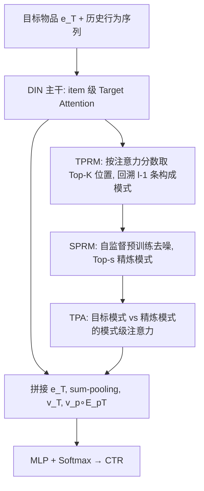
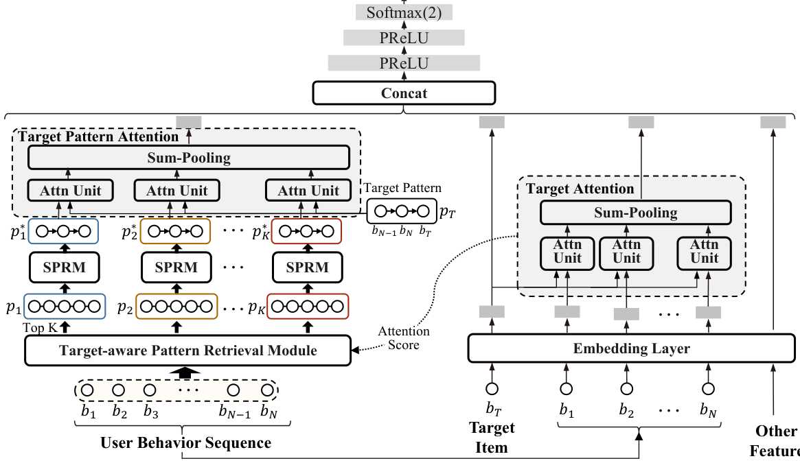

# Deep Pattern Network for Click-Through Rate Prediction (深度行为模式网络：从物品级注意力到模式级注意力)

- **会议/期刊**: SIGIR 2024
- **作者与机构**: Hengyu Zhang, Xiu Li (清华大学深圳国际研究生院)；Junwei Pan, Dapeng Liu, Jie Jiang (腾讯)
- **推荐链路定位**: 精排 (CTR 预估)
- **研究方向**: CTR/CVR 预估与特征交叉 / 自监督对比学习与交互去噪
- **论文原文**: [https://arxiv.org/abs/2404.11456v1](https://arxiv.org/abs/2404.11456v1)
- **开源代码**: 暂未开源

## TL;DR (1分钟核心速览)

现有用户行为建模（DIN 系）只算「目标物品 ↔ 历史单个物品」的共现注意力，忽略了用户习惯性的**行为模式（物品子序列）**及其相互依赖。DPN 把 Query/Key/Value 由单物品**加宽为模式**：TPRM 按目标注意力分数检索 Top-$K$ 相关模式，SPRM 用自监督去噪预训练筛掉模式内误点击噪声，TPA 做模式级注意力聚合。在 Tmall/Taobao/Alipay 上 AUC 达 0.9573/0.9431/0.9438，相对最强基线 CAN 提升 1.53%/2.40%/2.95%。

## Background & Motivation (背景与核心矛盾)

- **主流范式**: DIN 提出目标注意力后，DIEN（GRU 演化）、MIMN（记忆网络）、SIM/ETA（长序列检索）、CAN（共现建模）基本都在「item 级共现 + 序列编码」框架里加长、加深或加检索。
- **前人局限**: ① 把整条行为序列当作同质兴趣用一个序列模型统一编码，**模式级（高阶子序列）依赖完全缺失**；② 模式数量爆炸且模式内部常混入误点击/其他兴趣驱动的无关物品，直接建模噪声大、算力不可接受。
- **核心洞察 (Key Insight)**: 统计显示 Taobao 中 3 阶模式极度集中——商品级 Top-1 模式 $(3371523,2367945,1591862)$ 出现 15901 次，类目级 Top-1 出现 135426 次。这说明**固定模式是可复用的强先验信号**，而非随机序列。
- **本文切入点**: 借 CV 中 $1\times1$ 卷积扩窗、NLP 中 uni-gram→N-gram 的思路，把注意力的 Q/K/V 由「单点」拓宽为「局部窗口（模式）」，并用检索+去噪控制代价。

## Method (核心方法设计)

### 1. 整体框架 (Overall Architecture)

输入为目标物品 $e_T$、定长历史行为序列$S=\{b_1,\dots,b_N\}$（物品+类目嵌入拼接）与其余特征。主干沿用 DIN 得到 item 级兴趣$v_T$；TPRM 复用主干注意力分数，取 Top-$K$位置并向前回溯$l-1$条行为构成$K$个原始模式；SPRM（预训练的两层 Transformer + MLP）对每个模式打 logit、取 Top-$s$得到精炼模式；TPA 以「目标模式」为 Query、精炼模式为 Key/Value 做注意力得到$v_p$；最后$[e_T;\sum_j e_j; v_T; v_p\circ E_{p_T}]$ 送入三层 MLP 输出二分类。

<figure class="paper-figure" markdown="span">
  <figcaption>图3：所提出DPN的整体架构。Target-ware Pattern Retrieval Model（TPRM）根据目标注意力分数从用户行为序列中检索Top-K个与目标相关的模式。SPRM采用预训练的细化网络对行为模式进行细粒度去噪，其详细示意图见图4。TPA建模目标行为模式与细化后的历史行为模式之间的依赖关系。</figcaption>
</figure>

### 2. 关键设计拆解 (Key Designs)

1. **TPRM：模式检索把复杂度压回线性**：若枚举所有模式代价不可接受（C3）。做法是直接复用目标注意力分数而非另训检索器：$idx_1,\dots,idx_K=\operatorname{argtopk}_K\{a(e_T,e_1),\dots,a(e_T,e_N)\}$，第$k$个模式取$p_k=\{b_{idx_k-l+1},\dots,b_{idx_k}\}$。直觉是「目标注意力分数本身就是相关性代理」，堆结构堆到$O(BN\log K)$ 即可，且检索与主干共享打分、零额外在线开销。

2. **SPRM：自监督去噪解决模式内部噪声与稀疏（C1+C2）**：随机把采样到的行为记录混入原始模式得到增广序列 $p_{aug}$（**末位记录保持一致**以告知决策目标），两层 Transformer 编码后由 MLP 输出长度$l$的 logit，用交叉熵回归「哪些位置属于原始模式」：$\mathcal{L}_{SSL}=-\sum_{j=1}^{l}\mathbb{I}_{p}(b''_j)\log o_j$。预训练得到的 logit 在 CTR 阶段即充当「模式内重要性打分」，取 Top-$s$ 完成精炼。等于把「模式稀疏下的高阶依赖学习」转化为「去噪式重构」，用自监督信号补足稀疏模式的监督不足。

3. **TPA 与目标函数**：以目标模式 $p_T=\{b_{N-s+2},\dots,b_N,b_T\}$为 Query 聚合精炼模式：$v_p=\sum_{k=1}^{K}a(E_{p_T},E_{p^*_k})\cdot E_{p^*_k}$，使模型判断「本次点击是否落在用户习惯的行为范式里」。总损失为 CTR 二元交叉熵$\mathcal{L}_{CTR}=-\frac{1}{B}\sum_{\mathcal{B}}[y\log\hat{y}+(1-y)\log(1-\hat{y})]$（SPRM 为两阶段预训练，不联合优化）；无负采样设计，全库曝光样本直接训练，复杂度$\mathcal{O}(BNd+BN\log K+BKld(l+d)+BKd)$。

## Experimental Setup & Evaluation Protocol (实验设置与评估协议)

- **数据集与预处理**:

| 数据集 | #Users | #Items | #Interactions | 稀疏度/密度 | 特征/场景说明 |
| :--- | :---: | :---: | :---: | :---: | :--- |
| Tmall | 424,170 | 1,090,390 | 54,925,330 | 极稀疏 | 2015.5–11 天猫行为，按 action time 排序 |
| Taobao | 987,994 | 4,162,024 | 100,150,807 | 极稀疏 | 点击/加购/购买统一视为交互 |
| Alipay | 963,923 | 2,353,207 | 44,528,127 | 极稀疏 | 2015.7–11 跨 Tmall/Taobao/Alipay 商家行为 |

- **数据划分与防穿越 (Splitting Strategy)**: 论文仅说明按行为时间戳排序构造序列，**未显式交代训练/测试切分比例与是否全局时间切分**，属可复现性缺口。
- **排名评测协议 (Ranking Protocol)**: 采用 CTR 领域标准的 **AUC**（非 Full-Ranking/非采样排序指标），相对提升按 $\text{RelImpr.}=\left(\frac{\text{AUC}-0.5}{\text{AUC}_{base}-0.5}-1\right)\times100\%$ 计算。
- **对比基线与超参设置**: 对比 DNN、NCF、Wide&Deep、PNN、RUM、GRU4Rec、ONN、DIN、DIEN、MIMN、SIM、ETA、CAN 共 13 个基线；序列长度 $N=100$、嵌入维度$d=16$、$K=5$、$l=5$、$s=3$、batch 256、Adam lr=0.001；检索类基线（SIM/ETA）检索物品数对齐为$K\times s$；显著性$p<0.05$（带 * 标注）。

## Key Experimental Results (实验关键数据)

### 1. 主实验对比 (Main Results)

| Method (AUC↑) | Tmall | Taobao | Alipay |
| :--- | :---: | :---: | :---: |
| GRU4Rec | 0.9392 | 0.9056 | 0.9191 |
| DIN | 0.9307 | 0.8931 | 0.9185 |
| DIEN | 0.9459 | 0.9058 | 0.9251 |
| MIMN | 0.9458 | 0.9162 | 0.9280 |
| SIM | 0.9494 | 0.9281 | 0.9205 |
| ETA | 0.9466 | 0.9259 | 0.9202 |
| CAN | 0.9504 | 0.9327 | 0.9311 |
| **DPN (Ours)** | **0.9573\*** | **0.9431\*** | **0.9438\*** |
| Improv. (vs. CAN) | +1.53% | +2.40% | +2.95% |

### 2. 消融实验 (Ablation Study)

| 变体 (AUC↑) | Tmall | Taobao | Alipay |
| :--- | :---: | :---: | :---: |
| Base Model (DIN) | 0.9307 | 0.8931 | 0.9185 |
| DPN w/o TPRM | 0.9507 | 0.9308 | 0.9371 |
| DPN w/o SPRM | 0.9409 | 0.9320 | 0.9364 |
| DPN w/o TPA | 0.9456 | 0.9312 | 0.9347 |
| **DPN** | **0.9573** | **0.9431** | **0.9438** |

兼容性验证：DPN(DNN) 由 0.9268/0.8731/0.9037 升至 0.9542/0.9309/0.9326；DPN(DIEN) 在 Tmall 达 **0.9601**，说明模块与主干正交。

### 3. 关键实验发现 (Key Findings)

1. **三模块缺一不可，且瓶颈随数据分布迁移**：去 TPA 造成 Tmall/Alipay 分别掉 1.17/0.91 个百分点；去 SPRM 在 Tmall 掉幅最大（0.9573→0.9409，约 1.64 pt），说明 Tmall 模式更杂乱、更依赖去噪；而 Taobao 上去 TPRM 影响最小、去 SPRM 影响最大（→0.9320），与「亿级交互中无关兴趣模式噪声最重」的直觉一致。
2. **模式长度 3 阶最优，过长反噬**：$s$ 由 2→3 普遍上涨，但 Alipay 上 4 阶略低于 3 阶，作者归因于该数据集高阶模式稀缺、增加长度只引入噪声——印证「模式阶数应与数据的高阶依赖密度匹配」。
3. **DPN 真正学到了模式级依赖而非更强 item 注意力**：以条件互信息 $I(\mathbb{P}(p_i)_H;\hat{Y}\,|\,\mathbb{P}(p_t)_T)$ 可视化，DPN 与 Ground Truth 矩阵高度相关，而 DIN/DIEN 对目标模式与历史模式均不敏感（同类目结尾的目标模式列向量余弦相似度 >0.9）；同时精炼后模式的 IntraPMI 的 CDF 曲线整体下移（即互信息更大），定量证明 SPRM 提升了模式内部依赖强度。

## Highlights & Limitations (亮点、对比与审稿批判)

- **与代表作对比 (vs. Prior Work)**: 与 DIN/DIEN 相比，DPN 的 Q/K/V 粒度从「单物品」变为「模式窗口」，建模的是模式间依赖而非物品共现；与 SIM/ETA 相比，检索目标不是「更长的序列」而是「更短但同质的模式」，且检索分数免费复用主干注意力；与 CAN 相比，CAN 仍停留在目标-物品共现，DPN 引入模式级二阶结构。
- **可迁移亮点**: ①「注意力分数即检索器」的零成本 Top-$K$ 复用，可直接搬进长序列/多兴趣召回做候选裁剪；②「随机混入 + 末位对齐 + 位置级交叉熵」的自监督打分头，是一种极轻量的序列内噪声定位范式，可用于会话去噪与序列增强。
- **审稿级局限批判**: ① 评估仅报 AUC 且未披露划分比例/时间切分与负样本构造，AUC 差异在 0.001 量级时缺乏方差与重复实验支撑，可复现性偏弱；② 在线开销被低估——TPRM 需对每个样本取 Top-$K$并对$K$条长度$l$的模式各跑一次两层 Transformer（$s$与$l$ 强耦合），论文未给出实际 QPS/延迟，也未讨论预训练与主任务分布不一致时 SPRM 的退化风险。

## Rating (四维评分)

- **方法创新性 (Novelty)**: ⭐⭐⭐⭐ （「注意力加宽为模式」视角清晰，检索复用 + 自监督去噪的组合有新意，但本质仍是注意力变体与增广式自监督的工程化拼装）
- **评估协议与实验扎实度 (Protocol & Experiments)**: ⭐⭐⭐ （三大工业数据集 + 13 基线 + 消融/兼容性/超参/互信息可视化完整，但仅 AUC、缺划分与方差细节，无 Full-Ranking 或线上 A/B）
- **写作与数学规范度 (Clarity & Rigor)**: ⭐⭐⭐⭐ （公式紧凑、复杂度分析完备、IntraPMI 与条件互信息两套度量自洽；但 SPRM 的位置级标注与 CTR 阶段 Top-$s$ 的语义衔接略跳跃）
- **工业落地与复现价值 (Industrial & Practical Value)**: ⭐⭐⭐⭐ （模块与主干正交、检索零额外打分、预训练可离线批量化，工程代价可控；但代码尚未开源，模式长度与 $K$ 需按数据集调参）

