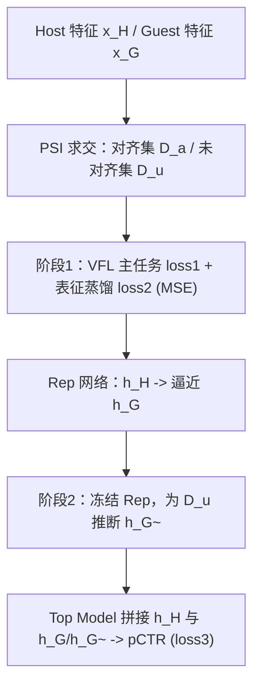
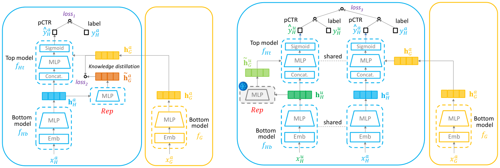

# FedUD: Exploiting Unaligned Data for Cross-Platform Federated Click-Through Rate Prediction (利用未对齐数据的跨平台联邦点击率预测)

- **会议/期刊**: SIGIR 2024 (Short Paper, 5 页)
- **作者与机构**: Wentao Ouyang, Rui Dong, Ri Tao, Xiangzheng Liu（阿里巴巴集团）
- **推荐链路定位**: 精排（跨平台特征增强的 CTR 预估，联邦训练 + 联邦推理）
- **研究方向**: CTR/CVR 预估与特征交叉 / 去偏公平、可信隐私与工业架构
- **论文原文**: [https://arxiv.org/abs/2407.18472v1](https://arxiv.org/abs/2407.18472v1)
- **开源代码**: 暂未开源

## TL;DR (1分钟核心速览)

纵向联邦学习（VFL）做跨平台 CTR 只能吃 PSI 交集后的对齐样本，交集外的海量流量既无法训练、推理时还会因"guest 特征缺失"而掉点（甚至不如单平台本地模型）。FedUD 提出两阶段方案：先在 aligned 数据上用 MSE 蒸馏训练一个 host→guest 的表征迁移网络 $Rep$，再冻结$Rep$ 为未对齐样本"伪造"guest 高阶表征，使其参与训练与推理。Avazu 全量测试 AUC 0.7355（最佳基线 0.7302），未对齐切片 0.7083 vs 0.7003；工业数据集 0.8057 vs 0.8001。

## Background & Motivation (背景与核心矛盾)

- **主流范式**: 广告平台用自身特征训 DNN/DeepFM/AutoInt 等集中式 CTR 模型；跨平台时改用 VFL（FedSplitNN、FedCTR），各方保留原始特征，只交换高阶表征 $h_G$与回传梯度$\nabla h_G$。
- **前人局限一**: VFL 依赖 PSI 求交，交集率低时绝大部分 host 样本被丢弃；FedSplitNN/FedCTR 在未对齐流量上因缺失 guest 表征而显著掉点（Avazu 0.6932 vs 本地 DNN 0.6997）。
- **前人局限二**: SS-VFL / FedHSSL 虽"用"了未对齐数据，但只把它当作各 party 内部的**自监督预训练**语料，从未在推理阶段为未对齐样本生成 guest 侧信息，因此推理收益为零。
- **核心洞察 (Key Insight)**: guest 侧高阶表征本质是"用户兴趣的软特征"，它在对齐样本上可由 host 表征**回归逼近**；一旦学到该映射，未对齐样本也能获得一份（带噪的）guest 表征，从而不再被 top model 当成缺失值处理。
- **本文切入点**: 把跨平台信息融合从"特征拼接"降级为"表征蒸馏 + 迁移"，用一个 $Rep$ 网络把对齐数据上的跨域知识外推到未对齐数据。

## Method (核心方法设计)

### 1. 整体框架 (Overall Architecture)

两方设定：host（广告平台，有标签与特征）与 guest（媒体平台，仅附加特征），样本键为哈希设备 ID，先经 PSI 得到对齐集 $\mathcal{D}^a=\{x_H^a,y_H^a,x_G^a\}$与 host 独享的未对齐集$\mathcal{D}^u=\{x_H^u,y_H^u\}$。阶段一在$\mathcal{D}^a$上跑标准 VFL（各自 bottom model 出$h_H^a$、$h_G^a$，host top model 拼接出 pCTR），同时并行一个$Rep$把$h_H^a$映射为$\tilde{h}_G^a$去逼近$h_G^a$，实现表征级蒸馏。阶段二保留全部参数、**冻结$Rep$**，对未对齐样本用$\tilde{h}_G^u=Rep(h_H^u)$补位，使$loss_3$ 同时覆盖对齐与未对齐两路监督。推理时无论样本是否在交集内，top model 都能拿到"真实或推断"的 guest 表征，这是相对传统 VFL 的根本差别。

<figure class="paper-figure" markdown="span">
  <figcaption>图 1：FedUD 中两个步骤的示意图。(a) 步骤 1：使用各参与方间对齐数据 {𝑥𝑎 进行联邦学习</figcaption>
</figure>

### 2. 关键设计拆解 (Key Designs)

1. **表征级知识蒸馏（loss2）**：痛点是 guest 的 $h_G^a$只在交集上可见、无法直接用于非交集样本；做法是不传原始特征，只让 host 侧网络$Rep$（单 MLP）去回归该表征：
$loss_2=\frac{1}{|Y_H^a|}\sum_{y_H^a}\|\tilde{h}_G^a-h_G^a\|^2=\frac{1}{|Y_H^a|}\sum_{y_H^a}\|Rep(h_H^a)-h_G^a\|^2$。
物理直觉：$h_G$ 携带的是 guest 平台对同一用户的兴趣编码，回归它等价于把跨域语义压进 host 表征空间的一条"低维流形映射"，比让 top model 直接吃缺失值更平滑。

2. **冻结迁移网络 + 双路监督（loss3）**：若 $Rep$与主任务联合训练，未对齐样本的伪表征会被 top model 反向"拉偏"成对预测有利的噪声。FedUD 在阶段二冻结$Rep$，仅优化
$loss_3=\mathrm{CE}(\hat{y}_H^a,y_H^a)+\beta\cdot \mathrm{CE}(\hat{y}_H^u,y_H^u)$，
其中 $\hat{y}_H^u=\sigma\big(f_{Ht}(h_H^u,\tilde{h}_G^u)\big)$。这相当于把$Rep$当成固定的"跨域特征生成器"，让$\beta$ 控制未对齐数据的话语权，避免伪标签式自训练常见的确认偏误。

3. **训练目标与隐私/开销**：阶段一总损失 $\mathcal{L}=loss_1+\alpha\,loss_2$（$\alpha$平衡主任务与蒸馏）；负采样策略不适用（pointwise 二分类 BCE，全量曝光样本）。通信量与 FedSplitNN 同级——只传$h_G^a$与$\nabla h_G^a$，未对齐样本完全不出 host 域，隐私边界不变。推理侧对齐样本走原链路，未对齐样本多一次 MLP 前向（$Rep$），开销可忽略。

## Experimental Setup & Evaluation Protocol (实验设置与评估协议)

- **数据集与预处理**: 无 `5-core` 过滤（CTR 场景保留全量曝光），按天切分：

| 数据集 | #Users | #Items | #Interactions | 稀疏度/密度 | 特征/场景说明 |
| :--- | :---: | :---: | :---: | :---: | :--- |
| Avazu | 未披露（哈希设备 ID） | — | 32.4M 训练 / 3.83M 验证 / 4.22M 测试（40.43M 曝光 / 6.86M 点击） | 点击率约 16.97% | 22 个 field，host 10 槽 + guest 12 槽 |
| Industrial | 未披露 | — | 439.3M 训练 / 62.5M 验证 / 61.7M 测试（563.5M 曝光 / 209.8M 点击） | 点击率约 37.2% | 34 个 field，host 22 槽（新闻信息流广告）+ guest 12 槽（媒体平台） |

- **数据划分与防穿越 (Splitting Strategy)**: `全局时间戳切分`（Avazu 8 天 / 1 天 / 1 天，工业 7 天 / 1 天 / 1 天），严格按自然日滚动，无未来信息泄漏。
- **排名评测协议 (Ranking Protocol)**: 非排序评测，采用 pointwise `AUC` 与 `LogLoss`，在 `overall / aligned / unaligned` 三个切片上分别汇报（unaligned 切片即无 guest 特征的流量，是本方法的核心考场）。
- **对比基线与超参设置**: 本地模型 DNN、Wide&Deep、DeepFM、AutoInt；VFL 基线 FedSplitNN、FedCTR（仅对齐）、SS-VFL、FedHSSL（对齐 + 未对齐自监督）。Embedding 维度 $d=10$，top model 层$[256,128]$，其余$[512,256,128]$，ReLU；最优结果配对 t 检验$p\le 0.01$ 标 `*`。

## Key Experimental Results (实验关键数据)

### 1. 主实验对比 (Main Results)

| 方法 | Avazu AUC↑ | Avazu LogLoss↓ | Avazu unaligned AUC↑ | Ind. AUC↑ | Ind. LogLoss↓ | Ind. unaligned AUC↑ |
| :--- | :---: | :---: | :---: | :---: | :---: | :---: |
| DNN | 0.7186 | 0.4140 | 0.6997 | 0.7996 | 0.5066 | 0.7909 |
| Wide&Deep | 0.7178 | 0.4154 | 0.6994 | 0.7997 | 0.5066 | 0.7909 |
| DeepFM | 0.7185 | 0.4142 | 0.6995 | 0.7997 | 0.5067 | 0.7910 |
| AutoInt | 0.7196 | 0.4111 | 0.7003 | 0.7997 | 0.5066 | 0.7912 |
| FedSplitNN | 0.7283 | 0.4074 | 0.6932 | 0.7990 | 0.5081 | 0.7761 |
| FedCTR | 0.7294 | 0.4068 | 0.6935 | 0.7998 | 0.5068 | 0.7786 |
| SS-VFL | 0.7298 | 0.4065 | 0.6948 | 0.8001 | 0.5063 | 0.7778 |
| FedHSSL | 0.7302 | 0.4063 | 0.6941 | 0.7999 | 0.5065 | 0.7771 |
| **FedUD** | **0.7355\*** | **0.4037\*** | **0.7083\*** | **0.8057\*** | **0.5026\*** | **0.7952\*** |
| Improv. | +0.0053 (+0.73%) | −0.0026 | +0.0080 (+1.14%) | +0.0056 (+0.70%) | −0.0037 | +0.0040 (+0.51%) |

（Improv. 相对最佳非 FedUD 基线；unaligned 切片 Avazu 对 AutoInt、工业对 AutoInt；若对最佳 VFL 基线 FedHSSL/SS-VFL，则分别提升 +0.0142 / +0.0174。）

### 2. 消融实验 (Ablation Study)

原文**未提供** `w/o $Rep$`、`w/o loss2` 的标准消融表，仅给出两组数据规模敏感性实验（数值为读图近似）：

| 配置（Avazu / Industrial） | Avazu overall AUC | Industrial overall AUC |
| :--- | :---: | :---: |
| 最少未对齐样本（0.3M / 15M） | ≈0.7300 | ≈0.8030 |
| 中等未对齐样本（1.1M / 60M） | ≈0.7335 | ≈0.8045 |
| 全量未对齐样本（2.8M / 150M）= FedUD | **0.7355** | **0.8057** |
| guest feature slot = 2 | ≈0.7305 | ≈0.8022 |
| guest feature slot = 8 | ≈0.7360 | ≈0.8055 |
| guest feature slot = 12（默认） | 0.7355 | 0.8057 |

### 3. 关键实验发现 (Key Findings)

1. **增益几乎全部来自未对齐切片**：Avazu aligned 切片仅从 0.7358 升到 0.7370（+0.0012），而未对齐切片从 0.6941 升到 0.7083（+2.05%），说明 FedUD 并未把对齐样本建模得更好，而是把"原本被判死刑的流量"救回来了——这解释了为何 overall 提升（+0.0053）远大于 aligned 提升。
2. **传统 VFL 在缺失 guest 特征时反而不如纯本地模型**：FedSplitNN 0.6932 / FedCTR 0.6935 / FedHSSL 0.6941 全部低于 AutoInt 的 0.7003，工业数据集差距更大（0.7761 vs 0.7912，约 −1.5%），证明"用常数/零向量补齐缺失表征"引入的分布偏移是 VFL 落地的真实痛点，而 $Rep$ 的软填充把这一损失基本抹平并反超。
3. **数据与特征呈边际递减**：未对齐样本 0.3M→2.8M 带来约 +0.005 AUC，但 60M→150M 的工业段几乎走平；guest 特征槽 2→8 提升约 +0.0055，8→12 反而略降（0.7360→0.7355），说明 guest 侧噪声特征会经 $Rep$ 被放大，槽位选择需早停而非"越多越好"。

## Highlights & Limitations (亮点、对比与审稿批判)

- **与代表作对比 (vs. Prior Work)**: ①FedSplitNN/FedCTR 只用对齐样本，本质上放弃长尾流量；②SS-VFL/FedHSSL 虽把未对齐数据纳入训练，但仅用于**各 party 内部自监督**，推理时未对齐样本仍无 guest 信息，故其 unaligned AUC 甚至低于本地 DNN；③FedUD 首次把"未对齐数据"从训练语料升级为**推理可受益对象**，靠的是显式的 $h_H\!\to\!h_G$ 表征迁移而非自监督代理任务。
- **可迁移亮点**: (1) "教师表征冻结 + 学生网络两阶段"这一范式可直接搬到多模态推荐的**缺失模态补全**与冷启动新物品的跨域特征外推；(2) 用 MSE 蒸馏高阶表征而非 logits，可绕开双方标签空间/校准不一致问题，适合跨业务场景联合建模。
- **审稿级局限批判**: ①$Rep$以未归一化的欧氏 MSE 对齐$h_G$，未做逐维标准化或白化，蒸馏信号易被大方差维度主导，且阶段二冻结后误差无法被主任务纠正，缺乏误差上界分析；②隐私论证仅"继承传统 VFL"，但$Rep$显式学习了$h_H\!\to\!h_G$ 的逆映射通道，host 侧可借此近似反演 guest 表征，文中未做成员推断/表征反演实验，也无 DP 保护；③实验仅两方、无多方 PSI 与非对称槽位讨论，评测停留在 AUC/LogLoss，未报告训练/推理延迟与线上 A/B，且代码未开源，复现成本高。

## Rating (四维评分)

- **方法创新性 (Novelty)**: ⭐⭐⭐⭐ （把跨平台融合重构为"表征蒸馏 + 冻结迁移"，思路干净且直击 VFL 交集率痛点，但组件本身均为成熟技术组合）
- **评估协议与实验扎实度 (Protocol & Experiments)**: ⭐⭐⭐ （时间切分 + aligned/unaligned 分切片评测设计到位、含 563M 曝光工业集与 t 检验，但缺关键消融、无排序指标与线上验证）
- **写作与数学规范度 (Clarity & Rigor)**: ⭐⭐⭐⭐ （两阶段流程与公式定义清晰、图 1 自解释性强，短板是对 $Rep$ 的可学习性/误差传播未给理论刻画）
- **工业落地与复现价值 (Industrial & Practical Value)**: ⭐⭐⭐ （通信开销与 FedSplitNN 同级、未对齐样本不出域，工程友好；但两阶段串行训练、PSI 依赖与无开源代码抬高落地门槛）

