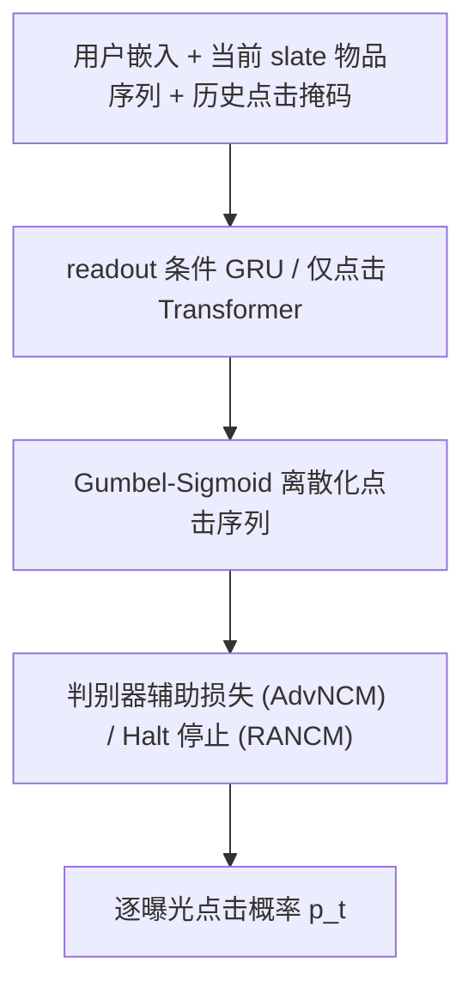
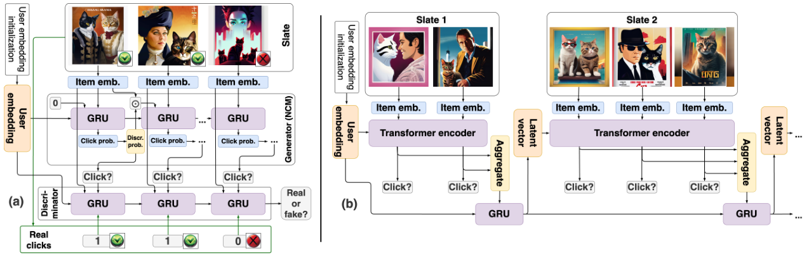

# Neural Click Models for Recommender Systems (面向推荐系统的神经点击模型)

- **会议/期刊**: SIGIR 2024 (Short Paper)
- **作者与机构**: Mikhail Shirokikh, Ilya Shenbin, Anton Alekseev, Anna Volodkevich, Alexey Vasilev, Andrey V. Savchenko, Sergey Nikolenko — St. Petersburg University / PDMI RAS / Sber AI Lab / ISP RAS
- **推荐链路定位**: 精排（曝光级点击预估）+ 推荐系统仿真器用户响应函数
- **研究方向**: CTR/CVR 预估与特征交叉 / 序列与会话推荐
- **论文原文**: [https://arxiv.org/abs/2409.20055v1](https://arxiv.org/abs/2409.20055v1)
- **开源代码**: [https://github.com/arabel1a/Neural-Click-Models-for-Recommender-Systems](https://github.com/arabel1a/Neural-Click-Models-for-Recommender-Systems)

## TL;DR (1分钟核心速览)

推荐系统的离线评估与 RL 预训练都依赖「用户响应仿真器」，但现有仿真器（RecSim/RecoGym/SOFA）缺乏对 slate 内部结构（曝光顺序、位置偏置、点击延续性）的显式刻画。本文把 Web 搜索的点击模型迁移到 slate 推荐，提出 readout 条件化 GRU（NCM）、对抗增强（AdvNCM）、随机访问 + Halt 解码（RANCM）与仅点击 Transformer（SCOT）。在 ContentWise Impressions 与 RL4RS 上按逐曝光二分类评测，AdvNCM 于 ContentWise 取得 AUC 0.791（较最优基线 0.744 提升 6.3%），SCOT 于 RL4RS 取得 AUC 0.934。

## Background & Motivation (背景与核心矛盾)

- **主流范式**: 用户响应建模分三支——概率点击模型与聚类/重采样统计模型、以 GAN 生成交互序列的合成数据方案、以及 RecSim/RecoGym/Virtual Taobao 等全栈 RL 仿真环境。
- **前人局限**: (1) 经典点击模型（Cascade、DCM、DBN）假设强：级联浏览至首次点击即停、单页至多一次点击、位置偏置可加性解耦，难以刻画「多页会话 + 同页多次点击」的推荐场景；(2) GAN/RL 类仿真器把用户当成黑盒策略，不显式使用「当前 slate 已曝光物品」这一最强信号，导致合成交互缺乏位置与延续性结构。
- **核心洞察 (Key Insight)**: slate 推荐与搜索结果页在结构上同构——用户在一个 session 内连续浏览多个 slate，是否点击 $i_t$ 既取决于该 item 在 slate 中的位置与其前序物品，也取决于跨 slate 的历史点击模式。因此「readout（上一步是否点击）」应作为显式输入而非隐状态的自然涌现。
- **本文切入点**: 保留 GRU/Transformer 的表达力，把点击模型的因果假设（前序点击影响当前点击）下沉为一个可微的 readout 输入，再用对抗训练与解码稀疏化进一步压缩假阳性。

## Method (核心方法设计)

### 1. 整体框架 (Overall Architecture)

输入为用户嵌入 $e_u$、当前 slate 的物品嵌入序列$\{e_{i_1},\dots,e_{i_L}\}$以及历史点击序列；主干按两种粒度组织：slate 内用 GRU/Transformer 编码位置交互，跨 slate 用 GRU 隐状态传递会话记忆。训练目标是逐位置点击概率$\hat{p}_t$ 的序列预测，而非单点二分类；推理时一次性输出整个 slate 的点击序列，可直接作为仿真器对推荐列表的响应。五种变体（NCM / AdvNCM / RANCM / SCOT / Transformer+GRU）共享同一输入输出接口，仅在「历史怎么读、点击怎么解码」上分化。

<figure class="paper-figure" markdown="span">
  <figcaption>图1：提出的两个模型：(a) 对抗神经点击模型（AdvNCM）；(b) 两阶段 Transformer + GRU 模型。</figcaption>
</figure>

### 2. 关键设计拆解 (Key Designs)

1. **Readout 条件化的 NCM（把「上一步是否点击」变成输入）**: 标准 Slate-wise GRU 把点击信息压缩进隐状态，模型无法区分「看过未点」与「根本没看到」。NCM 在第 $t$步显式拼接 readout 向量$r_t$：若上一步有点击则回填上一物品嵌入，否则回填零向量，即$h_t=\mathrm{GRU}\big([e_{i_t};\,c_{t-1}e_{i_{t-1}}],h_{t-1}\big)$，$\hat{p}_t=\sigma(\mathbf{w}^\top h_t)$。该算子等价于把级联模型的「继续/停止」语义注入循环单元，使同一物品在不同点击上下文下获得不同打分——这正是位置偏置可控的物理直觉来源。

2. **AdvNCM：判别器只当损失源，不当生成器**: 序列级点击预测容易退化为「全体低概率」的保守解。作者训练一个 GRU 判别器区分生成点击序列与真实点击序列，生成器额外最小化对抗项：
$\mathcal{L}=\mathcal{L}_{\mathrm{BCE}}+\lambda\,\mathbb{E}\big[\log D(c^{\text{real}})+\log\big(1-D(\tilde{c})\big)\big]$。
由于 $\tilde{c}$由 Gumbel-Sigmoid 重参数化$\tilde{c}_t=\sigma\big((\log\frac{\hat{p}_t}{1-\hat{p}_t}+g_t)/\tau\big)$，梯度可穿透离散采样。关键区别：这不是 GAN——生成器不产生随机噪声样本，对抗项纯粹作为**结构化正则**，迫使预测序列在「整体点击节奏」上与真人一致，抑制局部逐点最优造成的节律崩塌。

3. **RANCM 的 Halt 解码与 SCOT 的稀疏注意力**: RANCM 借视觉注意力模型，每步用 GRU 输出查询向量 $q_t$，与当前 slate 嵌入矩阵相乘并额外拼接一个可学习的 Halt 嵌入：$\alpha_t=\mathrm{softmax}\big([E_{\text{slate}}q_t;\;q_t^\top e_{\text{halt}}]\big)$，选中 Halt 即终止，天然适配 RL 环境中的「随时停止交互」动作空间。SCOT 则观察到点击物品仅占曝光极小比例，于是只把**真实点击过的物品**送入会话级 Transformer，并用时序掩码保证第$t$次预测只能关注前序点击，把$O(|\text{session}|^2)$降为$O(|\text{clicks}|^2)$。

4. **训练目标、负采样与推理效率**: 全程为逐位置 BCE（无负采样，全部曝光样本均参与监督，正负比由数据本身决定），AdvNCM 叠加对抗项。训练采用 Gumbel-Softmax 全序列反传与 teacher forcing 混合策略——约 20% 迭代用完整 readout、其余用 teacher forcing，作者报告纯 teacher forcing 显著掉点而混合策略在几乎不损性能下大幅加速。推理为单次前向输出整条点击序列，Transformer+GRU 两阶段结构把 Transformer 限制在单 slate 内、仅用 GRU 跨 slate 传递，避免了会话级注意力的二次复杂度爆炸。

## Experimental Setup & Evaluation Protocol (实验设置与评估协议)

- **数据集与预处理**: 仅选用同时具备「slate 曝光日志 + 点击/购买事件」的两个公开数据集，未做 5-core 过滤（曝光日志本身即全量）。

| 数据集 | #Users | #Items | #Interactions | 特征/场景说明 |
| :--- | :---: | :---: | :---: | :--- |
| ContentWise Impressions | —（原文未列） | —（剧集按 series 分组） | 曝光级日志 | 视频流媒体；屏幕位置左上为高相关位，位置偏置显著，正样本极稀疏 |
| RL4RS (Slate / SeqSlate) | 140K | 283 | 曝光级日志 | 网易手游；解锁规则约束换页，含匿名画像、点击历史嵌入、价格/品类特征 |

- **数据划分与防穿越 (Splitting Strategy)**: 以用户会话（session）为样本单位组织，原文未显式说明时间戳切分与冷启动划分细节，这是复现时的模糊点。
- **排名评测协议 (Ranking Protocol)**: **非排序评测**，而是逐曝光二分类（点击/未点击），报告 ROC-AUC、$F_1$、Accuracy；因此不涉及 Full-Ranking 或采样排序协议，全部曝光样本均被评分。
- **对比基线与超参设置**: 基线含 MF(SVD/ALS)、逻辑回归、Session-wise GRU、Slate-wise GRU、Aggregated Slate-wise GRU、Slate-wise Transformer、Session-wise Transformer、Neural Click Model；嵌入提供三种口径（SVD 矩阵分解、可学习 NN 层、RL4RS 外部嵌入）。作者称 AUC 与 $F_1$ 上的领先具统计显著性，Accuracy 噪声大不作主要依据。

## Key Experimental Results (实验关键数据)

### 1. 主实验对比 (Main Results)

| 模型 | 嵌入 | CW AUC | CW $F_1$| CW Acc | RL4RS AUC | RL4RS$F_1$ | RL4RS Acc |
| :--- | :---: | :---: | :---: | :---: | :---: | :---: | :---: |
| MF (SVD/ALS) | — | 0.654 | 0.198 | 0.257 | 0.719 | 0.755 | 0.653 |
| Logistic Regression | NN | 0.689 | 0.270 | 0.787 | 0.915 | 0.880 | 0.837 |
| Session-wise GRU | NN | 0.740 | 0.308 | 0.739 | 0.859 | 0.851 | 0.790 |
| Aggregated Slate-wise GRU | NN | 0.725 | 0.300 | 0.826 | 0.851 | 0.850 | 0.781 |
| Slate-wise GRU | NN | 0.744 | 0.331 | 0.860 | 0.924 | 0.878 | 0.832 |
| Session-wise Transformer | NN | 0.704 | 0.284 | 0.774 | 0.925 | 0.885 | 0.843 |
| Slate-wise Transformer | NN | 0.740 | 0.328 | 0.839 | 0.930 | 0.890 | 0.853 |
| Neural Click Model | NN | 0.730 | 0.283 | **0.891** | 0.919 | 0.884 | 0.848 |
| **AdvNCM** | NN | **0.791** | 0.351 | 0.858 | 0.906 | 0.868 | 0.820 |
| **RANCM** | SVD | — | **0.362** | 0.871 | — | — | — |
| **SCOT** | NN | 0.715 | 0.306 | 0.813 | **0.934** | **0.896** | **0.865** |
| Transformer + GRU | NN | 0.737 | 0.317 | 0.850 | 0.877 | 0.856 | 0.808 |
| *Improv.% (最优 vs 最优基线)* | — | *+6.3%* | *+9.4%* | — | *+0.4%* | *+0.7%* | — |

### 2. 消融实验 (Ablation Study)

| 变体对照（同架构逐项增删） | CW AUC | CW $F_1$| RL4RS AUC | RL4RS$F_1$ |
| :--- | :---: | :---: | :---: | :---: |
| Slate-wise GRU（无 readout） | 0.744 | 0.331 | 0.924 | 0.878 |
| NCM（加 readout，无对抗） | 0.730 | 0.283 | 0.919 | 0.884 |
| AdvNCM（readout + 对抗项） | **0.791** | **0.351** | 0.906 | 0.868 |
| Slate-wise Transformer | 0.740 | 0.328 | 0.930 | 0.890 |
| Transformer + GRU（两阶段） | 0.737 | 0.317 | 0.877 | 0.856 |
| SCOT（仅点击输入） | 0.715 | 0.306 | **0.934** | **0.896** |
| AdvNCM / SCOT（SVD 嵌入） | 0.719 / 0.672 | 0.348 / 0.297 | — / 0.910 | — / 0.875 |
| SCOT（外部嵌入 Ext.） | — | — | 0.927 | 0.891 |

### 3. 关键实验发现 (Key Findings)

1. **对抗项才是 ContentWise 上的真正增益源**：单独加 readout 的 NCM 反而在 AUC 上低于同架构 Slate-wise GRU（0.730 vs 0.744），说明「点击延续性」信号在稀疏正样本下会放大噪声；一旦叠加判别器正则（AdvNCM），AUC 跃升至 0.791、$F_1$ 至 0.351，即 readout 的价值需由对抗信号「校准」后才释放。
2. **架构优劣高度依赖数据集正样本比例**：SCOT 在 ContentWise 上 AUC 仅 0.715（落后 AdvNCM 6.6 个点），却在 RL4RS 上以 0.934 反超所有模型——RL4RS 正反馈比例高，丢弃未点击曝光的信息损失小；ContentWise 正样本极稀疏，仅点击序列几乎退化为无信息。RANCM 的低 RL4RS 表现同理：正样本密集时 Halt 过早触发。
3. **嵌入口径的收益有限且不稳定**：AdvNCM 从 SVD 换到可学习 NN 带来 AUC 0.719→0.791 的大幅提升，但 SCOT 在 RL4RS 上外部嵌入 (0.927) 反低于可学习嵌入 (0.934)，验证了作者结论——SVD 嵌入在工业实践中仍是合理的第一步，端到端嵌入并非稳定红利。

## Highlights & Limitations (亮点、对比与审稿批判)

- **与代表作对比 (vs. Prior Work)**: 相较 RecSim/RecoGym/SOFA 等 RL 仿真环境，本文不建模推荐策略与环境的策略交互，而是把资源集中在「响应函数」这一最细粒度组件上，参数量与训练成本低一个量级；相较 Cascade/DCM/DBN 等经典点击模型，本文放弃了「位置偏置可加性解耦」的强假设，转而用循环/注意力结构与 readout 学习隐式位置先验，因而能处理同页多次点击与跨页会话；相较已有 NCM（RNN 点击模型），本文首次将其接入 slate 推荐并补上对抗与稀疏化解码。
- **可迁移亮点**: (1) Gumbel-Softmax + teacher forcing 的混合训练调度（约 20% 全反传）可低成本迁移到任何离散序列生成式推荐；(2) 「仅对正反馈做注意力、用掩码保序」的稀疏化思路，可直接用于长会话场景的 Transformer 压缩。
- **审稿级局限批判**: (1) 仅两个数据集且 RL4RS 物品数只有 283，样本多样性不足，跨域外推性存疑；(2) 评测止步于曝光级二分类 AUC/$F_1$，未验证这些模型作为仿真器时能否复现真实 RS 的策略排序结论（如 off-policy evaluation 偏差），而这恰是论文声称的核心应用；(3) 未报告划分方式、超参搜索范围与显著性检验的$p$值，$F_1$ 阈值选择亦未说明，复现门槛偏高；(4) RANCM 因 RL4RS 缺少点击顺序而完全缺席该数据集，模型比较不完整。

## Rating (四维评分)

- **方法创新性 (Novelty)**: ⭐⭐⭐ （readout 条件化与「判别器即正则」的思路有洞察，但本质是 NCM 的工程化迁移组合，缺乏理论刻画）
- **评估协议与实验扎实度 (Protocol & Experiments)**: ⭐⭐ （仅两数据集、逐曝光二分类、无排序或仿真下游验证，划分与显著性细节缺失）
- **写作与数学规范度 (Clarity & Rigor)**: ⭐⭐⭐ （架构图与公式表达清晰、五种变体界限分明，但关键训练细节与超参交代偏薄）
- **工业落地与复现价值 (Industrial & Practical Value)**: ⭐⭐⭐⭐ （代码已开源，模型轻量、推理单次前向即可产出整条点击序列，作为仿真器或预训练数据生成器落地成本低）

