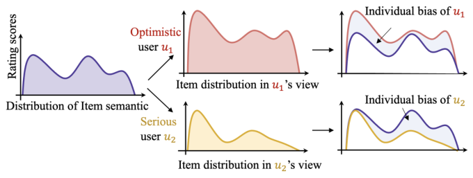
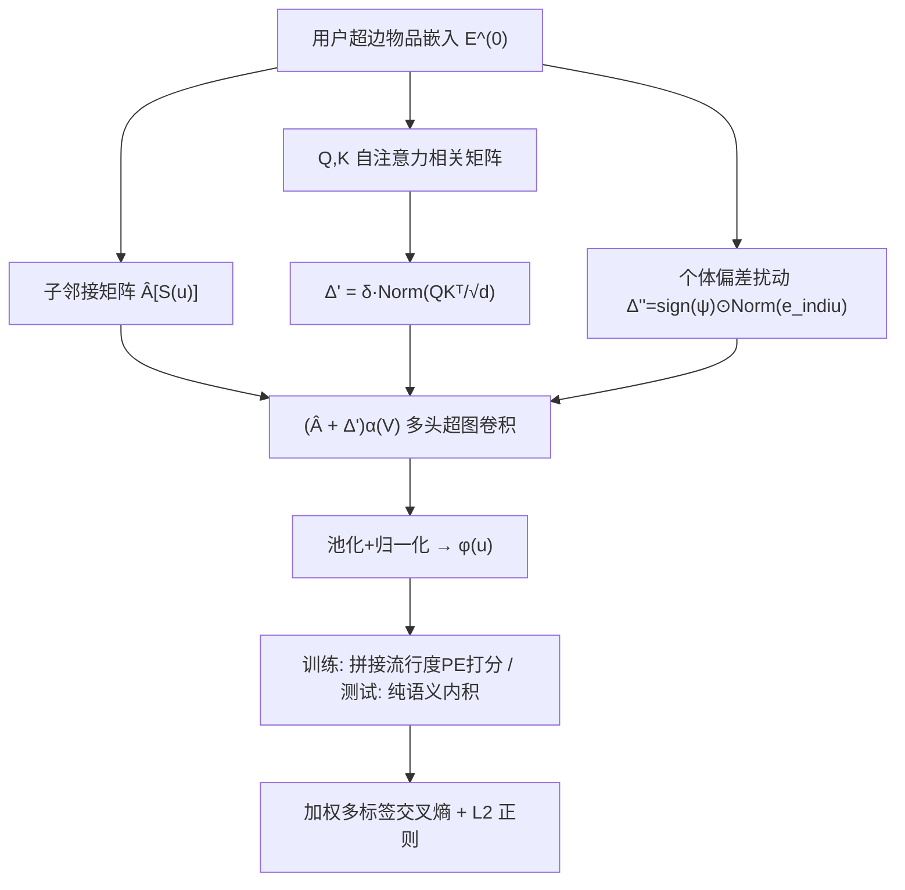

# CaDRec: Contextualized and Debiased Recommender Model (上下文感知与去偏推荐模型)

- **会议/期刊**: SIGIR 2024
- **作者与机构**: Xinfeng Wang, Fumiyo Fukumoto, Jin Cui, Yoshimi Suzuki, Jiyi Li（University of Yamanashi）, Dongjin Yu（Hangzhou Dianzi University）
- **推荐链路定位**: 召回（图协同过滤表征学习）
- **研究方向**: 去偏公平、可信隐私与工业架构 / 图神经网络与知识图谱推荐
- **论文原文**: [https://arxiv.org/abs/2404.06895v3](https://arxiv.org/abs/2404.06895v3)
- **开源代码**: [https://github.com/WangXFng/CaDRec](https://github.com/WangXFng/CaDRec)

## TL;DR (1分钟核心速览)

本文同时打击图推荐的两大顽疾：**递归卷积导致的节点过平滑**与**流行度/用户个体偏差导致的交互分布倾斜**。做法是把 Transformer 自注意力相关矩阵当作可学习扰动注入超图卷积算子（结构 + 序列双上下文选邻），并把流行度用交互计数的位置编码表示、把个体偏差建模成物品语义上的可学习扰动做双向解耦，再从梯度层面证明正样本惩罚缺失加剧流行度偏置并补上 L2 正则与 IA/FIA 加权。在 Yelp2018/Foursquare/Douban-book/ML-1M 四数据集全库排序协议下，R@20 较最强基线（EEDN/XSimGCL）相对提升约 4.2%–4.8%，ML-1M 上 N@20 达 0.3261。

## Background & Motivation (背景与核心矛盾)

- **主流范式**: 以 LightGCN 式对称归一化邻接矩阵传播协同信号，辅以自监督对比（SGL/NCL/XSimGCL）、图增广或超图（HCCF/EEDN）缓解过平滑；去偏侧则用双编码器 + 正交约束（DICE/InvCF）分离流行度与物品语义。
- **前人局限 (过平滑)**: GCN 算子只看「两节点是否相连」这条静态结构边，**完全丢失邻居间先后依赖**——用户读完一部书的初卷，续作（序列近邻）与该用户随机交互的另一物品在邻接矩阵中等价，导致 $n_1,n_2,n_3$ 经两轮卷积后特征不可分。
- **前人局限 (偏置)**: 双编码器只保证「流行度 ≠ 物品表征」，却未约束编码器究竟学到了什么（可能学到性别/年龄）；且**几乎无人建模用户个体偏差**——乐观用户打 $(5,5,4,5)$、苛刻用户打$(3,5,1,2)$，真实语义皆为$(4,5,3,3)$，观测分布被个体偏移$(\pm1,0,\pm1,\pm2)$ 扭曲。
- **核心洞察 (Key Insight)**: 作者把 HGC 与 Self-Attention 拆解后发现二者本质同为「同尺寸相关矩阵加权聚合 $\mathbf{E}\to\mathbf{ME}$」，只是分布在不同空间：$\hat{\mathbf{A}}\in\mathbb{R}^{L\times L}$刻画结构、$\mathbf{Q}\mathbf{K}^\top\in\mathbb{R}^{L\times L}$ 刻画序列，故可互为扰动而非串行堆叠。
- **本文切入点**: 用「结构矩阵 + 缩放后的序列相关矩阵」做卷积核，同时在评分梯度式里显式拆出流行度与个体偏差两类纠缠源。

<figure class="paper-figure" markdown="span">
  <figcaption>图 2</figcaption>
</figure>

## Method (核心方法设计)

### 1. 整体框架 (Overall Architecture)

输入为用户超边 $\mathcal{H}(u)$内$L$个物品的嵌入$\mathbf{E}^{(0)}$；上下文表征模块对每个用户切片出子邻接矩阵$\hat{\mathbf{A}}[S(u)]\in\mathbb{R}^{L\times L}$，与本用户序列自注意力矩阵相加后做多头超图卷积，池化 + L2 归一化得用户向量$\phi(u)$；去偏模块训练时把「个体偏差扰动$\Delta''$」注入物品嵌入输入、把「流行度位置编码」拼接进打分，测试时只保留纯语义$\langle\phi(u),\psi(i)\rangle$；最后用带 L2 正则与 IA/FIA 权重的多标签交叉熵训练。

### 2. 关键设计拆解 (Key Designs)

1. **结构-序列扰动式超图卷积 (HGC + SA Perturbation)**：痛点是静态邻接矩阵无法区分「续作」与「随机邻居」，迭代卷积必然过平滑。作者不叠加 Transformer，而把序列相关矩阵当作对结构边的可训练扰动：
$\hat{\mathbf{E}}^{(l)}=(\hat{\mathbf{A}}+\Delta')\,\alpha_1(\mathbf{V}),\ \Delta'=\delta\cdot\mathrm{Norm}\!\left(\frac{\mathbf{Q}\mathbf{K}^{\top}}{\sqrt{d_m}}\right),\ \mathbf{Q}=\mathbf{E}^{(l)}\mathbf{W}_Q,\ \mathbf{V}=\mathbf{E}^{(l)}\mathbf{W}_1$由于在用户超边上做切片，复杂度从$O(N^2)$降至$O(L^2)$，且因式合并（先算$\mathbf{Q}\mathbf{K}^\top$再乘$\mathbf{V}$）进一步降到$O(L^2+L)$。直觉上$\Delta'$ 是「让序列上强相关的邻居在聚合中占更大权重」的各向异性修正项，直接打破各向同性平滑。

2. **流行度位置编码 + 个体偏差扰动双向解耦**：痛点是用两个黑箱编码器分离两个隐因子，语义不可控。本文改为**可解释的加性结构**：物品流行度由其全局交互计数 $z_c$经正弦位置编码得到$[\mathbf{e}^{pop}_i]_j=\cos(z_c/10000^{(j-1)/d_m})$或$\sin(z_c/10000^{j/d_m})$，相似活跃度物品在空间中天然邻近；用户个体偏差则作为物品语义上的符号保持扰动$\Delta''=\mathrm{sign}(\boldsymbol{\psi}(i_k))\odot\mathrm{Norm}(\mathbf{e}^{indiu})$，训练时打分改为拼接形式$\langle[\phi(u),\beta_1\bar{\mathbf{e}}^{pop}_u],[\psi(i),\beta_1\mathbf{e}^{pop}_i]\rangle$，**测试时丢弃拼接项**——即「训练拟合偏置、推理只用去偏表征」，这一非对称设计是其去偏生效的关键。

3. **梯度失衡诊断、正则与加权损失**：作者对多标签交叉熵求导得 $\frac{\partial\mathcal{L}}{\partial\Theta}\propto-\boldsymbol{\gamma}^\top\frac{e^{-\mathbf{R}}}{1+e^{-\mathbf{R}}}\cdot\frac{\partial\mathbf{R}}{\partial\Theta}$，并推出「已交互物品比未来交互物品多出一项$\mathrm{HGC}'(\mathbf{Q}^{IA})[\mathbf{Q}^{IA},\mathbf{Q}^{FIA}]^\top$」，且负样本因$\gamma_i=0$完全无惩罚 → 热门物品嵌入被过度鼓励、方差显著偏大。修补方式是更新式中的乘性正则项$(1-\sum_{u\in\mathcal{U}_B}\mathbb{I}(i\in S(u))\,\eta\beta_2)$ 与分类权重：
$\mathcal{L}_{total}=\sum_{u\in\mathcal{U}}\left(-\mathbf{C}_{u,*}\odot\boldsymbol{\gamma}^{\top}\log\alpha_2(\mathbf{r}_{u,*})+\beta_2\!\!\sum_{i\in S(u)}\|\boldsymbol{\psi}(i)\|^2\right),\ c_{u,i}=\lambda_1\ (\text{已交互}),\ \lambda_2\ (\text{将交互}),\ 0\ (\text{其他})$正则收缩热门物品嵌入复杂度，$\lambda_1\!>\!\lambda_2$平衡 IA/FIA 梯度项数差。全流程免负采样、每用户一次前向，推理开销$O(N)$。

## Experimental Setup & Evaluation Protocol (实验设置与评估协议)

- **数据集与预处理**:

| 数据集 | #Users | #Items | #Interactions | 平均交互 | 密度 |
| :--- | :---: | :---: | :---: | :---: | :---: |
| Yelp2018 | 31,668 | 38,048 | 1,561,406 | 49.3 | 0.13% |
| Foursquare | 7,642 | 28,483 | 512,532 | 68.2 | 0.24% |
| Douban-book | 12,859 | 22,294 | 598,420 | 46.5 | 0.21% |
| ML-1M | 6,038 | 3,533 | 575,281 | 95.3 | 2.7% |

- **数据划分与防穿越**: 按用户级**时间戳比例切分**——最早 70% 为训练、次 10% 为验证、最近 20% 为测试（非 Leave-One-Out）；对原本 8:2 划分的基线，把训练+验证合并以对齐训练量，测试集完全一致。
- **排名评测协议**: 指标为 Recall@K 与 NDCG@K（$K\in\{5,10,20\}$），沿用 EEDN / XSimGCL / SGL 一脉的**全库未交互物品排序（Full-Ranking）**协议；论文未采用采样排序，也无负采样候选裁剪。
- **对比基线与超参**: 5 组共 15 个基线（GCN 类 LightGCN/LCFN；SA 类 AutoCF/STaTRL；扩散 DiffRec；去偏类 DICE/InvCF/LightGCL；过平滑缓解类 SGL/IMPGCN/GDE/HCCF/NCL/XSimGCL/EEDN）。$d_m=768$（Foursquare）/512（其余），HGC 层数$z_l=1$，头数 3/2/1，学习率$1e\text{-}2$，$\delta$ 取 0–0.5，Optuna 调参，每组跑 5 次取均值。

## Key Experimental Results (实验关键数据)

### 1. 主实验对比 (Main Results)

| 数据集 | 指标 | LightGCN | DICE | InvCF | LightGCL | HCCF | NCL | XSimGCL | EEDN | **CaDRec** | Improv. |
| :--- | :---: | :---: | :---: | :---: | :---: | :---: | :---: | :---: | :---: | :---: | :---: |
| Yelp2018 | R@20 | 0.0582 | 0.0570 | 0.0657 | 0.0674 | 0.0688 | 0.0665 | 0.0745 | 0.0760 | **0.0792** | +4.2% |
| Yelp2018 | N@20 | 0.0484 | 0.0410 | 0.0543 | 0.0587 | 0.0565 | 0.0558 | 0.0635 | 0.0639 | **0.0668** | +4.5% |
| Foursquare | R@20 | 0.1094 | 0.1010 | 0.1069 | 0.1067 | 0.1121 | 0.1206 | 0.1138 | 0.1270 | **0.1314** | +3.5% |
| Foursquare | N@20 | 0.0934 | 0.0827 | 0.0828 | 0.0920 | 0.0964 | 0.1012 | 0.0905 | 0.1047 | **0.1068** | +2.0% |
| Douban-book | R@20 | 0.1455 | 0.1520 | 0.1410 | 0.1624 | 0.1747 | 0.1898 | 0.1989 | 0.1954 | **0.2085** | +4.8% |
| Douban-book | N@20 | 0.1253 | 0.1409 | 0.1356 | 0.1501 | 0.1585 | 0.1713 | 0.1867 | 0.1852 | **0.1960** | +5.0% |
| ML-1M | R@20 | 0.2622 | 0.2514 | 0.2361 | 0.2517 | 0.2321 | 0.2727 | 0.2747 | 0.2665 | **0.2907** | +5.8% |
| ML-1M | N@20 | 0.3076 | 0.2863 | 0.2703 | 0.3002 | 0.2706 | 0.3227 | 0.3203 | 0.2927 | **0.3261** | +1.1% |

### 2. 消融实验 (Ablation Study)

| 变体 | Yelp2018 R@20 / N@20 | Foursquare R@20 / N@20 | ML-1M R@20 / N@20 | Douban-book R@20 / N@20 |
| :--- | :---: | :---: | :---: | :---: |
| w/o SA (仅 HGC) | 0.0775 / 0.0649 | 0.1282 / 0.1039 | 0.2907 / 0.3261 | 0.1954 / 0.1846 |
| w/o Dis (无解耦) | 0.0759 / 0.0632 | 0.1238 / 0.1010 | 0.2593 / 0.2913 | 0.1933 / 0.1816 |
| w/o ER (无嵌入正则) | 0.0720 / 0.0605 | 0.1217 / 0.1002 | 0.2580 / 0.2921 | 0.1713 / 0.1632 |
| w/o WS (无加权) | 0.0751 / 0.0622 | 0.1273 / 0.1044 | 0.2795 / 0.3152 | 0.2038 / 0.1919 |
| **Full** | **0.0792 / 0.0668** | **0.1314 / 0.1068** | **0.2907 / 0.3261** | **0.2085 / 0.1960** |

### 3. 关键实验发现 (Key Findings)

1. **嵌入正则 (ER) 是最大功臣，且在稀疏/冷门数据集上最敏感**：去掉 ER 后 Douban-book R@20 从 0.2085 崩至 0.1713（−17.8%）、Yelp2018 −9.1%，远超去掉 SA 的 −2.1%；配合图 5 的标准化差统计，正则把「最热 50 物品 vs 最冷 50 物品」嵌入方差鸿沟显著收窄，说明流行度偏置确实通过梯度失衡传导到几何结构。
2. **两类偏置互补但数据集依赖明显**：表 4 的 $2\times2$ 解耦实验显示，仅去流行度在 Foursquare / Douban-book 收益更大（R@20 0.1294 / 0.2023），仅去个体偏差在 Yelp2018 / ML-1M 更优（0.0774 / 0.2783），两者全开取得 4.7%–12.1% 的平均提升——印证个体偏差不是流行度的子集。
3. **序列上下文不能无脑注入**：表 5 显示「加权相加」融合普遍劣于扰动式融合（ML-1M 0.2588 vs 0.2714），而 ML-1M 上纯 SA 编码器本身就很差（R@20 仅 0.1692），此时最优 $\delta=0$ 即完全关闭 SA 反而最好——序列信息增益与数据集序列性强度强相关，需按数据集自适应开关。

## Highlights & Limitations (亮点、对比与审稿批判)

- **与代表作对比 (vs. Prior Work)**: 相较 EEDN/HCCF 的「超图卷积 + 后接 Transformer」，本文指出二者本质同构、改为**前置扰动注入**，避免堆叠解码器带来的 $O(L^2)$额外开销；相较 DICE/InvCF 的双编码器黑箱解耦，本文用**位置编码 + 符号扰动**给出可解释的参数化，并额外引入被前人忽略的个体偏差维度；相较 XSimGCL/NCL 依赖 InfoNCE 与批内负采样（$O(MLd_{neg})+O(MLB)$），本文免负采样、单用户全交互一次前向，训练信号更干净且不误伤假负样本。
- **可迁移亮点**: (1)「训练拟合偏置、测试丢弃偏置」的非对称打分头可低成本移植到任意 CTR/召回模型；(2) 用交互计数的正弦位置编码表征流行度，替代易失效的正交解耦约束，工程上零额外推理开销。
- **审稿级局限批判**: (1) $\delta,\beta_1,\beta_2,\lambda_1,\lambda_2$五参数逐数据集网格搜索（Yelp 与 Foursquare 最优值差一个数量级），且$\delta$ 在 ML-1M 直接取 0，超参鲁棒性与自动化程度存疑；(2) 评测仅覆盖四个中小规模公开集、无采样排序对照、无显著性检验与线上 A/B，也未与 SASRec 类纯序列模型对比，对工业亿级物品库的 Full-Ranking 可行性未做讨论。

## Rating (四维评分)

- **方法创新性 (Novelty)**: ⭐⭐⭐⭐ （把 HGC 与 SA 同构性拆解为「相关矩阵扰动」，并从梯度式显式推导流行度偏置来源，机制与理论双支撑，但个体偏差的符号扰动设计偏启发式）
- **评估协议与实验扎实度 (Protocol & Experiments)**: ⭐⭐⭐⭐ （四数据集 + 15 基线 + 主/消融/解耦/融合/复杂度五重分析齐全，但缺少显著性检验与采样排序对照，且训练/验证合并对齐稍影响可比性）
- **写作与数学规范度 (Clarity & Rigor)**: ⭐⭐⭐⭐ （式 6/10/13/14 推导链条清晰、复杂度分析到位；个别符号如 $\phi(\cdot)\in\mathbb{R}$与$\mathbb{R}^{d_m}$混用、$L$与$\mathcal{L}$ 排版歧义需修正）
- **工业落地与复现价值 (Industrial & Practical Value)**: ⭐⭐⭐⭐⭐ （代码开源，切片式超图卷积把复杂度从 $O((M+N)^2)$降到$O(L^2)$，测试期净化为单次内积，无负采样无对比学习，部署成本极低）

