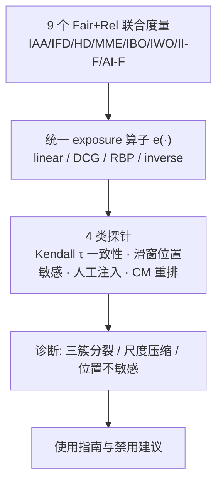

# Can We Trust Recommender System Fairness Evaluation? The Role of Fairness and Relevance (我们能否信任推荐系统公平性评估？公平与相关性的角色)

- **会议/期刊**: SIGIR 2024 (Full Paper)
- **作者与机构**: Theresia Veronika Rampisela, Tuukka Ruotsalo, Maria Maistro, Christina Lioma (University of Copenhagen; LUT University)
- **推荐链路定位**: 离线评估 / 度量基准（覆盖召回-排序全链路的评测环节）
- **研究方向**: 去偏公平、可信隐私与工业架构
- **论文原文**: [论文原文链接](https://arxiv.org/abs/2405.18276v1)
- **开源代码**: [开源代码仓库链接](https://github.com/theresiavr/can-we-trust-recsys-fairness-evaluation)

## TL;DR (1分钟核心速览)

推荐系统的"公平+相关性"联合度量（Fair+Rel）近年大量涌现，却被默认可直接信任。本文首次把 9 个此类度量（IAA/IFD÷/IFD×/HD/MME/IBO/IWO/II-F/AI-F）放到统一 exposure 算子框架下，在 4 个真实数据集、4 个推荐器（含 COMBMNZ 重排干预）、Full-Ranking 协议上做四问体检。结论：度量间 Kendall τ 最低可达 $-1$且互相矛盾、对排名位置变化的敏感度比单维度度量低约 1–2 个数量级、分数在低端被压缩（多数$\le 10^{-3}$），因此**不可直接信任**，需按文中指南谨慎使用。

## Background & Motivation (背景与核心矛盾)

- **主流范式**: 物品级个体公平以曝光（exposure）为核心；近期工作提出把曝光与相关性耦合的"联合度量"，声称能一个分数同时反映公平与相关。
- **前人局限**: 纯公平度量（Jain/Gini/Entropy 等）已被系统检视过，而联合度量从未被审计；同时 Rel 度量的最优模型与 Fair 度量的最优模型在多数数据集上本就不同。
- **核心洞察 (Key Insight)**: 所有联合度量其实共享同一个"曝光折扣函数 $e(\cdot)$ + 相关性权重"的算子骨架，只是耦合方式（逐物品差 / 成对聚合 / 阈值占比）不同，因此**尺度不可比、且两股信号会相互掩盖**。
- **本文切入点**: 不提出新度量，而是把度量本身当作被评测对象，用一致性、位置敏感度、注入敏感度三类探针做"元评估"。

## Method (核心方法设计)

### 1. 整体框架 (Overall Architecture)

把 9 个联合度量统一表述为：对每个用户 $u$、物品$i$、推荐轮次$w$，先由$e(\cdot)$给出位置$z(u,i,w)$的曝光权重（linear / DCG / RBP / inverse 四族），再与相关性$r_{u,i,w}$ 以三种方式耦合——(a) 逐物品差（IAA, HD, II-F, AI-F）、(b) 成对或全局聚合（IFD, MME）、(c) 相对均匀策略的阈值占比（IBO/IWO）。随后在 4 个真实数据集上跑 4 个推荐器并叠加重排干预，用四类探针（RQ1 与单维度一致性、RQ2 度量间一致性、RQ3 排名位置滑窗、RQ4 人工注入）量化其行为，最终反推出使用指南。

### 2. 关键设计拆解 (Key Designs)

1. **统一 exposure 算子与三簇耦合结构**：痛点是各度量公式写法迥异、无法横向比较；本文抽出唯一枢纽 $e(\cdot)$：$e_{\text{DCG}}(u,i,w)=1/\log_2(z+1)$、$e_{\text{RBP}}=\gamma^{z-1}$、$e_{\text{inv}}=1/z$、$\tilde{e}_{\text{li}}=(k-z)/(k-1)$，并证明耦合方式决定其与 Rel/Fair 的归属。典型逐物品差形式为
$$\text{IAA}(u)=\frac{1}{n}\left|\sum_{i\in I}\frac{1}{W}\sum_{w=1}^{W}\mathbb{1}_{L_{u,w}}(i)\cdot\tilde{e}_{\text{li}}(u,i,w)-\tilde{r}(u,i,w)\right|$$
直觉：曝光应正比于相关性，故差值越小越公平；也正因减的是"同一用户内归一化"的量，其对绝对排名漂移极不敏感。

2. **成对型度量的尺度塌缩机制（IFD×）**：痛点是想用物品对之间的曝光差距衡量不公平；本文指出其乘性耦合在稀疏数据上恒为 0：
$$J_\times(u,i)=\frac{1}{W}\sum_{w}r_{u,i,w}\cdot\mathbb{1}_{L_{u,w}}(i)\cdot e_{\text{DCG}}(u,i,w),\quad \text{IFD}_\times(u)=\frac{1}{n(n-1)}\sum_{i}\sum_{i'\neq i}\left[J_\times(u,i)-J_\times(u,i')\right]^2$$
因为每用户相关物品极少（中位数 $\le 46$），未进 top-$k$的相关物品$J_\times=0$，差值平方项被大量零对稀释，实测恒为$10^{-3}$ 以下。

3. **探针与重排干预、计算开销**：四个推荐器（ItemKNN 余弦、BPR pairwise、MultiVAE 多项似然 ELBO、NCL 邻域对比学习）均用 RecBole 训练 300 epoch + 早停；公平侧用 COMBMNZ 融合 $k'=25$的重排（相关性分 min-max 归一 +$(1-\text{归一化覆盖率})$ 作为公平分），无需重训练即可制造"更公平但更不相关"的对照。开销上 MME 为成对度量，大数据集单次计算约 30 分钟，IFD× 次之，IAA/HD/II-F 可线性计算。

## Experimental Setup & Evaluation Protocol (实验设置与评估协议)

- **数据集与预处理**: 全部 `5-core` 过滤，重复交互保留最新；Amazon-lb / ML-10M 将评分 $\ge 3$二值化为 1，$<3$ 丢弃。

| 数据集 | #Users | #Items | #Interactions | 稀疏度 | 特征/场景说明 |
| :--- | :---: | :---: | :---: | :---: | :--- |
| Lastfm | 1,859 | 2,823 | 71,355 | 98.64% | 音乐，隐式反馈 |
| Amazon-lb | 1,054 | 791 | 12,397 | 98.51% | 奢侈美妆电商，1–5 星 |
| QK-video | 4,656 | 6,423 | 51,777 | 99.83% | 视频，仅用 sharing 交互 |
| ML-10M | 49,378 | 9,821 | 5,362,685 | 98.89% | 电影，0.5–5 星 |

- **数据划分与防穿越**: Amazon-lb / ML-10M 用 `全局时间戳切分` 6:2:2；Lastfm / QK-video 无时间戳，用 `全局随机比例切分` 6:2:2；所有划分仅保留训练集交互数 $\ge 5$ 的用户。
- **排名评测协议**: **无偏 `Full-Ranking`**——测试时全部未交互物品作为候选，训练/验证集物品从该用户候选中剔除，无负采样；主指标 $k=10$。
- **对比基线与超参**: Rel 侧 6 个（HR/MRR/P/MAP/R/NDCG），Fair 侧 5 个（Jain/QF/Ent/FSat/Gini），联合侧 9 个（含 IBO/IWO 归一化到 $[0,1]$）。HD 取$\gamma=0.9$，II-F/AI-F 取$\gamma=0.8$；4 推荐器 × {原模型, +CM} 共 8 个 run，以验证集 NDCG@10 选型。一致性用 Kendall$\tau$ 度量 run 排序的相似性。

## Key Experimental Results (实验关键数据)

### 1. 主实验对比 (Main Results)

Lastfm（$k=10$，Full-Ranking；CM 为 COMBMNZ 重排）：

| Recommender | NDCG↑ | Jain↑ | Gini↓ | IAA↓ | IFD÷↓ | HD↓ | IBO↑ | IWO↓ |
| :--- | :---: | :---: | :---: | :---: | :---: | :---: | :---: | :---: |
| ItemKNN | 0.245 | 0.042 | 0.904 | 0.004 | 0.074 | 0.099 | 0.209 | 0.791 |
| BPR | 0.252 | 0.058 | 0.910 | 0.004 | 0.075 | 0.104 | 0.208 | 0.792 |
| MultiVAE | 0.247 | 0.097 | 0.839 | 0.004 | 0.073 | 0.095 | 0.261 | 0.739 |
| NCL | **0.261** | 0.082 | 0.872 | 0.004 | 0.076 | **0.092** | 0.242 | 0.758 |
| ItemKNN+CM | 0.119 | 0.094 | 0.790 | 0.004 | 0.053 | 0.177 | 0.256 | 0.744 |
| BPR+CM | 0.126 | 0.140 | 0.818 | 0.004 | 0.054 | 0.174 | 0.253 | 0.747 |
| MultiVAE+CM | 0.102 | **0.222** | **0.696** | 0.004 | **0.049** | 0.203 | 0.278 | 0.722 |
| NCL+CM | 0.115 | 0.215 | 0.728 | 0.004 | 0.052 | 0.177 | **0.292** | **0.708** |
| *指标指认的最优模型* | *NCL* | *MVAE+CM* | *MVAE+CM* | *全平* | *MVAE+CM* | *NCL* | *NCL+CM* | *NCL+CM* |

ML-10M（$k=10$）：

| Recommender | NDCG↑ | Jain↑ | Gini↓ | IAA↓ | IFD÷↓ | HD↓ | IBO↑ | IWO↓ |
| :--- | :---: | :---: | :---: | :---: | :---: | :---: | :---: | :---: |
| ItemKNN | 0.150 | 0.011 | 0.987 | 0.008 | 0.018 | 0.221 | 0.031 | 0.969 |
| BPR | 0.160 | 0.037 | 0.945 | 0.008 | 0.019 | 0.226 | 0.069 | 0.931 |
| MultiVAE | 0.119 | 0.003 | 0.997 | 0.009 | 0.016 | 0.265 | 0.012 | 0.988 |
| NCL | **0.167** | 0.024 | 0.969 | 0.008 | 0.020 | **0.218** | 0.054 | 0.946 |
| NCL+CM | 0.100 | **0.069** | **0.930** | 0.009 | **0.012** | 0.257 | **0.074** | **0.926** |

（ML-10M 上 $\downarrow$MME$\approx 0.001$、$\downarrow$AI-F$\approx 0.000$、$\downarrow$IFD× 恒为$0.000$，全部无法区分模型。）

### 2. 消融实验 (Ablation Study)

以 NCL 为骨架，移除/替换各探针条件后的度量响应幅度：

| 探测条件 | Rel 侧响应 | Fair 侧响应 | 联合度量响应 | 结论 |
| :--- | :--- | :--- | :--- | :--- |
| `w/o` CM（Lastfm） | NDCG 0.261 | Jain 0.082 | IAA 0.004, MME 0.001 | 单维差异在 $10^{-2}$ 量级 |
| `w/` CM（Lastfm） | NDCG ↓0.146 至 0.115 | Jain ↑0.133 至 0.215 | IAA 0.004, MME 0.001, IFD÷ ↓0.024, HD ↑0.085 | 联合度量几乎无反应 |
| 滑窗 1–5 → 5–9 位置（$k=5$） | Rel 单调下降，幅度最高达$10^{2}$ 倍 | Fair 单调上升 | 变化被掩盖，量级远小于单维 | 位置分辨力缺失 |
| 人工注入 0% → 100%（$m=1000,n=10^4$） | 由 0 升至$\approx 1$| 由 0 升至$\approx 1$| IBO/IWO 线性变化；IAA/IFD×/MME/II-F/AI-F 全程$\in(0,0.0015)$ | 低端分数压缩 |

### 3. 关键实验发现 (Key Findings)

1. **度量间互相打架**：Kendall $\tau$显示三簇——IAA/HD/II-F 与 Rel 强正相关（$\tau \in [0.57,1]$），IFD/MME/AI-F 与 Rel 负相关（$\tau \in [-1,-0.29]$），IBO/IWO 随数据集剧烈摆动（$\tau \in [-0.64,0.77]$）；同一簇内 τ 接近 1（如 MME 与 AI-F 为$0.79$–$0.93$），跨簇则强负相关，说明 9 个度量实质只有 3 种信号。
2. **公平度量与相关性度量永不同时最优**：Lastfm 上 NDCG 最优为 NCL（0.261）、Jain 最优为 MultiVAE+CM（0.222）、IBO/IWO 最优为 NCL+CM，联合度量内部也各指一方，导致"用哪个联合度量"直接决定论文结论。
3. **低端压缩造成"虚假完美公平"**：ML-10M 上 $\downarrow$IWO$\approx 1$（按理论$[0,1]$区间即极不公平）、$\downarrow$HD$\approx 0.22$、$\downarrow$AI-F$\approx 0$（看似极公平），三者对同一 run 给出完全相反的定性；人工注入实验进一步显示即使 Rel/Fair 均为最差，IAA/IFD×/MME/II-F/AI-F 仍给出$< 10^{-3}$ 的"接近最优"分数。

## Highlights & Limitations (亮点、对比与审稿批判)

- **与代表作对比 (vs. Prior Work)**: 相比 Rampisela et al. 对"纯公平度量"的综述，本文首次审计"联合度量"；相比 Amigó et al. 的群体/个体公平框架，本文聚焦个体物品公平；相比 Gao et al. 的 KL+IDCG 加权组合，本文覆盖的是原生耦合型（非事后加权）度量族，因而诊断更具普适性。
- **可迁移亮点**: (i) "统一算子骨架 + 分簇去冗余"的元评估范式可直接迁移到 LLM 推荐的有用性/安全性联合指标审计；(ii) 用合成注入数据构造"理想响应曲线"来验证指标单调性，成本低、说服力强。
- **审稿级局限批判**: (i) 未考察"模型直接以公平为目标优化"的情形，仅用 COMBMNZ 事后重排这一种干预，可能低估度量在公平训练下的表现；(ii) 仅 4 个中小规模数据集、单一 $k=10$口径且未做显著性检验，MME 等成对度量在工业级物品库上的计算成本（$\sim$30 min/次）也使其难以进入线上评测闭环。

## Rating (四维评分)

- **方法创新性 (Novelty)**: ⭐⭐⭐⭐ （不造新模型但首次系统审计联合度量族，统一 exposure 骨架 + 三簇分类是有洞察的"元方法"贡献）
- **评估协议与实验扎实度 (Protocol & Experiments)**: ⭐⭐⭐⭐⭐ （4 数据集 × 8 run × Full-Ranking + 一致性/滑窗/合成注入/重排四类探针，代码全开源，唯一遗憾是缺显著性检验）
- **写作与数学规范度 (Clarity & Rigor)**: ⭐⭐⭐⭐ （度量公式整理完整、区间与失效条件交代清楚；但公式密集、部分符号如 $\tilde{e}$与$e$ 混用略增阅读负担）
- **工业落地与复现价值 (Industrial & Practical Value)**: ⭐⭐⭐⭐ （直接给出"避免同簇冗余、慎用低尺度度量、公平与相关性分开报"的落地指南；短板是依赖全库相关性标注且成对度量算力开销大）

