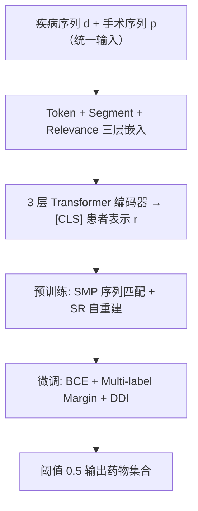
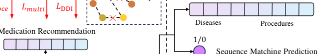

# Leave No Patient Behind: Enhancing Medication Recommendation for Rare Disease Patients (不落下任何患者：面向罕见病患者的用药推荐增强)

- **会议/期刊**: SIGIR 2024
- **作者与机构**: Zihao Zhao, Yi Jing, Fuli Feng, Jiancan Wu, Chongming Gao, Xiangnan He（中国科学技术大学）
- **推荐链路定位**: 精排（多标签药物集合预测）
- **研究方向**: 去偏公平、可信隐私与工业架构 / 自监督对比与交互去噪
- **论文原文**: [https://arxiv.org/abs/2403.17745v2](https://arxiv.org/abs/2403.17745v2)
- **开源代码**: [https://github.com/zzhUSTC2016/RAREMed](https://github.com/zzhUSTC2016/RAREMed)

## TL;DR (1分钟核心速览)

用药推荐模型在 EHR 疾病码长尾分布下存在严重公平性问题：常见病患者的 Jaccard 明显高于罕见病患者。本文提出 RAREMed，把疾病码与手术码拼成一条统一序列送入 Transformer，并用两个自监督预训练任务（序列匹配预测 SMP、自重建 SR）强化罕见码表征，再以 BCE + multi-label margin + DDI 损失微调。在 MIMIC-III/IV 的 4:1:1 随机划分、全标签集合打分协议下，Jaccard 分别达 0.5414 / 0.4625（较最强基线 +2.1% / +1.1%），同时 DDI 率降至 0.0529 / 0.0508，五组患者 Jaccard 标准差由 0.0116 降至 0.0096。

## Background & Motivation (背景与核心矛盾)

- **主流范式**: 用药推荐分两类——longitudinal 方法（GAMENet/SafeDrug/COGNet/MICRON/MoleRec）用历史就诊序列 + DDI 图/分子图保证安全；instance-based 方法（LEAP）只用当次就诊的疾病码做多标签预测。
- **前人局限**: ① 长尾偏置无人处理：图 1(a) 显示两套 MIMIC 的疾病码高度长尾，图 1(b) 显示 SOTA 在最常见组与最罕见组的 Jaccard 差距显著，公平性从未被显式建模；② 手术码被普遍丢弃或与疾病码简单拼接，而同一手术在不同疾病/严重程度下含义不同（如肾结石的体外碎石 vs 内镜手术），简单拼接无法刻画这种耦合关系。
- **核心洞察 (Key Insight)**: 作者对 MIMIC-IV 按"最罕见疾病码流行度"分 13 组做统计（图 2）：疾病越罕见，患者的疾病数、手术数、处方药数与药物冷门度全部单调上升，即**罕见病患者临床状态更复杂、用药方案更个性化**，因此简单重采样（Rebalancing）不足以建模其专属用药需求。
- **本文切入点**: 用 pretrain-finetune 范式，在无标注的临床码序列上做自监督学习，把"数据稀缺 + 关联复杂 + 需求特异"三个困难统一转化为表征质量问题。

<figure class="paper-figure" markdown="span">
  ![图 1：(a) MIMIC-III \[14\] 和 MIMIC-IV \[13\] 数据集中疾病代码的长尾分布。(b) 根据患者最少见疾病代码的流行度排名，将 MIMIC-IV 中的患者划分为五个等规模组。子图展示了 SOTA 方法在最常见和最罕见代码组上的推荐准确率（以 Jaccard 指数衡量）。](../../../../assets/papers/2403.17745v2/figure_1.png)<figcaption>图 1：(a) MIMIC-III [14] 和 MIMIC-IV [13] 数据集中疾病代码的长尾分布。(b) 根据患者最少见疾病代码的流行度排名，将 MIMIC-IV 中的患者划分为五个等规模组。子图展示了 SOTA 方法在最常见和最罕见代码组上的推荐准确率（以 Jaccard 指数衡量）。</figcaption>
</figure>

## Method (核心方法设计)

### 1. 整体框架 (Overall Architecture)

模型分三段：① 编码器——把患者的疾病序列 $\mathbf{d}$与手术序列$\mathbf{p}$拼成统一输入 `[CLS] d [SEP] p`，叠加 token / segment / relevance 三层嵌入后送入 3 层 4 头 Transformer，取 `[CLS]` 输出作为患者表示$\mathbf{r}$；② 预训练——在训练集上先跑 SMP 30 epoch 再跑 SR 30 epoch，让编码器学会临床码之间的上下文依赖并保留全部码信息（尤其低频码）；③ 微调与推理——接多标签分类头输出药物概率，联合 BCE、multi-label margin 与 DDI 损失优化，推理时$\hat{o}_i>0.5$ 即推荐。整套流程不依赖历史就诊，因此在单次/多次就诊两种设定下结果完全一致。

<figure class="paper-figure" markdown="span">
  <figcaption>图 3：我们提出的 RAREMed 示意图。首先用三个嵌入层和一个 transformer 编码器对患者临床信息建模，得到患者表示。然后在序列匹配预测任务和自重建任务上预训练模型。最后在药物推荐任务上微调模型，得到推荐的药物组合。</figcaption>
</figure>

### 2. 关键设计拆解 (Key Designs)

1. **统一序列 + relevance 嵌入（让罕见码被"排序感知"地编码）**：痛点是前人把疾病/手术分开编码或简单拼接，丢失跨类型耦合与优先级。本文用
$\mathbf{r}=\mathrm{Encoder}\big(E_{tok}(\text{input})+E_{seg}(\text{input})+E_{rel}(\text{input})\big)[0]$其中$E_{seg}$区分疾病/手术两类，$E_{rel}$ 按医生标注的优先级顺序分配可学习向量。直觉：把"哪些码更关键"这一临床先验显式注入注意力，缓解稀有码被高频码淹没。

2. **两个自监督预训练任务（用无标注共现结构补数据稀缺）**：SMP 为每条 $(d_i,p_i)$ 随机替换疾病或手术序列生成负例，用 BCE 判别是否同属一个患者：
$\mathcal{L}_{SMP}=-\log(\hat{y}_i)+\log(1-\hat{y}_j)$强迫模型学"疾病-手术"的合法搭配；SR 从患者表示重建整条输入码序列：$\mathcal{L}_{SR}=-\sum_{j=1}^{|\mathcal{D}|+|\mathcal{P}|}\big[c_j\log\hat{c}_j+(1-c_j)\log(1-\hat{c}_j)\big]$
由于重建损失对每个码一视同仁，低频码获得与高频码同等的梯度份额——这是公平性提升的直接机制来源。

3. **训练目标、负采样与推理效率**：微调损失为
$\mathcal{L}=(1-\beta)\big((1-\alpha)\mathcal{L}_{bce}+\alpha\mathcal{L}_{multi}\big)+\beta\mathcal{L}_{ddi}$其中$\alpha=0.03$、$\beta=0.7$；$\mathcal{L}_{ddi}=\sum_{i,j}A_{ij}\hat{o}_i\hat{o}_j$惩罚 DDI 图上相邻药物被同时推荐。负例无需采样（多标签全空间 BCE + margin 排序），推理仅一次前向 + 0.5 阈值截断，与病种数量无关，单次推理成本为$O(L^2 d)$（$L$为码序列长度，$d=512$）。

## Experimental Setup & Evaluation Protocol (实验设置与评估协议)

- **数据集与预处理**:

| 数据集 | #Visits/#Patients | 疾病/手术/药物空间 | 平均/最大就诊数 | 平均疾病/手术/药物数 | 说明 |
| :--- | :---: | :---: | :---: | :---: | :--- |
| MIMIC-III | 14949 / 6344 | 2026 / 630 / 112 | 4.96 / 29 | 13.76 / 4.45 / 19.60 | 长尾偏置较轻 |
| MIMIC-IV | 16117 / 6352 | 3415 / 1072 / 123 | 7.30 / 47 | 12.66 / 2.53 / 12.79 | 长尾偏置更重，更具挑战 |

- **数据划分与防穿越 (Splitting Strategy)**: 沿用 GAMENet/SafeDrug/MoleRec 的**随机比例划分 4:1:1**（train/valid/test），非按时间戳切分；单次就诊设定下每次就诊视为独立患者。
- **排名评测协议 (Ranking Protocol)**: **全药物空间打分**（$|\mathcal{M}|$维 multi-hot 全标签评估，非采样负例），指标为 Jaccard、PRAUC、F1、DDI rate、#MED（推荐药物数），阈值$\delta=0.5$。公平性协议：按患者"最罕见疾病码"的流行度等频分为 5 组$G_1$（最常见）…$G_5$（最罕见），报告各组平均 Jaccard 及其标准差$\sigma$ 作为不公平度度量。
- **对比基线与超参设置**: 基线含 LR、LEAP、RETAIN、G-Bert、GAMENet、SafeDrug、COGNet、MICRON、MoleRec，另加面向公平性的 Rebalancing（IPS 加权重采样）。Embedding 维 $d=512$、3 层 Transformer、4 头注意力、AdamW、lr=1e-5、weight decay=0.1、预训练各 30 epoch。原文未报告显著性检验。

## Key Experimental Results (实验关键数据)

### 1. 主实验对比 (Main Results)

单次就诊设定（RAREMed 与多次就诊结果相同，因其不使用历史记录）：

| Method | MIMIC-III Jaccard | PRAUC | F1 | DDI | MIMIC-IV Jaccard | PRAUC | F1 | DDI |
| :--- | :---: | :---: | :---: | :---: | :---: | :---: | :---: | :---: |
| LR | 0.4933 | 0.7639 | 0.6519 | 0.0786 | 0.4150 | 0.6782 | 0.5650 | 0.0736 |
| LEAP | 0.4526 | 0.6583 | 0.6154 | 0.0722 | 0.3907 | 0.5540 | 0.5437 | 0.0548 |
| GAMENet | 0.5210 | 0.7780 | 0.6762 | 0.0781 | 0.4401 | 0.6833 | 0.5933 | 0.0718 |
| SafeDrug | 0.5255 | 0.7732 | 0.6804 | 0.0688 | 0.4560 | 0.6858 | 0.6098 | 0.0689 |
| COGNet | 0.5109 | 0.6465 | 0.6676 | 0.0737 | 0.4313 | 0.6112 | 0.5850 | 0.0866 |
| MICRON | 0.5119 | 0.5190 | 0.6676 | 0.0610 | 0.4495 | 0.4353 | 0.6033 | 0.0502 |
| MoleRec | 0.5303 | 0.7795 | 0.6844 | 0.0692 | 0.4502 | 0.6867 | 0.6040 | 0.0699 |
| **RAREMed** | **0.5414** | **0.7922** | **0.6942** | **0.0529** | **0.4625** | **0.7008** | **0.6158** | **0.0508** |
| Improv. | +2.09% | +1.63% | +1.43% | −23.1% | +1.07% | +0.59% | +0.98% | −3.8% |

（多次就诊设定下 RAREMed 数值相同；MIMIC-III 上 GAMENet/SafeDrug/MoleRec 反而较单次设定微降，说明历史建模易引入噪声。GT 的 DDI 率为 0.082 / 0.081，RAREMed 显著低于真实处方水平。）

### 2. 消融实验 (Ablation Study)

MIMIC-IV，含分组公平性指标：

| 变体 | Jaccard | PRAUC | F1 | DDI | $G_1$|$G_5$|$\sigma$ |
| :--- | :---: | :---: | :---: | :---: | :---: | :---: | :---: |
| w/o P（去预训练） | 0.4561 | 0.6939 | 0.6092 | 0.0509 | 0.4719 | 0.4410 | 0.01157 |
| w/o U（疾病/手术双编码器） | 0.4589 | 0.6965 | 0.6122 | 0.0545 | 0.4773 | 0.4423 | 0.01320 |
| w/o s&r（去 segment+relevance 嵌入） | 0.4528 | 0.6892 | 0.6062 | 0.0554 | 0.4695 | 0.4342 | 0.01286 |
| **RAREMed** | **0.4625** | **0.7008** | **0.6158** | **0.0508** | **0.4773** | **0.4521** | **0.00962** |

### 3. 关键实验发现 (Key Findings)

1. **预训练是公平性的主要来源，但并非"只救尾部"**：去掉预训练后 $G_5$从 0.4521 掉到 0.4410（−2.5%），而$G_1$同步从 0.4773 掉到 0.4719，说明 SMP/SR 提升的是全体表征质量，尾部受益更大从而压缩了组间差距（$\sigma$ 0.01157→0.00962）。
2. **公平性最敏感的是 relevance/segment 嵌入而非编码器结构**：w/o s&r 的 $G_5$仅 0.4342（为四者最低）、$\sigma$=0.01286（最高），比"双编码器"退化更严重，说明丢失优先级与类型先验对稀有码伤害最大。
3. **预训练收益随偏差程度放大**：图 4(c)(d) 显示在偏置较轻的 MIMIC-III 上各组提升均匀，而在长尾更重的 MIMIC-IV 上最罕见组提升比例最高；但预训练超过 30 epoch 后下游 Jaccard 增益饱和（预训练任务过拟合），$\beta=0.75$ 时 DDI 可压到 5% 以下而 Jaccard 仍保持较高水平。

## Highlights & Limitations (亮点、对比与审稿批判)

- **与代表作对比 (vs. Prior Work)**: 与 G-Bert 同属"预训练 + Transformer"，但 G-Bert 仅用疾病码做单次就诊预训练、丢弃手术码，导致其在 $G_5$ 仍显著劣于 RAREMed；与 SafeDrug/MoleRec 依赖 DDI 图与分子结构的"安全导向"路线相比，RAREMed 不引入外部药理知识却在精度与 DDI 两项同时占优；与 Rebalancing（IPS 重采样）相比，本文用表征学习而非数据重加权解决长尾，避免了重采样带来的常见病精度回退。
- **可迁移亮点**: ① "把异质 ID 序列拼接 + segment/relevance 双嵌入"的构造方式可直接迁移到电商多行为序列（曝光/点击/加购）或内容多域 ID 建模；② "序列判别 + 全码重建"这套自监督组合，对任何稀疏 ID 集合推荐（冷启动物品、长尾标签）都是低成本可加模块。
- **审稿级局限批判**: ① **公平性定义单一**：只用"最罕见疾病码流行度"分组，未考察年龄/性别/保险等敏感属性，也未与 DP/EO 等标准公平指标对齐；② **划分存在时序泄漏风险**：采用随机 4:1:1 而非按时间戳切分，同一患者的后续就诊可能进入训练集，指标偏乐观（且单/多就诊表格数值完全一致，说明历史信息实际未被利用，多就诊对比并不公平）；③ 仅在 MIMIC-III/IV 同源数据上验证，$d=512$ 与 60 轮预训练在真实院端部署成本较高，阈值固定 0.5 也未做校准分析，缺少显著性检验。

## Rating (四维评分)

- **方法创新性 (Novelty)**: ⭐⭐⭐ （首次显式提出用药推荐的罕见病公平性问题，"统一序列 + SMP/SR 预训练"组合有清晰动机，但各组件本身多为 NLP/推荐已有技术的领域适配，理论分析偏少）
- **评估协议与实验扎实度 (Protocol & Experiments)**: ⭐⭐⭐ （单/多就诊双设定、9 个基线、五组公平性度量 + 标准差 + 消融较完整，但随机划分无时序防穿越、无显著性检验、公平性仅单一分组维度）
- **写作与数学规范度 (Clarity & Rigor)**: ⭐⭐⭐⭐ （统一序列构造与三个损失函数定义清晰，图 2 的患者画像统计为动机提供了扎实的定量支撑；SMP 损失写法略不规范、缺少复杂度与时序说明）
- **工业落地与复现价值 (Industrial & Practical Value)**: ⭐⭐⭐⭐ （代码开源、推理单次前向且与病种数无关，DDI 约束可直接作为安全门控部署；但 512 维 3 层 Transformer + 60 轮预训练的院内训练开销需权衡）

