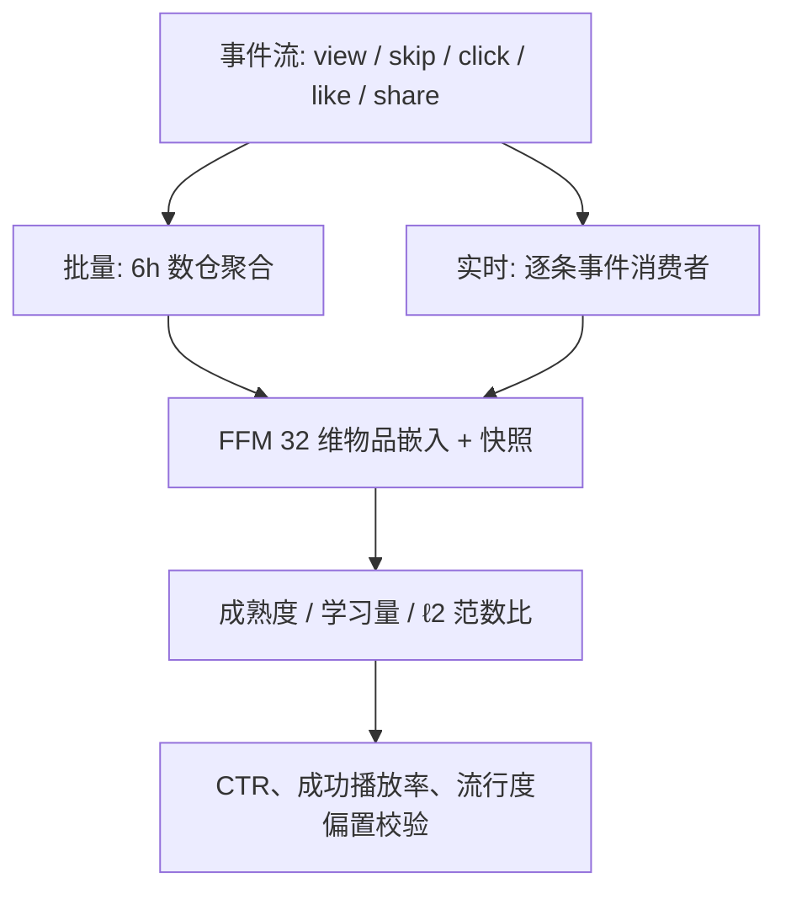
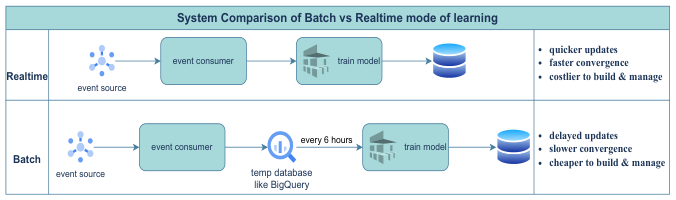
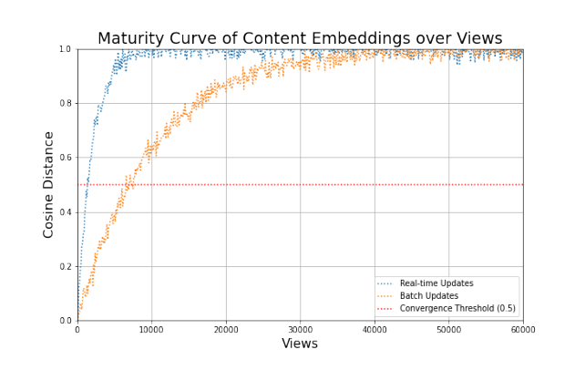

# Monitoring the Evolution of Behavioural Embeddings in Social Media Recommendation (社交媒体推荐中行为嵌入演化的监控)

- **会议/期刊**: SIGIR 2024 (Industrial Track, 5 页短文)
- **作者与机构**: Srijan Saket, Olivier Jeunen, Md. Danish Kalim（ShareChat）
- **推荐链路定位**: 召回（内容向量表示与内积检索）
- **研究方向**: 去偏公平、可信隐私与工业架构 / 协同过滤与双塔召回
- **论文原文**: [https://arxiv.org/abs/2312.15265v2](https://arxiv.org/abs/2312.15265v2)
- **开源代码**: 暂未开源

## TL;DR (1分钟核心速览)

短视频平台每天新增约 200 万条内容，物品嵌入的“成熟速度”直接决定冷内容能否被正确分发。本文不提出新模型，而是在 ShareChat 线上系统（1.8 亿用户）上构建一套嵌入演化监控体系：以收敛阈值、逐曝光学习量与 $\ell_2$ 范数比三个指标，对比“每 6 小时批量更新”与“逐交互实时更新”两种模式。结果显示实时更新的物品只需约 20% 的曝光量（≈2k vs ≈10k 次观看）即达到同等成熟度，饱和点提前约 3 倍，并将批量模式下高曝光内容高达 ×5 的范数膨胀与 >60% 的头部曝光垄断显著压低。

## Background & Motivation (背景与核心矛盾)

- **主流范式**: 工业短视频推荐普遍用 FFM / Wide&Deep / 双塔学习用户与内容低维嵌入，以用户-物品内积排序；嵌入由离线或准在线流水线周期性批量刷新。
- **前人局限**: 其一，批量更新把 6 小时内所有交互一次性回灌，新内容在冷启动窗口内长期处于“未成熟”嵌入状态，被系统性低估；其二，内积排序天然耦合向量模长，批量累积更新使高频内容范数持续膨胀，形成自我强化的流行度偏置。
- **核心洞察 (Key Insight)**: 嵌入的“质量”不是静态指标，而是一条随曝光量演化的轨迹；只有把这条轨迹画出来，才能判断该在多少次交互后信任该向量，以及范数漂移是否已污染排序。
- **本文切入点**: 定义可在线计算的成熟度、学习量、范数比三类监控量，用同一生产系统上的 A/B 式观测给出批量 vs 实时的定量结论。

## Method (核心方法设计)

### 1. 整体框架 (Overall Architecture)

系统侧有两条并行数据通路：批量模式将用户事件落到数仓（BigQuery 类），每 6 小时聚合训练一次并回写物品嵌入；实时模式由事件消费者在每次交互后立即更新对应物品嵌入。两路共享同一 FFM 模型结构（32 维嵌入），差异仅在更新频率与数据窗口。监控侧对每条内容按曝光量切分检查点 $V_1,\dots,V_k$，保存各检查点嵌入快照，离线计算成熟度曲线、平均学习量与范数比，并与线上 CTR、成功播放率、曝光份额等业务指标做交叉验证，形成“嵌入指标—业务指标”的闭环诊断。

<figure class="paper-figure" markdown="span">
  <figcaption>图1：面向内容嵌入的实时学习与批量学习的系统比较。</figcaption>
</figure>

### 2. 关键设计拆解 (Key Designs)

1. **成熟度阈值指标（判断“何时可以用这条向量”）**：痛点是没有客观标准判断新内容嵌入是否可用。定义 $1-\cos(\text{emb}_t,\text{emb}_{\text{converged}})<\alpha$（取$\alpha=0.5$）为成熟条件，即以最终收敛向量为参照的余弦距离首次跌破阈值所需曝光量作为成熟成本。直觉上，该量把“冷启动要等多久”转换成可对数化的曝光预算，便于跨信号、跨内容类型横向比较。
2. **逐曝光学习量算子（定位“最高信息更新点”）**：固定阈值受初始化与数据分布影响，作者改为度量相邻检查点之间的平均位移：

$$L(V_i)=\frac{1}{(V_i-V_{i-1})\,N_i}\sum_{j=1}^{N_i}\text{Dist}\left(V_{ij},V_{i-1,j}\right)$$

其中 $\text{Dist}(x,y)=1-\frac{\langle x,y\rangle}{\|x\|_2\|y\|_2}$，$N_i$为达到$V_i$ 曝光的内容数。除以曝光增量后得到“每次观看带来的单位信息量”，曲线峰值即最高信息更新点、尾部趋零即饱和点，从而把收敛过程拆成“快速塑形期”与“微调期”。
3. **范数比与偏置度量（把内积偏置显式化）**：定义 $\text{norm\_ratio}_{view=x}=\|\text{emb}_{view=x}\|_2/\|\text{emb}_{view=0}\|_2$，统计其在不同曝光桶中的分布，并结合各曝光桶内容所占曝光份额，衡量排序是否被模长而非语义支配。

**训练与推理开销**：模型为 FFM，多信号（view/skip/click/like/share）各自学习嵌入；论文未披露负采样与正则细节，属于复现盲区。实时模式显著更快收敛，但事件消费与在线训练链路成本更高；批量模式工程成本低但延迟 6 小时。

## Experimental Setup & Evaluation Protocol (实验设置与评估协议)

- **数据集与预处理**: ShareChat 上一周内印地语视频帖子，仅保留累计观看 $\geq 10^5$ 的内容，逐检查点快照嵌入：

| 更新模式 | 信号 | #Posts | #Embedding Updates |
| :--- | :--- | :---: | :---: |
| Batch (6h) | click / share / view / skip / like | ~42K / ~54K / ~100K / ~108K / ~120K | ~42K / ~76K / ~100K / ~108K / ~177K |
| Realtime | click / share / view / skip / like | ~145K / ~145K / ~140K / ~140K / ~145K | ~34M / ~34M / ~18M / ~18M / ~34M |

- **数据划分与防穿越 (Splitting Strategy)**: 非随机划分，而是**按曝光的时序检查点切分**（1k, 1.5k, 3.5k, 5k, 10k, 50k, 100k 观看），用 $t$与$t-1$ 快照配对计算位移，天然避免未来信息泄漏；分析主用 view 信号。
- **排名评测协议 (Ranking Protocol)**: 无离线 Full-Ranking / Sampled Ranking 评测；采用**生产系统观测对照**（批量 vs 实时两套嵌入在同一线上环境下的业务指标），评测量为 CTR、成功播放率与各曝光桶内容占比。
- **对比基线与超参设置**: 以“批量 6h 更新”为对照组、“实时逐条更新”为实验组，二者共享 FFM 结构与 $d=32$；阈值$\alpha=0.5$；论文未报告显著性检验与置信区间。

## Key Experimental Results (实验关键数据)

### 1. 主实验对比 (Main Results)

| 观测维度 | Batch (6h) | Realtime | 相对变化 |
| :--- | :---: | :---: | :---: |
| 达到 $1-\cos<0.5$ 所需曝光 | ~10,000 views | ~2,000 views | 曝光需求 ↓约 80% |
| 最高信息更新点位置 | 较晚 | 提前约 2× | — |
| 学习量饱和点 | ~3,500 views | ~1,500 views | 提前约 2.3–3× |
| 高曝光内容 norm_ratio | 分布右偏，最高约 ×5 | 集中于低值区 | 范数膨胀大幅收敛 |
| <5k 曝光桶 CTR / 成功播放率 | 较低 | 较高 | 冷内容增益最大 |
| 头部内容占曝光份额 | >60% | 显著下降 | 流行度偏置缓解 |

### 2. 消融实验 (Ablation Study)

论文为观测型工业研究，未做传统组件消融；以下为其**信号覆盖对比**，用于说明批量模式下“更新/帖子比”远低于实时：

| 信号 | Batch 更新/帖子 | Realtime 更新/帖子 |
| :--- | :---: | :---: |
| view | ~1.0 | ~129 |
| skip | ~1.0 | ~129 |
| click | ~1.0 | ~234 |
| like | ~1.5 | ~234 |
| share | ~1.4 | ~234 |

<figure class="paper-figure" markdown="span">
  <figcaption>图2：批量与实时物品嵌入的成熟度曲线比较。实时更新比批量更新显著更快达到收敛。</figcaption>
</figure>

### 3. 关键实验发现 (Key Findings)

1. **实时更新把冷启动成本压到 1/5**：以 $\alpha=0.5$ 计，批量需约 1 万次观看才成熟，实时仅需约 2 千次；若按学习量饱和点看则从 3.5k 降至 1.5k，说明实时反馈在小样本区间内即可完成嵌入塑形，这对日增 200 万条新内容的平台是量级差异。
2. **偏置来自范数而非语义**：批量模式下高曝光内容嵌入模长相对初始值最高膨胀约 5 倍，而内积排序直接放大该模长，最终头部内容攫取 >60% 的曝光；实时模式因每次仅用极小批次更新，模长漂移被抑制，头部份额随之下降。
3. **业务指标与嵌入指标同向**：CTR 与成功播放率的增益集中出现在 <5k 曝光的低曝光桶，正好对应成熟度曲线中实时模式已收敛而批量模式尚未收敛的区间，交叉验证了监控指标的因果解释力。

## Highlights & Limitations (亮点、对比与审稿批判)

- **与代表作对比 (vs. Prior Work)**: 与 SGL/SimGCL 等改进表征质量的模型类工作不同，本文不改动目标函数，而是把“嵌入何时可信”作为一等监控对象；与 TikTok/快手类短视频工业论文侧重系统架构不同，本文给出可复用的量化诊断指标（成熟度、学习量、范数比），填补了“训练频率”这一工程旋钮缺乏度量依据的空白。
- **可迁移亮点**: ① 用 $\text{norm\_ratio}$ 分布 + 曝光桶份额联合作图，是检测任何内积检索系统流行度偏置的低成本例行体检；② 以“单位曝光信息量”曲线定位饱和点，可直接用于决定何时降低某条内容的更新频率以节省算力。
- **审稿级局限批判**: ① 对照不严格——两套模式的数据量、帖子集合、时间窗均不同（实时组帖子与更新数几乎差两个数量级），业务指标差异可能混入内容分布与流量分配差异，且全文无显著性检验与置信区间；② 结论绑定单一配置（FFM、32 维、仅 view 信号、印地语、$\alpha=0.5$ 主观阈值），未讨论维数、模型族或阈值敏感性，也未量化实时链路带来的工程与算力成本，外推需谨慎。

## Rating (四维评分)

- **方法创新性 (Novelty)**: ⭐⭐⭐ （未提出新模型，但“成熟度—学习量—范数比”三件套把训练频率这一工程问题首次量化，指标设计简洁且有理论直觉）
- **评估协议与实验扎实度 (Protocol & Experiments)**: ⭐⭐⭐ （线上 1.8 亿用户规模的真实观测难得，四类信号交叉印证，但缺显著性检验、缺严格控制对照、无消融与敏感性分析）
- **写作与数学规范度 (Clarity & Rigor)**: ⭐⭐⭐⭐ （三组公式定义清晰、图形与结论对应明确，5 页短文叙事紧凑；负采样与正则等训练细节缺失略影响复现）
- **工业落地与复现价值 (Industrial & Practical Value)**: ⭐⭐⭐⭐ （监控指标可直接嵌入生产看板指导 batch/realtime 选型与更新频率调度，但无开源代码，且实时链路的成本收益需企业自行权衡）

