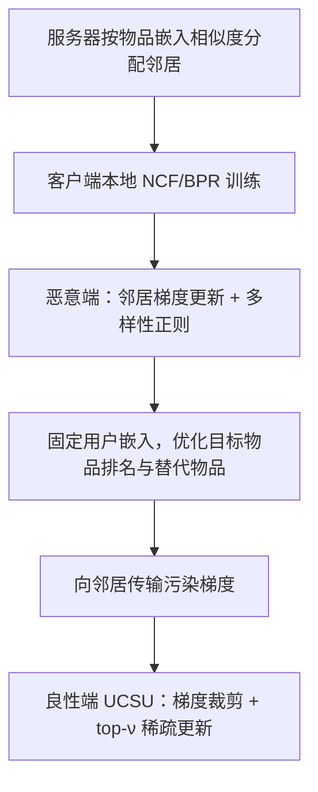
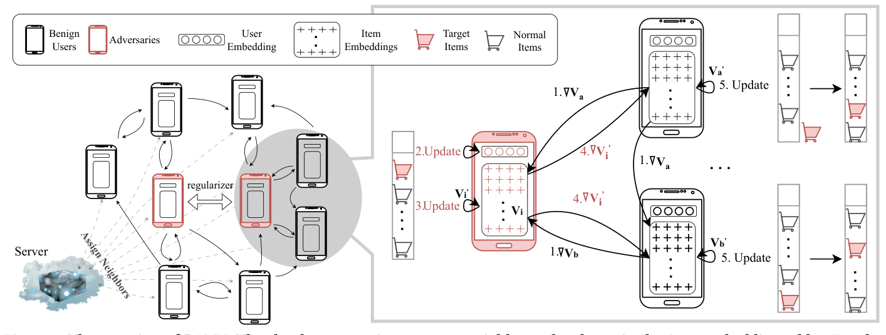

# Poisoning Decentralized Collaborative Recommender System and Its Countermeasures（去中心化协同推荐系统的投毒攻击及其防御）

- **会议/期刊**: SIGIR 2024
- **作者与机构**: Ruiqi Zheng, Liang Qu, Tong Chen, Kai Zheng, Yuhui Shi, Hongzhi Yin；南方科技大学、昆士兰大学、电子科技大学
- **推荐链路定位**: 端到端训练（去中心化协同训练）
- **研究方向**: 去偏公平、可信隐私与工业架构 / 协同过滤与双塔召回
- **论文原文**: [https://arxiv.org/abs/2404.01177v1](https://arxiv.org/abs/2404.01177v1)
- **开源代码**: 暂未开源

## TL;DR (1分钟核心速览)

DecRecs 无中心服务器聚合，现有 FedRec 投毒攻击因通信局部性失效。本文提出 PAMN：恶意客户端按邻居梯度自适应更新，固定用户嵌入优化目标物品排名，并用多样性正则扩大影响面；同时提出用户级裁剪+稀疏更新 UCSU。MovieLens/Amazon 上 ER@20 达 0.8627/0.9168，较 PSMU 提升 4.84×/33.8×，HR@20 基本不变。

## Background & Motivation (背景与核心矛盾)

- **主流范式**: 隐私与效率驱动推荐训练从中心服务器迁移到设备端，FedRecs 依赖服务器聚合，DecRecs 仅由服务器分配邻居，客户端直接交换梯度。
- **前人局限**: 现有投毒攻击几乎面向 FedRecs，依赖全局梯度分发或均匀构造恶意用户；在 DecRecs 中每个攻击者只能影响少量邻居，直接迁移会因局部性和非 IID 数据失效。
- **核心洞察 (Key Insight)**: 作者利用“目标物品若在恶意用户 top-K 中高曝光，其流行度可向良性用户传播”的现象，并让不同攻击者针对各自邻居生成不同污染梯度。
- **本文切入点**: 用自适应恶意邻居+多样性正则扩大攻击覆盖面，再以用户侧梯度裁剪和稀疏更新做防御。

## Method (核心方法设计)

### 1. 整体框架 (Overall Architecture)

服务器每 $T$轮基于物品嵌入相似度分配邻居；客户端本地用 NCF+BPR 训练。恶意客户端接收邻居梯度后更新物品/模型参数，模仿良性用户画像；随后固定用户嵌入，优化目标物品局部排名并构造替代物品增强竞争，最后把污染梯度传给邻居。良性客户端收到梯度后执行 UCSU：先裁剪，再存入记忆库并仅保留 top-$\nu$% 梯度更新，兼顾攻击抑制与推荐性能。

<figure class="paper-figure" markdown="span">
  <figcaption>图1：PAMN 概述。云服务器将用户分配给共享相似物品嵌入表的邻居。对于攻击，a）攻击者从邻居接收梯度以更新用户和物品嵌入，从而有效模拟这些邻居的用户画像。b）攻击者利用其固定用户嵌入，通过优化目标物品的本地排序来微调物品嵌入。c）攻击者传递本地物品嵌入表的梯度，以提升协作网络内其他用户对目标物品的排序。</figcaption>
</figure>

### 2. 关键设计拆解 (Key Designs)

1. **自适应恶意邻居攻击 PAMN**：痛点在于 DecRecs 中攻击者只能接触局部邻居，统一攻击策略覆盖不足。PAMN 用每个恶意端收到的邻居梯度更新本地参数，并以 $\widetilde{\mathcal{L}}_{rate}=\sum_{\tilde{u}_i\in\widetilde{\mathcal{U}}}\sum_{v_j\in\hat{\mathcal{V}}_i\setminus\widetilde{\mathcal{V}}}\sum_{v_t\in\widetilde{\mathcal{V}}\cup\mathcal{V}^{si}_i\setminus\widetilde{\mathcal{V}}^+_i}\sigma(\hat{r}_{ij}-\hat{r}_{it})$ 拉高目标物品相对 top-K 竞争物品的评分；直觉是让目标物品在局部排序中“挤掉”原本高分物品。

2. **多样性正则与替代物品**：若所有恶意用户嵌入过于相似，只能影响同一小簇良性用户。作者加入 $\mathcal{L}_{user}=\mathcal{L}_{loc}^{\tilde{u}_i}-\lambda\sum_{\tilde{u}_k\in\widetilde{\mathcal{U}}}\|\mathbf{u}_i-\mathbf{u}_k\|_p$，鼓励恶意画像分散以覆盖多偏好群体；替代物品则选与目标物品嵌入相似且偏好分高的物品，扩大竞争集合，使目标物品获得更强梯度。

3. **UCSU 用户级防御与训练目标**：DecRecs 无中心聚合器，防御必须落在用户侧。UCSU 只处理物品嵌入梯度，先做 $\nabla\mathbf{V}'_k=\nabla\mathbf{V}_k\cdot\min(1,\frac{\text{avg}\|\nabla\mathbf{V}_k\|_p}{\|\nabla\mathbf{V}_k\|_p})$ 抑制主导性污染梯度，再用记忆库仅保留 top-$\nu$% 大梯度更新；其物理直觉是低幅污染梯度在累积初期被过滤，避免其逐步累积到主导更新。训练仍以本地 BPR 为主，攻击端额外优化上述排序损失；推理阶段与常规 DecRecs 一致，UCSU 仅增加用户侧记忆库与排序开销。

## Experimental Setup & Evaluation Protocol (实验设置与评估协议)

- **数据集与预处理**: 采用 `5-core` 过滤，评分二值化为 1，负样本按 1:4 采样；80% 训练、20% 测试。

| 数据集 | #Users | #Items | #Interactions | 稀疏度/密度 | 特征/场景说明 |
| :--- | :---: | :---: | :---: | :---: | :--- |
| MovieLens-1M | 6,040 | 3,900 | 1,000,208 | 密度约 4.25% | 电影评分 |
| Amazon Digital Music | 16,566 | 11,797 | 169,781 | 密度约 0.087% | 音乐评分 |

- **数据划分与防穿越**: 随机 `80/20` 比例划分，非 Leave-One-Out；攻击在服务器完成初始邻居分配后启动，假设攻击者仅掌握邻居传来的梯度。
- **排名评测协议**: 采用采样排序（测试负样本正负比 1:4），报告 `HR@20` 与目标物品曝光率 `ER@20`；未声明全库 Full-Ranking。
- **对比基线与超参**: 攻击基线为 No Attack、Random Attack、Explicit Boosting、PSMU；防御基线为 Median、Trimmed Mean、Item-Krum、$\ell_2$Clip。基础模型 NCF 三层 FFN（64-32-16），嵌入维度 32，Adam 学习率$10^{-3}$，邻居数$N=50$，恶意比例$\xi=1\%$，$\alpha=30$，$\nu=10\%$，$\mu=1$，$p=2$。原文未报告显著性检验。

## Key Experimental Results (实验关键数据)

### 1. 主实验对比 (Main Results)

| 方法 | ML HR@20 | ML ER@20 | Amazon HR@20 | Amazon ER@20 |
| :--- | :---: | :---: | :---: | :---: |
| No Attack | **0.3635** | 0.0000 | **0.0126** | 0.0000 |
| Random Attack | 0.3531 | 0.0000 | 0.0113 | 0.0000 |
| Explicit Boosting | 0.3581 | 0.0000 | 0.0120 | 0.0000 |
| PSMU | 0.3495 | 0.1478 | 0.0118 | 0.0271 |
| **PAMN (Proposed)** | 0.3622 | **0.8627** | 0.0124 | **0.9168** |
| **Improv. (ER@20 vs PSMU)** | — | **+483.7%** | — | **+3283.0%** |

### 2. 消融实验 (Ablation Study)

原文以图3给出消融趋势，未列表具体数值；下表按图中观察归纳：

| 变体 | 关键变化 | 观察 |
| :--- | :--- | :--- |
| PAMN w/o Reg | 去掉恶意用户多样性正则 | ER@20 下降，攻击覆盖面收缩 |
| PAMN w/o SI | 去掉替代物品 | ER@20 下降，目标物品竞争力减弱 |
| UCSU w/o AU | 去掉自适应更新 | 目标物品 ER@20 回升，防御退化 |
| UCSU w/o clip | 去掉用户级裁剪 | 防御几乎失效，ER@20 明显升高 |

### 3. 关键实验发现 (Key Findings)

1. PAMN 在 MovieLens 上将 ER@20 从 PSMU 的 0.1478 提升至 0.8627（4.84×），Amazon 从 0.0271 提升至 0.9168（33.8×），同时 HR@20 仅从 0.3635/0.0126 变为 0.3622/0.0124，说明攻击高曝光且隐蔽。
2. RA 与 EB 在两个数据集上的 ER@20 均为 0，直接迁移 FedRecs 攻击无效；PSMU 虽有提升但受统一攻击策略限制，验证了 DecRecs 局部通信下“自适应邻居”的必要性。
3. 恶意比例从 0.2% 增至 1% 时 ER@20 上升且 HR 稳定，5% 时 HR 明显下降；UCSU 在不显著牺牲 HR 的情况下压低 ER@20，且去掉 clip 后防御失效，表明梯度裁剪是该防御的核心。

## Highlights & Limitations (亮点、对比与审稿批判)

- **与代表作对比 (vs. Prior Work)**: A-hum/PSMU 面向 FedRecs，依赖全局聚合或均匀构造恶意用户；PAMN 首次针对 DecRecs 的局部通信，按邻居自适应生成污染梯度，并用多样性正则突破局部性。
- **可迁移亮点**: 用户级“裁剪+top-ν 稀疏更新”适合非 IID 去中心化学习中的低幅投毒过滤；多样性正则可用于多攻击者协同扩散场景。
- **审稿级局限批判**: 威胁模型较强，假设攻击者控制全部恶意端并可收集其私有用户嵌入；防御与消融仅有图2/图3趋势，缺少精确数值和显著性检验；仅两个数据集、采样排序评估，未讨论真实部署延迟与自适应攻击。

## Rating (四维评分)

- **方法创新性 (Novelty)**: ⭐⭐⭐⭐ （首次系统揭示 DecRecs 局部通信下的投毒面，自适应邻居与多样性正则针对性强）
- **评估协议与实验扎实度 (Protocol & Experiments)**: ⭐⭐⭐ （主攻击表清晰，但防御/消融缺精确数值，仅采样排序与两数据集）
- **写作与数学规范度 (Clarity & Rigor)**: ⭐⭐⭐ （攻击目标与防御算子定义清楚，但部分符号与实验细节略简）
- **工业落地与复现价值 (Industrial & Practical Value)**: ⭐⭐⭐ （用户侧防御易嵌入 DecRecs，但记忆库开销与强威胁假设仍需工程验证）

