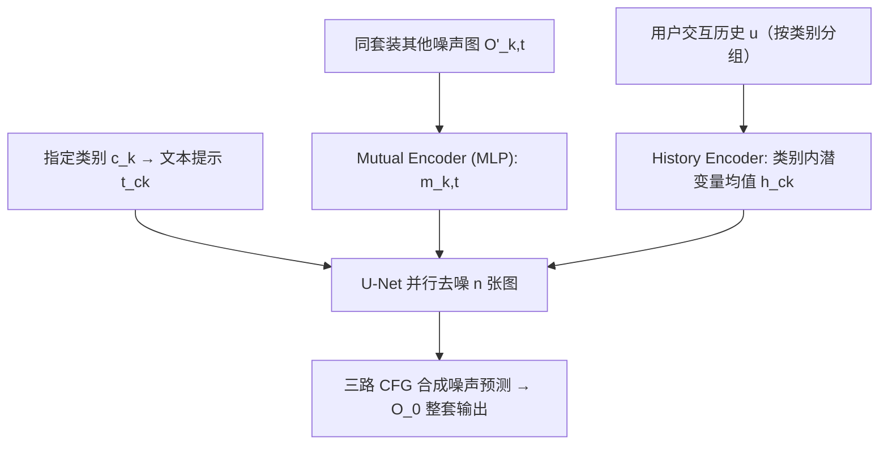
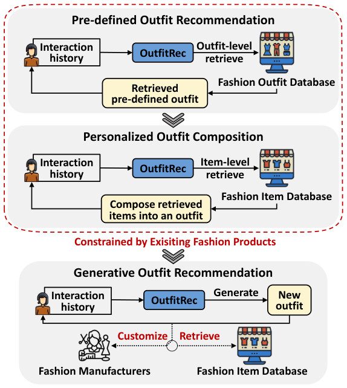

# Diffusion Models for Generative Outfit Recommendation (面向生成式套装推荐的扩散模型)

- **会议/期刊**: SIGIR 2024
- **作者与机构**: Yiyan Xu, Wenjie Wang, Fuli Feng, Yunshan Ma, Jizhi Zhang, Xiangnan He (中国科学技术大学、新加坡国立大学)
- **推荐链路定位**: 端到端生成式（生成即推荐，生成后可回检现有商品库）
- **研究方向**: 生成式推荐与离散语义ID / 多模态推荐
- **论文原文**: [arXiv:2402.17279v3](https://arxiv.org/abs/2402.17279v3)
- **开源代码**: [YiyanXu/DiFashion](https://github.com/YiyanXu/DiFashion)

## TL;DR (1分钟核心速览)

现有时尚套装推荐只能"从既有商品库里检索/拼装"，受限于商品数量与设计细节，无法满足用户对颜色、版型、图案的个性化想象。本文提出 **Generative Outfit Recommendation (GOR)** 新任务与 **DiFashion**：在同一次反向过程中**并行去噪生成整套 $n$ 件服饰图像**，并用"类别提示 + 互条件 + 历史条件"三类条件与三路 Classifier-Free Guidance 分别对齐**保真度、兼容性、个性化**。在 iFashion 与 Polyvore-U 上，PFITB 任务 FID 由 42.47 降至 34.06（−19.8%），兼容性评分 0.46→0.58；人评中相对 SD-v1.5/v2 的一致偏好率均 ≥57.5%。

## Background & Motivation (背景与核心矛盾)

- **主流范式**: 套装推荐（OR）经历两阶段——套装级检索（HFN/HFGN 直接召回已搭配好的套装）与个性化套装组合（BGN 等按类别逐件检索后拼装）。
- **前人局限**: ①两阶段均被"既有商品库"锁死，颜色/图案/剪裁无法定制，长尾需求失效；②个性化组合把套装当作**有序序列**建模 $P_\theta(\boldsymbol{i}_k|\boldsymbol{i}_1,\dots,\boldsymbol{i}_{k-1})$，先生成的单品永远看不到后生成的单品，与"整套互相协调"的目标存在结构性偏差。
- **核心洞察 (Key Insight)**: 扩散模型的多步反向过程天然提供了一个可迭代优化的近似解——在第 $t$步可以用"其他单品的当前噪声版本$\boldsymbol{O}'_{k,t}$"作为真实完整套装的替身，从而**并行地**互相校正，绕过序列化假设。
- **本文切入点**: 把套装视为一组在同一扩散步上互相可见的潜变量，用三种条件注入 U-Net，一次性生成整套。

## Method (核心方法设计)

### 1. 整体框架 (Overall Architecture)

基于 Stable Diffusion 潜空间：前向过程对套装内每张图**独立**加噪 $q(\boldsymbol{O}_t|\boldsymbol{O}_{t-1})=\prod_{k=1}^{n}\mathcal{N}(\boldsymbol{i}_{k,t};\sqrt{1-\beta_t}\boldsymbol{i}_{k,t-1},\beta_t\mathbf{I})$；反向过程则**联合**建模$p_\theta(\boldsymbol{O}_{t-1}|\boldsymbol{O}_t)=\prod_{k=1}^{n}\mathcal{N}(\boldsymbol{i}_{k,t-1};\boldsymbol{\mu}_\theta(\boldsymbol{O}_t,t),\boldsymbol{\Sigma}_\theta(\boldsymbol{O}_t,t))$，即第$k$件图的去噪均值依赖**整套**潜变量$\boldsymbol{O}_t$，这是"兼容性"能进入梯度的关键。三类条件分别走文本提示、MLP 编码器、U-Net 首层通道扩展三条通路汇入 U-Net；推理时三路 CFG 组合预测噪声，从纯噪声并行解码出整套图像。

<figure class="paper-figure" markdown="span">
  <figcaption>图1：套装推荐的演变。相较于现有时尚产品，GOR 旨在生成一组时尚产品，作为兼容且个性化的套装。</figcaption>
</figure>

### 2. 关键设计拆解 (Key Designs)

1. **互条件 (Mutual Condition)：让套装内单品在每一步互相"看见"**：痛点是无序集合 $P_\theta(\boldsymbol{i}_k|\boldsymbol{O}'_k,\boldsymbol{u})$不可解。作者以其余单品潜变量的均值经 MLP 提炼兼容信息，再以比例$\eta$做元素级插值：$\boldsymbol{m}_{k,t}=f_\phi\big(\frac{1}{n-1}\sum_{v\neq k}\boldsymbol{i}_{v,t}\big)$，$\boldsymbol{i}^{\text{mutual}}_{k,t}=(1-\eta)\boldsymbol{i}_{k,t}+\eta\boldsymbol{m}_{k,t}$。直觉：均值池化给出"整套风格的平均基调"，MLP 负责去噪与升维（消融显示去掉 MLP 后 FID 从 34.06 崩到 100.56，说明裸均值会把大量纹理噪声直接灌进 U-Net）。

2. **历史条件 (History Condition)：类别级细粒度个性化**：用户历史若整段编码会与当前类别语义错位。作者先按类别切分 $\boldsymbol{u}_{c_k}=\{\boldsymbol{i}_r^{c_k}\}_{r=1}^{m}$，用 SD 自带的图像编码器压到潜空间后取均值$\boldsymbol{h}_{c_k}=\frac{1}{m}\sum_{r=1}^{m}\mathcal{E}(\boldsymbol{i}_r^{c_k})$，并**扩展 U-Net 首个卷积层通道（零初始化）**，以$[\boldsymbol{i}^{\text{mutual}}_{k,t},\boldsymbol{h}_{c_k}]$ 拼接注入。直觉：零初始化保证微调初期不破坏预训练先验，类别对齐使"帽子历史"只影响帽子。

3. **训练目标、条件掩码与推理开销**：总损失为多图并行去噪回归 $\mathcal{L}_{\theta,\phi}=\frac{1}{n}\sum_{k=1}^{n}\mathbb{E}_{t,\boldsymbol{\epsilon}_k\sim\mathcal{N}(0,\mathbf{I})}\big\|\boldsymbol{\epsilon}_k-\boldsymbol{\epsilon}_{\theta,\phi}(\boldsymbol{i}_{k,t},\boldsymbol{t}_{c_k},\boldsymbol{m}_{k,t},\boldsymbol{h}_{c_k},t)\big\|_2^2$。为支持三路 CFG，训练时以 0.2 概率单独掩码各条件、0.3 概率同时掩码互条件与历史条件，使模型见过全部 4 种条件组合；推理时$\tilde{\boldsymbol{\epsilon}}=\boldsymbol{\epsilon}(\varnothing)+s_t[\cdot]+s_m[\cdot]+s_h[\cdot]$逐级叠加。无负采样概念（非判别式排序），但成本高昂：每步需 4 次 U-Net 前向，$T$步 ×$n$ 图并行，训练约 1 张 A100 一天。

## Experimental Setup & Evaluation Protocol (实验设置与评估协议)

- **数据集与预处理**: iFashion 只保留长度恰为 4 的套装；Polyvore-U 将长度 3 的套装当作"交互单品"、长度 4 当作"交互套装"，并用 iFashion 上微调的 Inception-V3 补齐细粒度类别。

| 数据集 | #Users | #Items | #Outfits | #Interactions | 稀疏度/说明 |
| :--- | :---: | :---: | :---: | :---: | :--- |
| iFashion | 12,806 | 344,186 | 19,882 | 107,396 | 长尾极重，仅 4 件式基础套装 |
| Polyvore-U | 517 | 119,202 | 33,906 | 33,908 | 用户极少、套装长度不一 |

- **数据划分与防穿越 (Splitting Strategy)**: 过滤出**至少交互 5 套套装的活跃用户**后，对交互套装做 **8:1:1 随机比例划分**（非全局时间戳切分，存在轻度未来信息泄漏风险）。
- **排名评测协议 (Ranking Protocol)**: 主体是生成质量指标（FID / IS / IS-acc / CLIP Score / CIS / LPIPS / 兼容性 / 个性化），**不做 Full-Ranking**。唯一的检索准确率采用 **Sampled Ranking**：PFITB 每样本为 1 个真值 + 4 个随机负样本（正负比 1:4），用 CLIP 特征余弦相似度把生成图 grounding 回商品库；GOR 的候选集为各指定类别下的全部商品。
- **对比基线与超参设置**: 生成类 OutfitGAN、SD-v1.5$^*$、SD-v2$^*$、SD-v1.5/SD-v2（本数据集微调）、SD-naive（条件直接拼接）、ControlNet；检索类 Random、HFN、HFGN、BGN、BGN-Trans。骨干统一为 SD-v2，学习率$1e^{-5}$，互编码器隐层 256，$\eta\in\{0.05,0.10,0.15\}$，$s_t\in[10,15]$，$s_m,s_h\in[2,7]$；未报告显著性检验。

## Key Experimental Results (实验关键数据)

### 1. 主实验对比 (Main Results)

PFITB 任务（生成类基线，iFashion 与 Polyvore-U）：

| 方法 | iFashion FID↓ | IS↑ | CIS↑ | Comp.↑ | Per.↑ | Polyvore FID↓ | CIS↑ | Comp.↑ | Per.↑ |
| :--- | :---: | :---: | :---: | :---: | :---: | :---: | :---: | :---: | :---: |
| OutfitGAN | 202.60 | 9.52 | 16.88 | 0.03 | 21.48 | 272.82 | 23.23 | 0.00 | 28.80 |
| SD-v1.5$^*$ | 52.62 | 22.54 | 38.35 | 0.08 | 46.31 | 51.34 | 40.56 | 0.70 | 51.05 |
| SD-v2$^*$ | 54.13 | 21.66 | 38.66 | 0.04 | 46.52 | 62.41 | 40.51 | 0.60 | 51.29 |
| SD-v1.5 (微调) | 42.47 | 26.76 | 44.80 | 0.46 | 53.16 | 53.72 | 45.71 | 0.75 | 58.20 |
| SD-naive | 44.38 | 25.45 | 44.93 | 0.36 | 52.95 | 58.22 | 47.01 | 0.73 | 59.24 |
| ControlNet | 42.74 | 27.76 | 41.93 | 0.16 | 49.90 | 44.31 | 43.79 | 0.73 | 55.44 |
| **DiFashion** | **34.06** | **29.99** | **47.36** | **0.58** | **55.86** | **32.58** | **48.82** | **0.80** | **61.44** |
| Improv.% | −19.8% | +8.0% | +5.7% | +26.1% | +5.1% | −26.5% | +3.9% | +6.7% | +3.7% |

以生成图回检现有商品的检索对比（PFITB）：iFashion 上 DiFashion 检索准确率 0.76 略胜 HFGN 0.75，兼容性 0.78 vs 0.75；但 Polyvore-U 上 0.66 明显低于 HFGN 的 0.74，GOR 任务 Compat 亦被 BGN-Trans（0.75）反超（0.52）。

### 2. 消融实验 (Ablation Study)

| 变体 | FID↓ | CIS↑ | Comp.↑ | Per.↑ |
| :--- | :---: | :---: | :---: | :---: |
| w/o MLP in Mutual Encoder | 100.56 | 31.72 | 0.16 | 38.99 |
| w/ MLP（完整 DiFashion） | **34.06** | **47.36** | **0.58** | **55.86** |
| w/o mutual condition（图 5a 趋势） | 上升 | — | 下降 | — |
| w/o history condition（图 5b 趋势） | — | 下降 | — | 下降 |

### 3. 关键实验发现 (Key Findings)

1. **收益来自条件设计而非"多图生成"本身**：同为 SD-v2、同样注入互条件与历史条件的 SD-naive 只能到 FID 44.38 / Comp 0.36，而带 MLP 互编码器的 DiFashion 达 34.06 / 0.58——说明"条件如何编码"比"条件是否存在"更决定兼容性。
2. **互条件同时反哺保真度**：去掉互条件不仅掉兼容性，FID 也变差（图 5a），因为整套风格一致性本身为目标图提供了额外的结构先验；而 MLP 缺失时 FID 暴涨 195%，验证均值池化必须配非线性去噪。
3. **引导尺度存在"过引导"拐点**：$s_m$增大时 FID 与兼容性先升后降，$s_h$增大则个性化与 CIS 单调提升，$\eta$ 在 0.10 附近最优——三条件互相竞争，任一条件过强都会压制其余条件；人评中 DiFashion 相对 SD-v2 的偏好率为 66.5%–70.0%（PFITB 保真度），显著高于 50% 随机线。

## Highlights & Limitations (亮点、对比与审稿批判)

- **与代表作对比 (vs. Prior Work)**: 相比 HFN/HFGN 等套装级检索，DiFashion 突破了商品库上限，可直接对接厂商定制（"生成后回检"只是落地过渡方案）；相比 BGN/BGN-Trans 的**有序序列**组合，本文的并行去噪让套装内所有单品在每步互相可见，从结构上消除了"前序不可见后序"的偏差；相比 ControlNet 冻结主干只学条件分支，本文端到端微调 U-Net 更适合适配时尚数据分布（ControlNet 兼容性仅 0.16）。
- **可迁移亮点**: ①"用当前噪声状态互相作为条件"的并行扩散集合生成范式，可迁移到捆绑推荐、多件商品搭配、播放列表生成；②按类别切分历史后取潜变量均值 + 首层通道零初始化扩展的注入方式，是低成本条件化改造的通用技巧。
- **审稿级局限批判**: ①**评测协议薄弱**：8:1:1 随机划分不防时间穿越，仅 4 件式套装限制了泛化；作者自承 GOR 任务上自动兼容性指标接近 0（生成图与真实图分布不一致导致评分器失效），只能退化为 50 例人工评测，统计功效有限；②**落地成本高**：每步 4 次 U-Net 前向 × $T$步 ×$n$ 图，单次请求延迟远超检索式推荐，且检索回检在 Polyvore-U 上反而不如 HFGN，说明生成-检索之间存在语义 gap；③个性化被压缩为"类别内历史均值"，无法刻画多属性偏好组合，也无法在线更新。

## Rating (四维评分)

- **方法创新性 (Novelty)**: ⭐⭐⭐⭐ （把集合级兼容性转化为"并行潜变量互相条件"，从任务定义到扩散算子都是新的，且给出了可解的多步近似推导）
- **评估协议与实验扎实度 (Protocol & Experiments)**: ⭐⭐⭐ （生成指标 + 人工评测较全面，但仅有随机 8:1:1 划分、单一负采样比 1:4、无显著性检验，自建兼容性评分器在 GOR 上失效）
- **写作与数学规范度 (Clarity & Rigor)**: ⭐⭐⭐⭐ （从不可解优化式 Eq.5 到近似式 Eq.6 的推导清晰，三条件与 CFG 组合公式符号一致、无歧义）
- **工业落地与复现价值 (Industrial & Practical Value)**: ⭐⭐⭐ （代码数据全开源、基于 SD 生态易复现，但 A100 一天训练与多路 CFG 推理延迟使其短期内只适合"生成 → 回检/定制"的离线场景）

