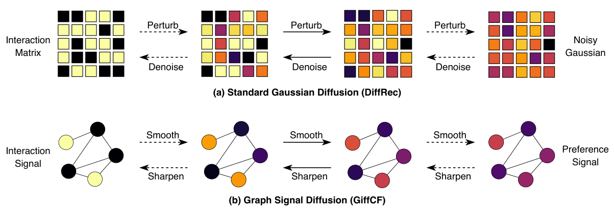
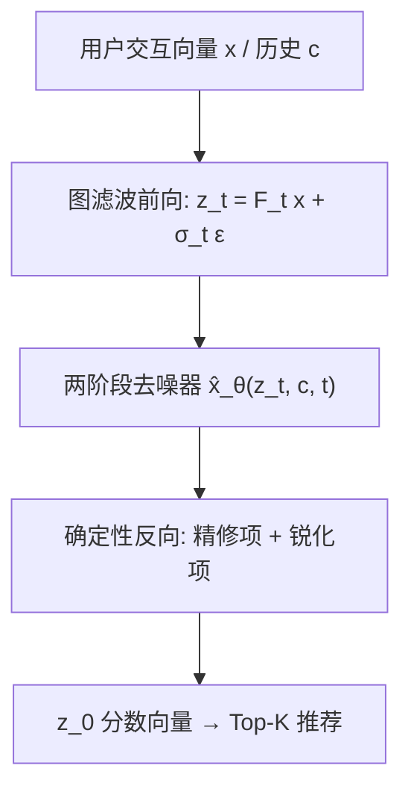
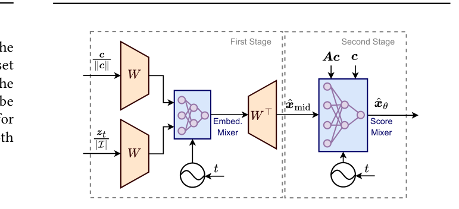

# Graph Signal Diffusion Model for Collaborative Filtering (图信号扩散协同过滤模型)

- **会议/期刊**: SIGIR 2024
- **作者与机构**: Yunqin Zhu, Chao Wang, Qi Zhang, Hui Xiong（中国科学技术大学 / 香港科技大学(广州) / 上海人工智能实验室）
- **推荐链路定位**: 召回（用户交互向量重建 → Top-K 排序）
- **研究方向**: 生成式推荐 / 图神经网络与知识图谱推荐
- **论文原文**: [论文原文链接](https://arxiv.org/abs/2311.08744v3)
- **开源代码**: [开源代码链接](https://github.com/HasiNed/GiffCF)

## TL;DR (1分钟核心速览)

隐式反馈稀疏且物品间强相关，而标准扩散的**各向同性高斯加噪**既忽略物品图结构、又用噪声摧毁用户交互向量中的个性化信息。本文提出 GiffCF：把交互向量视作物品相似图上的信号，前向过程用**热方程图滤波**做平滑-锐化式的广义"加噪"，反向过程用**无噪声确定性采样 + 两阶段去噪器**逐级重建。在 MovieLens-1M/Yelp/Amazon-Book 三个基准（7:1:2 划分，全库排序）上全面超越 8 个基线，Recall@20 相对提升最高 5.44%，Amazon-Book 上领先最强图信号基线 LinkProp 2.69%。

## Background & Motivation (背景与核心矛盾)

- **主流范式**: 协同过滤被建模为条件生成逆问题 $p_\theta(\boldsymbol{x}|\boldsymbol{c})$，从 Masked/去噪自编码器（Mult-VAE、DAE）发展到 DiffRec 这类 DDPM 式隐变量分层生成模型。
- **前人局限**: ①标准高斯扩散在**各向同性**地对交互向量做衰减加噪，完全无视物品间相关性，与交互空间的图结构错位；②高斯噪声会冲掉用户交互向量中的个性化信号，反向重建难度大（DiffRec 仅靠"限制噪声方差"打补丁，未触及问题①）。
- **核心洞察 (Key Insight)**: GNN 的"过平滑"缺陷反过来可当作一种**专为图信号设计的破坏算子**——反复平滑直到稳态，恰是把个性化交互信号退化为"平滑偏好信号"的自然过程，无需注入噪声。
- **本文切入点**: 以物品-物品相似图上的热方程 $\partial\boldsymbol{z}/\partial\tau=\alpha\nabla^2\boldsymbol{z}$ 定义前向扩散，把图邻接作为归纳偏置直接注入生成模型。

<figure class="paper-figure" markdown="span">
  <figcaption>图1：隐式反馈中不同扩散过程的比较。标准高斯扩散用高斯噪声破坏交互矩阵中的个性化信息。相反，我们的图信号扩散利用交互空间的图结构，将交互信号破坏为平滑的偏好信号。(a)中每个方块表示一个矩阵元素，(b)中每个圆圈表示一个标量值图节点。颜色越深表示数值越高。</figcaption>
</figure>
图 1：标准高斯扩散（a）用噪声摧毁交互矩阵；图信号扩散（b）把交互信号平滑为偏好信号，保留图结构。

## Method (核心方法设计)

### 1. 整体框架 (Overall Architecture)

输入为用户交互向量 $\boldsymbol{x}\in\{0,1\}^{|\mathcal{I}|}$。训练时先随机 dropout 得到历史$\boldsymbol{c}$，再按预计算的多跳图滤波$\boldsymbol{F}_t$把$\boldsymbol{x}$平滑到第$t$步的潜信号$\boldsymbol{z}_t$，去噪器$\hat{\boldsymbol{x}}_\theta(\boldsymbol{z}_t,\boldsymbol{c},t)$学习从平滑态还原$\boldsymbol{x}$。推理时以$\boldsymbol{z}_T=\boldsymbol{F}_T\boldsymbol{c}$为先验，执行$T$步确定性反向采样：每步先用"精修项"把潜信号拉回去噪预测、再用"锐化项"沿热方程负方向补回被平滑掉的高频细节，最终$\boldsymbol{z}_0$ 即预测分数向量，用于全库 Top-K 排序。全流程噪声尺度可取 0，是无噪声扩散。

<figure class="paper-figure" markdown="span">
  <figcaption>图3：GiffCF 中去噪器 ˆ𝒙𝜃 的架构。</figcaption>
</figure>
图 3：两阶段去噪器架构（Embedding Mixer + Score Mixer）。

### 2. 关键设计拆解 (Key Designs)

1. **热方程图平滑前向过程（用图滤波替代对角加噪）**：既然只需估计 $\mathbb{E}[\boldsymbol{x}|\boldsymbol{c}]$，就不必用高斯扰动遍历整个交互分布。将连续热方程解$e^{-\tau\alpha(\boldsymbol{I}-\boldsymbol{A})}$ 做一阶 Taylor 截断（也避免过平滑丢个性化信息），得到线性平滑滤波器：

$$\boldsymbol{F}_t=(1-\tau_t\alpha)\boldsymbol{I}+\tau_t\alpha\boldsymbol{A},\qquad \boldsymbol{z}_t=\boldsymbol{F}_t\boldsymbol{x}+\sigma_t\boldsymbol{\epsilon}_t$$

对角化后等价于图频域中的**各向异性噪声调度**：$\tilde{\boldsymbol{z}}_t=[(1-\tau_t\alpha)\mathbf{1}+\tau_t\alpha\boldsymbol{\lambda}]\odot\tilde{\boldsymbol{x}}+\sigma_t\tilde{\boldsymbol{\epsilon}}_t$，高频分量被$1-\lambda$ 以指数速率衰减。直觉：前向过程本身就是一次低通去噪，天然削弱 dropout 噪声并注入邻接先验。

2. **统一的物品图滤波器（把 LinkProp 与 GF-CF 熔为一个算子）**：单一 2 跳传播表达力受限，理想低通又能补高阶信号。作者取二者加权并归一：

$$\boldsymbol{A}=\frac{1}{1+\omega}\Big(\boldsymbol{A}_{\beta,\gamma,\delta}/\|\boldsymbol{A}_{\beta,\gamma,\delta}\|_2+\omega\,\boldsymbol{U}_{\beta,\gamma,\delta,d}\boldsymbol{U}_{\beta,\gamma,\delta,d}^{\top}\Big)$$

其中 $\boldsymbol{A}_{\beta,\gamma,\delta}=\boldsymbol{D}_\mathcal{I}^{-\delta}\boldsymbol{X}^{\top}\boldsymbol{D}_\mathcal{U}^{-\gamma}\boldsymbol{X}\boldsymbol{D}_\mathcal{I}^{-\beta}$，默认$\beta=\gamma=\delta=\tfrac12$（实验优于 LightGCN 式堆叠）。复杂度上，传播项$O(|\mathcal{X}|)$稀疏乘、低通项$O(|\mathcal{I}|d)$低秩乘，规避$O(|\mathcal{I}|^2)$ 稠密运算。

3. **精修-锐化反向分解与训练目标**：将 DDIM 式确定性更新 $\boldsymbol{z}_{t-1}=\boldsymbol{F}_{t-1}\hat{\boldsymbol{x}}_\theta+\frac{\sigma_{t-1}}{\sigma_t}(\boldsymbol{z}_t-\boldsymbol{F}_t\hat{\boldsymbol{x}}_\theta)$ 改写为

$$\boldsymbol{z}_{t-1}=\boldsymbol{z}_t+\underbrace{\Big(1-\tfrac{\sigma_{t-1}}{\sigma_t}\Big)(\boldsymbol{F}_t\hat{\boldsymbol{x}}_\theta-\boldsymbol{z}_t)}_{\text{Refining}}+\underbrace{(\tau_t-\tau_{t-1})\alpha(\boldsymbol{I}-\boldsymbol{A})\hat{\boldsymbol{x}}_\theta}_{\text{Sharpening}}$$

精修项补偿先验 $\boldsymbol{z}_T=\boldsymbol{F}_T\boldsymbol{c}$的错配（$\sigma_{t-1}/\sigma_t$控制强度），锐化项等价于**反向求解热方程**，把被平滑掉的高频差异补回。由 VLB 推导（先验项与重建项为常数）得到与标准 DM 同形、仅$w_t=1$、直接预测$\boldsymbol{x}$ 的损失：

$$\mathcal{L}=\mathbb{E}_{t\sim U(1,T)}\big\|\hat{\boldsymbol{x}}_\theta(\boldsymbol{z}_t,\boldsymbol{c},t)-\boldsymbol{x}\big\|^2$$

**负采样与推理开销**：无 BPR 式负采样，全部物品隐式进入 softmax-free 的平方误差；推理仅 $T=3$ 步、每步一次稀疏图乘 + 两个 item-wise MLP，无 U-Net 采样开销。

## Experimental Setup & Evaluation Protocol (实验设置与评估协议)

- **数据集与预处理**（沿用 DiffRec 的公开预处理版本）：

| 数据集 | #Users | #Items | #Interactions | 稀疏度 | 特征/场景说明 |
| :--- | :---: | :---: | :---: | :---: | :--- |
| MovieLens-1M | 5,949 | 2,810 | 571,531 | 96.6% | 电影评分，稠密小规模 |
| Yelp | 54,574 | 34,395 | 1,402,736 | 99.93% | 本地商户评论 |
| Amazon-Book | 108,822 | 94,949 | 3,146,256 | 99.97% | 图书评论，高维极稀疏 |

- **数据划分与防穿越**: **比例划分 7:1:2**（train/valid/test）；用验证集选最优 epoch。
- **排名评测协议**: 用户级 **Full-Ranking（全库未交互物品排序）**，报告 Recall@K、NDCG@K、MRR@K（$K\in\{10,20\}$），对所有用户取平均；无采样负例。
- **对比基线与超参**: 8 个基线覆盖三类——BPR 类（MF、LightGCN）、生成式（Mult-VAE、DiffRec、L-DiffRec）、图信号处理（LinkProp、GF-CF、BSPM）；统一 embedding/隐层/低通截断维度 $d=200$，dropout 0.5；GiffCF 默认$T=3$、$\alpha=1.5$、$\sigma_T=0$，$\omega\in\{0,0.1,0.2,0.3\}$、$\sigma_{t-1}/\sigma_t\in\{0.1,0.5,1.0\}$网格搜索；单样本 t-test，$p<0.05$ 标显著性。

## Key Experimental Results (实验关键数据)

### 1. 主实验对比 (Main Results)

| Dataset | Metric | MF | LightGCN | Mult-VAE | DiffRec | L-DiffRec | LinkProp | GF-CF | BSPM | GiffCF | Improv. |
| :--- | :--- | :---: | :---: | :---: | :---: | :---: | :---: | :---: | :---: | :---: | :---: |
| ML-1M | Recall@20 | 0.1389 | 0.1798 | 0.1833 | 0.1827 | 0.1847 | 0.1509 | 0.1718 | 0.1740 | **0.1947** | +5.44% |
| ML-1M | NDCG@20 | 0.0871 | 0.1089 | 0.1149 | 0.1148 | 0.1122 | 0.1031 | 0.1067 | 0.1079 | **0.1221** | +6.28% |
| ML-1M | MRR@20 | 0.1325 | 0.1495 | 0.1616 | 0.1630 | 0.1520 | 0.1574 | 0.1505 | 0.1513 | **0.1704** | +4.53% |
| Yelp | Recall@20 | 0.0852 | 0.1041 | 0.0979 | 0.0961 | 0.0971 | 0.0980 | 0.1029 | 0.1033 | **0.1063** | +2.12% |
| Yelp | NDCG@20 | 0.0406 | 0.0504 | 0.0477 | 0.0487 | 0.0469 | 0.0485 | 0.0502 | 0.0505 | **0.0523** | +3.59% |
| Yelp | MRR@20 | 0.0398 | 0.0497 | 0.0474 | 0.0493 | 0.0460 | 0.0493 | 0.0501 | 0.0503 | **0.0527** | +4.84% |
| Amazon-Book | Recall@20 | 0.1037 | 0.1083 | 0.1005 | 0.1011 | 0.1029 | 0.1488 | 0.1435 | 0.1435 | **0.1528** | +2.69% |
| Amazon-Book | NDCG@20 | 0.0518 | 0.0536 | 0.0520 | 0.0547 | 0.0540 | 0.0832 | 0.0807 | 0.0814 | **0.0858** | +3.16% |
| Amazon-Book | MRR@20 | 0.0471 | 0.0487 | 0.0482 | 0.0540 | 0.0506 | 0.0807 | 0.0795 | 0.0808 | **0.0842** | +4.16% |

### 2. 消融实验 (Ablation Study)

| 去噪器变体 | ML-1M R@20 / N@20 | Yelp R@20 / N@20 | Amazon-Book R@20 / N@20 |
| :--- | :---: | :---: | :---: |
| Full GiffCF | **0.1947 / 0.1221** | **0.1063 / 0.0523** | **0.1528 / 0.0858** |
| w/o latent（去掉一阶段 $\boldsymbol{z}_t$） | 0.1667 / 0.1105 | 0.1055 / 0.0520 | 0.1506 / 0.0846 |
| w/o pre-cond（去掉一阶段 $\boldsymbol{c}$） | 0.1829 / 0.1159 | 0.1041 / 0.0509 | 0.1518 / 0.0850 |
| w/o post-cond（二阶段去掉 $\boldsymbol{Ac},\boldsymbol{c}$） | 0.1888 / 0.1204 | 0.0851 / 0.0418 | 0.1057 / 0.0570 |

### 3. 关键实验发现 (Key Findings)

1. **稀疏度是分水岭**：Amazon-Book 上所有 embedding 类方法（含 DiffRec 0.1011）被图信号方法（LinkProp 0.1488）甩开约 **47%**，说明对高维极稀疏交互做低秩分解必然丢失细节；GiffCF 在此仍取得 0.1528（+2.69%），证明"扩散分层重建 + 图结构先验"可兼得两者之长。
2. **二阶段条件混合是稀疏场景的命门**：去掉 `post-cond` 后 Amazon-Book Recall@20 从 0.1528 崩到 0.1057（**−30.8%**），Yelp 从 0.1063 降到 0.0851（−20.0%），而在稠密的 ML-1M 上仅降 3.0%——该模块的本质是**用原始交互补齐低秩压缩 artifacts**，越稀疏收益越大。
3. **无噪声 + 少步数即最优**：$\sigma_T$从 0 增至 1.0 时性能单调下降，验证"高斯噪声对 CF 有害"；$T$从 1 增到 3 显著提升、超过 3 后震荡下降；$\alpha>1.5$出现过平滑导致性能回落。图 8 显示潜信号$\boldsymbol{z}_t$沿$t=T\to0$ 逐步提升 Recall@20，证实精修-锐化轨迹确实在持续纠错。

## Highlights & Limitations (亮点、对比与审稿批判)

- **与代表作对比 (vs. Prior Work)**: 与 DiffRec 的本质区别是"破坏算子"换血——DiffRec 仍是无条件高斯扩散 + dropout 补丁，本文把条件 $\boldsymbol{c}$ 显式并入每个反向步并彻底去噪；与 GF-CF/LinkProp/BSPM 的区别是把它们的线性图滤波**收编进扩散的概率框架**（式 13 统一为前向算子），从而获得分层迭代增益，而非单次滤波。
- **可迁移亮点**: ①"用任务先验的线性破坏算子替换高斯加噪"这一思路可直接迁移到序列推荐/多模态特征的扩散建模；②把 DAE dropout 噪声与扩散噪声**解耦**、让 dropout 只作用于条件 $\boldsymbol{c}$ 的建模方式，对任何条件生成式推荐都适用。
- **审稿级局限批判**: ①$T=3$虽快，但反向每步需两次 item-wise MLP 与一次低通低秩乘，在千万级物品库上的**在线延迟**未给出实测，且特征分解需预处理；②评测仅限静态协同过滤三数据集，缺冷启动/序列场景与采样排序协议对照，$\alpha,\omega,\sigma_{t-1}/\sigma_t$三个超参在小数据集与大稀疏集上最优值相反（如$\sigma_{t-1}/\sigma_t$ 在 Yelp 宜小、Amazon-Book 宜近 1.0），迁移时需重调。

## Rating (四维评分)

- **方法创新性 (Novelty)**: ⭐⭐⭐⭐ （首次将热方程图平滑作为扩散前向算子纳入 DM 理论框架，图频域各向异性噪声调度的解释清晰且有统一 LinkProp/GF-CF 的功力）
- **评估协议与实验扎实度 (Protocol & Experiments)**: ⭐⭐⭐⭐ （三规模数据集 + 8 基线 + 全库排序 + t-test 显著性齐全，消融与采样轨迹分析到位；略欠采样排序协议与冷启动场景）
- **写作与数学规范度 (Clarity & Rigor)**: ⭐⭐⭐⭐ （VLB 三项分解与 KL 上界推导完整，算法伪代码清晰；部分符号如 $\tau_t,\sigma_{t|s}$ 的调度假设交代略简）
- **工业落地与复现价值 (Industrial & Practical Value)**: ⭐⭐⭐⭐ （已开源 TensorFlow 实现，$T=3$ 且免负采样、稀疏乘为主，工程成本可控；但依赖预处理特征分解与逐用户反向采样，超大规模在线部署仍需加速）

