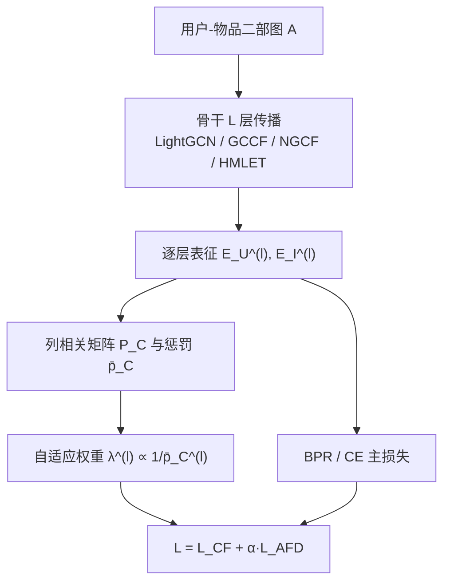
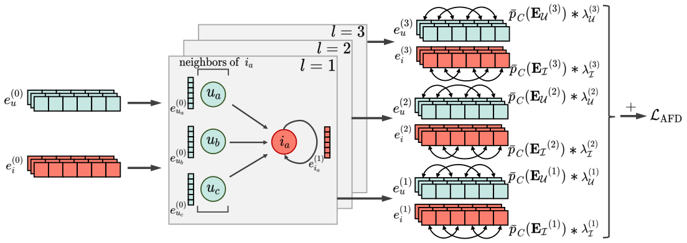

# AFDGCF: Adaptive Feature De-correlation Graph Collaborative Filtering for Recommendations (自适应特征去相关的图协同过滤推荐)

- **会议/期刊**: SIGIR 2024
- **作者与机构**: Wei Wu, Chao Wang, Dazhong Shen, Chuan Qin, Liyi Chen, Hui Xiong（USTC / 港科大(广州) / 上海AI Lab / BOSS直聘）
- **推荐链路定位**: 召回（GNN 协同过滤表征学习）
- **研究方向**: 图神经网络与知识图谱推荐 / 协同过滤
- **论文原文**: [论文原文链接](https://arxiv.org/abs/2403.17416v2)
- **开源代码**: [开源代码仓库链接](https://github.com/U-rara/AFDGCF)

## TL;DR (1分钟核心速览)

GNN-CF 层数一深性能就掉，学界惯常归咎于“过平滑”，本文指出另一条被忽视的病根——**特征过相关**（表征矩阵列方向维度高度线性相关），并从理论上证明行/列相关范数严格成正比。据此提出模型无关的 AFDGCF：对每层用户/物品表征加权施加列相关惩罚 $\bar{p}_C$，权重按各层相关度**自适应反比分配**，深层惩罚轻以保住平滑性。在 4 个数据集、4 个骨干上用全库排序评测，Yelp 上 GCCF/HMLET 的 Recall@10 分别提升 12.31%/12.03%，LightGCN 提升 9.92%。

## Background & Motivation (背景与核心矛盾)

- **主流范式**: LightGCN/GCCF/NGCF/HMLET 等通过堆叠多层二部图消息传递捕获高阶协同信号，再池化得到用户/物品表征。
- **前人局限**: ①层数超过 2–3 层后性能反降，已有工作（IMP-GCN、UltraGCN、对比学习/蒸馏方案）几乎只处理“过平滑”，默认表征质量只由节点间相似度决定；②DGCF 虽用了解耦约束，但仅在意图子空间内约束，子空间内各特征列仍高度相关，且细粒度解耦会掉点。
- **核心洞察 (Key Insight)**: 作者用 Corr（列间平均 |Pearson|）与 SMV（行间平均归一化欧氏距离）在 Movielens 上量化发现：随层数增加 Corr 单调上升、SMV 单调下降，而 NDCG@20 在 2–3 层后下滑——**过相关与过平滑是同源双生**，只治其一会留下另一半损失。
- **本文切入点**: 给出二者范数意义下的严格比例关系，把“治过相关”作为同时缓解两个问题的一根杠杆，用逐层自适应惩罚实现。

## Method (核心方法设计)

### 1. 整体框架 (Overall Architecture)

AFDGCF 是一个**外挂式正则框架**，不改变任何骨干的传播算子。输入用户-物品二部图，骨干（LightGCN 等）做 $L$层传播，每层输出用户矩阵$\mathbf{E}^{(l)}_{\mathcal{U}}$与物品矩阵$\mathbf{E}^{(l)}_{\mathcal{I}}$。与传统做法只在最终池化表征$\mathbf{E}$上加约束不同，框架在**每一层、并对用户与物品分开**计算列相关惩罚$\bar{p}_C$，再按各层相关度反比分配权重$\lambda^{(l)}$，与原始 BPR/CE 损失加权求和后联合反传。推理阶段惩罚项被丢弃，打分仍为$\hat{y}_{ui}=\mathbf{e}_u^\top\mathbf{e}_i$，**零额外在线开销**。

<figure class="paper-figure" markdown="span">
  <figcaption>图 3</figcaption>
</figure>

### 2. 关键设计拆解 (Key Designs)

1. **过相关—过平滑的比例定理（理论支点）**：以往只把过平滑当作行方向问题。作者在表征矩阵双重标准化（行列均值为 0、方差为 1）下定义列相关阵 $\mathbf{P}_C=\frac{1}{m}\mathbf{E}^\top\mathbf{E}$、行相关阵$\mathbf{P}_R=\frac{1}{n}\mathbf{E}\mathbf{E}^\top$，借助 SVD$\mathbf{E}=\mathbf{U}\boldsymbol{\Sigma}\mathbf{V}^\top$及$\mathrm{tr}((\mathbf{E}^\top\mathbf{E})^2)=\mathrm{tr}((\mathbf{E}\mathbf{E}^\top)^2)$ 推得

$$\frac{1}{m}\|\mathbf{P}_R\|_F=\frac{1}{n}\|\mathbf{P}_C\|_F=\sqrt{c},\quad c=\frac{\sum_{i=1}^{d}e_i^2}{(mn)^2}$$

即列相关与行相关**按 $\sqrt{c}$ 同比例缩放**。物理直觉：压制列冗余会自动抬高节点间区分度，一举两得，无需再单独设计去平滑模块。

2. **列相关惩罚 $\bar{p}_C$（惩罚什么）**：把每个特征维视为随机变量，作者比较了 KL 散度、欧氏/余弦距离与相关系数，指出标准化后三者等价而相关系数计算最省。故目标为使$\mathbf{P}_C$ 逼近单位阵：

$$\bar{p}_C(\mathbf{E})=\frac{1}{\sqrt{2}}\|\mathbf{P}_C-\mathbf{I}_d\|_F,\quad (\mathbf{P}_C)_{ij}=\frac{(\mathrm{Cov}_C)_{ij}}{\sqrt{(\mathrm{Cov}_C)_{ii}(\mathrm{Cov}_C)_{jj}}}$$

3. **层级自适应权重（在哪里惩罚）**：固定 $1/L$或$1/l$ 惩罚会误伤深层表征——深层本就靠平滑性贡献协同信号（LightGCN 有效性来源）。作者反向缩放：

$$\lambda^{(l)}_{\mathcal{U}}=\frac{1/\bar{p}_C(\mathbf{E}^{(l)}_{\mathcal{U}})}{\sum_{i=1}^{L}1/\bar{p}_C(\mathbf{E}^{(i)}_{\mathcal{U}})},\qquad \mathcal{L}=\mathcal{L}_{CF}+\alpha\mathcal{L}_{AFD}$$

相关度越高的层被压得越轻（保平滑），总惩罚预算守恒；且因惩罚落在每层而非池化后表征，$\alpha$在**不同骨干间可迁移**（同一数据集最优$\alpha$ 基本一致）。

4. **训练目标与开销**：$\mathcal{L}_{CF}$为 BPR（或 CE），负采样沿用骨干原有策略（BPR 单负样本），$\alpha\in\{10^{-5},\dots,10^{-2}\}$。每 epoch 额外复杂度$\mathcal{O}((p+q)d^2)$，实测每 epoch 慢 5%–15%（MovieLens 4.51s→5.12s），但收敛 epoch 减半（LightGCN 309→114）；大规模场景建议按 batch 采样子集估计$\mathbf{P}_C$。

## Experimental Setup & Evaluation Protocol (实验设置与评估协议)

- **数据集与预处理**（Yelp/Amazon-book 过滤 <15 次交互，Gowalla <10 次，Movielens 未过滤）：

| 数据集 | #Users | #Items | #Interactions | 密度 | 场景 |
| :--- | :---: | :---: | :---: | :---: | :--- |
| Movielens | 6,040 | 3,629 | 836,478 | 3.8e-2 | 电影（稠密） |
| Yelp | 26,752 | 19,857 | 1,001,901 | 1.8e-3 | 本地生活 |
| Gowalla | 29,859 | 40,989 | 1,027,464 | 8.4e-4 | LBS 签到 |
| Amazon-book | 58,145 | 58,052 | 2,517,437 | 7.5e-4 | 图书（最稀疏） |

- **数据划分与防穿越**: 随机 **8:1:1** 比例划分 train/valid/test，valid 上以 NDCG@10 早停（未采用时间戳切分，属潜在穿越风险）。
- **排名评测协议**: **Full-Ranking（all-ranking 全库未交互物品排序）**，规避负采样偏差；指标 Recall@10 / NDCG@10 / MAP@10。
- **对比基线与超参**: BPRMF、DMF、ENMF（非图）；MultiVAE、RecVAE（VAE）；DGCF、NGCF、GCCF、LightGCN、HMLET（图）。统一 $d=128$、3 层传播、Adam、lr=1e-3、batch=4096、Xavier 初始化，RecBole 实现；配对 t 检验$p<0.05$。

## Key Experimental Results (实验关键数据)

### 1. 主实验对比 (Main Results)

| Method | ML R@10 | ML N@10 | Yelp R@10 | Yelp N@10 | Gowalla R@10 | Gowalla N@10 | Amazon R@10 | Amazon N@10 |
| :--- | :---: | :---: | :---: | :---: | :---: | :---: | :---: | :---: |
| BPRMF | 0.1697 | 0.2353 | 0.0643 | 0.0437 | 0.1110 | 0.0790 | 0.0678 | 0.0470 |
| ENMF | 0.1941 | 0.2613 | 0.0742 | 0.0520 | 0.1271 | 0.0914 | 0.0839 | 0.0617 |
| RecVAE | 0.1852 | 0.2524 | 0.0777 | 0.0536 | 0.1466 | 0.1046 | 0.1044 | 0.0772 |
| DGCF | 0.1819 | 0.2477 | 0.0712 | 0.0487 | 0.1372 | 0.0974 | 0.0951 | 0.0689 |
| NGCF | 0.1743 | 0.2404 | 0.0613 | 0.0419 | 0.1129 | 0.0800 | 0.0695 | 0.0484 |
| GCCF | 0.1761 | 0.2460 | 0.0658 | 0.0451 | 0.1268 | 0.0907 | 0.0898 | 0.0639 |
| LightGCN | 0.1886 | 0.2540 | 0.0756 | 0.0525 | 0.1433 | 0.1019 | 0.1015 | 0.0744 |
| HMLET | 0.1799 | 0.2479 | 0.0723 | 0.0503 | 0.1427 | 0.1028 | 0.0967 | 0.0699 |
| **AFD-LightGCN** | **0.1985** | **0.2689** | **0.0831** | **0.0575** | **0.1564** | **0.1117** | **0.1078** | **0.0781** |
| Improv. | +5.25% | +5.87% | +9.92% | +9.52% | +9.14% | +9.62% | +6.21% | +4.97% |

四个骨干实例化后全部正向：NGCF 提升 1.20%–9.21%、GCCF 4.31%–14.98%、HMLET 5.12%–12.03%、LightGCN 4.52%–10.85%，且 AFD-LightGCN 全面超越 VAE 类与非图基线。

### 2. 消融实验 (Ablation Study)

对比“自适应权重 vs 固定 $1/l$权重”($\text{AFD-f}$)：

| 数据集 | 指标 | AFD-N | AFD-f-N | AFD-G | AFD-f-G | AFD-H | AFD-f-H | AFD-L | AFD-f-L |
| :--- | :---: | :---: | :---: | :---: | :---: | :---: | :---: | :---: | :---: |
| Yelp | Recall | 0.0636 | 0.0623 | 0.0739 | 0.0719 | 0.0810 | 0.0796 | 0.0831 | 0.0808 |
| Yelp | NDCG | 0.0432 | 0.0424 | 0.0506 | 0.0487 | 0.0562 | 0.0552 | 0.0575 | 0.0558 |
| Gowalla | Recall | 0.1233 | 0.1198 | 0.1315 | 0.1298 | 0.1541 | 0.1465 | 0.1564 | 0.1505 |
| Gowalla | NDCG | 0.0869 | 0.0850 | 0.0949 | 0.0937 | 0.1101 | 0.1069 | 0.1117 | 0.1081 |

### 3. 关键实验发现 (Key Findings)

1. **自适应权重是真实增益源**：8 组对比中固定权重全部落后，Gowalla 上 AFD-HMLET 的 Recall 比固定版高 0.0076（+5.2%），证明“深层少惩罚”不是可有可无的调参技巧，而是保平滑的必要设计。
2. **越稀疏、越深层收益越大**：稠密 Movielens 仅 +5.25%，而稀疏 Yelp 上 GCCF/HMLET 达 +12.31%/+12.03%；图 5 显示 1→5 层时 AFD 增益单调扩大，与“过相关随层数累积”的诊断自洽。
3. **双问题同时被压制**：施加 AFD 后所有层 Corr 显著下降、SMV 上升，说明列约束确实反传成行方向区分度，验证定理 1。此外收敛更快——LightGCN 在 Amazon-book 上最优 epoch 从 742 降至 360（约减半），侧面说明过相关导致正负样本可分性变差、拖慢训练。

## Highlights & Limitations (亮点、对比与审稿批判)

- **与代表作对比**: ①相对 LightGCN/GCCF/UltraGCN 等“改传播算子”路线，本文**不动结构只加正则**，可即插即用；②相对 DGCF 的意图解耦，本文约束的是全局特征列而非意图子空间，避免了 DGCF 在大稀疏数据上的过拟合掉点；③相对对比学习（SGL/SimGCL）靠数据增广造视图，本文用矩阵谱性质给出确定性惩罚，无采样随机性。
- **可迁移亮点**: $\bar{p}_C=\frac{1}{\sqrt{2}}\|\mathbf{P}_C-\mathbf{I}_d\|_F$ 这一“表征列解耦”正则可直接移植到序列推荐的双塔输出、多模态融合表征、LLM 语义 embedding 上抑制维度坍缩；反比分层权重思路也适用于任意深层网络的层级正则。
- **审稿级局限批判**: ①**随机 8:1:1 划分**而非全局时间戳切分，存在未来信息泄漏，且未报告时间切分下结论是否成立；②每 epoch 慢 5%–15%、需在大矩阵上算 $\mathbf{P}_C$，论文只给“可采样”口头建议而无近似误差分析或大规模工业验证；③$\alpha$虽跨骨干一致但跨数据集漂移，且$\alpha\ge5\times10^{-2}$ 时训练直接崩溃，鲁棒区间窄；④理论证明依赖“双重标准化”强假设，真实表征未必满足。

## Rating (四维评分)

- **方法创新性 (Novelty)**: ⭐⭐⭐⭐ （首次在 RS 中系统提出特征过相关，并用 SVD 给出列/行相关范数成比例的严格定理，把两个老问题统一为一个杠杆）
- **评估协议与实验扎实度 (Protocol & Experiments)**: ⭐⭐⭐⭐ （4 数据集 × 4 骨干 × 全库排序 + 配对 t 检验 + 效率/层数/超参/案例四组分析完整，但随机划分与缺失时间切分是硬伤）
- **写作与数学规范度 (Clarity & Rigor)**: ⭐⭐⭐⭐ （双重标准化假设交代清楚、定理证明简洁，Corr/SMV 指标定义可复现；自适应权重的最优性仅经验验证、未给收敛性分析）
- **工业落地与复现价值 (Industrial & Practical Value)**: ⭐⭐⭐⭐ （代码开源、模型无关、推理零开销且训练 epoch 减半，工程量主要在损失端；但 $\mathbf{P}_C$的$\mathcal{O}((p+q)d^2)$ 在亿级用户下需采样近似）

