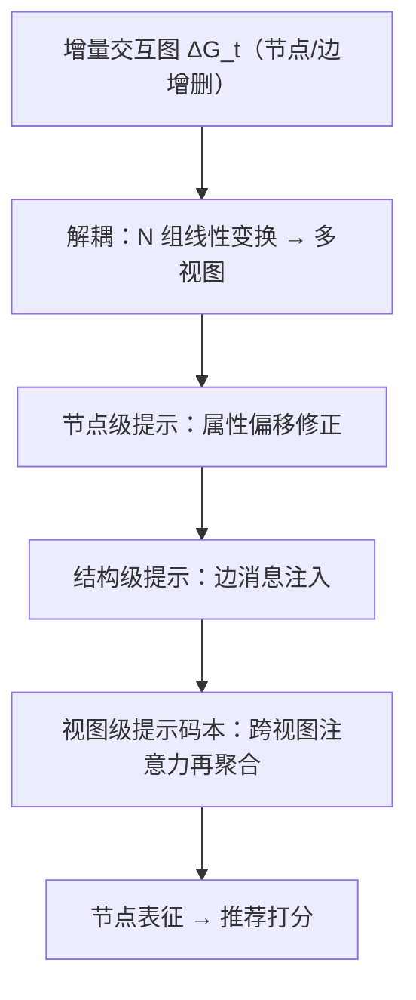

# GPT4Rec: Graph Prompt Tuning for Streaming Recommendation (面向流式推荐的图提示微调)

- **会议/期刊**: SIGIR 2024
- **作者与机构**: Peiyan Zhang, Yuchen Yan, Xi Zhang, Liying Kang, Chaozhuo Li(通讯), Feiran Huang, Senzhang Wang, Sunghun Kim — HKUST / 北京大学 / 微软亚洲研究院 等
- **推荐链路定位**: 召回（图嵌入表征学习）
- **研究方向**: 图神经网络与知识图谱推荐 / 序列与会话推荐（时间分段流式场景）
- **论文原文**: [论文原文链接](https://arxiv.org/abs/2406.08229v2)
- **开源代码**: 暂未开源

## TL;DR (1分钟核心速览)

流式推荐中，新交互不断到达而旧知识易被覆盖（灾难性遗忘）；回放法受隐私限制、正则法在分布漂移大时失效、模型隔离/扩张法参数爆炸且更新慢。GPT4Rec 将演化用户-物品图解耦为多视图，仅训练节点级、结构级、视图级三类轻量图提示来"指令化"冻结主干 GNN 适配新分布。在 4 个真实时序数据集的分段 8:1:1 划分下以 Recall@20/NDCG@20 评测，相对最强基线 DEGC 提升 4.16%/4.93%（Taobao2014），且单 epoch 训练时间与朴素 Finetune 相当。

## Background & Motivation (背景与核心矛盾)

- **主流范式**: 持续图学习 (CGL) 将交互流切为等长时段 $D_1,\dots,D_T$，在$G_t = G_{t-1} + \Delta G_t$ 上顺序训练，靠经验回放、参数正则或模型隔离/扩张三大流派抗遗忘。
- **前人局限**: ①回放依赖历史样本缓存，在隐私受限场景不可行，且小缓存无法覆盖旧分布；②正则法（GraphSAIL、TWP 等）强约束参数，当新数据偏离旧模式时"过稳定"反而阻碍适应；③DEGC 等隔离扩张法需不断剪枝/扩图卷积，参数与训练开销随段数增长。
- **核心洞察 (Key Insight)**: 图数据的变化是**级联**的——单个节点/边的增删会波及其邻居乃至全图结构，因此"要适应什么"不是单一层级的问题，需按节点属性层、子图连接层、跨视图语义层分别建模；而 NLP 的 prompt tuning 以少量参数改变模型"解读方式"而非改写权重，天然规避分布漂移与遗忘的取舍。
- **本文切入点**: 把 prompt tuning 从欧氏空间搬到动态图：先解耦多视图，再以三级提示逐层对齐增量变化，最后用"码本"式视图提示完成再聚合。

## Method (核心方法设计)

### 1. 整体框架 (Overall Architecture)

输入为时刻 $t$的增量图$\Delta G_t$与冻结的历史 GNN 主干。首先用$N$组线性变换把全图交互模式解耦成$N$个视图，每个视图承载一类关系语义（如 user-item / 结构近邻）；在每个视图内叠加**节点级提示**（修正节点属性偏移）与**结构级提示**（沿边注入消息，修正子图连接模式）；随后用**视图级提示码本**对$N$个解耦视图做注意力再聚合，得到最终节点表征$\hat{x}_i$ 并送入门控打分/排序损失。训练仅更新提示与少量线性层，主干参数冻结；推理时每段只需前向适配，无需重训。

### 2. 关键设计拆解 (Key Designs)

1. **节点级提示（Node-Level Prompt）——处理级联变化中的"个体属性漂移"**：节点属性变化是最细粒度的增量，若直接微调主干会污染旧语义。本文为每个视图维护 $L$个可学习提示$P=[p_1,\dots,p_L]$，以相关性加权叠加到解耦表征上：$\tilde{x}_i=\tilde{x}_i+\sum_{j=1}^{L}\alpha_{ij}p_j$，其中$\alpha_{ij}=\mathrm{softmax}_j(\tilde{x}_i p_j)$。直觉：提示相当于一组"语义模板"，注意力自动为不同节点挑选当下最相关的模板，使新旧模式共存而不互相覆盖。

2. **结构级提示（Structure-Level Prompt）——处理"子图连接模式"的变化**：新物品会重塑多个用户的邻域，仅节点级修正无法捕捉。本文为边设计提示集 $Q=[q_1,\dots,q_K]$，先对每条边$(i,j)$生成提示化消息$u_{ij}=\sum_{k}att_{ij,k}q_k$，$att_{ij,k}=\mathrm{softmax}_k\big(\mathrm{Linear}(\tilde{x}_i\|\tilde{x}_j)q_k\big)$，再按邻居权重聚合：$\tilde{x}_i=\tilde{x}_i+\sum_{j\in N(x_i)}\beta_{ij}u_{ij},\ \beta_{ij}=\mathrm{softmax}_j(\tilde{x}_i u_{ij})$。直觉：把"边"从固定的消息函数升级为可学习的、随上下文挑选的关系算子，等价于对$\Delta A_t$ 做低秩自适应。

3. **视图级提示与训练目标**：朴素注意力聚合 $\hat{x}_i=x_i+\sum_j\gamma_{i,j}\tilde{x}_{i,j}$的权重是静态的，新数据到来后视图相关性会漂移。本文引入码本$Z=[z_1,\dots,z_N]$修改注意力打分：$\epsilon(i,z,j)=\mathrm{softmax}_j\big(\mathrm{Linear}(x_i+z_i)\tilde{x}_{i,j}\big)$，$\hat{x}_i=x_i+\sum_j\epsilon(i,z,j)\tilde{x}_{i,j}$。总损失为各段推荐损失之和$\mathcal{L}=\sum_t \mathcal{L}_t(\hat{x}; \Delta G_t)$（BPR/交叉熵，负采样沿用主干设定，**免历史回放**）。可训练参数仅$|P|+|Q|+|Z|+$少量线性层（数十~数百维），复杂度$O(L+K+N)$ 级别，远低于隔离扩张法。

## Experimental Setup & Evaluation Protocol (实验设置与评估协议)

- **数据集与预处理**（4 个跨域时序数据集，AER 为相邻时段平均实体重叠率，越高表示流越稳定）：

| 数据集 | #Users | #Items | #Interactions | 时间跨度 / AER | 特征/场景说明 |
| :--- | :---: | :---: | :---: | :---: | :--- |
| Taobao2014 | 8K | 39K | 749K | 31 天 / 35.5% | 电商点击流，漂移最剧烈 |
| Taobao2015 | 192K | 10K | 9M | 123 天 / 26.0% | 电商，最稀疏、漂移最大 |
| Netflix | 301K | 9K | 49M | 74 月 / 58.4% | 影视评分，最稳定 |
| Foursquare | 52K | 37K | 2M | 22 月 / 60.0% | POI 签到 |

- **数据划分与防穿越 (Splitting Strategy)**: 按全局时间戳切分为 $T$个等长时段（流式分段），**每段内部再按 8:1:1 划为 train/valid/test**；模型在$D_t$上评测时只能使用$D_1..D_{t-1}$ 的知识，最终报告全时间线平均指标。
- **排名评测协议 (Ranking Protocol)**: 报告 Recall@20 与 NDCG@20；原文未明确区分全库排序或采样排序，也未披露负采样比例——这构成本文可复现性的薄弱点（见局限）。
- **对比基线与超参设置**: 四类基线——(a) Finetune；(b) 回放类 Uniform / Inverse Degree Sampling / ContinualGNN；(c) 正则/蒸馏类 TWP、GraphSAIL、SGCT、MGCT、LWC-KD；(d) 隔离扩张类 DEGC。主干 GNN 分别取 MGCCF、NGCF、LightGCN 以验证骨干无关性；提示规模 $L,K,N\in\{32,64,96,128\}$，视图数$\in\{2,4,8,16\}$，Adam 优化，5 个随机种子取均值，成对 t 检验$p<0.01$。

## Key Experimental Results (实验关键数据)

### 1. 主实验对比 (Main Results)

以 MGCCF 为主干（完整基线共 11 个，下表保留 7 个代表性项，R@20 / N@20）：

| 数据集 | 指标 | Finetune | ContinualGNN | GraphSAIL | SGCT | LWC-KD | DEGC | **GPT4Rec** | Improv. |
| :--- | :--- | :---: | :---: | :---: | :---: | :---: | :---: | :---: | :---: |
| Taobao2014 | R@20 | 0.0412 | 0.0311 | 0.0395 | 0.0423 | 0.0440 | 0.1082 | **0.1127** | +4.16% |
| Taobao2014 | N@20 | 0.0052 | 0.0035 | 0.0051 | 0.0054 | 0.0059 | 0.0142 | **0.0149** | +4.93% |
| Taobao2015 | R@20 | 0.4256 | 0.4203 | 0.4371 | 0.4411 | 0.4512 | 0.4892 | **0.5018** | +2.58% |
| Taobao2015 | N@20 | 0.0117 | 0.0111 | 0.0126 | 0.0129 | 0.0139 | 0.0167 | **0.0172** | +2.99% |
| Netflix | R@20 | 0.3359 | 0.3089 | 0.3470 | 0.3300 | 0.2616 | 0.2949 | **0.3508** | +1.10% |
| Netflix | N@20 | 0.0580 | 0.0491 | 0.0583 | 0.0572 | 0.0482 | 0.0520 | **0.0589** | +1.03% |
| Foursquare | R@20 | 0.1154 | 0.1056 | 0.1086 | 0.1255 | 0.1280 | 0.1425 | **0.1477** | +3.65% |
| Foursquare | N@20 | 0.0115 | 0.0098 | 0.0110 | 0.0137 | 0.0144 | 0.0178 | **0.0185** | +3.93% |

骨干鲁棒性（R@20 / N@20）：NGCF 主干下 Taobao2014 为 0.0972/0.0129、Netflix 0.3341/0.0573；LightGCN 主干下为 0.0979/0.0131、0.3348/0.0567，均优于全部基线。

### 2. 消融实验 (Ablation Study)

原文仅以图 3（Taobao2014，横轴 Day 0-30 曲线）呈现，下表为据曲线归纳的相对结论：

| 变体 | Recall@20 变化 | NDCG@20 变化 | 归因 |
| :--- | :--- | :--- | :--- |
| w/o view-level codebook | 全程下降最明显（早期即显著低于完整模型） | 同步下降 | 静态注意力权重无法跟踪视图相关性漂移，跨视图融合失效 |
| w/o node-level prompt | 逐日持续下降，后期差距拉大 | 同步下降 | 个体属性偏移无法修正，新用户/新物品表征滞后 |
| w/o structure-level prompt | 中后期明显下降 | 同步下降 | 邻域连接模式变化未被吸收，全局结构理解退化 |

### 3. 关键实验发现 (Key Findings)

1. **提升幅度与数据漂移强度强相关**：漂移最剧烈的 Taobao2014（AER 35.5%）上 R@20 由 DEGC 的 0.1082 提至 0.1127（+4.16%），而最稳定的 Netflix（AER 58.4%）上仅 +1.10%（0.3470→0.3508，且 DEGC 在此甚至退化到 0.2949）——说明提示法收益主要来自"适应新分布"，流稳定时边际收益收窄，同时验证了隔离扩张法在高稳定流上的不稳定。
2. **效率与效果同时占优**：提示参数量仅为 $L+K+N$ 量级，单 epoch 平均训练时间与 Finetune 基本持平，并显著低于 GraphSAIL、ContinualGNN、TWP、MGCT、DEGC（图 2），彻底避免了隔离扩张法的参数膨胀，工程上可支撑天级流式更新。
3. **骨干无关但基线格局受数据集支配**：Taobao2014 上所有回放/正则类基线停留在 0.03-0.044，而 DEGC 与 GPT4Rec 跃至约 0.10（NGCF/LightGCN 下同样成立），说明该数据集的漂移使"静态适应"整体失效；此时 GPT4Rec 相对 DEGC 的优势仅 0.10-0.70 个百分点，提示其相对增益在极端漂移下被强基线压缩。

## Highlights & Limitations (亮点、对比与审稿批判)

- **与代表作对比 (vs. Prior Work)**: 相比 ContinualGNN/回放类，无需缓存任何历史交互，规避隐私红线；相比 GraphSAIL/TWP 等正则类，不冻结也不强约束主干权重，靠提示"改变解读方式"避免过稳定；相比 DEGC 的图卷积剪枝-扩张，参数量与训练时间几乎不随段数增长。
- **可迁移亮点**: ①"解耦视图 + 三级提示"的分层自适应范式可直接迁移到跨域/多场景推荐中的场景增量适配；②结构级提示把边消息函数参数化，是时序动态图增量学习的一个通用低秩算子技巧。
- **审稿级局限批判**: ①评测协议披露不足——未说明是 Full-Ranking 还是采样排序及负样本比例，Recall@20 绝对量级差异（0.04 vs 0.11）很大程度上可能源于排序协议与分段构造，跨论文可比性存疑；②理论部分仅证明"至少不弱于全局微调"的表达能力，**未给出遗忘界或收敛速率**，且实验限于小规模 4 数据集、缺乏线上 A/B 与长时段（>2 年）验证；③超参敏感：提示数与视图数均存在明显拐点（节点级宜小、跨视图级宜大），视图数超过阈值后性能回落并带来额外开销，实际部署需逐业务调参。

## Rating (四维评分)

- **方法创新性 (Novelty)**: ⭐⭐⭐⭐ （首次把图提示微调用于流式推荐，"节点-结构-视图"三级解耦提示与码本聚合针对图级联变化设计，思路清晰；但理论仅止于表达能力等价，未触及遗忘机理）
- **评估协议与实验扎实度 (Protocol & Experiments)**: ⭐⭐⭐ （4 数据集 × 3 主干 × 5 种子 + t 检验较完备，但排序协议与负采样细节缺失，消融只用曲线呈现无具体数值）
- **写作与数学规范度 (Clarity & Rigor)**: ⭐⭐⭐ （三级提示公式定义完整、符号一致，但聚合公式与注意力记号略显重复冗余，定理证明较为粗线条）
- **工业落地与复现价值 (Industrial & Practical Value)**: ⭐⭐⭐⭐ （参数开销近零、训练时间与 Finetune 持平、无需历史回放，天然契合隐私合规的日更流式推荐；可惜未开源）

