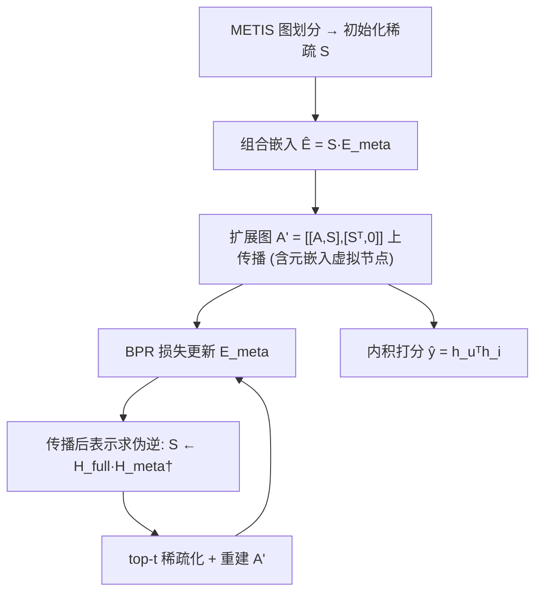
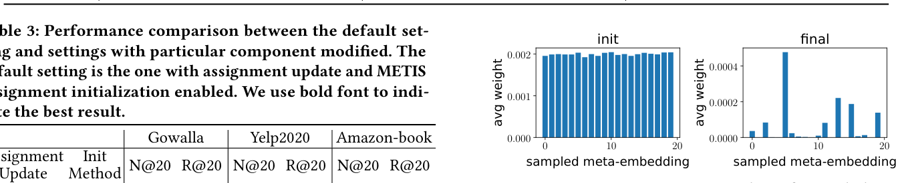

# Lightweight Embeddings for Graph Collaborative Filtering (面向图协同过滤的轻量化嵌入框架)

- **会议/期刊**: SIGIR 2024
- **作者与机构**: Xurong Liang, Tong Chen, Hongzhi Yin 等（昆士兰大学、山东大学、合肥工业大学）
- **推荐链路定位**: 召回（嵌入层参数压缩，适配任意 GNN 基座）
- **研究方向**: 图神经网络与知识图谱推荐 / 协同过滤与双塔召回
- **论文原文**: [https://arxiv.org/abs/2403.18479v2](https://arxiv.org/abs/2403.18479v2)
- **开源代码**: [https://github.com/xurong-liang/LEGCF](https://github.com/xurong-liang/LEGCF)

## TL;DR (1分钟核心速览)

GNN 推荐器的嵌入表参数规模达千万至千亿级，而现有"元嵌入 + 固定哈希映射"(如 QR、PEP)把用户/物品 ID 哈希到几个桶再池化，既忽略交互图中的语义相关性，又对所有元嵌入一视同仁地等权组合。LEGCF 把哈希映射替换为**可学习的稀疏分配矩阵** $\mathbf{S}$，并把元嵌入作为虚拟节点接入扩展交互图共同传播；$\mathbf{S}$通过语义相似约束$\mathbf{H}_{full}\approx\mathbf{S}\mathbf{H}_{meta}$的**伪逆闭式解**交替更新。在三个基准上以 0.21M–0.35M 参数（比$d{=}128$ 全表小约 44×）取得 NDCG@20 相对最强轻量基线 +32.6%/+24.4%/+191% 的提升，仅比全量嵌入低约 6.5%。

## Background & Motivation (背景与核心矛盾)

- **主流范式**: 用参数共享压缩嵌入层——由 $c\ll N$个元嵌入（meta-embedding）构成码本，靠多重哈希为每个实体抽取$t$ 个向量并加和/池化组合成实体嵌入，代表作 QR trick、PEP、CIESS、NimbleTT。
- **前人局限 1（映射僵化）**: 哈希函数只依赖相互独立的用户/物品 ID，同一用户与其厌恶物品可能共享大量元嵌入而被打出虚高相似度；反之高相关实体的分配可能完全错开，图上的协同语义被彻底丢弃。
- **前人局限 2（等权同质）**: 组合时对所有被选中元嵌入赋同一权重，无法区分贡献度，实体嵌入趋于同质化，在需要消息传递的 GNN 推荐器上进一步放大。
- **核心洞察**: 分配矩阵本质上是"实体—元嵌入"的相似度矩阵；若它在输入层成立，经 $L$ 层图传播后该关系应被保持——这给出了一个可闭式求解的约束，从而把 NP-hard 的离散子集选择转化为连续矩阵分解问题。
- **本文切入点**: 学习 $\mathbf{S}$而非预设$\mathbf{S}$，且与元嵌入**解耦交替优化**以避免乘积$\mathbf{S}\mathbf{E}_{meta}$ 引起的梯度共适应震荡。

## Method (核心方法设计)

### 1. 整体框架 (Overall Architecture)

先用 METIS 图划分把交互图切成 $c$个社区，为每个实体指定锚元嵌入初始化稀疏$\mathbf{S}$；将$\mathbf{S}$作为实体与元嵌入间的加权二部连接拼入邻接矩阵得扩展图$\mathbf{A}'$，实体组合嵌入与元嵌入一并作为 0 层输入做 LightGCN 式对称归一化传播。第一阶段冻结$\mathbf{S}$仅用 BPR 预热码本；第二阶段每隔$m$轮用传播后的表示做伪逆闭式更新$\mathbf{S}$并即时 top-$t$稀疏化、重建$\mathbf{A}'$，与码本交替训练直至收敛。打分即传播后用户/物品向量的内积。

### 2. 关键设计拆解 (Key Designs)

1. **可学习分配矩阵替代固定哈希（选择 + 加权一体化）**：痛点是哈希映射与语义无关且等权。改为 $\hat{\mathbf{E}}=\mathbf{S}\mathbf{E}_{meta}$，$\mathbf{S}\in\mathbb{R}_{\geq 0}^{N\times c}$每行的非零元同时编码"选了哪几个元嵌入"与"各占多少权重"，把组合优化变成可训练参数，且天然支持按批切片$\hat{\mathbf{E}}_b=\mathbf{S}_b\mathbf{E}_{meta}$ 训练。

2. **扩展图上的元嵌入传播（让码本吃到协同信号）**：痛点是元嵌入本身从未被图卷积作用，只是被查表。构造
$$\mathbf{A}'=\begin{bmatrix}\mathbf{A} & \mathbf{S}\\ \mathbf{S}^{\top} & \mathbf{0}\end{bmatrix},\quad \mathbf{H}^{(l+1)}=(\mathbf{D}^{-\frac{1}{2}}\mathbf{A}'\mathbf{D}^{-\frac{1}{2}})\mathbf{H}^{(l)}$$
以 $\mathbf{H}^{(0)}=[\hat{\mathbf{E}};\mathbf{E}_{meta}]$ 同步传播，元嵌入因此汇聚其所服务实体的邻域信息，语义相近的实体倾向"抢到"同一个锚元嵌入。

3. **伪逆闭式分配更新与稀疏化（无梯度、抗共适应）**：约束 $\mathbf{H}_{full}\approx\mathbf{S}\mathbf{H}_{meta}$，用 Moore–Penrose 伪逆（经 SVD 计算）得
$$\mathbf{S}=\mathbf{H}_{full}\mathbf{H}_{meta}^{\dagger}=\mathbf{H}_{full}\mathbf{V}\boldsymbol{\Sigma}^{-1}\mathbf{U}^{*}$$
因 $\mathbf{H}_{full}$中相近的两行乘同一伪逆后仍相近，语义关联被自动保留；更新后按$\mathbf{S}[p,q]\leftarrow 0$若$q\notin\mathrm{top}\text{-}t(\mathbf{S}[p,:])$就地稀疏化。空间复杂度$O(tN+cd)\ll O(Nd)$。

4. **训练目标与开销**：主损失为标准 BPR $\mathcal{L}=-\sum\ln\sigma(\hat{y}_{ui^+}-\hat{y}_{ui^-})+\lambda\|\Theta\|^2$，每正样本采 5 个均匀负样本，无额外对比/正则项；分配更新为 SVD 级开销且每$m$ 轮才做一次，推理时按行查表组合，与 LightGCN 同等量级。

<figure class="paper-figure" markdown="span">
  <figcaption>图3：采样元嵌入的平均分配权重。图中的权重数值较小，因为我们对数据集中所有用户/物品的权重取平均。</figcaption>
</figure>

## Experimental Setup & Evaluation Protocol (实验设置与评估协议)

- **数据集与预处理**: 直接采用 LightGCN 官方版本，未额外做 k-core 过滤。

| 数据集 | #Users | #Items | #Interactions | 稀疏度/密度 | 特征/场景说明 |
| :--- | :---: | :---: | :---: | :---: | :--- |
| Gowalla | 29,858 | 40,981 | 1,027,370 | 0.084% | LBS 签到社交图 |
| Yelp2020 | 71,135 | 45,063 | 1,782,999 | 0.056% | 本地生活商户点评 |
| Amazon-book | 52,643 | 91,599 | 2,984,108 | 0.062% | 电商图书评论 |

- **数据划分与防穿越**: 沿用 LightGCN 的 train/valid/test 比例划分协议（非 Leave-One-Out，用户级随机切分）。
- **排名评测协议**: NDCG@{10,20} 与 Recall@{10,20}；**采样排序（Sampled Ranking）**——训练每正例配 5 个随机负例，测试阶段采用同源负采样协议，未做 Full-Ranking 全库排序。
- **对比基线与超参**: 基座统一为 LightGCN；可变尺寸基线 PEP、QR；固定尺寸基线 ESAPN、AutoEmb、OptEmbed、CIESS、DHE、NimbleTT；另设 $d=64/128$的统一维度全表 (UD) 上界。$d=128$，$c=500$，$t=2$，GNN 3–4 层，Adam，$\lambda\in\{0,5e^{-4},1e^{-3},5e^{-3},1e^{-2}\}$，3 个随机种子取均值。

## Key Experimental Results (实验关键数据)

### 1. 主实验对比 (Main Results)

| 方法 | Gowalla #Param | N@20 | R@20 | Yelp2020 #Param | N@20 | R@20 | Amazon #Param | N@20 | R@20 |
| :--- | :---: | :---: | :---: | :---: | :---: | :---: | :---: | :---: | :---: |
| UD - dim 128 | 9.07m | 0.1059 | 0.1576 | 14.87m | 0.0382 | 0.0721 | 18.46m | 0.0230 | 0.0367 |
| UD - dim 64 | 4.53m | 0.1041 | 0.1557 | 7.44m | 0.0366 | 0.0687 | 9.23m | 0.0222 | 0.0353 |
| CIESS | 0.29m | 0.0745 | 0.1080 | 0.47m | 0.0234 | 0.0437 | 0.57m | 0.0029 | 0.0054 |
| PEP | 0.21m | 0.0698 | 0.0807 | 0.30m | 0.0218 | 0.0326 | 0.29m | 0.0037 | 0.0043 |
| QR | 0.21m | 0.0412 | 0.0606 | 0.30m | 0.0088 | 0.0157 | 0.29m | 0.0053 | 0.0082 |
| NimbleTT | 0.20m | 0.0300 | 0.0431 | 0.28m | 0.0071 | 0.0122 | 0.31m | 0.0037 | 0.0055 |
| OptEmbed | 1.42m | 0.0405 | 0.0498 | 5.96m | 0.0109 | 0.0159 | 2.11m | 0.0050 | 0.0062 |
| **LEGCF** | **0.21m** | **0.0988** | **0.1444** | **0.30m** | **0.0291** | **0.0548** | **0.35m** | **0.0172** | **0.0259** |
| Improv.% (vs 最强轻量) | — | +32.6% | +33.7% | — | +24.4% | +25.4% | — | +190% | +216% |

### 2. 消融实验 (Ablation Study)

| 分配更新 | 初始化方式 | Gowalla N@20 | Gowalla R@20 | Yelp2020 N@20 | Amazon N@20 |
| :---: | :---: | :---: | :---: | :---: | :---: |
| on | METIS | **0.0988** | **0.1444** | **0.0291** | **0.0172** |
| off | METIS | 0.0901 | 0.1254 | 0.0272 | 0.0147 |
| on | random | 0.0788 | 0.1113 | 0.0183 | 0.0109 |

### 3. 关键实验发现 (Key Findings)

- **分配矩阵的"语义初始化"比更新更关键**: 去掉 METIS 改随机锚嵌入，Gowalla N@20 从 0.0988 崩到 0.0788（−20.2%），跌幅甚至大于完全冻结分配更新的 0.0901（−8.8%）；说明预热阶段若 $S$ 无语义基座，码本会收敛到错误的组合空间，后续伪逆更新也难以救回。
- **精度—容量曲线在极小桶下反而最优**: $c$从 500 降到 100 时 Gowalla/Yelp2020 仍取得最佳成绩，$c>1000$后（Amazon-book 尤甚）性能快速下滑，印证"轻量场景下元嵌入共享带来的隐式正则"优于单纯扩容，但也意味着$c$ 必须按数据规模逐数据集调。
- **组合数 $t$存在硬门槛**:$t{=}1$等价于单哈希映射，Gowalla N@20 仅 0.0917、Amazon 仅 0.0112；$t$由 1 增至 2 立刻跃升到 0.0988/0.0172，之后 3–5 边际收益趋缓，作者据此将默认值定为$t{=}2$ 以兼顾分配矩阵存储。

## Highlights & Limitations (亮点、对比与审稿批判)

- **与代表作对比**: QR/PEP 把分配写死为哈希函数、只在码本上做梯度，本文让分配本身可学并吃图信号；CIESS/NimbleTT 虽同为轻量，但仅在嵌入层做 AutoML/张量分解，与 GNN 传播完全解耦，因而在 Amazon-book 这类稀疏大数据上直接失效（N@20 0.002–0.005），LEGCF 则保持 0.0172。
- **可迁移亮点**: ① 用"传播后表示应保持输入层相似关系"构造约束、再用伪逆求闭式解，可迁移到任何需要学稀疏映射的场景（如特征分桶、码本量化、语义 ID 分配）；② 交替优化 + 就地 top-$t$ 稀疏化，避免了对离散选择用 RL/STE 的工程复杂度。
- **审稿级局限批判**: ① 评测全部走 5 负例采样排序，未给 Full-Ranking 结果，轻量嵌入在真实全库检索下的相对优势可能被高估；② 相对 $d{=}128$全表仍有约 6.5% 的 NDCG 损失，且伪逆更新需周期性对$c\times d$的$\mathbf{H}_{meta}$做 SVD，桶数较大时训练开销与收益的折中缺乏定量分析；③$c$、$t$、$w^*$、$m$四个超参在各数据集上最优值不一致（$c$ 在 100 与 500 间摇摆），落地调参成本不低。

## Rating (四维评分)

- **方法创新性 (Novelty)**: ⭐⭐⭐⭐ （把参数共享的"固定哈希"翻转为可学稀疏分配，并用伪逆闭式解绕开组合优化的思路清晰且有理论直觉）
- **评估协议与实验扎实度 (Protocol & Experiments)**: ⭐⭐⭐☆ （三个基准 + 消融 + 超参 + GNN 基座泛化齐备，但仅用采样排序、缺 Full-Ranking 与大桶开销分析）
- **写作与数学规范度 (Clarity & Rigor)**: ⭐⭐⭐⭐ （扩展图与伪逆推导完整、算法伪代码清晰，伪逆约束的严格性更多是启发式近似）
- **工业落地与复现价值 (Industrial & Practical Value)**: ⭐⭐⭐⭐ （代码开源，实测 44× 参数压缩、精度仅掉 6.5%，对端侧/大规模 ID 特征存储有直接价值）

