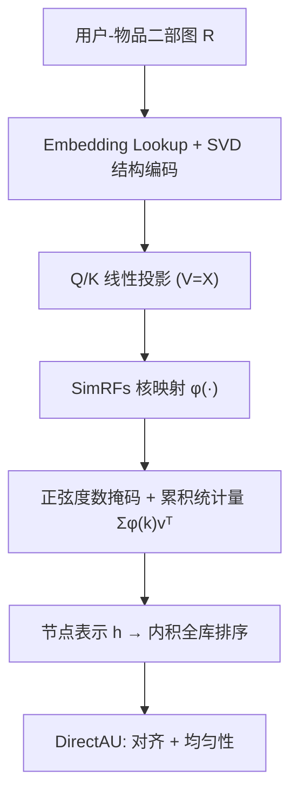
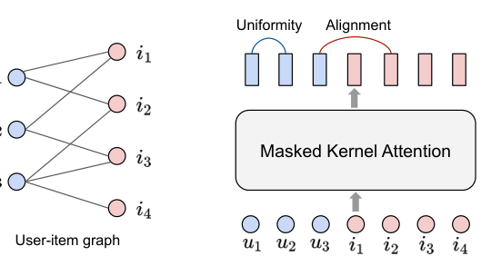
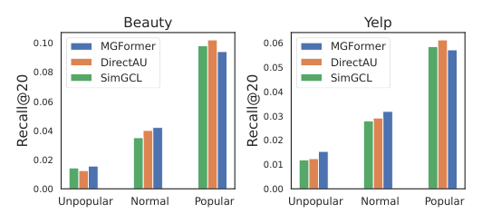

# Masked Graph Transformer for Large-Scale Recommendation (面向大规模推荐的掩码图 Transformer)

- **会议/期刊**: SIGIR 2024
- **作者与机构**: Huiyuan Chen, Zhe Xu, Chin-Chia Michael Yeh, Vivian Lai, Yan Zheng, Minghua Xu, Hanghang Tong（Visa Research / UIUC）
- **推荐链路定位**: 召回（用户-物品全库排序）
- **研究方向**: 图神经网络与知识图谱推荐 / 协同过滤与双塔召回
- **论文原文**: [https://arxiv.org/abs/2405.04028v1](https://arxiv.org/abs/2405.04028v1)
- **开源代码**: 暂未开源

## TL;DR (1分钟核心速览)

GNN 受限于局部消息传递，难以建模低度节点与长程依赖；而 Graph Transformer 的全节点自注意力是 $O(n^2)$复杂度，无法扩展到百万级用户/物品。MGFormer 把所有节点当作独立 token，用 SVD 结构编码注入全局拓扑，用 Simplex Random Features 将 softmax 注意力线性化为$\phi(\mathbf{q})^\top\sum_j\phi(\mathbf{k}_j)\mathbf{v}_j^\top$，再用可分解的正弦相对度数掩码实现"重加权但仍是线性"。在 Beauty/Yelp/Alibaba 三数据集、Full-Ranking、Recall@20/NDCG@20 协议下，相对最强基线 DirectAU 分别提升 4.50%/5.35%、7.14%/8.62%、5.25%/5.47%，且仅需单层单头。

## Background & Motivation (背景与核心矛盾)

- **主流范式**: LightGCN/UltraGCN/SimGCL 等基于图卷积的协同过滤，靠邻域传播加对比学习或 alignment-uniformity 损失学表征。
- **前人局限**: ① 卷积本质是局部算子，感受野受层数约束，堆深又遭遇过平滑与高复杂度；② 低度（冷门）物品被高阶传播淹没，GNN 天然偏向高度节点。
- **前人局限（GT 侧）**: Graphormer/GFormer 等能建模全对交互，但注意力矩阵为 $n\times n$（$n=M+N$），显存与时间双二次，在百万节点推荐图上不可行；NLP 的稀疏/哈希/低秩近似也未验证能否适配推荐图。
- **核心洞察 (Key Insight)**: 推荐图不需要逐对显式算相似度——把 softmax 核换成可分解正定核后，$\sum_j\phi(\mathbf{k}_j)\mathbf{v}_j^\top$ 只需算一次供所有 query 复用，即可在保持"全对交互"表达力的同时拿到线性复杂度；而拓扑信息可以塞进位置编码与被因式分解的掩码里，不必写进注意力矩阵。
- **本文切入点**: 构建一个"纯 Transformer、无 GNN 组件"的线性复杂度协同过滤模型。

## Method (核心方法设计)

### 1. 整体框架 (Overall Architecture)

用户/物品经查表得到 $\mathbf{E}\in\mathbb{R}^{(M+N)\times d}$，与交互矩阵 SVD 得到的结构编码$\mathbf{P}$拼接为$\mathbf{X}=[\mathbf{E},\mathbf{P}]\in\mathbb{R}^{n\times 2d}$；$\mathbf{X}$线性投影出$\mathbf{Q},\mathbf{K}$（$\mathbf{V}=\mathbf{X}$ 省去值投影），送入掩码核注意力层，用 SimRFs 特征映射与正弦度数掩码一次性累积两个统计量后与 query 相乘得到节点表示，最后以 DirectAU 的对齐-均匀性损失端到端训练，推理时取用户/物品表示内积做全库排序。

<figure class="paper-figure" markdown="span">
  <figcaption>图1：所提出的 MGFormer 概述。</figcaption>
</figure>

### 2. 关键设计拆解 (Key Designs)

1. **SVD 结构编码（把全局拓扑变成坐标系）**: 纯注意力对节点在图中的位置一无所知。作者直接对交互矩阵分解 $\mathrm{SVD}(\mathbf{R})\Rightarrow(\hat{\mathbf{U}}\sqrt{\Sigma}),(\hat{\mathbf{V}}\sqrt{\Sigma})$，分别作为用户与物品的结构编码并拼到输入上，等价于给每个 token 一个保留全局图结构的坐标基，代价仅一次离线 SVD。

2. **SimRFs 核化线性注意力（把 $O(n^2)$变$O(n)$）**: 用正定核$\kappa(\mathbf{a},\mathbf{b})=\phi(\mathbf{a})^\top\phi(\mathbf{b})$ 替代 softmax，得
$$\mathbf{h}_i=\frac{\phi(\mathbf{q}_i)^\top\sum_{j=1}^{n}\phi(\mathbf{k}_j)\mathbf{v}_j^\top}{\phi(\mathbf{q}_i)^\top\sum_{j=1}^{n}\phi(\mathbf{k}_j)}$$
分母与分子中的累加项与 $i$无关，只需算一遍即可复用；$\phi$选用 Simplex Random Features（$\chi_m$ 对角阵 × Haar 正交阵 × 单纯形投影，再加高斯指数缩放），因其对 softmax 核的无偏估计均方误差最小。

3. **正弦相对度数掩码（重加权而不破坏线性）**: 若掩码 $\mathbf{M}$稠密，$\mathbf{P}_1=\mathbf{M}\cdot\mathrm{vec}(\phi(\mathbf{k})\mathbf{v}^\top)$又会退化为二次。作者令$M_{ij}=\sin\!\left(\frac{\pi}{2}\times\frac{z_{\deg(i)}+z_{\deg(j)}}{2}\right)$，其中$z_{\deg(\cdot)}$ 是度数嵌入经 sigmoid 的可学习中心性，利用和角公式拆成两组 sin/cos 特征：
$$\mathbf{h}_i=\frac{\phi_{\sin}(\mathbf{q}_i)^\top\sum_j\phi_{\cos}(\mathbf{k}_j)\mathbf{v}_j^\top+\phi_{\cos}(\mathbf{q}_i)^\top\sum_j\phi_{\sin}(\mathbf{k}_j)\mathbf{v}_j^\top}{\phi_{\sin}(\mathbf{q}_i)^\top\sum_j\phi_{\cos}(\mathbf{k}_j)+\phi_{\cos}(\mathbf{q}_i)^\top\sum_j\phi_{\sin}(\mathbf{k}_j)}$$
即在 $(0,\pi/2)$ 单调递增的正弦下，高度节点获得更大注意力权重，而计算仍为两次线性累积。

4. **训练目标、负采样与推理效率**: 采用 DirectAU 损失，**完全免负采样**：
$$\mathcal{L}=\mathbb{E}_{(u,i)\sim p_{pos}}\|\mathbf{h}_u-\mathbf{h}_i\|_2+\lambda\left(\log\mathbb{E}_{(u,u')\sim p_{user}}e^{-\|\mathbf{h}_u-\mathbf{h}_{u'}\|^2}+\log\mathbb{E}_{(i,i')\sim p_{item}}e^{-\|\mathbf{h}_i-\mathbf{h}_{i'}\|^2}\right)$$
$\lambda\in[0.1,5.0]$ 调节均匀性强度；推理只需前向一次、单层单头，无需邻域采样。

## Experimental Setup & Evaluation Protocol (实验设置与评估协议)

- **数据集与预处理**:

| 数据集 | #Users | #Items | #Interactions | 密度 | 特征/场景说明 |
| :--- | :---: | :---: | :---: | :---: | :--- |
| Amazon-Beauty | 22.4k | 12.1k | 198.5k | 0.07% | 稀疏电商评论 |
| Yelp-2018 | 31.7k | 38.0k | 1561.4k | 0.13% | 本地生活 POI 评论 |
| Alibaba | 106.0k | 53.6k | 907.5k | 0.016% | 极稀疏工业电商 |

- **数据划分与防穿越**: 沿用 DirectAU 的训练/验证/测试比例划分（非 Leave-One-Out、非全局时间戳切分），测试集未见交互即为候选。
- **排名评测协议**: 无偏 **Full-Ranking（全库未交互物品排序）**，指标 Recall@20 与 NDCG@20。
- **对比基线与超参**: BPRMF、LightGCN、SGL、GOTNet、SimGCL、GFormer、DirectAU 共 7 个基线；嵌入维度 $d\in\{32,64,128\}$ 网格搜索，基线均调至最优；MGFormer 固定单层单头。

## Key Experimental Results (实验关键数据)

### 1. 主实验对比 (Main Results)

| Method | Beauty R@20 | Beauty N@20 | Yelp R@20 | Yelp N@20 | Alibaba R@20 | Alibaba N@20 |
| :--- | :---: | :---: | :---: | :---: | :---: | :---: |
| BPRMF | 0.1153 | 0.0534 | 0.0693 | 0.0428 | 0.0439 | 0.0190 |
| LightGCN | 0.1201 | 0.0581 | 0.0833 | 0.0514 | 0.0585 | 0.0275 |
| SGL | 0.1228 | 0.0644 | 0.0896 | 0.0554 | 0.0602 | 0.0295 |
| GOTNet | 0.1309 | 0.0650 | 0.0924 | 0.0567 | 0.0643 | 0.0301 |
| SimGCL | 0.1367 | 0.0682 | 0.0937 | 0.0571 | 0.0667 | 0.0311 |
| GFormer | 0.1362 | 0.0671 | 0.0955 | 0.0597 | 0.0653 | 0.0305 |
| DirectAU | 0.1465 | 0.0710 | 0.0981 | 0.0615 | 0.0664 | 0.0308 |
| **MGFormer** | **0.1531** | **0.0748** | **0.1051** | **0.0668** | **0.0702** | **0.0328** |
| **Improv.** | +4.50% | +5.35% | +7.14% | +8.62% | +5.25% | +5.47% |

### 2. 消融实验 (Ablation Study)

| 版本 (Beauty) | Recall@20 | NDCG@20 |
| :--- | :---: | :---: |
| default MGFormer | **0.1531** | **0.0748** |
| w/o 结构编码 | 0.1413 | 0.0712 |
| w/o 度数中心性掩码 | 0.1501 | 0.0739 |
| 用图邻接矩阵作掩码 | 0.1318 | 0.0674 |
| $\phi=1+\mathrm{elu}(\cdot)$ | 0.1507 | 0.0740 |
| $\phi=$ focused 函数 | 0.1514 | 0.0742 |

### 3. 关键实验发现 (Key Findings)

1. **结构编码是最大功臣**: 去掉它 Recall@20 从 0.1531 掉到 0.1413（-7.7%），跌幅远超去掉度数掩码（-2.0%），说明纯注意力在没有拓扑位置先验时几乎退化为"忽略图结构的矩阵分解"；而邻接矩阵当硬掩码更糟（-13.9%），因为注意力被过度稀疏化，反而削弱了全对交互的长程优势。
2. **特征映射鲁棒但对核选择敏感**: 换 $1+\mathrm{elu}$ 或 focused 仅掉 1.1%–1.6%，说明线性化框架本身稳；真正决定上限的是"能否可分解地注入度数先验"——正弦掩码与 sin/cos 分解那一步是不可替代的。
3. **稀疏/冷门场景优势最大**: 按物品流行度分桶后（图 2），MGFormer 在 Unpopular 组显著超过 SimGCL 与 DirectAU，印证全对注意力确实补偿了 GNN 对低度节点的系统性偏差；代价是每 epoch 8.7s vs DirectAU 3.6s（约 2.4×），复杂度仍为线性。

<figure class="paper-figure" markdown="span">
  <figcaption>图2：不同物品组的性能。表3：MGFormer 在 Beauty 数据集上的消融研究。</figcaption>
</figure>

## Highlights & Limitations (亮点、对比与审稿批判)

- **与代表作对比 (vs. Prior Work)**: 与 LightGCN/SimGCL 相比，MGFormer 彻底抛弃邻域传播，用全对注意力替代多跳传播，规避过平滑；与 DirectAU 相比，二者共享同一损失，差别在于编码器从 LightGCN 换成线性核注意力，因此提升可干净归因于编码器；与 Graphormer/GFormer 相比，它不需构造 $n\times n$ 注意力与最短路矩阵，复杂度从二次降到线性。
- **可迁移亮点**: ① "正弦相对度数掩码 + 和角分解"是一套通用模板，任何想把节点先验（度数、时间差、位置）注入线性注意力又不破坏 $O(n)$ 的场景都可直接套用；② 单层单头即打平深层 GNN，提示在推荐图上"广连接"比"深堆叠"更划算。
- **审稿级局限批判**: ① 单层单头虽高效，但论文未给出多头/多层在更大图上的扩展实验，"表达能力是否足够"缺少边界分析；② 相比于 LightGCN 的线上传导，8.7s/epoch 的额外开销来自随机特征与 Q/K 投影，论文未报告内存峰值与百万级节点实测；③ 仅三个中等规模数据集（最大 10.6 万用户），且未做显著性检验，与"large-scale"的标题主张存在张力。

## Rating (四维评分)

- **方法创新性 (Novelty)**: ⭐⭐⭐⭐ （全对线性核注意力 + 可分解正弦度数掩码的组合在推荐侧是新配方，但线性注意力与随机特征本身在 NLP 已有原型）
- **评估协议与实验扎实度 (Protocol & Experiments)**: ⭐⭐⭐⭐ （Full-Ranking 协议规范、7 个强基线齐全、消融覆盖 5 个变体，惜无显著性检验与更大规模图验证）
- **写作与数学规范度 (Clarity & Rigor)**: ⭐⭐⭐⭐⭐ （从 Eq.6 到 Eq.12 的因式分解推导链条完整清晰，复杂度论证明确，符号一致）
- **工业落地与复现价值 (Industrial & Practical Value)**: ⭐⭐⭐⭐ （免负采样 + 单层结构利于部署，SVD 可离线；但随机特征与 2.4× 训练开销需在工业规模上再验证，且暂未开源）

