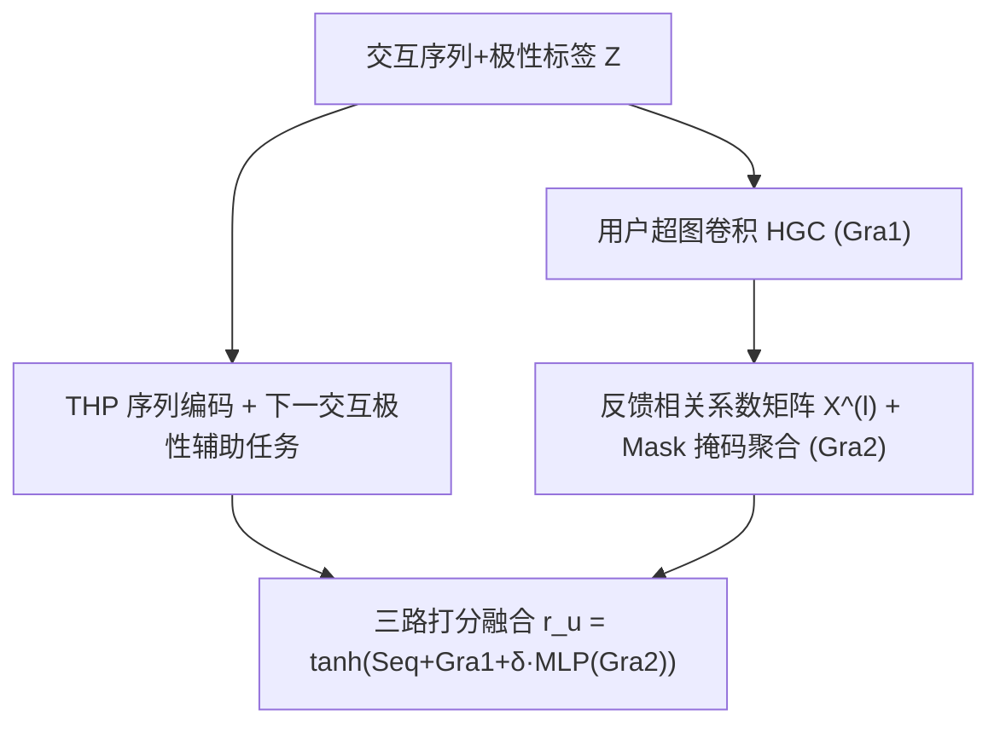
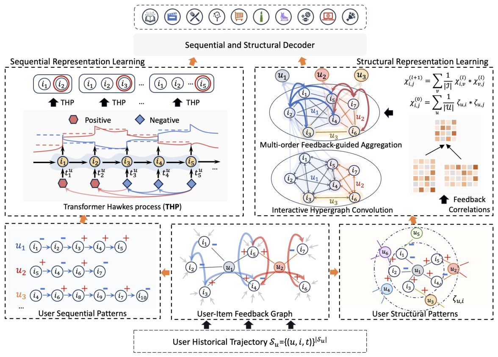

# NFARec: A Negative Feedback-Aware Recommender Model (负反馈感知的推荐模型)

- **会议/期刊**: SIGIR 2024
- **作者与机构**: Xinfeng Wang, Fumiyo Fukumoto, Jin Cui, Yoshimi Suzuki (University of Yamanashi), Dongjin Yu (Hangzhou Dianzi University)
- **推荐链路定位**: 召回（用户/物品表征学习）
- **研究方向**: 图神经网络与知识图谱推荐 / 序列推荐
- **论文原文**: [https://arxiv.org/abs/2404.06900v3](https://arxiv.org/abs/2404.06900v3)
- **开源代码**: [https://github.com/WangXFng/NFARec](https://github.com/WangXFng/NFARec)

## TL;DR (1分钟核心速览)

主流 GCN/超图推荐把所有交互边视为等价正反馈，忽略了同一物品上不同用户反馈相反、以及用户会对"明显不合口味"的物品仍发生交互这两类关键信号。NFARec 用**反馈极性相关系数矩阵**引导两阶段超图卷积走"最优消息通路"，并用 **Transformer Hawkes Process (THP)** 辅助预测下一交互的情感极性，从而在序列与结构两种模式中同时利用负反馈。在 Yelp-2023/MovieLens/Recipes/Books/Beauty 五数据集上，按 R@{5,10,20}、N@{5,10,20} 排序评测，相对最强基线 EEDN 分别提升最高 **+6.6% (R@20)** 与 **+15.3% (N@5)**，且 $p<0.01$ 显著。

## Background & Motivation (背景与核心矛盾)

- **主流范式**: LightGCN/SGL/XSimGCL 等在图或超图上做无权重邻域聚合，SHT/AutoCF/EEDN 进一步把序列注意力与图结构并联，以同时捕获高阶协同信号与序列兴趣。
- **前人局限 (一)**: 图侧所有边被等权处理，但同一物品上 $u_1$给正反馈、$u_2$给负反馈时，消息仍无差别地经$u_2\to i_4$ 传播，节点表征被污染（图 1）；现有负反馈工作把正负表征独立学习，切断了跨物品的行为关联。
- **前人局限 (二)**: 序列侧默认"交互即喜欢"，无法解释用户尝试后又给差评的行为；且多数工作直接剔除评分 <4 的样本（脱离真实分布）。
- **核心洞察 (Key Insight)**: 反馈极性本身就是一条可用的"相似度度量"——用户的相似性应由其在共同物品上的**极性一致性**定义，而非仅仅"是否共同交互"；序列侧则应显式建模"下一交互会不会是负反馈"。
- **本文切入点**: 把反馈极性同时作为超图卷积的**路径筛选信号**与序列编码的**辅助监督信号**。

## Method (核心方法设计)

### 1. 整体框架 (Overall Architecture)

输入为用户历史交互序列 $\mathcal{T}_t=\{(t_j,z_j)\}$（含时间戳与极性标签）与全局反馈矩阵$\mathbf{Z}$。序列分支用 THP 自注意力编码历史交互并输出$e^S_u$，同时以强度函数做"下一交互极性预测"辅助任务；结构分支先用标准超图卷积（以用户为超边）得到$e^{H1}_u$，再用反馈相关系数矩阵$\hat{\mathbf{X}}$进行掩码，聚合出反馈感知表征$e^{H2}_u$。三路表征分别与物品嵌入内积后融合打分，主任务用加权多标签交叉熵、辅助任务用 THP 对数似然联合训练；推理时对全库物品打分排序，无需采样。

<figure class="paper-figure" markdown="span">
  <figcaption>图2：我们的NFARec框架架构。NFARec在序列模式和结构模式中学习负反馈。</figcaption>
</figure>

### 2. 关键设计拆解 (Key Designs)

1. **反馈感知的相关系数矩阵与两阶段 HGC**：痛点是超图卷积对超边内节点均权，冲突反馈节点间仍互相传信。作者先以 $\chi^{(0)}_{i,j}=\frac{1}{|\mathcal{U}|}\sum_{u}\zeta_{i,u}\cdot\zeta_{u,j}$统计物品$i,j$在共同用户上的极性一致度（同正/同负为正、相反为负），再用$\chi^{(l+1)}_{i,j}=\frac{1}{|\mathcal{I}|}\sum_{v}\chi^{(l)}_{i,v}\chi^{(l)}_{v,j}$逐层蒸馏高阶关系得到$\hat{\mathbf{X}}=\sum_l \mathbf{X}^{(l)}$，并对$\hat{\mathbf{X}}$中负元素做掩码后聚合$e^{H2}_u=\mathrm{AvgPooling}(\mathbf{H}(u)\,\mathrm{Mask}(\hat{\mathbf{X}})\,\Lambda^{(L_2)})$。直觉：把"极性一致"当作可乘的转移概率，等价于在多层图上只保留符号一致的通路，抑制跨立场泄漏。

2. **基于 THP 的下一交互极性辅助任务**：痛点是序列模型无法区分"交互了但不喜欢"。以条件强度 $\lambda_z(t|\mathcal{T}_t)=\mathrm{softplus}\!\left(\alpha_z\frac{t-t_j}{t_j}+\mathrm{MLP}(\mathbf{h}(t_j))\right)$建模两类极性事件的激发强度，下一交互预测为$\hat{z}_{j+1}=\arg\max_z \lambda_z(t_{j+1}|\mathcal{T}_t)/\lambda(t_{j+1}|\mathcal{T}_t)$。直觉：Hawkes 的衰减核天然编码"时间越久影响越弱"，迫使隐状态$\mathbf{h}(t)$ 编码情感相关性，而非单纯物品共现。

3. **训练目标与复杂度**：主损失为加权多标签交叉熵 $\mathcal{L}_{main}=-\sum_{u}\sum_{i}c_{u,i}\gamma^{(u)}_i\log\sigma(\hat r_{u,i})$（$c_{u,i}$对已交互/将交互样本取不同权重$\beta_1,\beta_2$），辅助损失$\mathcal{L}_{auxi}$为交互与连续对数似然之和，其中积分项用蒙特卡洛积分$\hat{\Delta}_{MCI}=\sum_j (t_j-t_{j-1})\frac{1}{N}\sum_k\lambda(x_k)$无偏估计；总目标$\mathcal{L}_{final}=\mathcal{L}_{main}+\delta_2\mathcal{L}_{auxi}$。**免负采样**（全库 softmax 式打分），主导复杂度为$O(|\mathcal{I}|^2)$（来自$\hat{\mathbf{X}}$的逐层矩阵乘），$d_m=1024$、$L_1=L_2=1$。

## Experimental Setup & Evaluation Protocol (实验设置与评估协议)

- **数据集与预处理**: 保留评分字段，**评分 <4 记为负反馈**、其余为正；按数据集剔除以少于 $n\in\{15,10,25,5\}$ 条交互的用户/物品。

| 数据集 | #Users | #Items | #Interactions | 稀疏度/密度 | 特征/场景说明 |
| :--- | :---: | :---: | :---: | :---: | :--- |
| Yelp 2023 | 48,993 | 34,298 | 3,415,569 | 0.20% | 本地商户点评，正/负 72.4/27.6 |
| MovieLens | 6,041 | 3,955 | 1,000,209 | 4.19% | 电影评分，人均 165.6 条，最稠密 |
| Recipes | 7,452 | 12,911 | 311,389 | 0.32% | 食谱交互，最稀疏难分 |
| Books | 19,804 | 22,086 | 1,273,679 | 0.29% | 图书评分，人均 64.3 |
| Beauty | 22,363 | 12,101 | 198,502 | 0.07% | 美妆，人均仅 8.9，最稀疏 |

- **数据划分与防穿越 (Splitting Strategy)**: 按 **7:1:2 比例划分** train/valid/test（非 Leave-One-Out，非全局时间戳切分）；序列分支内部用上三角 Mask 防止 $e_{t-1}$ 窥视未来事件。
- **排名评测协议 (Ranking Protocol)**: 采用 Recall@K 与 NDCG@K，$K\in\{5,10,20\}$；原文未显式声明候选集构造与负采样比例，按指标规模与"全库打分"实现推断为 **Full-Ranking（全库未交互排序）**，需注意这一点在复现时存在协议模糊性。
- **对比基线与超参设置**: 5 大类共 12 个基线（CF: DirectAU/InvCF；GCN: LightGCN/SGL/HCCF；GCL: NCL/LightGCL/XSimGCL；Diff: DiffRec；S&G: SHT/AutoCF/EEDN）。$d_m=1024$，$\delta\approx1.2$，$\delta_2$依数据集在$10^{-5}\sim0.5$间取值；超参用 Optuna 搜索；采用 10 次试验 t-test，$p<0.01$ 标 `*`。

## Key Experimental Results (实验关键数据)

### 1. 主实验对比 (Main Results)

| 模型 | Yelp'23 R@20 | Yelp'23 N@20 | ML R@20 | ML N@20 | Beauty R@20 | Beauty N@20 |
| :--- | :---: | :---: | :---: | :---: | :---: | :---: |
| LightGCN | 0.0752 | 0.0715 | 0.1107 | 0.2047 | 0.0879 | 0.0570 |
| SGL | 0.0721 | 0.0740 | 0.1432 | 0.2541 | 0.0939 | 0.0607 |
| XSimGCL | 0.0857 | 0.0756 | 0.1426 | 0.2481 | 0.1007 | 0.0640 |
| DiffRec | 0.0809 | 0.0713 | 0.1204 | 0.2284 | 0.0876 | 0.0517 |
| SHT | 0.0796 | 0.0785 | 0.1509 | 0.2400 | 0.0901 | 0.0587 |
| AutoCF | 0.0939 | 0.0810 | 0.1470 | 0.2452 | 0.1034 | 0.0625 |
| EEDN (次优) | 0.1031 | 0.0858 | 0.1628 | 0.2631 | 0.1054 | 0.0648 |
| **NFARec** | **0.1074** | **0.0894** | **0.1736** | **0.3007** | **0.1103** | **0.0683** |
| **Improv.** | +4.2% | +4.1% | +6.6% | +14.2% | +4.6% | +5.4% |

其余数据集：Recipes R@5 0.0292 (+8.6%)、N@5 0.0418 (+9.4%)；Books R@5 0.0489 (+3.4%)、N@5 0.1139 (+5.3%)。

### 2. 消融实验 (Ablation Study)

NDCG@20，`w/o X` 为移除该分支；MovieLens 上 `w/o Seq`、`w/o Gra2` 是在同时去掉 Gra1 后测得：

| 变体 | Yelp'23 | MovieLens | Recipes | Books | Beauty |
| :--- | :---: | :---: | :---: | :---: | :---: |
| w/o Seq (去 THP 辅助任务) | 0.0862 | 0.2741 | 0.0460 | 0.1026 | 0.0654 |
| w/o Gra1 (去基础超图卷积) | 0.0866 | **0.3007** | 0.0462 | 0.1133 | 0.0648 |
| w/o Gra2 (去反馈感知聚合) | 0.0873 | 0.2865 | 0.0466 | 0.1094 | 0.0669 |
| **Full** | **0.0894** | 0.2851 | **0.0492** | **0.1141** | **0.0683** |

编码器替换（表 4，THP vs Transformer vs NHP）：Yelp'23 N@20 为 0.0894 / 0.0777 / 0.0793；MovieLens R@20 为 0.1736 / 0.1512 / 0.1478；去掉 Mask 后 MovieLens R@20 从 0.1736 跌至 0.1608。

### 3. 关键实验发现 (Key Findings)

1. **序列辅助任务贡献最大且最稳定**：移除 Seq 使五数据集 N@20 分别下降 3.7%/9.7%/7.0%/11.2%/4.4%，且 THP 显著优于同架构 Transformer（MovieLens R@20 +14.8%）与 NHP（受 RNN 长程依赖短板拖累），说明极性强度的时序衰减建模是主要增量来源。
2. **无反馈约束的图结构收益不稳定，甚至为负**：单独 Gra1 在 MovieLens 上 N@20 反而比移除后低 5.2%（0.2851 vs 0.3007），而在 Books 上几乎无增益（+0.7%），印证"等权传信在冲突反馈网络上产生噪声表征"；叠加 Gra2 后 MovieLens 由 0.3007 回落但仍高于 w/o Gra2，说明反馈感知通路主要在稠密、极性分化明显的数据上兑现收益。
3. **阶数不宜过高**：1 阶相关系数在 Recipes/Books 最优，2 阶在 Yelp/MovieLens/Beauty 最优，3–5 阶持续退化（MovieLens R@20 从 0.1736 降至 0.1709/0.1683），因为高阶幂乘稀释了低阶依赖；同时 $\delta$ 在全部数据集上最优值稳定于 1.2 附近，仅 Recipes 敏感度偏高。

## Highlights & Limitations (亮点、对比与审稿批判)

- **与代表作对比 (vs. Prior Work)**: 相比 SGL/XSimGCL 只做边/节点级对比增广而不区分极性，NFARec 把极性符号直接写进图卷积的转移核；相比 SHT/AutoCF 的"序列+图"拼接，本文的序列侧引入了事件强度而非注意力池化；相比 EEDN 挖隐式特征，本文显式建模负反馈语义，故在 NDCG 类指标（排序质量）上增益（+14.2%）远大于 Recall（+6.6%）。
- **可迁移亮点**: (1) 用"符号一致性矩阵 + 负元素 Mask"改造任意超图/GCN 聚合层，可作为即插即用的去噪算子；(2) 用 Hawkes 强度作辅助任务预测下一交互极性，可直接迁移到短视频跳过、退货、点击后秒退等隐式负反馈场景。
- **审稿级局限批判**: (1) 复杂度 $O(|\mathcal{I}|^2)$来自逐层构建$\hat{\mathbf{X}}$，在百万级物品库上不可直接部署，且论文只报告了复杂度量级而无实际训练/推理时延；(2) 评测协议交代不足——未声明 Full-Ranking 与采样比例、未做时间切分（比例划分可能造成未来信息泄漏），负反馈判定一律用评分 <4 也过于粗糙，缺少对隐式负反馈（跳过）的验证。

## Rating (四维评分)

- **方法创新性 (Novelty)**: ⭐⭐⭐⭐ （把反馈极性同时用作超图转移核与 Hawkes 辅助监督，两条线互补且互不重复，但单点技术均为已有模块的符号化改造）
- **评估协议与实验扎实度 (Protocol & Experiments)**: ⭐⭐⭐ （五数据集 + 12 基线 + t-test 与多组消融较完整，但划分方式、候选集构造与负样本协议交代不清，存在复现歧义）
- **写作与数学规范度 (Clarity & Rigor)**: ⭐⭐⭐⭐ （公式链条完整、符号统一，MCI 近似与掩码定义清晰，个别公式编号与超参符号 $\delta_1$ 前后略有出入）
- **工业落地与复现价值 (Industrial & Practical Value)**: ⭐⭐⭐⭐ （代码开源、模块可插拔，但 $O(|\mathcal{I}|^2)$ 的相关系数矩阵在大规模场景需稀疏化或邻域截断改造）

