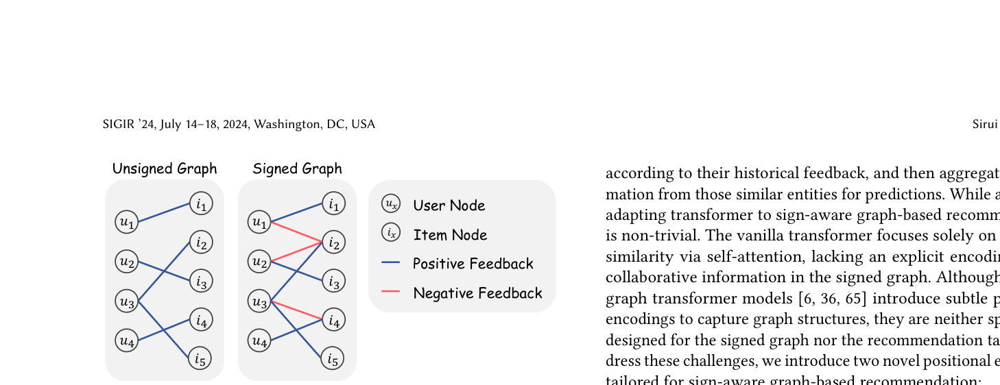
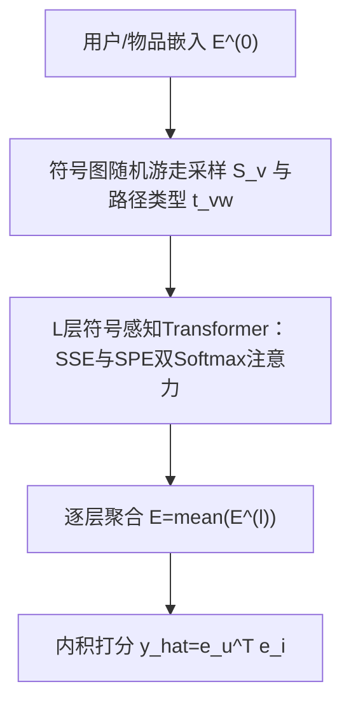
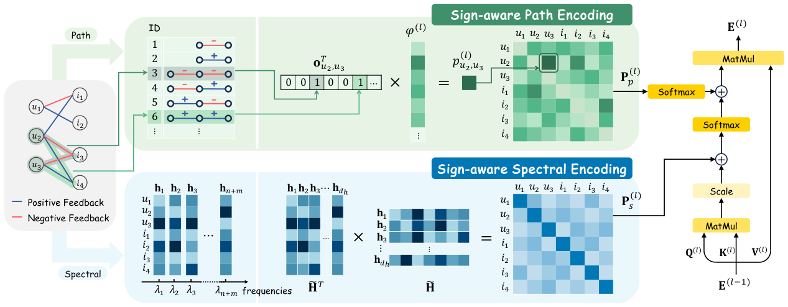

# SIGformer: Sign-aware Graph Transformer for Recommendation (符号感知图Transformer推荐)

- **会议/期刊**: SIGIR 2024
- **作者与机构**: Sirui Chen, Jiawei Chen, Sheng Zhou, Bohao Wang, Shen Han, Chanfei Su, Yuqing Yuan, Can Wang；浙江大学、华中农业大学、OPPO
- **推荐链路定位**: 召回/表示学习
- **研究方向**: 图神经网络与知识图谱推荐 / 协同过滤与双塔召回
- **论文原文**: [https://arxiv.org/abs/2404.11982v3](https://arxiv.org/abs/2404.11982v3)
- **开源代码**: [https://github.com/StupidThree/SIGformer](https://github.com/StupidThree/SIGformer)

## TL;DR (1分钟核心速览)

针对图推荐忽视负反馈、符号图方法分开处理正负子图且GNN同质性假设在负边失效的问题，SIGformer以Transformer为骨干直接编码整张符号图，并用符号谱编码SSE与符号路径编码SPE注入结构。五数据集5-core、7:1:2划分、Recall/NDCG@20下，KuaiRand Recall@20较最优基线提升15.61%。

## Background & Motivation (背景与核心矛盾)

- **主流范式**: 图推荐多把用户-物品正反馈构造成二部图，用LightGCN类GNN做高阶协同过滤；负反馈常被丢弃。
- **前人局限**: SiReN/SiGRec/PANE-GNN把正图、负图分开建模再拼接，未整体利用符号图；且负图不满足GNN同质性，MLP又难在稀疏推荐数据中训练。
- **核心洞察 (Key Insight)**: 符号图中的负边高阶路径也携带协同信号，例如“共同不喜欢”可反映相似性，正负交替路径还能刻画“相似用户喜欢某物”的关系。
- **本文切入点**: 用Transformer替代GNN作为符号图编码骨干，并设计符号感知位置编码，把整张符号图的结构注入注意力。

<figure class="paper-figure" markdown="span">
  <figcaption>图1：符号感知推荐系统的示意图，其中符号图可由正反馈和负反馈共同构建，携带更丰富的协同信息。</figcaption>
</figure>

## Method (核心方法设计)

### 1. 整体框架 (Overall Architecture)

输入用户/物品$d$维嵌入$\mathbf{E}^{(0)}$；每层用符号图随机游走采样邻居$S_v$并记录路径类型$t_{vw}$，在注意力中同时注入SSE谱编码与SPE路径编码；经$L$层后逐层平均得最终嵌入，用内积$\hat{y}_{ui}=\mathbf{e}_u^T\mathbf{e}_i$打分。训练用带负反馈的BPR，推理仍为向量内积。

### 2. 关键设计拆解 (Key Designs)

1. **符号谱编码SSE（Signed Spectral Encoding）**：将正负拉普拉斯合并为$L=(L_+-\alpha L_-)/(1-\alpha)$，取$d_h$个最小特征向量$\tilde{H}$，令$P_s^{(l)}=\theta^{(l)}\tilde{H}^T\tilde{H}$。低通滤波引理表明：保留低频等价于拉近正边节点、推远负边节点；$\alpha$可取负值，因为负反馈常只是“相对不偏好”。
2. **符号路径编码SPE（Signed Path Encoding）**：枚举长度$\le L_p$的符号路径，路径类型数$N_p=2(2^{L_p}-1)$；$o_{vw}$为路径类型指示向量，$p_{vw}^{(l)}=o_{vw}^T\varphi^{(l)}$。不同正负组合对应不同亲和度，比只编码最短距离更完整。
3. **训练目标、负采样与推理效率**：损失为带负反馈的BPR，正边拉大$\hat{y}_{ui}-\hat{y}_{uj}$，负边以$\beta$调制同式；$j$从未交互物品采样。随机游走采样把注意力复杂度降至$O((n+m)d\hat{N})$，推理用内积，开销接近LightGCN。

<figure class="paper-figure" markdown="span">
  <figcaption>图2：SIGformer 中我们提出的符号感知路径编码和符号感知谱编码示意图。</figcaption>
</figure>

## Experimental Setup & Evaluation Protocol (实验设置与评估协议)

- **数据集与预处理**:

| 数据集 | #Users | #Items | #Interactions | 密度 | Pos/Neg |
| :--- | :---: | :---: | :---: | :---: | :---: |
| Amazon-CDs | 51,267 | 46,464 | 895,266 | 0.038% | 1:0.22 |
| Amazon-Music | 3,472 | 2,498 | 49,875 | 0.575% | 1:0.25 |
| Epinions | 17,894 | 17,660 | 413,774 | 0.131% | 1:0.37 |
| KuaiRec | 1,411 | 3,327 | 253,983 | 5.41% | 1:5.95 |
| KuaiRand | 16,974 | 4,373 | 263,100 | 0.354% | 1:1.25 |

- **数据划分与防穿越**: 采用`5-core`，随机按7:1:2划分训练/验证/测试，**非全局时间戳切分**。
- **排名评测协议**: 报告`Recall@20`、`NDCG@20`；原文未明示采样负例比例，按主流图推荐全库候选口径理解，训练负例为未交互物品。
- **对比基线与超参**: 覆盖无符号图推荐（LightGCN、XSimGCL、GFormer）、符号感知推荐（SiReN、SiGRec、PANE-GNN）、符号图表征与图Transformer。嵌入$d=64$、层数$L=3$、$d_h=64$、学习率$1e^{-2}$、权重衰减$1e^{-4}$；$\alpha\in[-0.8,0.8]$、$\beta\in[-1,1]$、$L_p\in\{1,\dots,6\}$网格搜索；显著性$p<0.05$。

## Key Experimental Results (实验关键数据)

### 1. 主实验对比 (Main Results)

下表每格为`Recall@20/NDCG@20`；加粗为各数据集最优。

| 方法 | Amazon-CDs | Amazon-Music | Epinions | KuaiRec | KuaiRand |
| :--- | :---: | :---: | :---: | :---: | :---: |
| LightGCN | 0.1325/0.0781 | 0.2725/0.1601 | 0.0854/0.0510 | 0.0826/0.0499 | 0.1197/0.0588 |
| XSimGCL | 0.1346/0.0796 | 0.2848/0.1683 | 0.0887/0.0558 | 0.0863/0.0522 | 0.1293/0.0641 |
| GFormer | 0.1366/0.0812 | 0.2807/0.1648 | **0.0978**/**0.0602** | 0.0864/0.0520 | 0.1083/0.0532 |
| SiReN | 0.1369/0.0801 | 0.2880/0.1725 | 0.0804/0.0492 | 0.0826/0.0473 | 0.1167/0.0571 |
| SiGRec | 0.1092/0.0648 | 0.1591/0.0896 | 0.0738/0.0475 | 0.0497/0.0314 | 0.1266/0.0699 |
| PANE-GNN | 0.1361/0.0810 | 0.2691/0.1605 | 0.0532/0.0301 | 0.0806/0.0514 | 0.1066/0.0522 |
| SGFormer | 0.0492/0.0275 | 0.2402/0.1373 | 0.0588/0.0343 | 0.0840/0.0504 | 0.0883/0.0423 |
| **SIGformer** | **0.1412**/**0.0828** | **0.3091**/**0.1827** | 0.0974/0.0585 | **0.0908**/**0.0539** | **0.1494**/**0.0722** |
| Improv. | +3.09%/+1.96% | +5.81%/+5.87% | -0.41%/-2.77% | +5.05%/+3.32% | +15.61%/+3.33% |

### 2. 消融实验 (Ablation Study)

每格为`Recall@20/NDCG@20`。

| 变体 | Amazon-CDs | Amazon-Music | Epinions | KuaiRec | KuaiRand |
| :--- | :---: | :---: | :---: | :---: | :---: |
| w/o Neg | 0.1349/0.0775 | 0.2937/0.1738 | 0.0824/0.0477 | 0.0708/0.0433 | 0.1173/0.0545 |
| w/o Enc. | 0.1355/0.0779 | 0.2932/0.1698 | 0.0894/0.0526 | 0.0728/0.0448 | 0.1413/0.0661 |
| w/o SPE | 0.1380/0.0798 | 0.2988/0.1744 | 0.0959/0.0574 | 0.0862/0.0520 | 0.1471/0.0697 |
| w/o SSE | 0.1381/0.0812 | 0.2947/0.1758 | 0.0945/0.0566 | 0.0866/0.0515 | 0.1457/0.0703 |
| **SIGformer** | **0.1412/0.0828** | **0.3091/0.1827** | **0.0974/0.0585** | **0.0908/0.0539** | **0.1494/0.0722** |

### 3. 关键实验发现 (Key Findings)

1. **负反馈是主增益**：去掉负反馈后，KuaiRec Recall从0.0908降至0.0708、KuaiRand从0.1494降至0.1173；在Neg占比最高的KuaiRec（Pos/Neg=1:5.95）最敏感。
2. **两个编码互补且都必要**：Amazon-Music全模型NDCG为0.1827，去SSE降至0.1758、去SPE降至0.1744；KuaiRec去SSE后NDCG也从0.0539降至0.0515。
3. **路径权重可解释**：KuaiRec学得“+”类路径权重达1.704，“-”类低至-1.303；论文案例显示“+”与“−−+”高亲和、“−−−+”与“−+”低亲和，说明模型学到了符号路径语义。

## Highlights & Limitations (亮点、对比与审稿批判)

- **与代表作对比 (vs. Prior Work)**: SiReN/SiGRec/PANE-GNN仍把正负图分开并依赖GNN/MLP；本文直接整图Transformer+双符号PE。GFormer把Transformer当增广生成器且只处理无符号图；本文把Transformer作推荐骨干。
- **可迁移亮点**: 符号拉普拉斯低频分量可作为低通位置编码；把路径符号序列映射为可学习亲和度，可迁移到社交、多行为与知识图谱推荐。
- **审稿级局限批判**: 随机游走采样会引入方差，且$L_p$、$\alpha$需按数据集调；Epinions上Recall/NDCG分别低于GFormer 0.41%/2.77%，说明并非所有稠密符号关系都稳定占优。

## Rating (四维评分)

- **方法创新性 (Novelty)**: ⭐⭐⭐⭐ （首个面向符号图推荐的Transformer骨干，SSE有低通滤波理论支撑，SPE补足路径级符号语义）
- **评估协议与实验扎实度 (Protocol & Experiments)**: ⭐⭐⭐⭐ （五个真实数据集、七类基线、消融/案例/效率齐全；但未显式说明采样评测口径，Epinions未胜）
- **写作与数学规范度 (Clarity & Rigor)**: ⭐⭐⭐⭐ （SSE引理与BPR目标清晰，符号定义完整；SPE路径空间随$L_p$指数增长，复杂度讨论略简）
- **工业落地与复现价值 (Industrial & Practical Value)**: ⭐⭐⭐⭐ （代码开源，随机游走采样后效率接近LightGCN；但线上需处理负反馈定义与采样方差）

