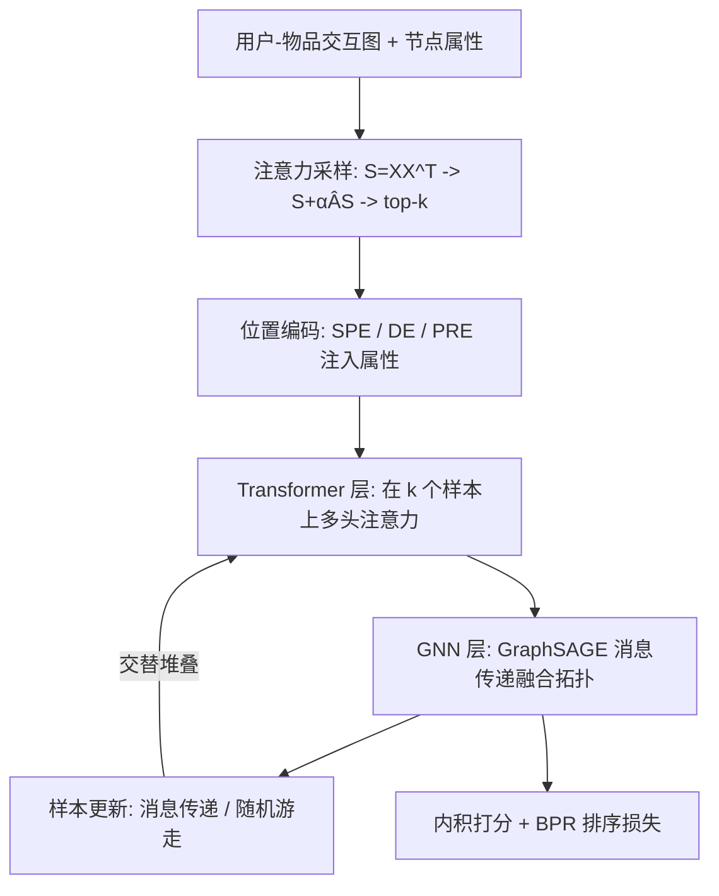
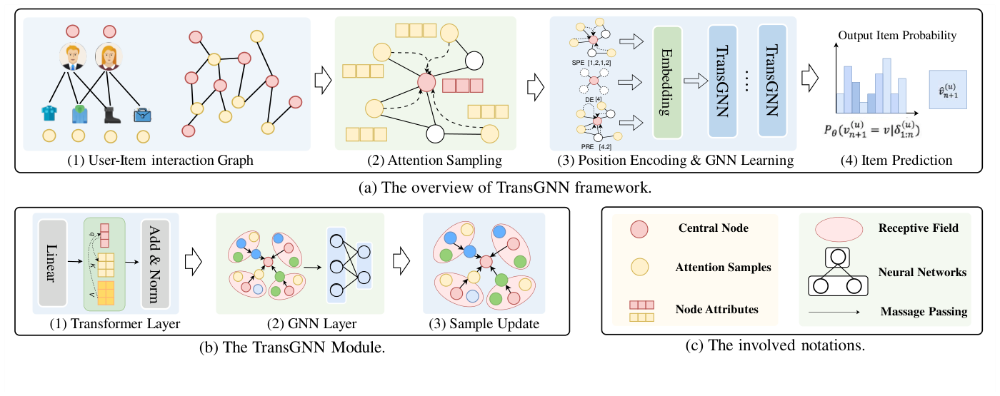
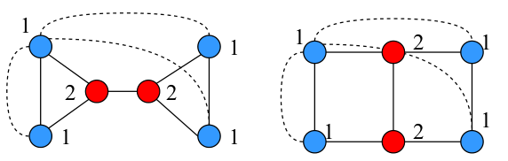

# TransGNN: Harnessing the Collaborative Power of Transformers and Graph Neural Networks for Recommender Systems (融合 Transformer 与图神经网络的协同过滤框架)

- **会议/期刊**: SIGIR 2024
- **作者与机构**: Peiyan Zhang, Yuchen Yan, Xi Zhang, Chaozhuo Li (MSRA), Senzhang Wang, Feiran Huang, Sunghun Kim (HKUST / PKU / Fuzhou Univ. 等)
- **推荐链路定位**: 召回（图协同过滤表征学习）
- **研究方向**: 图神经网络与知识图谱推荐 / 序列与会话推荐
- **论文原文**: [https://arxiv.org/abs/2308.14355v3](https://arxiv.org/abs/2308.14355v3)
- **开源代码**: [https://github.com/Peiyance/TransGNN-torch](https://github.com/Peiyance/TransGNN-torch)

## TL;DR (1分钟核心速览)

GNN 协同过滤受限于浅层感受野（通常 ≤3 跳）与"兴趣无关边"噪声，而 Transformer 虽能全局自适应聚合却丢失图拓扑且全局注意力是 $O(N^2)$。TransGNN 用**交替堆叠的 Transformer 层与 GNN 层**互促：Transformer 在 top-$k$ 语义+结构相似采样节点上聚合以扩感受野并绕开噪声边，GNN 通过三种结构位置编码与消息传递把拓扑信息回注 Transformer；配合两种高效样本更新策略保持线性复杂度。在 5 个公开数据集、**全库排序（all-rank）**协议下，Yelp Recall@20 提升 21.04%、NDCG@20 提升 32.25%。

## Background & Motivation (背景与核心矛盾)

- **主流范式**: 以 NGCF/LightGCN 为代表，沿用户-物品交互边递归消息传递，用多层邻域聚合精炼 embedding。
- **前人局限之一**: 曝光位置偏置与热门物品过度推荐使图中存在大量"兴趣无关连接"，沿边传播会把噪声放大到表征中。
- **前人局限之二**: 过平滑使有效层数被卡在 3 层以内，只能覆盖 3 跳；而真实用户行为序列常远超该长度，长程协同信号无法触达。
- **核心洞察 (Key Insight)**: Transformer 的注意力聚合**不依赖边**，天然具备全局感受野与自适应权重，恰好可绕过噪声边并突破跳数限制；反过来 GNN 的边约束能为 Transformer 补回被忽视的拓扑结构。
- **本文切入点**: 不做"Transformer 替代 GNN"，而是让两者**逐层交替、互为对方的增强模块**，并用采样把全局注意力压到线性开销。

## Method (核心方法设计)

### 1. 整体框架 (Overall Architecture)

先由注意力采样模块为每个中心节点挑选 top-$k$ 语义与结构上都相关的候选节点；再由位置编码模块把最短路径跳数、度、PageRank 三类拓扑信号编码进节点属性，使 Transformer 能"看见"图结构；随后进入 TransGNN 模块，按「Transformer 层 → GNN 层 → 样本更新」顺序交替堆叠（默认 3 个 Transformer 层夹 2 个 GNN 层，GNN 主干用 GraphSAGE），Transformer 扩大 GNN 感受野，GNN 融合结构与邻居信息并顺带产出更相关的邻居样本；最后由内积打分输出物品概率，用 pairwise BPR 损失训练。

<figure class="paper-figure" markdown="span">
  <figcaption>图1：TransGNN 框架。我们首先为中心节点采样相关节点，然后通过结合结构信息计算位置编码以增强原始属性。在 TransGNN 模块中，Transformer 层与 GNN 层相互促进，随后是样本更新子模块。</figcaption>
</figure>

### 2. 关键设计拆解 (Key Designs)

1. **注意力采样与邻居偏好修正（把 $O(N^2)$全局注意力换成$O(Nk)$）**：全局注意力既贵又会拉入无关节点。先用语义相似度$S=XX^{\top}$起手，但纯语义忽略结构，故用$\hat{A}=A+I$做一跳偏好传播修正：$S \leftarrow S+\alpha\hat{A}S$（$\alpha=0.5$），再对每行取 top-$k$得$\mathrm{Smp}(v_i)$。直觉是"喜欢某物品会通过共同邻居影响对另一物品的亲和度"，只保留最相关$k$ 个节点即可同时降复杂度与滤噪。

2. **三重结构位置编码（让无边约束的注意力感知拓扑）**：Transformer 的聚合不依赖边，必须显式注入结构。对中心 $v_i$及其样本$v_j$定义$\mathrm{SPE}(v_i,v_j)=\mathrm{MLP}(P(i,j))$（最短路径跳数）、$\mathrm{DE}(v_i)=\mathrm{MLP}(\deg_i)$（交互频次/物品热度）、$\mathrm{PRE}(v_i)=\mathrm{MLP}(\mathrm{Pr}(v_i))$（PageRank 结构影响力），并以拼接聚合、两层 MLP 组合：$h_j=\mathrm{COMB}\big(\mathrm{AGG}(x_j,\mathrm{SPE},\mathrm{DE},\mathrm{PRE})\big)$。三者分别刻画邻近度、活跃度与全局重要性，粒度互补。

3. **交替增强与两条样本更新路径**：Transformer 层在样本集上做多头注意力 $h_i=\mathrm{softmax}\big(QK^{\top}/\sqrt{d_{out}}\big)V$（$Q=h_iW_Q$，$K,V=H_{\mathrm{Smp}_i}W_K,W_V$）；GNN 层执行标准消息传递。关键是样本需随表征演化而更新，为此给出两条免$O(N^2)$的路径：(i) **消息传递式更新**，令$\mathrm{Attn\_Msg}(v_i)=\bigcup_{v_j\in\mathcal{N}(v_i)}\mathrm{Smp}(v_j)$，在邻居样本并集中重选，零额外开销；(ii) **随机游走式更新**，以$p_{i\to j}\propto h_ih_j^{\top}$游走长度$L$ 探索局部邻域，开销略高且更易被噪声边带偏。论文默认 (i)。

**训练目标、负采样与推理效率**：损失为逐用户逐时刻的 pairwise 排序损失 $\mathcal{L}=\sum_{u}\sum_{t}\log\sigma\big(P(i_{t+1})-P(i^{-}_{t+1})\big)$，负样本为**均匀随机采样**单个负物品。理论上以 top-1 mask 退化可证 TransGNN 至少等价于 GCN（$W_V$取对角$\sqrt{d_{out}}-1$时回到$\sigma(AHW)$），且借助位置编码可区分 1-WL 不可分的图；额外复杂度仅$O(Nk)$与$O(Nkd_a)$，均为线性。

<figure class="paper-figure" markdown="span">
  <figcaption>图2：示例说明。虚线表示 Transformer 层的感受野，颜色表示相似性关系。</figcaption>
</figure>

## Experimental Setup & Evaluation Protocol (实验设置与评估协议)

| 数据集 | #Users | #Items | #Interactions | 稀疏度/密度 | 特征/场景说明 |
| :--- | :---: | :---: | :---: | :---: | :--- |
| Yelp | 29,601 | 24,734 | 1,527,326 | $2.1\times10^{-3}$ | 本地商户点评，隐式反馈 |
| Gowalla | 50,821 | 24,734 | 1,069,128 | $4.0\times10^{-4}$ | 2016–2019 地理签到 |
| Tmall | 47,939 | 41,390 | 2,357,450 | $1.2\times10^{-3}$ | 电商 2017-12 页面浏览 |
| Amazon-Book | 78,578 | 77,801 | 3,200,224 | $5.2\times10^{-4}$ | 图书评论，`10-core` 过滤 |
| ML-10M | 69,878 | 10,196 | 9,998,816 | $1.4\times10^{-2}$ | 电影评分，最稠密 |

- **数据划分与防穿越**: 所有数值评分/评论统一转为隐式 1；按用户分组并按**时间戳排序**构造交互序列，取序列末位为目标物品（时序式留一划分），其余用作训练/验证。
- **排名评测协议**: **Full-Ranking（全库未交互物品与测试正样本共同排序）**，指标 Recall@20/40 与 NDCG@20/40，无采样负例偏置。
- **对比基线与超参**: 五类基线——自编码器 AutoR；GNN 类 GCMC/PinSage/NGCF/LightGCN/GCCF；超图类 HyRec/DHCF；自监督类 MHCN/SLRec/SGL；Transformer-GNN 类 SHT。注意力采样大小 $k\in\{5,\dots,35\}$，头数$h\in\{2,4,8,16,32\}$，Adam 优化，早停（验证 Recall 20 轮不升），5 次均值，显著性$p<0.01$ 配对 t 检验。

## Key Experimental Results (实验关键数据)

### 1. 主实验对比 (Main Results)

| 数据集 | 指标 | NGCF | LightGCN | GCCF | DHCF | MHCN | SGL | SHT | **TransGNN** | Improv. |
| :--- | :--- | :---: | :---: | :---: | :---: | :---: | :---: | :---: | :---: | :---: |
| Yelp | Recall@20 | 0.0579 | 0.0653 | 0.0462 | 0.0458 | 0.0646 | 0.0675 | 0.0651 | **0.0817** | +21.04% |
| Yelp | NDCG@20 | 0.0477 | 0.0532 | 0.0398 | 0.0376 | 0.0410 | 0.0555 | 0.0546 | **0.0734** | +32.25% |
| Gowalla | Recall@20 | 0.1570 | 0.1820 | 0.1577 | 0.1642 | 0.1710 | 0.1709 | 0.1232 | **0.1887** | +3.68% |
| Amazon-Book | Recall@20 | 0.0344 | 0.0411 | 0.0415 | 0.0411 | 0.0552 | 0.0478 | 0.0740 | **0.0801** | +8.24% |
| Amazon-Book | NDCG@20 | 0.0263 | 0.0318 | 0.0308 | 0.0312 | 0.0384 | 0.0379 | 0.0553 | **0.0603** | +9.04% |
| ML-10M | Recall@20 | 0.2136 | 0.2402 | 0.2356 | 0.2368 | 0.2509 | 0.2474 | 0.2546 | **0.2668** | +4.79% |
| ML-10M | NDCG@20 | 0.2218 | 0.2704 | 0.2682 | 0.2697 | 0.2761 | 0.2813 | 0.3038 | **0.3223** | +6.09% |
| Tmall | Recall@20 | 0.0402 | 0.0525 | 0.0327 | 0.0385 | 0.0405 | 0.0436 | 0.0387 | **0.0608** | +15.81% |

### 2. 消融实验 (Ablation Study)

| 变体 | Yelp R@20 | Yelp N@20 | Tmall R@20 | Tmall N@20 |
| :--- | :---: | :---: | :---: | :---: |
| w/o 注意力采样 (-AS) | 0.0686 | 0.0583 | 0.0418 | 0.0349 |
| w/o 位置编码 (-PE) | 0.0704 | 0.0610 | 0.0437 | 0.0375 |
| w/o SPE | 0.0910 | 0.0760 | 0.0591 | 0.0412 |
| w/o DE | 0.0922 | 0.0781 | 0.0602 | 0.0416 |
| w/o PRE | 0.0907 | 0.0772 | 0.0595 | 0.0417 |
| w/o Transformer (-Trans) | 0.0479 | 0.0391 | 0.0237 | 0.0159 |
| w/o GNN (-GNN) | 0.0390 | 0.0316 | 0.0209 | 0.0126 |
| 随机游走更新 (+RW) | 0.0924 | 0.0782 | 0.0601 | 0.0417 |
| w/o 样本更新 (-MP) | 0.0723 | 0.0611 | 0.0462 | 0.0360 |
| **TransGNN 完整** | **0.0927** | **0.0787** | **0.0608** | **0.0422** |

### 3. 关键实验发现 (Key Findings)

1. **Transformer 与 GNN 是硬耦合而非冗余**：删掉任一者都崩得比删采样更狠——Yelp Recall@20 从 0.0927 掉到 0.0479（-Trans）与 0.0390（-GNN），降幅 48%/58%，远超 -AS 的 26%，说明全局视野与局部拓扑缺一不可。
2. **位置编码是 Transformer 上图的"入场券"，且三者可叠加**：整体去掉 -PE 使 Yelp Recall 掉至 0.0704（-24%），而单删 SPE/DE/PRE 仅降到 0.0907–0.0922，证明三种结构信号存在互补冗余而非单点依赖。
3. **深堆叠不退化且采样成本极低**：Amazon-Book 上 SHT 在 3 层后性能回落（0.0740→0.0684），TransGNN 则从 1 层 0.0723 单调升至 5 层 0.0807，有效打破过平滑；同时 $k$从 5 增到 35 收益迅速饱和，最佳$k$ 随图规模仅缓慢增长，参数量 1.77M、FLOPs 3.74M 均低于 SHT（1.75M/4.89M），显存 1.79GB 显著少于 SHT 2.33GB，训练/推理比 NGCF 快 30%–40%。

## Highlights & Limitations (亮点、对比与审稿批判)

- **与代表作对比 (vs. Prior Work)**: 相比 LightGCN 等纯 GNN 方案，本文不改消息传递算子，而是"外挂"注意力分支补足长程感受野；相比 SGL/MHCN 依赖随机增强的自监督正则，本文的噪点抑制来自可学习的 top-$k$ 采样筛选，更直接作用于结构；相比 SHT 这类超图 Transformer，本文避免超图构造开销且位置编码更细粒度（跳数/度/PageRank 三视图），并在深层堆叠下不退化。
- **可迁移亮点**: (1) $S+\alpha\hat{A}S$的"语义相似度 + 一跳邻居偏好修正"是极低成本的相关性重排，可直接用于召回候选筛选或对比学习正样本构造；(2) 消息传递式样本更新$\mathrm{Attn\_Msg}=\bigcup_{v_j\in\mathcal{N}(v_i)}\mathrm{Smp}(v_j)$ 零额外开销地实现动态近邻刷新，可移植到任何"采样+注意力"的图模型。
- **审稿级局限批判**: (1) 位置编码中的最短路径跳数矩阵 $P$需预计算（$O(N(N+E)\log E)$），在千万级节点工业图上仍是离线瓶颈，论文仅在 Yelp 级规模验证；(2) 样本更新默认沿用邻居样本并集，长尾冷启动物品邻居稀少时该并集可能退化为空集，且论文未给出冷启动/稀疏分桶实验；(3) 全局扩展性验证仅通过"缩放数据子集"间接进行，缺少真实大规模线上 A/B 或延迟指标。

## Rating (四维评分)

- **方法创新性 (Novelty)**: ⭐⭐⭐⭐ （交替互促框架+三视图位置编码+消息传递式零成本样本更新，虽为组合式创新但 coupling 设计与 1-WL 表达力论证到位）
- **评估协议与实验扎实度 (Protocol & Experiments)**: ⭐⭐⭐⭐ （5 数据集 + 无偏全库排序 + $p<0.01$ 显著性 + 完整消融与效率表，但缺少冷启动与线上验证）
- **写作与数学规范度 (Clarity & Rigor)**: ⭐⭐⭐⭐ （复杂度分模块拆解清晰、两个定理证明简洁；部分符号如 $\hat{A}$与$A+I$ 的等价表述略显重复）
- **工业落地与复现价值 (Industrial & Practical Value)**: ⭐⭐⭐⭐ （FLOPs 与显存均低于 SHT、训练比 NGCF 快 30%–40%，代码已开源，但最短路径预处理限制超大规模直接部署）

