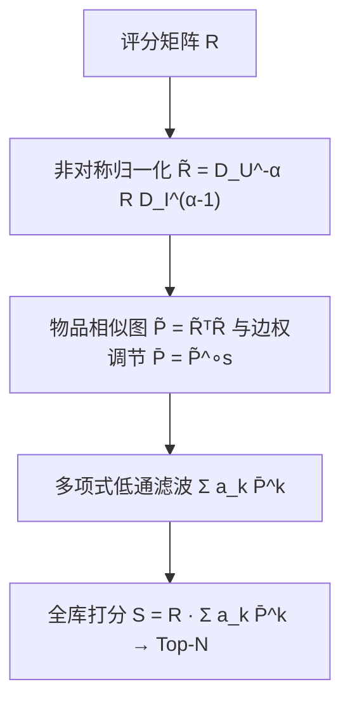
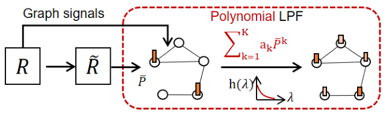
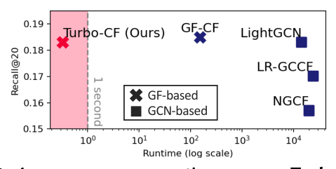

# Turbo-CF: Matrix Decomposition-Free Graph Filtering for Fast Recommendation (免矩阵分解的多项式图滤波快速推荐)

- **会议/期刊**: SIGIR 2024 (Short Paper, 5 pages)
- **作者与机构**: Jin-Duk Park, Yong-Min Shin, Won-Yong Shin (Yonsei University)
- **推荐链路定位**: 召回（全库打分）
- **研究方向**: 图神经网络与知识图谱推荐 / 协同过滤与双塔召回
- **论文原文**: [https://arxiv.org/abs/2404.14243v1](https://arxiv.org/abs/2404.14243v1)
- **开源代码**: [https://github.com/jindeok/Turbo-CF](https://github.com/jindeok/Turbo-CF)

## TL;DR (1分钟核心速览)

图滤波协同过滤 (GF-CF) 虽免训练，但为构造理想低通滤波器必须对物品-物品相似图做特征分解，复杂度 $O(|I|^3)$，无法支撑实时推荐。Turbo-CF 用**矩阵多项式$\sum_k a_k\bar{P}^k$ 直接逼近任意频率响应**，全过程只剩矩阵乘法，可在 GPU 上并行；配合非对称归一化与 Hadamard 幂次调边权，在 Gowalla/Yelp 上推理耗时从 GF-CF 的 2m33s 降至 **0.3s**（提速约 510×），Amazon-book 上 NDCG@20 反超 GF-CF **4.6%**。

## Background & Motivation (背景与核心矛盾)

- **主流范式**: 一类工作是 GCN 式 CF (NGCF/LightGCN/LR-GCCF)，靠消息传递拟合高阶邻域，但必须离线训练；另一类是 GF-CF 等图滤波方法，用理想低通滤波器 $\bar{U}\bar{U}^\top$ 直接平滑用户评分信号，**无需任何训练**即可达到 SOTA 精度。
- **前人局限**: ① 理想 LPF 依赖 top-$k$奇异向量，必须做 SVD，代价$O(|I|^3)$，物品数上万即不可接受；② 该分解无法用 GPU 加速，且用户兴趣与交互流快速变化，模型需分钟级甚至秒级刷新，慢速滤波器在实时场景失效。
- **核心洞察 (Key Insight)**: 图滤波的本质只是"改特征值"而非"求特征向量"——只要频率响应 $h(\lambda)$合适，用$\bar{P}$ 的多项式即可实现同样的谱变换，而多项式乘法天然是 GPU 友好的稠密矩阵乘。
- **本文切入点**: 用 1–3 阶多项式 LPF 逼近理想 LPF，同时重新设计图构造（非对称归一化 + 边权幂次调节）弥补失去精确分解后的精度损失。

## Method (核心方法设计)

### 1. 整体框架 (Overall Architecture)

先用非对称幂次归一化的评分矩阵 $\tilde{R}$构建物品相似图$\bar{P}$，再对其做 Hadamard 幂次调节边权；随后对每个用户的历史评分向量$r_u$施加$K$阶多项式低通滤波$\sum_k a_k\bar{P}^k$，一次矩阵乘法同时得到全部用户对全部物品的偏好分数$S$，按分数全库排序取 Top-$N$。训练阶段完全为空（无参数学习、无负采样、无反向传播），系数$\{a_k\}$ 为先验设计或一次性数值拟合，滤波器类型仅在验证集上做离散选择。

<figure class="paper-figure" markdown="span">
  <figcaption>图2：Turbo-CF的概览示意图。在Turbo-CF中，使用多项式LPF平滑图信号。</figcaption>
</figure>

### 2. 关键设计拆解 (Key Designs)

1. **多项式图滤波替代特征分解（核心增量）**：GF-CF 需 $\bar{U}\bar{U}^\top$实现理想 LPF，代价$O(|I|^3)$。本文注意到$\bar{P}$的特征分解$\bar{P}=\tilde{U}\Lambda\tilde{U}^\top$满足$\bar{P}^k=\tilde{U}\Lambda^k\tilde{U}^\top$，故任意多项式本身就是合法图滤波器，且频率响应有闭式解：

$$s_u = r_u\sum\nolimits_{k=1}^{K}a_k\bar{P}^k,\qquad h(\lambda)=\sum\nolimits_{k=1}^{K}a_k(1-\lambda)^k$$

   即**只需设计标量函数 $h(\cdot)$ 即可，无需触碰特征向量**；整个打分是一次"矩阵乘-求和"，可完全交给 PyTorch/CUDA 并行，这正是 510× 提速的根源。

2. **非对称归一化 + 边权幂次调节（精度补偿）**：前人对称归一化 $\tilde{R}=D_U^{-1/2}RD_I^{-1/2}$ 隐含"用户/物品流行度影响等价"的假设。本文改为

$$\tilde{R}=D_U^{-\alpha}RD_I^{\alpha-1},\quad \bar{P}=\tilde{P}^{\circ s},\ \ \tilde{P}=\tilde{R}^\top\tilde{R}$$

   $\alpha$增大抑制高活跃用户、放大热门物品影响，$s$则整体缩放边权强度以匹配所选滤波器的平滑力度（高阶滤波器易过平滑）。实验显示最优$\alpha=0.7$、$s=0.6$，说明对称归一化 ($\alpha=0.5$) 与原始边权 ($s=1$) 均非最优，这一"零成本调参"是维持精度的关键。

3. **三个即插即用的低通滤波器与训练/推理开销**：为避免在验证集上盲目搜索高阶系数（并控制内存），作者固定 $K\le 3$给出三个预设：线性$h(\lambda)=1-\lambda$；二阶$2\bar{P}-\bar{P}^2$对应$h(\lambda)=1-\lambda^2$；以及对理想阶跃滤波器$h(\lambda)=\mathbb{I}_{\lambda\le 0.1}$做非线性最小二乘拟合得$\hat{f}_\tau(\bar{P})=-\bar{P}^3+10\bar{P}^2-29\bar{P}$，并与线性项组合为$\bar{P}+\beta\hat{f}_\tau(\bar{P})$。**无损失函数、无负采样、无训练轮次**，推理仅$K$次$|U|\times|I|$与$|I|\times|I|$ 矩阵乘。

## Experimental Setup & Evaluation Protocol (实验设置与评估协议)

- **数据集与预处理**: 三个公开基准，**未做 k-core 过滤**，仅统计原始交互：

| 数据集 | #Users | #Items | #Interactions | 密度 | 场景说明 |
| :--- | :---: | :---: | :---: | :---: | :--- |
| Gowalla | 29,858 | 40,981 | 1,027,370 | 0.084% | LBSN 签到 |
| Yelp | 31,668 | 38,048 | 1,561,406 | 0.130% | 本地生活商户 |
| Amazon-book | 52,643 | 91,599 | 2,984,108 | 0.062% | 图书电商 |

- **数据划分与防穿越**: 对每个用户按 **70%/20%/10% 随机比例划分** train/test/validation，验证集仅用于超参 ($\alpha,s,\beta$) 与滤波器类型选择，测试集不参与任何调参。
- **排名评测协议**: 属 **Full-Ranking（全库未交互物品排序）**——由 $S=R\sum a_k\bar{P}^k$直接对全部$|I|$ 个物品打分后排序，**不做负采样**，避免采样偏差；指标为 Recall@20 与 NDCG@20。
- **对比基线与超参设置**: 8 个基线覆盖四类——MF 类 (MF-BPR, NeuMF)、生成式 (Multi-VAE, DiffRec)、GCN 类 (NGCF, LightGCN, LR-GCCF)、图滤波类 (GF-CF)；GCN/MF 结果直接引用原文以保证公平，仅 DiffRec 重跑。关键超参 $\alpha\in[0,1]$、$s$ 由验证集网格搜索，GPU 为 RTX A6000。

## Key Experimental Results (实验关键数据)

### 1. 主实验对比 (Main Results)

| Method | Gowalla R@20 | Gowalla N@20 | Yelp R@20 | Yelp N@20 | Amazon R@20 | Amazon N@20 |
| :--- | :---: | :---: | :---: | :---: | :---: | :---: |
| MF-BPR | 0.1291 | 0.1109 | 0.0433 | 0.0354 | 0.0250 | 0.0190 |
| NeuMF | 0.1399 | 0.1212 | 0.0451 | 0.0363 | 0.0258 | 0.0200 |
| Multi-VAE | 0.1641 | 0.1335 | 0.0584 | 0.0450 | 0.0407 | 0.0315 |
| DiffRec | 0.1653 | 0.1417 | 0.0656 | 0.0552 | OOM | OOM |
| NGCF | 0.1570 | 0.1327 | 0.0579 | 0.0477 | 0.0344 | 0.0263 |
| LightGCN | **0.1830** | **0.1554** | 0.0649 | 0.0530 | 0.0411 | 0.0315 |
| LR-GCCF | 0.1701 | 0.1452 | 0.0604 | 0.0498 | 0.0375 | 0.0296 |
| GF-CF | **0.1849** | 0.1518 | **0.0697** | 0.0571 | 0.0710 | 0.0584 |
| **Turbo-CF** | 0.1835 | 0.1531 | 0.0693 | **0.0574** | **0.0730** | **0.0611** |
| **Improv.** | −0.8% | −1.5% | −0.6% | +0.5% | **+2.8%** | **+4.6%** |

运行时间（Gowalla，同硬件）：NGCF 6h34m15s（训练）、LightGCN 4h1m9s（训练）、GF-CF 2m33s（前向）、**Turbo-CF 0.3s / 5.6s / 5.8s**（三种滤波器）。

<figure class="paper-figure" markdown="span">
  <figcaption>图1：在Gowalla数据集上，Turbo-CF与其他基准方法的准确率与运行时间对比。</figcaption>
</figure>

### 2. 消融实验 (Ablation Study)

论文以"滤波器阶数"作为主要消融维度（Turbo-CF-1/2/3 分别为线性、二阶、理想 LPF 多项式逼近）：

| 变体 | Gowalla 耗时 | Gowalla R@20 | Yelp 耗时 | Yelp R@20 | Amazon 耗时 | Amazon R@20 |
| :--- | :---: | :---: | :---: | :---: | :---: | :---: |
| Turbo-CF-1 (线性) | **0.32s** | 0.1823 | **0.31s** | 0.0689 | **27.9s** | **0.0730** |
| Turbo-CF-2 (二阶) | 5.59s | 0.1740 | 4.80s | 0.0693 | OOM | OOM |
| Turbo-CF-3 (逼近理想) | 5.79s | **0.1835** | 4.82s | 0.0689 | OOM | OOM |

### 3. 关键实验发现 (Key Findings)

1. **矩阵分解几乎是"无用开销"**：线性滤波器 Turbo-CF-1 在 Gowalla 已达 0.1823 Recall，仅比二维逼近的 Turbo-CF-3 (0.1835) 低 0.6%，却快 **18×**；相对 GF-CF 的 0.1849 仅差 0.8% 召回，而耗时从 2m33s 降到 0.3s——说明 GF-CF 中 $O(|I|^3)$ 的 SVD 买到的精度极其昂贵。
2. **高阶滤波器并非单调增益，且存内存瓶颈**：Gowalla 上最优是 Turbo-CF-3、Yelp 上最优是 Turbo-CF-2 (0.0693)、Amazon-book 上最优反为一阶（高阶直接 OOM）——因 $\bar{P}^k$ 需将高维稠密矩阵驻留显存；作者建议用 Strassen 或子矩阵分块缓解，这也意味着该方法的"免分解"优势随物品规模增长会被显存反噬。
3. **图构造的调参收益可量化且不可忽略**：在 Gowalla 上把归一化指数从对称的 $\alpha=0.5$调到$0.7$、边权从$s=1$调到$0.6$，是 Turbo-CF 在失去理想 LPF 后仍能追平 GF-CF 的主要原因；换言之，两个标量超参大致"抵偿"了特征分解带来的谱截断能力。

## Highlights & Limitations (亮点、对比与审稿批判)

- **与代表作对比 (vs. Prior Work)**: 与 LightGCN 等 GCN-CF 相比，本文彻底去掉训练（4 小时 → 0.3 秒），精度在 Gowalla 上仅低 1.5% NDCG；与最相关的 GF-CF 相比，二者精度差距在噪声范围内，但本文用"多项式谱近似"替换了"精确谱截断"，把算力瓶颈从 SVD 转移到 GPU 稠密乘，工程意义远大于精度意义。
- **可迁移亮点**: ① "用多项式逼近任意频率响应 $h(\lambda)$、且$h$有闭式表达"这一技巧可直接迁移到 LightGCN 的传播核设计或时序图滤波；② 非对称归一化$D_U^{-\alpha}RD_I^{\alpha-1}$+ Hadamard 幂次$\bar{P}^{\circ s}$ 是一套极低成本（2 个标量）的图重加权方案，可插入任何基于相似图的方法。
- **审稿级局限批判**: ① 评测仅 3 个中等规模数据集、单一 70/20/10 随机划分，缺少时间切分与冷启动划分，未验证"用户兴趣快速漂移"这一核心动机场景下的实际收益；短论文亦无显著性检验；② 声称"矩阵分解免了"，但功率迭代 $\bar{P}^k$在高阶时仍达$O(K|I|^2)$稠密乘并引发 Amazon-book OOM，可扩展性证据不足；③$\alpha,s$ 仍需验证集网格搜索，与"秒级实时刷新"叙事存在张力，且论文未报告滤波器系数拟合的稳定性。

## Rating (四维评分)

- **方法创新性 (Novelty)**: ⭐⭐⭐⭐ （把谱域图滤波从"求特征向量"重构为"设计标量频率响应"，视角简洁优雅，但多项式滤波本身在信号处理中属经典工具，迁移增量大于理论增量）
- **评估协议与实验扎实度 (Protocol & Experiments)**: ⭐⭐⭐ （Full-Ranking 无采样偏差、基线覆盖四大类且耗时对比充分，但仅 3 数据集、单一随机划分、无显著性检验，长尾/稀疏分桶分析缺失）
- **写作与数学规范度 (Clarity & Rigor)**: ⭐⭐⭐⭐ （定理 3.1 给出频率响应闭式解、三个滤波器推导清晰，可惜证明因页数限制被省略，复杂度分析偏薄）
- **工业落地与复现价值 (Industrial & Practical Value)**: ⭐⭐⭐⭐⭐ （代码开源、无训练无负采样、亚秒级前向，天然适配需要分钟级模型刷新的信息流与本地生活召回场景）

