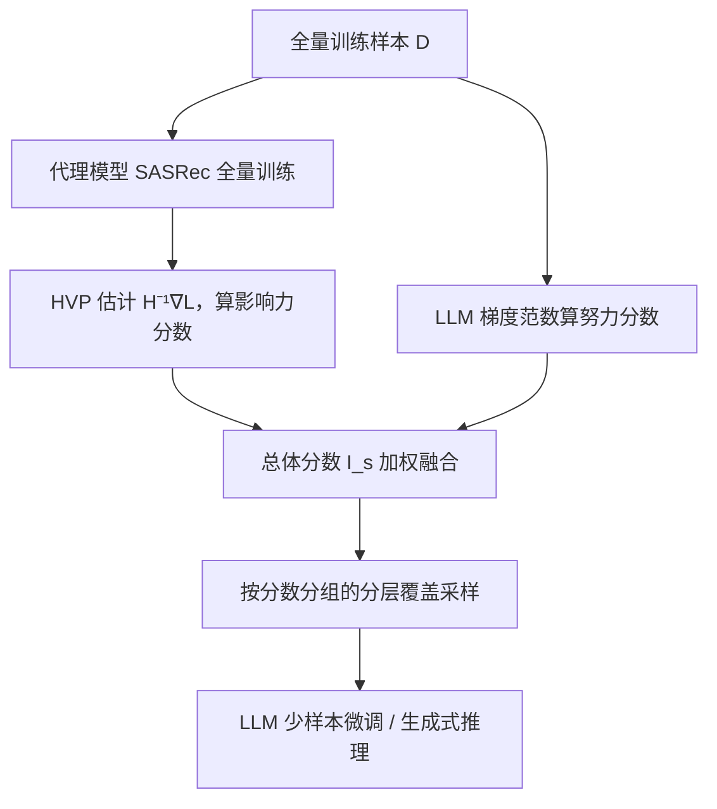
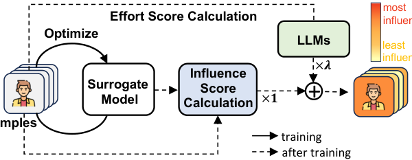

# Data-efficient Fine-tuning for LLM-based Recommendation (面向 LLM 推荐的数据高效微调)

- **会议/期刊**: SIGIR 2024
- **作者与机构**: Xinyu Lin, Wenjie Wang, Yongqi Li, Shuo Yang, Fuli Feng, Yinwei Wei, Tat-Seng Chua（NUS / PolyU / HKU / USTC / Monash）
- **推荐链路定位**: 端到端生成式（LLM 微调数据侧优化）
- **研究方向**: 大语言模型推荐 / 生成式推荐
- **论文原文**: [arXiv:2401.17197v2](https://arxiv.org/abs/2401.17197v2)
- **开源代码**: [Linxyhaha/DEALRec](https://github.com/Linxyhaha/DEALRec)

## TL;DR (1分钟核心速览)

LLM 推荐依赖全量数据微调，代价高且数据日更频繁，而随机少样本采样会丢失关键行为信息；已有 coreset 选择依赖启发式指标或昂贵的双层优化，且必须先在**全量数据上训好 LLM** 才可选样本——这在推荐场景不可行。DEALRec 用「影响函数派生的小代理模型影响力分数」+「LLM 梯度范数努力分数正则」选出高影响力样本，仅用 2% 数据即在 BIGRec 上全面超越全量微调（Recall@20 最高 +43.5%），微调耗时下降 95%–98%。

## Background & Motivation (背景与核心矛盾)

- **主流范式**: BIGRec / TIGER 等生成式推荐模型在全量用户序列上微调 LLM，将下一物品标题或语义 ID token 化后自回归生成。
- **前人局限**: ① 全量微调成本高昂且数据持续涌入需频繁重训，实际不可持续；② 现有 coreset 方法要么用熵/梯度范数/聚类等**启发式指标**（不显式估计对经验风险的影响），要么求解**双层优化**（大规模推荐数据上不可解）；③ 两类方法都隐含"先用全量数据训好模型"，对 LLM 而言本身就不可负担。
- **核心洞察 (Key Insight)**: 图 1(a) 显示，BIGRec 仅用数百样本即可逼近全量性能，说明**绝大部分样本冗余**；图 1(b) 显示 SASRec 代理模型的显存/耗时仅为 BIGRec 的 ~2%，但 LLM 自带世界知识，其"难学样本"分布与代理模型显著不同（图 3）。
- **本文切入点**: 把"选哪些样本喂给 LLM"形式化为新的数据剪枝任务，用代理模型廉价估计影响力、再用 LLM 侧努力分数补偿能力差距。

## Method (核心方法设计)

### 1. 整体框架 (Overall Architecture)

先在**全量数据**上训练一个小型序列模型（SASRec）作为代理，并对所有样本计算影响力分数；同时用待微调 LLM 的当前参数计算每条样本的努力分数（梯度范数）；两分数加权得总体分数后按分数分 $K$组做**分层覆盖采样**，得到$r|\mathcal{D}|$ 条样本用于 LLM 少样本微调。

<figure class="paper-figure" markdown="span">
  <figcaption>图2：DEALRec 概览。DEALRec 首先在全量训练样本上训练代理模型。随后，它计算影响分数，并由努力分数进行正则化，以识别有影响力的样本。</figcaption>
</figure>

### 2. 关键设计拆解 (Key Designs)

1. **影响力分数（影响函数 + 对称性加速）**：目标是最小化"删掉样本 $s$后经验风险的变化"。由影响函数出发，删样等价于反权重$\epsilon=-1/n$，链式法则给出

$$I_{\text{remove,loss}}(s,\mathcal{D})=\frac{1}{n^2}\nabla_\theta\mathcal{L}(s,\hat\theta)^{\top}H_{\hat\theta}^{-1}\Big[\sum_i\nabla_\theta\mathcal{L}(s_i,\hat\theta)\Big]$$

直接逐样本求 $H^{-1}\nabla_\theta\mathcal{L}(s,\hat\theta)$需$n$次估计。作者利用$H^{-1}$对称性把求和项提成**对所有样本共享的常数向量**，只需做一次 HVP 估计：$\tilde{H}^{-1}_t v=v+(I-\nabla^2_\theta\mathcal{L}(s_t))\tilde{H}^{-1}_{t-1}v$。这样$O(nm^2+m^3)$ 的显式求逆被免去，复杂度降到每样本一次前向+内积。

2. **努力分数（gap 正则）**：代理模型与 LLM 学习能力不同，代理眼中的"高影响力"未必是 LLM 眼中的"高信息"。定义为 LLM 侧样本损失的梯度范数 $\delta_s=\|\nabla_\phi\mathcal{L}_{\text{LLM}}(s)\|_2$，直观刻画"LLM 当前参数要拟合该序列还需移动多远"。总分

$$I_s=\frac{1}{n^2}\nabla_\theta\mathcal{L}(s,\hat\theta)^{\top}H_{\hat\theta}^{-1}\Big[\sum_i\tfrac{1}{n}\nabla_\theta\mathcal{L}(s_i,\hat\theta)\Big]+\lambda\|\nabla_\phi\mathcal{L}_{\text{LLM}}(s)\|_2$$

即惩罚 LLM 已"学会"的简单样本，把配额让给难样本（图 3(b) 验证两模型努力分数分布确有偏移）。

3. **覆盖增强采样与训练目标**：贪心取 Top-$r$会选出一批高度相似样本、破坏经验风险上界。改为按总分分组、逐轮从**当前样本最少**的组中抽取并更新预算，保证分布覆盖。最终损失仍为标准下一物品 NLL：$\hat\phi=\arg\min_\phi\frac{1}{|\mathcal{S}|}\sum_{s_i\in\mathcal{S}}\mathcal{L}^{\text{LLM}}_\phi(s_i)$，全流程免负采样（生成式解码），推理开销与原 LLM 推荐模型一致。

## Experimental Setup & Evaluation Protocol (实验设置与评估协议)

- **数据集与预处理**: 三个真实序列推荐数据集，Games/Book 保留评分 $\ge 4$ 的交互，按全局时间戳排序：

| 数据集 | #Users | #Items | #Interactions | 密度 | 说明 |
| :--- | :---: | :---: | :---: | :---: | :--- |
| Games | 49,156 | 17,332 | 342,329 | 0.04% | Amazon 视频游戏，含标题文本 |
| MicroLens-50K | 49,887 | 19,217 | 359,048 | 0.04% | 微视频，含多模态特征 |
| Book | 88,263 | 86,272 | 5,303,707 | 0.07% | Amazon 图书 |

- **数据划分与防穿越**: **全局时间戳切分**，train/valid/test = 8:1:1，严格防止未来交互泄漏。
- **排名评测协议**: **Full-Ranking**（生成式解码后在**全物品库**上匹配排序，未做采样负例），指标 Recall@K / NDCG@K；Games 取 $K\in\{10,20\}$，MicroLens-50K 与 Book 取$K\in\{20,50\}$。
- **对比基线与超参设置**: 基线含 Random、GraNd、EL2N、CCS、TF-DCon、RecRanker（优化类因双层优化不可解被排除）；后端模型为 BIGRec（LLaMA-7B + LoRA，item title）与 TIGER（语义 ID，全参微调）；代理模型 SASRec，HVP 迭代 $T=5000$，$\lambda\in\{0.1,0.3,0.5,1.0,2.0\}$，聚类数$K\in\{25,50,75\}$；3 次随机种子取均值，单样本 t 检验$p<0.01$。

## Key Experimental Results (实验关键数据)

### 1. 主实验对比 (Main Results)

BIGRec 后端，1024-shot（Games/MicroLens $r=2\%$，Book$r=1\%$）：

| 方法 | Games R@10 | Games R@20 | Games N@20 | MicroLens R@20 | MicroLens N@20 | Book R@20 | Book N@20 |
| :--- | :---: | :---: | :---: | :---: | :---: | :---: | :---: |
| Random | 0.0163 | 0.0241 | 0.0122 | 0.0108 | 0.0054 | 0.0099 | 0.0090 |
| GraNd | 0.0158 | 0.0250 | 0.0125 | 0.0014 | 0.0010 | 0.0102 | 0.0087 |
| EL2N | 0.0154 | 0.0256 | 0.0128 | 0.0096 | 0.0016 | 0.0107 | 0.0094 |
| CCS | 0.0164 | 0.0246 | 0.0122 | 0.0096 | 0.0049 | 0.0110 | 0.0096 |
| TF-DCon | 0.0102 | 0.0157 | 0.0078 | 0.0066 | 0.0034 | 0.0104 | 0.0092 |
| RecRanker | 0.0112 | 0.0166 | 0.0090 | 0.0024 | 0.0014 | 0.0108 | 0.0097 |
| **DEALRec** | **0.0181** | **0.0276** | **0.0142** | **0.0124** | **0.0064** | **0.0117** | **0.0104** |
| Improv.% | +10.4% | +14.5% | +10.9% | +14.8% | +18.5% | +6.4% | +8.3% |

TIGER 后端（Games）：DEALRec R@10 0.0074 / N@10 0.0062，对比最优基线 Random（0.0062 / 0.0039），提升 +19.4% / +59.0%。

**与全量微调对比（BIGRec，表 3）**：Games R@20 0.0276 vs Full 0.0233（+18.45%），耗时 1.67h vs 36.87h（−95.47%）；MicroLens R@20 +17.65%、N@20 +20.75%，耗时 −98.15%；Book R@20 +43.52%、N@20 +52.94%，耗时 −97.72%。

### 2. 消融实验 (Ablation Study)

图 4 组件消融（Games / MicroLens-50K，趋势为相对完整模型）：

| 变体 | Games R@20 | Games N@20 | MicroLens R@20 | 结论 |
| :--- | :---: | :---: | :---: | :--- |
| DEALRec (full) | 最优 | 最优 | 最优 | — |
| w/o IS（去影响力分数） | ↓ | ↓ | ↓ | 失去对经验风险的估计 |
| w/o $\delta_s$（去努力分数） | ↓ | ↓ | ↓ | 代理-LLM 能力差未被补偿 |
| Greedy（贪心替分层采样） | ↓↓ | ↓↓ | ↓↓ | 样本同质化、覆盖不足 |

代理模型鲁棒性（Games R@10）：BERT4Rec 0.0175、SASRec 0.0181、DCRec 0.0211，**三者均超全量微调 0.0169**，且 SASRec 训练仅 0.45h 最省。

### 3. 关键实验发现 (Key Findings)

- **少样本反超全量**: 表格 3 中 2% 样本在三个数据集上**全线优于**全量微调，说明推荐数据中存在大量冗余甚至有害样本（如假阴性交互、无信息长尾序列），剪枝同时实现了"去噪"收益。
- **难样本增益最大**: 按用户难度分组（图 6），DEALRec 相对 Random 在 Group 1/2/3 的 Recall@20 提升分别为 +11.42% / +37.29% / +5.98%，增益峰值落在**中等难度组**，表明努力分数有效挑选了"LLM 尚未掌握但可学习"的样本，而非一味追难。
- **选择率存在饱和点**: $r$从 0.2%→1% 精度快速上升并在$r=1\%$即超越全量，2%→4% 边际收益趋零（图 5），说明 LLM 适配所需的信息集中在极小子集中，推荐工程上取$r\approx1\%$。

## Highlights & Limitations (亮点、对比与审稿批判)

- **与代表作对比 (vs. Prior Work)**: 相较 GraNd/EL2N 等**启发式**方法，DEALRec 显式估计删样对经验风险的一阶影响，且用对称性把 $n$ 次 HVP 降为 1 次；相较 CCS 的覆盖采样，本文额外注入 LLM 侧梯度范数信号；相较 TF-DCon/RecRanker（依赖已训好的 LLM 做聚类/打分），本文只需一个 SASRec 代理即可完成选择，剪枝阶段成本可忽略。
- **可迁移亮点**: ① "代理模型算影响力 + 目标模型算努力分数"的解耦范式可迁移到 CTR 精排、多模态推荐等任何"大模型贵、小模型廉"的微调场景；② 按分数分组的分层预算采样是一种极轻量的覆盖度增强手段，可替代 k-center 类昂贵算法。
- **审稿级局限批判**: ① 影响力分数基于凸/二阶可微与 $H$正定假设，对 LoRA 低秩参数化的适用性只在实验层面验证，缺乏理论刻画；② 每个新数据集都需重训代理并跑 5000 次 HVP，且$r$需按数据集调（Games 2% vs Book 1%），跨域迁移时选择率与$\lambda$ 的敏感性仍依赖网格搜索；③ 生成式全库排序下报告 Recall/NDCG，未报告 MRR/命中率之外的成本指标，也未做线上 A/B。

## Rating (四维评分)

- **方法创新性 (Novelty)**: ⭐⭐⭐⭐ （把影响函数引入 LLM4Rec 数据剪枝，并用对称性把 HVP 从 $n$ 次降到 1 次，工程巧思明确）
- **评估协议与实验扎实度 (Protocol & Experiments)**: ⭐⭐⭐⭐ （三数据集 × 两后端 × 六基线 + 全量对照 + 消融/分组/比例/代理鲁棒性，$p<0.01$ 显著性检验，唯缺线上验证）
- **写作与数学规范度 (Clarity & Rigor)**: ⭐⭐⭐⭐ （影响函数推导链条完整、算法伪代码清晰，$1/n$ 系数的书写略显冗余易误读）
- **工业落地与复现价值 (Industrial & Practical Value)**: ⭐⭐⭐⭐⭐ （代码开源，97% 训练成本削减直接对应算力账单，代理模型仅 0.45h，落地门槛极低）

