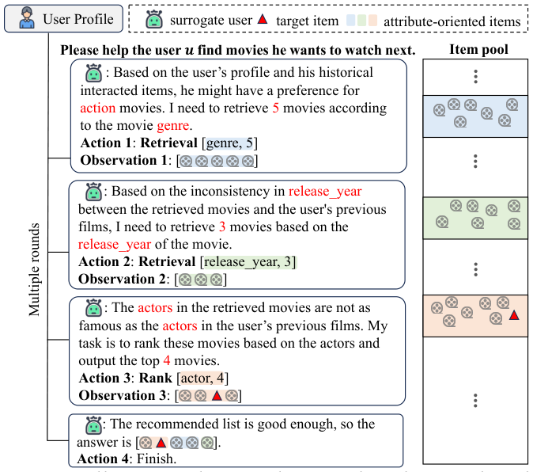
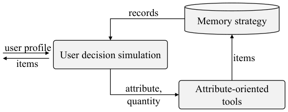
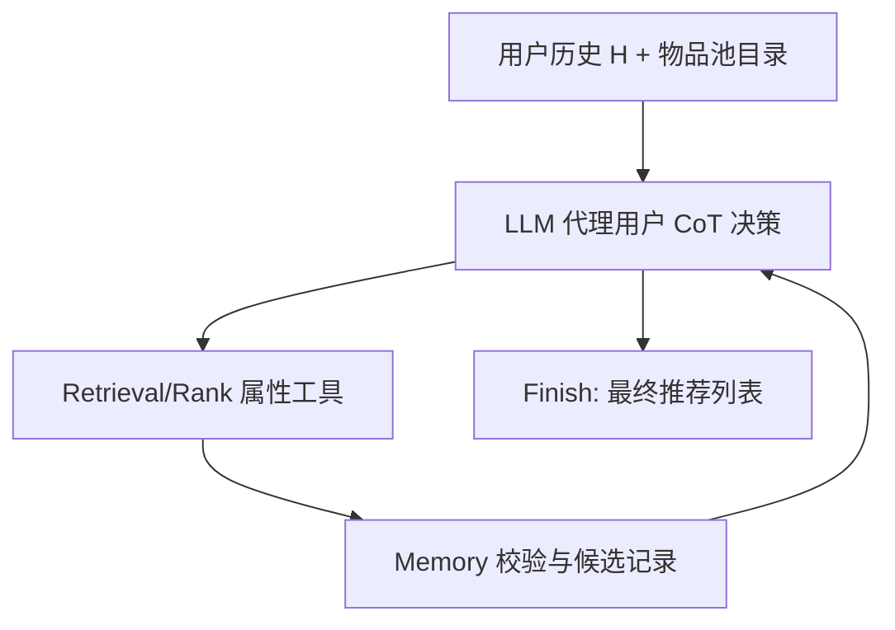

# Let Me Do It For You: Towards LLM Empowered Recommendation via Tool Learning (让 LLM 替你推荐：通过工具学习实现 LLM 赋能的推荐)

- **会议/期刊**: SIGIR 2024
- **作者与机构**: Yuyue Zhao, Jiancan Wu, Xiang Wang 等；USTC、University of Amsterdam、UTS
- **推荐链路定位**: 重排/端到端决策（LLM 控制推荐流程）
- **研究方向**: 大语言模型推荐 / 对话推荐与智能体仿真
- **论文原文**: [https://arxiv.org/abs/2405.15114v1](https://arxiv.org/abs/2405.15114v1)
- **开源代码**: [https://github.com/Go0day/ToolRec-Code](https://github.com/Go0day/ToolRec-Code)

## TL;DR (1分钟核心速览)

针对传统序列推荐只依赖历史交互、LLM4Rec 又存在幻觉/语义-行为错位/控制策略过简的问题，ToolRec 把 ChatGPT 作为“代理用户”，以 CoT 生成 Retrieval/Rank/Finish 动作，调用属性级检索与排序工具多轮探索物品池，并用 memory 校验物品。在 ML-1M、Amazon-Book 上 Recall@10 相对最优基线提升 3.36%、14.28%，NDCG@10 提升 15.10%、5.14%；Yelp 因本地商家知识不足而退化。

## Background & Motivation (背景与核心矛盾)

- **主流范式**: LLM4Rec 分三类——LLM 直接当推荐器、LLM 作为语义增强器、LLM 作为推荐流程控制器。
- **前人局限**: LLM 直接生成物品易在大物品库中幻觉；语义增强器把 LLM 语义空间与用户行为空间拼接，易错位；LLM 控制器多为单轮“排/不排”或依赖用户主动参与，策略过于简化。
- **核心洞察 (Key Insight)**: 推荐可视为在属性粒度上探索用户兴趣：代理用户根据历史判断当前列表欠缺哪个属性，再调用外部工具探测物品池的不同区域。
- **本文切入点**: 用 LLM 模拟用户决策过程，让属性级工具为 LLM 提供可验证、可探索的外部动作空间。

（图1：代理用户通过属性工具多轮探索物品池）

<figure class="paper-figure" markdown="span">
  <figcaption>图1：说明ToolRec的工作原理。基于LLM的代理用户学习真实用户的偏好，并决定使用面向属性的工具来探索物品区域。该过程形成物品的广阔视图，进而成功检索到目标物品。需要注意的是，依据特定属性检索到的、代表不同面向属性物品的区域可能包含重叠元素。</figcaption>
</figure>

## Method (核心方法设计)

### 1. 整体框架 (Overall Architecture)

ToolRec 从用户历史 $H$初始化代理用户$\hat{u}$；每轮 ChatGPT 依据工具说明与演示产生 thought 与 action，动作为 Retrieval$[a_t,K]$、Rank$[a_t,K]$ 或 Finish。检索工具返回属性匹配候选，排序工具按属性重排，memory 校验候选是否在目录、记录工具标记并在异常时触发重跑；代理用户满意或达到 8 轮即输出列表。

（图2：ToolRec 总体框架）

<figure class="paper-figure" markdown="span">
  <figcaption>图2：所提出的基于LLM的工具学习推荐方法概览。</figcaption>
</figure>

### 2. 关键设计拆解 (Key Designs)

1. **用户决策模拟（CoT + 工具学习）**：传统控制器只做一次排序/过滤；ToolRec 建模策略 $\pi(g_t,A_t|c_t)$，其中$c_t=(o_0,g_1,A_1,\ldots,o_{t-1})$，$A_t=$`T_type`$[a_t,K]$，$T_{\text{type}}\in\{\text{Retrieval},\text{Rank}\}$。这样把推荐拆成可解释的属性探索轨迹，由 LLM 的开放世界知识决定下一属性。

2. **属性导向检索/排序工具**：为每个属性训练独立模型成本高。预训练序列模型得 $\mathbf{H}=f_{\text{seq}}(H|\beta)$，冻结$\beta$，仅训练属性编码器$\mathbf{a}_u=f_{\text{attr}}(a_u|\gamma)$，再融合为$\mathbf{u}=\text{Dense}(\mathbf{a}_u\oplus\mathbf{H},\theta)$；排序工具则直接用 LLM 指令按属性$a_t$ 排序，无需训练。

3. **Memory 策略与训练/推理**：物品名/ID 易幻觉，memory 以物品池目录校验候选，异常时附错误细节重跑，并记录候选的工具标记。检索工具用 BPR 损失训练：$\mathcal{L}_{BPR}=-\sum_{(H,v)\in O^+,(H,w)\in O^-}\log\sigma(\phi(\mathbf{u},\mathbf{v})-\phi(\mathbf{u},\mathbf{w}))$；负样本为常规随机负采样（论文未细述分布）。LLM 不微调，训练仅小编码器；推理最多 8 轮 ChatGPT 调用，延迟与费用较高。

## Experimental Setup & Evaluation Protocol (实验设置与评估协议)

- **数据集与预处理**:

| 数据集 | #Users | #Items | #Interactions | 稀疏度 | 属性/说明 |
| :--- | :---: | :---: | :---: | :---: | :--- |
| ML-1M | 6,041 | 3,884 | 1,000,209 | 95.74% | genre、release year |
| Amazon-Book | 158,349 | 97,566 | 3,876,663 | 99.97% | price、sales rank；10-core |
| Yelp2018 | 77,278 | 45,582 | 2,102,836 | 99.94% | categories、city、stars；10-core |

- **数据划分与防穿越**: 采用 `Leave-One-Out`，按时间戳组织历史序列，划分 train/validation/test；检索工具在 train+validation 上训练。
- **排名评测协议**: 评价 Recall@10、NDCG@10。传统模型全库排序；Chat-REC/LLMRank 先用 SASRec 取 30 候选，ToolRec 由属性工具返回候选。每个数据集随机抽 200 用户、重复 3 次，报告均值±标准差；未报告显著性检验。
- **对比基线与超参**: SASRec、BERT4Rec、P5、SASRec$_{BERT}$、BERT4Rec$_{BERT}$、Chat-REC、LLMRank。主 LLM 为 `gpt-3.5-turbo-16k`，属性用 GloVe 词向量，检索骨干为 SASRec/BERT4Rec，最大 8 轮。

## Key Experimental Results (实验关键数据)

### 1. 主实验对比 (Main Results)

| 方法 | ML-1M R@10 | ML-1M N@10 | Amazon R@10 | Amazon N@10 | Yelp R@10 | Yelp N@10 |
| :--- | :---: | :---: | :---: | :---: | :---: | :---: |
| SASRec | 0.203 | 0.1017 | 0.047 | 0.0205 | 0.030 | 0.0165 |
| BERT4Rec | 0.158 | 0.0729 | 0.042 | 0.0212 | 0.033 | 0.0218 |
| P5 | 0.208 | 0.0962 | 0.006 | 0.0026 | 0.012 | 0.0050 |
| SASRec$_{BERT}$ | 0.192 | 0.0967 | 0.042 | 0.0194 | 0.032 | 0.0131 |
| BERT4Rec$_{BERT}$ | 0.202 | 0.0961 | 0.045 | 0.0233 | **0.040** | **0.0208** |
| Chat-REC | 0.185 | 0.1012 | 0.033 | 0.0171 | 0.022 | 0.0121 |
| LLMRank | 0.183 | 0.0991 | 0.047 | 0.0246 | 0.030 | 0.0140 |
| **ToolRec** | **0.215** | **0.1171** | **0.053** | **0.0259** | 0.028 | 0.0159 |
| ToolRec$_B$ | 0.185 | 0.0895 | 0.043 | 0.0223 | 0.025 | 0.0136 |
| Improv. | 3.36% | 15.10% | 14.28% | 5.14% | -29.16% | -27.32% |

注：表中为均值，std 见原文；Improv. 为 ToolRec 相对各行最优基线（Yelp 为 ToolRec 对最优值）计算。

### 2. 消融实验 (Ablation Study)

| 变体/设置 | 关键现象与解读 |
| :--- | :--- |
| frozen+$a_1$, frozen+$a_2$ | 单独属性检索工具在 ML-1M 上低于 SASRec，说明单属性工具本身不足。 |
| w/ single | 禁用 CoT 与工具学习，仅对 SASRec 30 候选做零样本排序，效果低于 SASRec。 |
| w/ multi | 对 SASRec 与属性工具候选做多轮重排，超过 SASRec，说明属性信息互补而非单纯扩候选。 |
| w/ Plan | 一次性生成全部工具调用再执行，低于 w/ multi，缺少逐步观察与修正。 |
| ToolRec 完整版 | ML-1M R@10 0.215/N@10 0.1171；Amazon 0.053/0.0259，均优于各基线。 |
| full+$a_1$vs frozen+$a_1$ | FLOPs 相同；frozen 仅训练属性编码器与 dense 层，可训练参数和存储显著更小。 |

### 3. 关键实验发现 (Key Findings)

1. **语义丰富域收益显著**：ML-1M 上 ToolRec NDCG@10 达 0.1171，较 Chat-REC 的 0.1012 提升 15.10%；Amazon-Book 上 Recall@10 0.053 较 SASRec 0.047 提升 14.28%，说明电影/图书等开放世界语义强的域更适合属性工具探索。
2. **增益不是单纯扩候选**：frozen+$a_1$、frozen+$a_2$ 单独在 ML-1M 上弱于 SASRec，但 w/ multi 与完整 ToolRec 超过 SASRec，说明提升来自 LLM 对多属性工具的组合调用；w/ Plan 低于 w/ multi，进一步证明逐步 CoT 决策必要。
3. **知识边界决定失效**：Yelp 上 ToolRec Recall@10 0.028、NDCG@10 0.0159，低于 BERT4Rec$_{BERT}$ 的 0.040/0.0208（-29.16%/-27.32%），归因于 LLM 对本地商家知识不足；多数成功流程在 3–4 轮结束，但多轮 API 调用成本高。

## Highlights & Limitations (亮点、对比与审稿批判)

- **与代表作对比 (vs. Prior Work)**: Chat-REC 是单轮 LLM 控制后端推荐，LLMRank 只做 LLM 重排；ToolRec 增加属性级 Retrieval/Rank 工具与多轮决策。相较 SASRec$_{BERT}$ 的语义特征拼接，ToolRec 保持行为骨干冻结，用工具级语义控制降低语义-行为错位。
- **可迁移亮点**: “冻结推荐骨干 + 轻量属性编码器”可低成本扩展多属性检索；memory 目录校验可直接用于缓解 LLM 生成物品名/ID 幻觉。
- **审稿级局限批判**: ①依赖 ChatGPT 推理与开放世界知识，Yelp 类本地/垂直域退化明显，且多轮调用延迟与成本高；②仅抽 200 用户重复 3 次、未报告显著性检验，不同方法候选集来源不一致（传统全库 vs LLM 控制类取 30 候选/工具候选），跨类比较需谨慎。

## Rating (四维评分)

- **方法创新性 (Novelty)**: ⭐⭐⭐⭐ （LLM-as-surrogate-user + 属性工具学习组合新颖，但工具调用与 CoT 并非全新范式。）
- **评估协议与实验扎实度 (Protocol & Experiments)**: ⭐⭐⭐ （三数据集与多类基线较完整，但 200 用户采样、无显著性检验、Yelp 负结果和候选集差异削弱结论强度。）
- **写作与数学规范度 (Clarity & Rigor)**: ⭐⭐⭐⭐ （框架与公式清晰，BPR/属性编码器定义简洁；负采样细节、轮次终止策略和复杂度分析略欠。）
- **工业落地与复现价值 (Industrial & Practical Value)**: ⭐⭐⭐ （代码开源、无需微调 LLM、参数量可控；但多轮 ChatGPT 在线开销与幻觉校验是部署瓶颈。）

