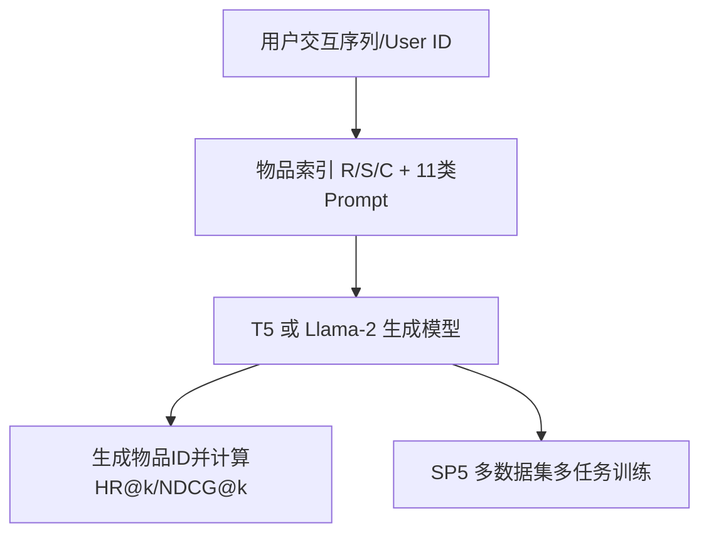

# OpenP5: An Open-Source Platform for Developing, Training, and Evaluating LLM-based Recommender Systems (OpenP5：面向LLM推荐系统开发、训练与评估的开源平台)

- **会议/期刊**: SIGIR 2024, Resource & Reproducibility Track
- **作者与机构**: Shuyuan Xu, Wenyue Hua, Yongfeng Zhang；Rutgers University
- **推荐链路定位**: 端到端生成式（召回/排序一体）
- **研究方向**: 大语言模型推荐 / 生成式推荐
- **论文原文**: [https://arxiv.org/abs/2306.11134v2](https://arxiv.org/abs/2306.11134v2)
- **开源代码**: [https://github.com/agiresearch/OpenP5](https://github.com/agiresearch/OpenP5)

## TL;DR (1分钟核心速览)

针对 LLM 生成式推荐缺乏统一开源研发平台的问题，OpenP5 将 P5 范式工程化为 T5/Llama-2 × 10 数据集 × 序列/直推任务 × 随机/顺序/协同三种物品索引，并提供预训练 checkpoint、11 类 prompt 与标准化 HR/NDCG 评测。T5+协同索引在多数主实验领先，ML1M 序列 HR@5 较最强基线提升 44.5%。

## Background & Motivation (背景与核心矛盾)

- **主流范式**: P5/M6/LMRecSys 将推荐改写为“用户历史+指令→物品 ID”的语言生成任务；生成式推荐依赖 LLM backbone 与 item tokenization。
- **前人局限**: ① 多数工作使用私有数据处理与训练脚本，数据集、prompt、索引方式不一致，结果难以复现横比；② 公共数据常缺元数据，依赖标题/评论的 M6、LMRecSys 式索引不通用。
- **核心洞察 (Key Insight)**: 物品 ID 的 token 化方式会向模型注入虚假的物品语义关系；随机 ID 中“2048/2049 共享 token”是结构性噪声，无法靠训练消除。
- **本文切入点**: 不做单一新模型，而是提供可扩展平台：统一 backbone、任务、数据集、索引四大维度，并开放 checkpoint 与评测。

## Method (核心方法设计)

### 1. 整体框架 (Overall Architecture)

OpenP5 将原始交互数据整理为“每用户一行、物品按时间排列”的序列，经随机/顺序/协同索引映射为语言可生成 ID，再填入 11 类个性化 prompt 模板，输入 T5 或 Llama-2 做条件生成；训练支持单数据集 OpenP5 与跨数据集 SP5，评测统一输出 HR@k、NDCG@k。平台通过 task-homogeneous batch、分布式训练与 LoRA 降低多任务/多数据集训练中的遗忘与开销。

### 2. 关键设计拆解 (Key Designs)

1. **四维可扩展平台（backbone/task/data/index）**：痛点是把推荐转语言生成时各实现割裂；平台将条件生成统一为 $\Pr(y\mid x)=\prod_{t=1}^{|y|}p_\theta(y_t\mid y_{<t},x)$，用户可替换 Transformers backbone、prompt、索引与数据格式。其价值在于把“模型比较”落到同一评测面。
2. **三种物品索引（RID/SID/CID）**：RID 随机分配数字 ID，SentencePiece 后易让无关物品共享 token；SID 按训练集交互顺序递增分配，使同位置共享 token 隐含顺序相似性；CID 先用 $M_{ij}=\sum_{u}\mathbb{I}(i\in S_u)\mathbb{I}(j\in S_u)$建共现图，再对$M$ 做谱聚类并递归分簇，簇内共享 token。CID 把协同相似性写进 ID 结构，且仅用训练数据建索引以防穿越。
3. **训练目标、负采样与推理**：损失为 $\mathcal{L}=-\sum_{(x,y)}\log\Pr(y\mid x)$，生成式训练无需显式负采样；T5 全参训练，Llama-2 用 LoRA，数字相关 token embedding 随机重置以去除预训练语义先验；多任务按 task-homogeneous batch 交替，小数据集重复至最大数据集规模；推理一次生成 top-k 物品 ID。

## Experimental Setup & Evaluation Protocol (实验设置与评估协议)

- **数据集与预处理**: 平台按近三年 SIGIR/RecSys/WSDM/KDD/WWW/CIKM 出现频次选 10 个数据集；正文主实验为 ML1M、Amazon Beauty、LastFM，完整统计与预处理见 GitHub。原始数据按 user 一行、item 按时间排列；正文未展开 5-core 等过滤细节。

| 数据集 | 领域 | 用途 |
| :--- | :---: | :--- |
| MovieLens-1M | 电影 | 主实验 |
| Amazon Beauty | 电商 | 主实验 |
| LastFM | 音乐 | 主实验 |
| ML-100K、Amazon Clothing/CDs/Movies/Electronics、Yelp、Taobao | 多域 | 平台内置/仓库结果 |

- **数据划分与防穿越 (Splitting Strategy)**: 平台自动切分 train/val/test；序列任务按用户历史时序构造输入；SID/CID 只在训练数据上建索引，避免测试交互泄漏；每任务 10 个 seen prompt + 1 个 unseen prompt 测模板泛化。
- **排名评测协议 (Ranking Protocol)**: 报告 HR@5/10、NDCG@5/10；原文未显式披露 Full-Ranking 与 Sampled Ranking 的负例比例，复现需依仓库脚本，本文按生成式 top-k 结果解读。
- **对比基线与超参设置**: 序列基线 Caser/HGN/GRU4Rec/BERT4Rec/FDSA/SASRec；直推基线 BPR-MF/BPR-MLP/SimpleX；T5 全参、Llama-2 LoRA，随机重置数字 token embedding，DDP 加速。

## Key Experimental Results (实验关键数据)

### 1. 主实验对比 (Main Results)

下表取 seen prompt 下的代表性结果（R/S/C=随机/顺序/协同索引）：

| 方法 | ML1M Seq HR@5 | ML1M Seq NDCG@10 | Beauty Seq HR@5 | Beauty Seq NDCG@10 | LastFM Seq HR@5 | LastFM Seq NDCG@10 | ML1M Dir HR@5 | ML1M Dir NDCG@10 |
| :--- | ---: | ---: | ---: | ---: | ---: | ---: | ---: | ---: |
| Caser | 0.0912 | 0.0734 | 0.0205 | 0.0176 | 0.0303 | 0.0214 | — | — |
| HGN | 0.1430 | 0.1231 | 0.0325 | 0.0266 | 0.0321 | 0.0233 | — | — |
| GRU4Rec | 0.0806 | 0.0649 | 0.0164 | 0.0137 | 0.0275 | 0.0187 | — | — |
| BERT4Rec | 0.1308 | 0.1097 | 0.0203 | 0.0170 | 0.0422 | 0.0337 | — | — |
| FDSA | 0.1167 | 0.0987 | 0.0267 | 0.0208 | 0.0303 | 0.0254 | — | — |
| SASRec | 0.1078 | 0.0918 | 0.0387 | 0.0318 | **0.0505** | **0.0390** | — | — |
| BPR-MF | — | — | — | — | — | — | 0.0141 | 0.0133 |
| SimpleX | — | — | — | — | — | — | 0.0301 | 0.0206 |
| OpenP5-T5-S | 0.1901 | 0.1535 | **0.0457** | **0.0389** | 0.0394 | 0.0321 | 0.0310 | 0.0275 |
| OpenP5-T5-C | **0.2066** | **0.1683** | 0.0421 | 0.0346 | 0.0453 | 0.0370 | **0.0347** | **0.0309** |

相对最强基线：ML1M Seq HR@5 +44.5%、NDCG@10 +36.7%；Beauty Seq HR@5 +18.1%、NDCG@10 +22.3%；ML1M Dir HR@5 +15.3%、NDCG@10 +50.0%。LastFM Seq 未超越 SASRec（HR@5 −10.3%）。

### 2. 消融实验 (Ablation Study)

原文无传统模块消融，下表为 backbone × 索引的关键对照（ML1M Seq）：

| 变体 | ML1M Seq HR@5 | ML1M Seq NDCG@10 | Beauty Seq HR@5 | LastFM Seq HR@5 |
| :--- | ---: | ---: | ---: | ---: |
| T5-R | 0.1098 | 0.0888 | 0.0318 | 0.0156 |
| T5-S | 0.1901 | 0.1535 | **0.0457** | 0.0394 |
| T5-C | **0.2066** | **0.1683** | 0.0421 | **0.0453** |
| Llama-R | 0.0300 | 0.0252 | 0.0018 | 0.0193 |
| Llama-S | 0.0714 | 0.0587 | 0.0022 | 0.0101 |
| Llama-C | 0.0012 | 0.0011 | 0.0002 | 0.0018 |
| SP5-T5-C | 0.1490 | 0.1221 | 0.0276 | 0.0192 |

### 3. 关键实验发现 (Key Findings)

1. **T5 明显优于 Llama-2**：ML1M Seq HR@5 上 T5-C 为 0.2066，Llama-C 仅 0.0012；稀疏推荐数据下大参数 Llama+LoRA 明显欠拟合，且 CID 的 OOV token 对 Llama 更不友好。
2. **协同索引总体最优但受域影响**：T5 下 ML1M HR@5 为 C 0.2066 > S 0.1901 > R 0.1098，验证“ID token 共享应反映共现”的直觉；Beauty 上 S 0.0457 略高于 C 0.0421，说明索引与数据稀疏度/域结构强相关。
3. **SP5 跨数据集单模型有迁移但退化明显**：SP5-T5-C 在 ML1M 为 0.1490，低于单数据集 T5-C 的 0.2066（−27.9%），说明数据规模不均衡与多任务遗忘仍是推荐基础模型的核心难题。

## Highlights & Limitations (亮点、对比与审稿批判)

- **与代表作对比 (vs. Prior Work)**: P5 给出生成式推荐范式，M6 依赖元数据生成 item embedding，LMRecSys 用标题作 ID；OpenP5 的差异是把 P5 工程化为可替换 backbone/任务/数据/索引的平台，并系统比较 R/S/C。
- **可迁移亮点**: ① 物品索引只在训练集构建，可直接用于任何 ID tokenization 防穿越；② 数字 token embedding 随机重置、task-homogeneous batch 交替，可缓解预训练语义干扰与多任务遗忘。
- **审稿级局限批判**: ① 正文未披露完整划分比例、全库/采样排序协议与显著性检验，平台论文的“标准化评测”仍不够硬；② SP5 与 Llama 结果偏弱，且缺少训练/推理效率、显存与线上延迟基准，工业可用性证据不足。

## Rating (四维评分)

- **方法创新性 (Novelty)**: ⭐⭐⭐ （资源平台与索引对照有价值，但核心仍是 P5 工程化，算法增量有限）
- **评估协议与实验扎实度 (Protocol & Experiments)**: ⭐⭐⭐ （10 数据集、双任务、双 backbone 较全，但划分/排序协议与显著性披露不足）
- **写作与数学规范度 (Clarity & Rigor)**: ⭐⭐⭐⭐ （模块、prompt 与索引算法描述清晰，公式克制但复杂度分析较少）
- **工业落地与复现价值 (Industrial & Practical Value)**: ⭐⭐⭐⭐ （开源代码、checkpoint 与 10 数据集可直接复现，适合作为 LLM4Rec 基线平台）

