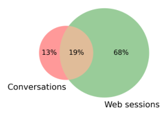
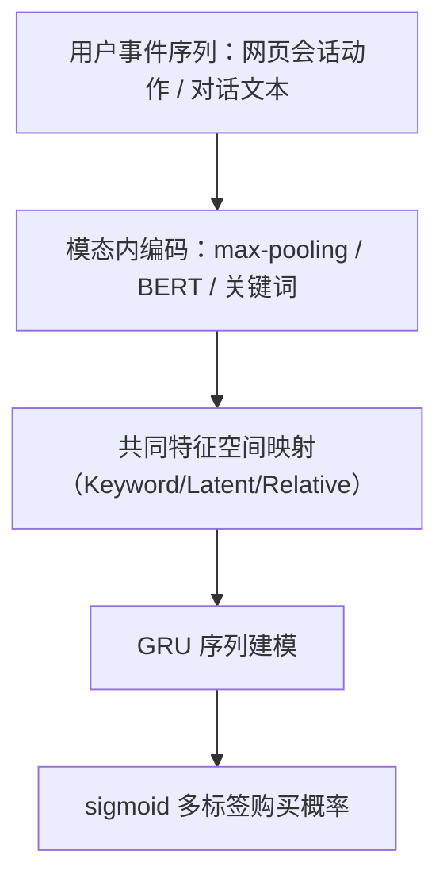
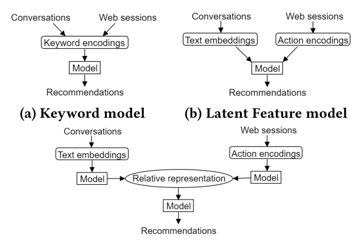

# Dataset and Models for Item Recommendation Using Multi-Modal User Interactions (面向多模态用户交互的物品推荐数据集与模型)

- **会议/期刊**: SIGIR 2024
- **作者与机构**: Simone Borg Bruun, Krisztian Balog, Maria Maistro；University of Copenhagen / University of Stavanger
- **推荐链路定位**: 排序 / 下一购买物品推荐
- **研究方向**: 多模态推荐与内容理解 / 序列与会话推荐
- **论文原文**: [论文原文链接](https://arxiv.org/abs/2405.04246v1)
- **开源代码**: [开源代码仓库链接](https://github.com/simonebbruun/RS_multi_modal_user_interactions)

## TL;DR (1分钟核心速览)

现有工作多做物品侧多模态表示且假设模态完整；本文发布保险领域“网页会话+电话对话”多模态用户交互数据集，提出将两类事件映射到共同特征空间后统一 GRU 建模，以应对自然缺失模态。在 24 物品全库排序、最新 10% 购买测试上，Latent Feature 模型 MAP@3 达 0.5339，较最强插补基线相对提升 3.46%。

## Background & Motivation (背景与核心矛盾)

- **主流范式**: 多模态推荐多聚焦物品图像/文本/音频表示，采用融合、图网络或知识图谱增强，默认训练与推理时模态完整。
- **前人局限**: 用户交互模态天然缺失，本数据仅 19% 用户同时有对话与网页会话；插补会捏造未发生的会话，知识蒸馏又受限于小交集，难以处理“正常使用导致的缺失”。
- **核心洞察 (Key Insight)**: 两模态信息互补；高频网页会话可增强稀疏对话学习；缺失本身也可能含用户选择信号，不宜简单补全。
- **本文切入点**: 不生成缺失模态，而将对话与网页会话映射到同一特征空间，让事件序列直接进入序列推荐器。

<figure class="paper-figure" markdown="span">
  <figcaption>图1：有对话和网页会话的用户分布。</figcaption>
</figure>

## Method (核心方法设计)

### 1. 整体框架 (Overall Architecture)

输入用户按时间排序的事件序列：网页会话为动作标签序列，对话为句文本或关键词。先做模态内编码：会话用动作二值向量逐元素 max-pooling，对话用 Danish BERT 句向量或关键词二值向量；再经 Keyword / Latent Feature / Relative Representation 三种方式映射到共同空间，送入单层 GRU，取末状态经 sigmoid 输出 24 个物品购买概率，以多标签 BCE 训练。三种映射分别提供可解释硬对齐、端到端隐空间对齐和锚点相对表示。

<figure class="paper-figure" markdown="span">
  <figcaption>图4：我们模型的示意概览。</figcaption>
</figure>

### 2. 关键设计拆解 (Key Designs)

1. **Latent Feature Model（主模型，端到端隐空间对齐）**：针对模态分布不同且缺失的问题，用模态专属矩阵将对话实值向量和会话二值向量压到同尺度，再统一过 GRU：
   $l_i=\tanh(W_c e_i\mathbb{I}\{e_i=c_i\}+W_s e_i\mathbb{I}\{e_i=s_i\})$。
   缺失时只需输入已有事件，不生成假样本，避免插补噪声。

2. **Relative Representation Model（锚点相对表示）**：先分别训练单事件编码网络，$\tilde{c}_i=\tanh(W_c c_i)$、$\tilde{s}_i=\tanh(W_s s_i)$，再以 125 个双模态用户为锚点计算
   $r_i=(\mathrm{sim}(\tilde{c}_i,\tilde{c}_{x_1}),\ldots,\mathrm{sim}(\tilde{c}_i,\tilde{c}_{x_{|X|}}))$。
   直觉是跨网络潜空间可比，且不依赖长历史，适合事件数少的用户。

3. **Keyword Model 与训练目标**：将对话关键词与网页动作手工对齐并二值化，再走同一 GRU。总损失为多标签 BCE：
   $\mathcal{L}=-\sum_{j=1}^{J}[p_j\log\hat{p}_j+(1-p_j)\log(1-\hat{p}_j)]$。
   无负采样，直接对 24 个物品全打分；推理仅一次前向，开销低。

## Experimental Setup & Evaluation Protocol (实验设置与评估协议)

- **数据集与预处理**: 过滤购买频次 <1% 的物品；删除连续重复动作、少于 4 句的对话、少于 3 个动作的会话；对话截断至 541 句、会话至 40 个动作；事件间隔 14 天内视为同任务，每用户最多保留 10 个近期事件。

| 数据集 | #Users | #Items | #Purchases | #Conversations | #Web sessions | 稀疏度/密度 | 场景说明 |
| :--- | :---: | :---: | :---: | :---: | :---: | :---: | :--- |
| Insurance | 51,877 | 24 | 62,401 | 25,515 | 115,045 | 24 物品、多标签购买 | 32% 用户有对话，87% 有网页会话，19% 两者兼有 |

- **数据划分与防穿越**: 最新 10% 购买为测试集，其余 90% 训练；训练集再取最新 10% 作验证集，按时间切分避免穿越。
- **排名评测协议**: 对全部 24 个物品做 `Full-Ranking`；附加险若缺少对应主险则后处理降分。报告 HR@3、MAP@3，并报告 MAP@1–5；5 个随机种子取均值，HR 用 McNemar、其余用 ANOVA，$p<0.05$。
- **对比基线与超参**: Popular、Conversation-only、Web Session-only、Late Fusion、Knowledge Distillation、Generative/Neutral Imputation；提出 Keyword、Latent Feature、Relative Representation。Adam、隐层 256、dropout 0.3、batch 512/256、早停。

## Key Experimental Results (实验关键数据)

### 1. 主实验对比 (Main Results)

| 模型 | Union HR@3 | Union MAP@3 | Intersection HR@3 | Intersection MAP@3 |
| :--- | :---: | :---: | :---: | :---: |
| Popular | 0.4595 | 0.2742 | 0.5111 | 0.3340 |
| Late Fusion | 0.6703 | 0.5179 | 0.6949 | 0.5287 |
| Knowledge Distillation | 0.6697 | 0.5168 | 0.6921 | 0.5235 |
| Generative Imputation | 0.6685 | 0.5156 | 0.6910 | 0.5270 |
| Neutral Imputation | 0.6767 | 0.5161 | 0.6966 | 0.5265 |
| Keyword | 0.6840 | 0.5250 | **0.7270** | **0.5629** |
| Latent Feature | **0.6872** | **0.5339** | 0.7183 | 0.5603 |
| Relative Representation | 0.6846 | 0.5308 | 0.7138 | 0.5554 |

相对最强插补基线 Neutral Imputation：Latent Feature 在 Union 上 HR@3/MAP@3 提升 **1.55%/3.46%**，在 Intersection 上提升 **3.12%/6.44%**；Keyword 在 Intersection 的 MAP@3 提升 **6.91%**。

### 2. 消融实验 (Ablation Study)

事件顺序消融（打乱训练与测试事件顺序，5 次平均）：

| 模型 | Union HR@3 | Union MAP@3 | Intersection MAP@3 |
| :--- | :---: | :---: | :---: |
| Keyword 原顺序 | 0.6840 | 0.5250 | 0.5629 |
| Keyword 打乱 | 0.6775 (-0.95%) | 0.5216 (-0.65%) | 0.5433 (-3.49%) |
| Latent Feature 原顺序 | 0.6872 | 0.5339 | 0.5603 |
| Latent Feature 打乱 | 0.6722 (-2.18%) | 0.5164 (-3.27%) | 0.5171 (-7.71%) |
| Relative Representation 原顺序 | 0.6846 | 0.5308 | 0.5554 |
| Relative Representation 打乱 | 0.6776 (-1.03%) | 0.5232 (-1.43%) | 0.5329 (-4.05%) |

### 3. 关键实验发现 (Key Findings)

1. **共同空间映射优于插补/蒸馏**：Latent Feature 的 Union MAP@3 为 0.5339，较 Neutral Imputation 的 0.5161 提升 3.46%；说明不生成假事件、直接对齐已有模态更稳。
2. **模态互补且高频补低频**：Intersection 上 Keyword/Latent/Relative 的 MAP@3 为 0.5629/0.5603/0.5554，均高于 Neutral 的 0.5265；Conversations-only 上 Latent MAP@3 达 0.5415，较 Neutral 的 0.5053 提升 7.17%，体现网页会话对稀疏对话的增益。
3. **事件顺序对联合建模重要**：打乱顺序后，Latent 的 Union MAP@3 降 3.27%、Intersection 降 7.71%；Relative 仅降 1.43%/4.05%，说明其更不依赖长历史，适合短事件序列。

## Highlights & Limitations (亮点、对比与审稿批判)

- **与代表作对比 (vs. Prior Work)**: 物品侧多模态融合假设模态完整；插补方法会捏造未发生的会话，丢失“未选择某渠道”的信号；知识蒸馏依赖小交集。本文以共同特征空间直接建模自然缺失的用户交互。
- **可迁移亮点**: 模态专属投影 + 共享序列编码器可迁移到“App 行为+客服文本”等缺失模态场景；Relative Representation 的锚点机制适合短历史用户。
- **审稿级局限批判**: 单一保险公司、仅 24 个物品，绝对增益有限且无线上 A/B；Relative 依赖 19% 双模态用户选锚点，冷启动或锚点稀疏时可能不稳；对话未显式建模说话人、时间与上下文。

## Rating (四维评分)

- **方法创新性 (Novelty)**: ⭐⭐⭐⭐ （从物品侧多模态转向用户交互模态，共同空间映射与相对表示有新意，但机制整体偏工程组合）
- **评估协议与实验扎实度 (Protocol & Experiments)**: ⭐⭐⭐⭐ （时间切分、全库排序、5 种子与显著性检验较规范；数据集规模与物品空间偏小）
- **写作与数学规范度 (Clarity & Rigor)**: ⭐⭐⭐⭐ （问题定义、公式与三种映射清晰；对缺失机制的理论刻画仍偏描述性）
- **工业落地与复现价值 (Industrial & Practical Value)**: ⭐⭐⭐⭐ （数据与代码开源，推理开销低；但高 stakes 保险场景与 24 物品限制外推）

